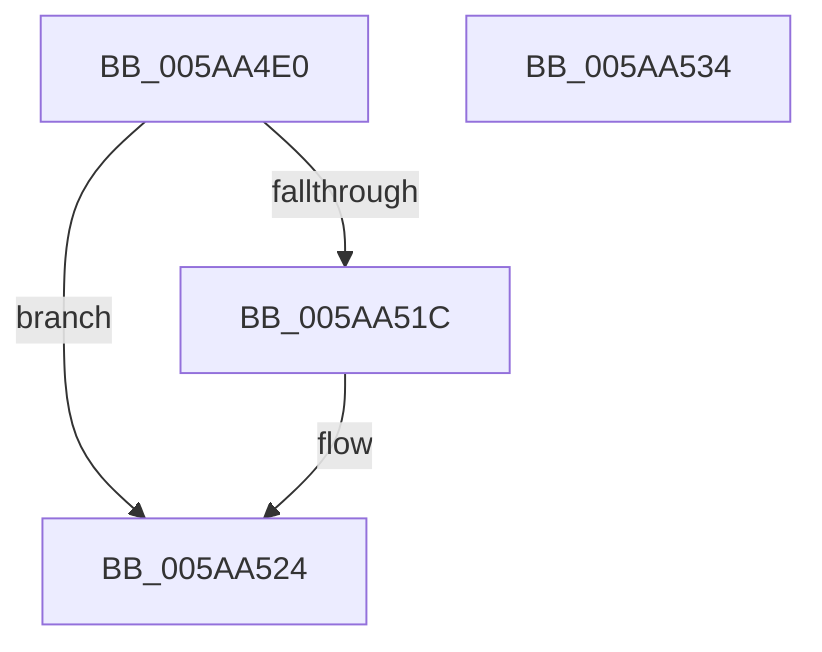

# IopDeviceEjectComplete

- RVA: `0x005AA4E0`–`0x005AA535` (길이 `85` bytes)
- VA: `0x00000001405AA4E0`
- 실행 섹션: `.text`
- PDB 이름 있음: `예`; PDB Function 태그: `아니요`
- unwind 정보 RVA: `0x0005CAAC`
- 디코드: `23`개 명령, `85/85` bytes 표시
- 미해석 바이트: `0` (있으면 어셈블리에 `.byte`로 보존)

> 이 문서는 커널 이미지의 기계어와 PDB 기호를 분석해 생성했습니다. 4번과 5번은 함수 원형과 자료형을 바이너리 사용 방식에서 추정한 C 해석이며 원본 소스 복구 결과는 아닙니다.

## 1. Dependencies

- 직접 호출 지점: **2**; 고유 호출 대상: **2**
- 직접 호출자로 확인된 함수: **0**
- RIP 상대 이미지 참조: **1**

### Outgoing calls
- `0x005AA512` → [ExQueueWorkItem](../2F/ExQueueWorkItem_function_002F9520.md) (function, `0x002F9520`)
- `0x005AA51F` → [IoFreeIrp](../24/IoFreeIrp_function_0024DF70.md) (function, `0x0024DF70`)

### Direct callers
- 이 함수 시작 RVA로 연결되는 직접 call은 확인되지 않았습니다. 간접 호출은 완전히 역산할 수 없습니다.

### Static image references
- `0x005AA4F1` → RVA `0x0072D090` (`PnpProcessCompletedEject`; read)

## 2. Other-region calls and transfers

- 다른 실행 섹션으로 향하는 call: **0**
- 별도 외부 분기/꼬리 이동을 확인하지 못했습니다.

## 3. Assembly (complete function range)

```asm
005AA4E0  48 89 5C 24 08                  mov qword ptr [rsp + 8], rbx
005AA4E5  57                              push rdi
005AA4E6  48 83 EC 20                     sub rsp, 0x20
005AA4EA  49 8D 48 10                     lea rcx, [r8 + 0x10]
005AA4EE  48 8B FA                        mov rdi, rdx
005AA4F1  48 8D 05 98 2B 18 00            lea rax, [rip + 0x182b98]
005AA4F8  BB 03 00 00 00                  mov ebx, 3
005AA4FD  41 87 58 50                     xchg dword ptr [r8 + 0x50], ebx
005AA501  48 83 21 00                     and qword ptr [rcx], 0
005AA505  BA 01 00 00 00                  mov edx, 1
005AA50A  48 89 41 10                     mov qword ptr [rcx + 0x10], rax
005AA50E  4C 89 41 18                     mov qword ptr [rcx + 0x18], r8
005AA512  E8 09 F0 D4 FF                  call 0x1402f9520
005AA517  83 FB 01                        cmp ebx, 1
005AA51A  74 08                           je 0x1405aa524
005AA51C  48 8B CF                        mov rcx, rdi
005AA51F  E8 4C 3A CA FF                  call 0x14024df70
005AA524  48 8B 5C 24 30                  mov rbx, qword ptr [rsp + 0x30]
005AA529  B8 16 00 00 C0                  mov eax, 0xc0000016
005AA52E  48 83 C4 20                     add rsp, 0x20
005AA532  5F                              pop rdi
005AA533  C3                              ret
005AA534  CC                              int3
```

## 4. C-style interpretation (structured pseudocode)

```c
__int64 __fastcall IopDeviceEjectComplete(__int64 a1, __int64 a2, __int64 a3)
{
    __int64 result;
    __int64 v_rsp;
    unsigned __int64 v_stack_p8;

    v_stack_p8 = v_rbx;
    v_rsp = (v_rsp) - (32);
    *(unsigned __int64 *)(a3 + 16 + 16) = v_rip + 1584024;
    *(unsigned __int64 *)(a3 + 16 + 24) = a3;
    result = ExQueueWorkItem(a3 + 16, 1, a3, a4);
    if (3 != 1) {
        a1 = a2;
        result = IoFreeIrp(a1, 1, a3, a4);
    }
    v_rsp = (v_rsp) + (32);
    return (unsigned int)(0xC0000016ULL);
}
```

## 5. (Beta) C Style

```c
int64_t IopDeviceEjectComplete(int64_t Arg1, int64_t Arg2, void *Arg3)
{
    uint8_t *arg3 = (uint8_t *)Arg3;

    int64_t result;
    int64_t local_rsp;
    uint64_t v_stack_p8;

    v_stack_p8 = local_rbx;
    local_rsp = (local_rsp) - (32);
    *(uint64_t *)(arg3 + 0x10 + 0x10) = v_rip + 1584024;
    *(void **)(arg3 + 0x10 + 0x18) = Arg3;
    result = ExQueueWorkItem(Arg3 + 16, 1, Arg3, a4);
    if (3 != 1) {
        Arg1 = Arg2;
        result = IoFreeIrp(Arg1, 1, Arg3, a4);
    }
    local_rsp = (local_rsp) + (32);
    return (uint32_t)(0xC0000016ULL);
}
```

### 관측된 메모리 오프셋

구조체 형식이 확인되지 않은 접근은 인자 기준의 오프셋으로만 기록했습니다.

| 기준 인자 | 오프셋 표현 | 폭 (bit) | 접근 |
|---|---:|---:|---|
| `Arg3` | `+ 0x0` | `64` | `R/W` |
| `Arg3` | `+ 0x10` | `64` | `R` |
| `Arg3` | `+ 0x10` | `64` | `W` |
| `Arg3` | `+ 0x18` | `64` | `W` |
| `Arg3` | `+ 0x50` | `32` | `R/W` |

## 6. Execution-region graph

[열기: 2D/3D 그래프와 함수 탐색 컨트롤 패널](../../../control-panel.html?section=text&rva=0x005AA4E0&view=graph)

- 2D 그래프는 위에서 아래로 흐르고, 3D 그래프는 빈 공간을 드래그해 회전합니다. Shift+드래그는 이동, 휠은 확대·축소, 함수 노드 선택은 대상 보고서 이동입니다.

### Static fallback


