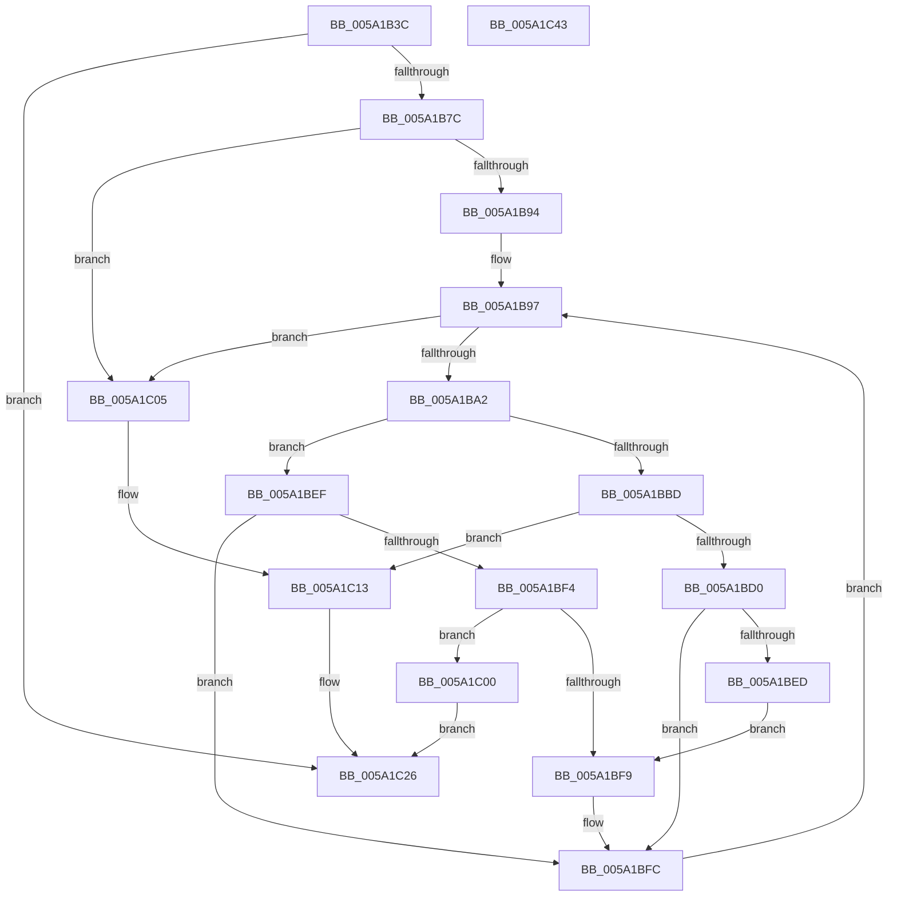

# IopFilterAndAddPageRangeToPageMaps

- RVA: `0x005A1B3C`–`0x005A1C44` (길이 `264` bytes)
- VA: `0x00000001405A1B3C`
- 실행 섹션: `.text`
- PDB 이름 있음: `예`; PDB Function 태그: `아니요`
- unwind 정보 RVA: `0x000C4928`
- 디코드: `80`개 명령, `264/264` bytes 표시
- 미해석 바이트: `0` (있으면 어셈블리에 `.byte`로 보존)

> 이 문서는 커널 이미지의 기계어와 PDB 기호를 분석해 생성했습니다. 4번과 5번은 함수 원형과 자료형을 바이너리 사용 방식에서 추정한 C 해석이며 원본 소스 복구 결과는 아닙니다.

## 1. Dependencies

- 직접 호출 지점: **2**; 고유 호출 대상: **1**
- 직접 호출자로 확인된 함수: **1**
- RIP 상대 이미지 참조: **1**

### Outgoing calls
- `0x005A1BDB` → [IopSearchAndAddPageRangeToPageMaps](../59/IopSearchAndAddPageRangeToPageMaps_function_005961B8.md) (function, `0x005961B8`)
- `0x005A1C21` → [IopSearchAndAddPageRangeToPageMaps](../59/IopSearchAndAddPageRangeToPageMaps_function_005961B8.md) (function, `0x005961B8`)

### Direct callers
- [IopAddPageToPageMap](../59/IopAddPageToPageMap_function_00594594.md) at `0x0059460A`

### Static image references
- `0x005A1B8B` → RVA `0x00E661A0` (`.data`; read)

## 2. Other-region calls and transfers

- 다른 실행 섹션으로 향하는 call: **0**
- 별도 외부 분기/꼬리 이동을 확인하지 못했습니다.

## 3. Assembly (complete function range)

```asm
005A1B3C  48 8B C4                        mov rax, rsp
005A1B3F  48 89 58 10                     mov qword ptr [rax + 0x10], rbx
005A1B43  48 89 68 18                     mov qword ptr [rax + 0x18], rbp
005A1B47  48 89 70 20                     mov qword ptr [rax + 0x20], rsi
005A1B4B  48 89 48 08                     mov qword ptr [rax + 8], rcx
005A1B4F  57                              push rdi
005A1B50  41 54                           push r12
005A1B52  41 55                           push r13
005A1B54  41 56                           push r14
005A1B56  41 57                           push r15
005A1B58  48 83 EC 30                     sub rsp, 0x30
005A1B5C  48 8B 84 24 80 00 00 00         mov rax, qword ptr [rsp + 0x80]
005A1B64  49 8B F9                        mov rdi, r9
005A1B67  45 33 C9                        xor r9d, r9d
005A1B6A  4D 8B E0                        mov r12, r8
005A1B6D  4C 8B EA                        mov r13, rdx
005A1B70  4C 8B D1                        mov r10, rcx
005A1B73  48 85 C0                        test rax, rax
005A1B76  0F 84 AA 00 00 00               je 0x1405a1c26
005A1B7C  44 8B BC 24 88 00 00 00         mov r15d, dword ptr [rsp + 0x88]
005A1B84  48 8D 58 FF                     lea rbx, [rax - 1]
005A1B88  48 03 DF                        add rbx, rdi
005A1B8B  4C 39 0D 0E 46 8C 00            cmp qword ptr [rip + 0x8c460e], r9
005A1B92  74 71                           je 0x1405a1c05
005A1B94  41 8B F1                        mov esi, r9d
005A1B97  48 8B 15 02 46 8C 00            mov rdx, qword ptr [rip + 0x8c4602]
005A1B9E  3B 32                           cmp esi, dword ptr [rdx]
005A1BA0  73 63                           jae 0x1405a1c05
005A1BA2  8B C6                           mov eax, esi
005A1BA4  48 03 C0                        add rax, rax
005A1BA7  48 8B 4C C2 08                  mov rcx, qword ptr [rdx + rax*8 + 8]
005A1BAC  4C 8B 74 C2 10                  mov r14, qword ptr [rdx + rax*8 + 0x10]
005A1BB1  4C 03 F1                        add r14, rcx
005A1BB4  49 8D 6E FF                     lea rbp, [r14 - 1]
005A1BB8  48 3B F9                        cmp rdi, rcx
005A1BBB  77 32                           ja 0x1405a1bef
005A1BBD  44 89 7C 24 28                  mov dword ptr [rsp + 0x28], r15d
005A1BC2  4C 8B CF                        mov r9, rdi
005A1BC5  4D 8B C4                        mov r8, r12
005A1BC8  49 8B D5                        mov rdx, r13
005A1BCB  48 3B D9                        cmp rbx, rcx
005A1BCE  72 43                           jb 0x1405a1c13
005A1BD0  48 2B CF                        sub rcx, rdi
005A1BD3  48 89 4C 24 20                  mov qword ptr [rsp + 0x20], rcx
005A1BD8  49 8B CA                        mov rcx, r10
005A1BDB  E8 D8 45 FF FF                  call 0x1405961b8
005A1BE0  4C 8B 54 24 60                  mov r10, qword ptr [rsp + 0x60]
005A1BE5  44 8B C8                        mov r9d, eax
005A1BE8  48 3B DD                        cmp rbx, rbp
005A1BEB  76 0F                           jbe 0x1405a1bfc
005A1BED  EB 0A                           jmp 0x1405a1bf9
005A1BEF  48 3B FD                        cmp rdi, rbp
005A1BF2  77 08                           ja 0x1405a1bfc
005A1BF4  48 3B DD                        cmp rbx, rbp
005A1BF7  76 07                           jbe 0x1405a1c00
005A1BF9  49 8B FE                        mov rdi, r14
005A1BFC  FF C6                           inc esi
005A1BFE  EB 97                           jmp 0x1405a1b97
005A1C00  41 8B C1                        mov eax, r9d
005A1C03  EB 21                           jmp 0x1405a1c26
005A1C05  44 89 7C 24 28                  mov dword ptr [rsp + 0x28], r15d
005A1C0A  4C 8B CF                        mov r9, rdi
005A1C0D  4D 8B C4                        mov r8, r12
005A1C10  49 8B D5                        mov rdx, r13
005A1C13  48 2B DF                        sub rbx, rdi
005A1C16  49 8B CA                        mov rcx, r10
005A1C19  48 FF C3                        inc rbx
005A1C1C  48 89 5C 24 20                  mov qword ptr [rsp + 0x20], rbx
005A1C21  E8 92 45 FF FF                  call 0x1405961b8
005A1C26  48 8B 5C 24 68                  mov rbx, qword ptr [rsp + 0x68]
005A1C2B  48 8B 6C 24 70                  mov rbp, qword ptr [rsp + 0x70]
005A1C30  48 8B 74 24 78                  mov rsi, qword ptr [rsp + 0x78]
005A1C35  48 83 C4 30                     add rsp, 0x30
005A1C39  41 5F                           pop r15
005A1C3B  41 5E                           pop r14
005A1C3D  41 5D                           pop r13
005A1C3F  41 5C                           pop r12
005A1C41  5F                              pop rdi
005A1C42  C3                              ret
005A1C43  CC                              int3
```

## 4. C-style interpretation (structured pseudocode)

```c
__int64 __fastcall IopFilterAndAddPageRangeToPageMaps(__int64 a1, __int64 a2, __int64 a3, __int64 a4, __int64 a5, unsigned int a6)
{
    __int64 result;
    __int64 v_r14;
    __int64 v_rbx;
    __int64 v_rsi;
    __int64 v_rsp;
    unsigned int v_stack_m30;
    unsigned __int64 v_stack_m38;
    unsigned __int64 v_stack_p10;
    unsigned __int64 v_stack_p18;
    unsigned __int64 v_stack_p20;
    unsigned __int64 v_stack_p8;

    *(unsigned __int64 *)(v_rsp + 16) = v_rbx;
    *(unsigned __int64 *)(v_rsp + 24) = v_rbp;
    *(unsigned __int64 *)(v_rsp + 32) = v_rsi;
    *(unsigned __int64 *)(v_rsp + 8) = a1;
    v_rsp = (v_rsp) - (48);
    a4 = 0;
    if (a5 == 0) goto loc_005A1C26;
    v_rbx = (a5 - 1) + (0);
    if ((*(unsigned __int64 *)(v_rip + 9192974)) == 0) goto loc_005A1C05;
loc_005A1B97:
    if (0 >= (*(unsigned int *)(*(unsigned __int64 *)(v_rip + 9192962)))) goto loc_005A1C05;
    result = (0) + (0);
    v_r14 = (*(unsigned __int64 *)(*(unsigned __int64 *)(v_rip + 9192962) + result * 8 + 16)) + (*(unsigned __int64 *)(*(unsigned __int64 *)(v_rip + 9192962) + result * 8 + 8));
    if (0 > (*(unsigned __int64 *)(*(unsigned __int64 *)(v_rip + 9192962) + result * 8 + 8))) goto loc_005A1BEF;
    v_stack_m30 = (unsigned int)((unsigned int)(a6));
    if (v_rbx < (*(unsigned __int64 *)(*(unsigned __int64 *)(v_rip + 9192962) + result * 8 + 8))) goto loc_005A1C13;
    a1 = (*(unsigned __int64 *)(*(unsigned __int64 *)(v_rip + 9192962) + result * 8 + 8)) - (0);
    v_stack_m38 = a1;
    result = IopSearchAndAddPageRangeToPageMaps(a1, a2, a3, 0);
    if (v_rbx <= (v_r14 - 1)) goto loc_005A1BFC;
    goto loc_005A1BF9;
loc_005A1BEF:
    if (0 > (v_r14 - 1)) goto loc_005A1BFC;
    if (v_rbx <= (v_r14 - 1)) goto loc_005A1C00;
loc_005A1BF9:
loc_005A1BFC:
    v_rsi = (unsigned int)((0) + 1);
    goto loc_005A1B97;
loc_005A1C00:
    goto loc_005A1C26;
loc_005A1C05:
    v_stack_m30 = (unsigned int)((unsigned int)(a6));
loc_005A1C13:
    v_rbx = (v_rbx) - (v_r14);
    v_rbx = (v_rbx) + 1;
    v_stack_m38 = v_rbx;
    result = IopSearchAndAddPageRangeToPageMaps(v_stack_p8, a2, a3, v_r14);
loc_005A1C26:
    v_rsp = (v_rsp) + (48);
    return result;
}
```

## 5. (Beta) C Style

```c
int64_t IopFilterAndAddPageRangeToPageMaps(int64_t Arg1, int64_t Arg2, int64_t Arg3, int64_t Arg4, int64_t Arg5, uint32_t Arg6)
{
    int64_t result;
    int64_t local_r14;
    int64_t local_rbx;
    int64_t local_rsi;
    int64_t local_rsp;
    uint32_t v_stack_m30;
    uint64_t v_stack_m38;
    uint64_t v_stack_p10;
    uint64_t v_stack_p18;
    uint64_t v_stack_p20;
    uint64_t v_stack_p8;

    *(uint64_t *)(local_rsp + 0x10) = local_rbx;
    *(uint64_t *)(local_rsp + 0x18) = local_rbp;
    *(uint64_t *)(local_rsp + 0x20) = local_rsi;
    *(uint64_t *)(local_rsp + 0x8) = Arg1;
    local_rsp = (local_rsp) - (48);
    Arg4 = 0;
    if (Arg5 == 0) goto loc_005A1C26;
    local_rbx = (Arg5 - 1) + (0);
    if ((*(uint64_t *)(v_rip + 0x8C460E)) == 0) goto loc_005A1C05;
loc_005A1B97:
    if (0 >= (*(uint32_t *)(*(uint64_t *)(v_rip + 0x8C4602)))) goto loc_005A1C05;
    result = (0) + (0);
    local_r14 = (*(uint64_t *)(*(uint64_t *)(v_rip + 0x8C4602) + result * 8 + 0x10)) + (*(uint64_t *)(*(uint64_t *)(v_rip + 0x8C4602) + result * 8 + 0x8));
    if (0 > (*(uint64_t *)(*(uint64_t *)(v_rip + 0x8C4602) + result * 8 + 0x8))) goto loc_005A1BEF;
    v_stack_m30 = (uint32_t)((uint32_t)(Arg6));
    if (local_rbx < (*(uint64_t *)(*(uint64_t *)(v_rip + 0x8C4602) + result * 8 + 0x8))) goto loc_005A1C13;
    Arg1 = (*(uint64_t *)(*(uint64_t *)(v_rip + 0x8C4602) + result * 8 + 0x8)) - (0);
    v_stack_m38 = Arg1;
    result = IopSearchAndAddPageRangeToPageMaps(Arg1, Arg2, Arg3, 0);
    if (local_rbx <= (local_r14 - 1)) goto loc_005A1BFC;
    goto loc_005A1BF9;
loc_005A1BEF:
    if (0 > (local_r14 - 1)) goto loc_005A1BFC;
    if (local_rbx <= (local_r14 - 1)) goto loc_005A1C00;
loc_005A1BF9:
loc_005A1BFC:
    local_rsi = (uint32_t)((0) + 1);
    goto loc_005A1B97;
loc_005A1C00:
    goto loc_005A1C26;
loc_005A1C05:
    v_stack_m30 = (uint32_t)((uint32_t)(Arg6));
loc_005A1C13:
    local_rbx = (local_rbx) - (local_r14);
    local_rbx = (local_rbx) + 1;
    v_stack_m38 = local_rbx;
    result = IopSearchAndAddPageRangeToPageMaps(v_stack_p8, Arg2, Arg3, local_r14);
loc_005A1C26:
    local_rsp = (local_rsp) + (48);
    return result;
}
```

## 6. Execution-region graph

[열기: 2D/3D 그래프와 함수 탐색 컨트롤 패널](../../../control-panel.html?section=text&rva=0x005A1B3C&view=graph)

- 2D 그래프는 위에서 아래로 흐르고, 3D 그래프는 빈 공간을 드래그해 회전합니다. Shift+드래그는 이동, 휠은 확대·축소, 함수 노드 선택은 대상 보고서 이동입니다.

### Static fallback


