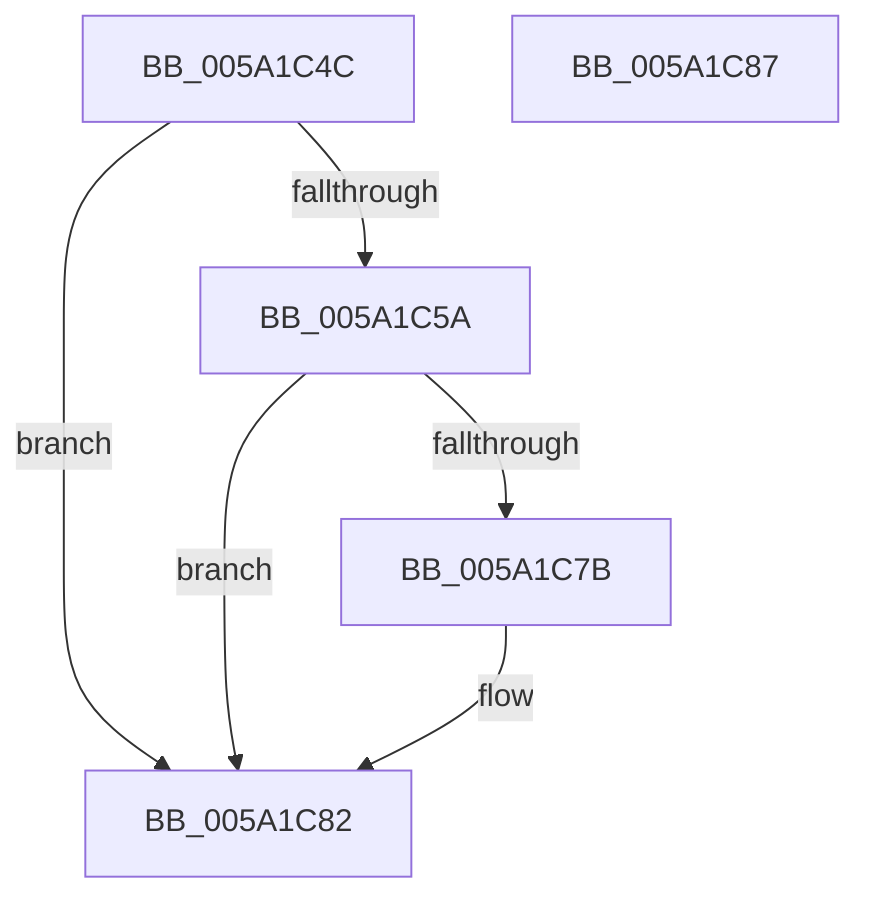

# IopInitializeRemovePagesArray

- RVA: `0x005A1C4C`–`0x005A1C88` (길이 `60` bytes)
- VA: `0x00000001405A1C4C`
- 실행 섹션: `.text`
- PDB 이름 있음: `예`; PDB Function 태그: `아니요`
- unwind 정보 RVA: `0x0005C788`
- 디코드: `14`개 명령, `60/60` bytes 표시
- 미해석 바이트: `0` (있으면 어셈블리에 `.byte`로 보존)

> 이 문서는 커널 이미지의 기계어와 PDB 기호를 분석해 생성했습니다. 4번과 5번은 함수 원형과 자료형을 바이너리 사용 방식에서 추정한 C 해석이며 원본 소스 복구 결과는 아닙니다.

## 1. Dependencies

- 직접 호출 지점: **1**; 고유 호출 대상: **1**
- 직접 호출자로 확인된 함수: **1**
- RIP 상대 이미지 참조: **2**

### Outgoing calls
- `0x005A1C6A` → [ExAllocatePool2](../../poolcode/B8/ExAllocatePool2_function_00B820F0.md) (function, `0x00B820F0`)

### Direct callers
- [IopInitializeCrashDump](../../page/71/IopInitializeCrashDump_function_0071A270.md) at `0x0071A434`

### Static image references
- `0x005A1C50` → RVA `0x00E661A0` (`.data`; read)
- `0x005A1C6F` → RVA `0x00E661A0` (`.data`; write)

## 2. Other-region calls and transfers

- 다른 실행 섹션으로 향하는 call: **1**
  - `0x005A1C6A` → [ExAllocatePool2](../../poolcode/B8/ExAllocatePool2_function_00B820F0.md) (`.text` → `POOLCODE`)
- 별도 외부 분기/꼬리 이동을 확인하지 못했습니다.

## 3. Assembly (complete function range)

```asm
005A1C4C  48 83 EC 28                     sub rsp, 0x28
005A1C50  48 83 3D 48 45 8C 00 00         cmp qword ptr [rip + 0x8c4548], 0
005A1C58  75 28                           jne 0x1405a1c82
005A1C5A  BA 88 3E 00 00                  mov edx, 0x3e88
005A1C5F  41 B8 49 6F 50 64               mov r8d, 0x64506f49
005A1C65  B9 40 00 00 00                  mov ecx, 0x40
005A1C6A  E8 81 04 5E 00                  call 0x140b820f0
005A1C6F  48 89 05 2A 45 8C 00            mov qword ptr [rip + 0x8c452a], rax
005A1C76  48 85 C0                        test rax, rax
005A1C79  74 07                           je 0x1405a1c82
005A1C7B  C7 40 04 E8 03 00 00            mov dword ptr [rax + 4], 0x3e8
005A1C82  48 83 C4 28                     add rsp, 0x28
005A1C86  C3                              ret
005A1C87  CC                              int3
```

## 4. C-style interpretation (structured pseudocode)

```c
__int64 __fastcall IopInitializeRemovePagesArray(void)
{
    __int64 result;
    __int64 v_rsp;

    v_rsp = (v_rsp) - (40);
    if ((*(unsigned __int64 *)(v_rip + 9192776)) != 0) goto loc_005A1C82;
    result = ExAllocatePool2(64, (unsigned int)(0x3E88ULL), (unsigned int)(0x64506F49ULL), a4);
    *(unsigned __int64 *)(v_rip + 9192746) = result;
    if (result != 0) {
        *(unsigned int *)(result + 4) = 1000;
    }
    v_rsp = (v_rsp) + (40);
    return result;
}
```

## 5. (Beta) C Style

```c
void IopInitializeRemovePagesArray(void)
{
    int64_t result;
    int64_t local_rsp;

    local_rsp = (local_rsp) - (40);
    if ((*(uint64_t *)(v_rip + 0x8C4548)) != 0) goto loc_005A1C82;
    result = ExAllocatePool2(64, (uint32_t)(0x3E88ULL), (uint32_t)(0x64506F49ULL), a4);
    *(uint64_t *)(v_rip + 0x8C452A) = result;
    if (result != 0) {
        *(uint32_t *)(result + 0x4) = 1000;
    }
    local_rsp = (local_rsp) + (40);
    return result;
}
```

## 6. Execution-region graph

[열기: 2D/3D 그래프와 함수 탐색 컨트롤 패널](../../../control-panel.html?section=text&rva=0x005A1C4C&view=graph)

- 2D 그래프는 위에서 아래로 흐르고, 3D 그래프는 빈 공간을 드래그해 회전합니다. Shift+드래그는 이동, 휠은 확대·축소, 함수 노드 선택은 대상 보고서 이동입니다.

### Static fallback


