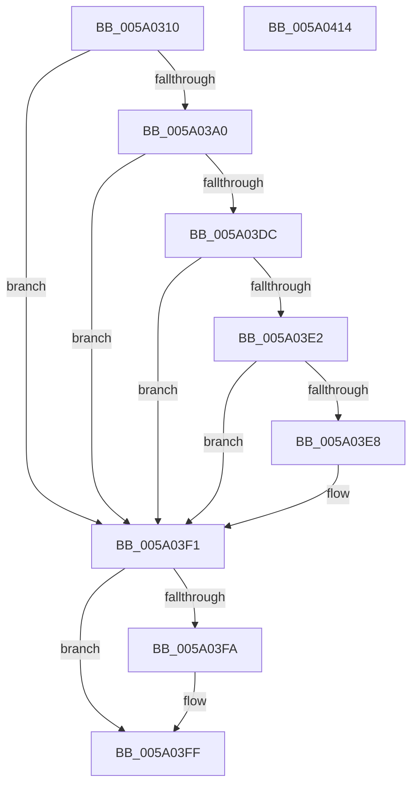

# IopInitializeSystemVariableService

- RVA: `0x005A0310`–`0x005A0415` (길이 `261` bytes)
- VA: `0x00000001405A0310`
- 실행 섹션: `.text`
- PDB 이름 있음: `예`; PDB Function 태그: `아니요`
- unwind 정보 RVA: `0x0009EA9C`
- 디코드: `64`개 명령, `261/261` bytes 표시
- 미해석 바이트: `0` (있으면 어셈블리에 `.byte`로 보존)

> 이 문서는 커널 이미지의 기계어와 PDB 기호를 분석해 생성했습니다. 4번과 5번은 함수 원형과 자료형을 바이너리 사용 방식에서 추정한 C 해석이며 원본 소스 복구 결과는 아닙니다.

## 1. Dependencies

- 직접 호출 지점: **7**; 고유 호출 대상: **6**
- 직접 호출자로 확인된 함수: **1**
- RIP 상대 이미지 참조: **5**

### Outgoing calls
- `0x005A034D` → [TraceLoggingRegisterEx_EtwRegister_EtwSetInformation](../../page/92/TraceLoggingRegisterEx_EtwRegister_EtwSetInformation_function_009208A0.md) (function, `0x009208A0`)
- `0x005A0362` → [RtlInitUnicodeString](../42/RtlInitUnicodeString_function_0042A780.md) (function, `0x0042A780`)
- `0x005A0397` → [ZwOpenKey](../6A/ZwOpenKey_function_006AD310.md) (function, `0x006AD310`)
- `0x005A03AB` → [RtlInitUnicodeString](../42/RtlInitUnicodeString_function_0042A780.md) (function, `0x0042A780`)
- `0x005A03D3` → [ZwQueryValueKey](../6A/ZwQueryValueKey_function_006AD3B0.md) (function, `0x006AD3B0`)
- `0x005A03FA` → [ZwClose](../6A/ZwClose_function_006AD2B0.md) (function, `0x006AD2B0`)
- `0x005A0406` → [_security_check_cookie](../6A/_security_check_cookie_function_006AC640.md) (function, `0x006AC640`)

### Direct callers
- [IoInitSystemPreDrivers](../../init/C2/IoInitSystemPreDrivers_function_00C2AC3C.md) at `0x00C2BC56`

### Static image references
- `0x005A031E` → RVA `0x00E0A740` (`.data`; read)
- `0x005A032E` → RVA `0x00E06ED8` (`.data`; read)
- `0x005A0357` → RVA `0x006CA580` (` ?? ::FNODOBFM::`string'`; read)
- `0x005A03A0` → RVA `0x006CA620` (` ?? ::FNODOBFM::`string'`; read)
- `0x005A03EB` → RVA `0x00F8D080` (`.data`; write)

## 2. Other-region calls and transfers

- 다른 실행 섹션으로 향하는 call: **1**
  - `0x005A034D` → [TraceLoggingRegisterEx_EtwRegister_EtwSetInformation](../../page/92/TraceLoggingRegisterEx_EtwRegister_EtwSetInformation_function_009208A0.md) (`.text` → `PAGE`)
- 별도 외부 분기/꼬리 이동을 확인하지 못했습니다.

## 3. Assembly (complete function range)

```asm
005A0310  40 55                           push rbp
005A0312  48 8D 6C 24 A9                  lea rbp, [rsp - 0x57]
005A0317  48 81 EC A0 00 00 00            sub rsp, 0xa0
005A031E  48 8B 05 1B A4 86 00            mov rax, qword ptr [rip + 0x86a41b]
005A0325  48 33 C4                        xor rax, rsp
005A0328  48 89 45 47                     mov qword ptr [rbp + 0x47], rax
005A032C  33 C0                           xor eax, eax
005A032E  48 8D 0D A3 6B 86 00            lea rcx, [rip + 0x866ba3]
005A0335  21 45 23                        and dword ptr [rbp + 0x23], eax
005A0338  0F 57 C0                        xorps xmm0, xmm0
005A033B  21 45 E7                        and dword ptr [rbp - 0x19], eax
005A033E  45 33 C0                        xor r8d, r8d
005A0341  89 45 0B                        mov dword ptr [rbp + 0xb], eax
005A0344  33 D2                           xor edx, edx
005A0346  21 45 0B                        and dword ptr [rbp + 0xb], eax
005A0349  0F 11 45 F7                     movups xmmword ptr [rbp - 9], xmm0
005A034D  E8 4E 05 38 00                  call 0x1409208a0
005A0352  48 83 65 EF 00                  and qword ptr [rbp - 0x11], 0
005A0357  48 8D 15 22 A2 12 00            lea rdx, [rip + 0x12a222]
005A035E  48 8D 4D F7                     lea rcx, [rbp - 9]
005A0362  E8 19 A4 E8 FF                  call 0x14042a780
005A0367  48 83 65 0F 00                  and qword ptr [rbp + 0xf], 0
005A036C  48 8D 45 F7                     lea rax, [rbp - 9]
005A0370  0F 57 C0                        xorps xmm0, xmm0
005A0373  48 89 45 17                     mov qword ptr [rbp + 0x17], rax
005A0377  4C 8D 45 07                     lea r8, [rbp + 7]
005A037B  C7 45 07 30 00 00 00            mov dword ptr [rbp + 7], 0x30
005A0382  BA 19 00 02 00                  mov edx, 0x20019
005A0387  C7 45 1F 40 02 00 00            mov dword ptr [rbp + 0x1f], 0x240
005A038E  48 8D 4D EF                     lea rcx, [rbp - 0x11]
005A0392  F3 0F 7F 45 27                  movdqu xmmword ptr [rbp + 0x27], xmm0
005A0397  E8 74 CF 10 00                  call 0x1406ad310
005A039C  85 C0                           test eax, eax
005A039E  78 51                           js 0x1405a03f1
005A03A0  48 8D 15 79 A2 12 00            lea rdx, [rip + 0x12a279]
005A03A7  48 8D 4D F7                     lea rcx, [rbp - 9]
005A03AB  E8 D0 A3 E8 FF                  call 0x14042a780
005A03B0  48 8B 4D EF                     mov rcx, qword ptr [rbp - 0x11]
005A03B4  48 8D 45 E7                     lea rax, [rbp - 0x19]
005A03B8  48 89 44 24 28                  mov qword ptr [rsp + 0x28], rax
005A03BD  4C 8D 4D 37                     lea r9, [rbp + 0x37]
005A03C1  41 B8 02 00 00 00               mov r8d, 2
005A03C7  C7 44 24 20 10 00 00 00         mov dword ptr [rsp + 0x20], 0x10
005A03CF  48 8D 55 F7                     lea rdx, [rbp - 9]
005A03D3  E8 D8 CF 10 00                  call 0x1406ad3b0
005A03D8  85 C0                           test eax, eax
005A03DA  78 15                           js 0x1405a03f1
005A03DC  83 7D 3B 04                     cmp dword ptr [rbp + 0x3b], 4
005A03E0  75 0F                           jne 0x1405a03f1
005A03E2  83 7D 3F 04                     cmp dword ptr [rbp + 0x3f], 4
005A03E6  75 09                           jne 0x1405a03f1
005A03E8  8B 45 43                        mov eax, dword ptr [rbp + 0x43]
005A03EB  89 05 8F CC 9E 00               mov dword ptr [rip + 0x9ecc8f], eax
005A03F1  48 8B 4D EF                     mov rcx, qword ptr [rbp - 0x11]
005A03F5  48 85 C9                        test rcx, rcx
005A03F8  74 05                           je 0x1405a03ff
005A03FA  E8 B1 CE 10 00                  call 0x1406ad2b0
005A03FF  48 8B 4D 47                     mov rcx, qword ptr [rbp + 0x47]
005A0403  48 33 CC                        xor rcx, rsp
005A0406  E8 35 C2 10 00                  call 0x1406ac640
005A040B  48 81 C4 A0 00 00 00            add rsp, 0xa0
005A0412  5D                              pop rbp
005A0413  C3                              ret
005A0414  CC                              int3
```

## 4. C-style interpretation (structured pseudocode)

```c
__int64 __fastcall IopInitializeSystemVariableService(__int64 a1, int a2, int a3)
{
    __int64 result;
    __int64 v_rsp;
    unsigned __int64 v_stack_m18;
    unsigned int v_stack_m1C;
    unsigned int v_stack_m20;
    unsigned int v_stack_m24;
    unsigned __int64 v_stack_m28;
    unsigned __int64 v_stack_m38;
    unsigned int v_stack_m3C;
    unsigned int v_stack_m40;
    unsigned __int64 v_stack_m48;
    unsigned __int64 v_stack_m50;
    unsigned int v_stack_m54;
    unsigned __int64 v_stack_m58;
    unsigned __int64 v_stack_m5F;
    unsigned __int64 v_stack_m68;
    unsigned __int64 v_stack_m70;
    unsigned int v_stack_m78;
    unsigned __int64 v_stack_m80;
    unsigned int v_stack_m88;

    v_rsp = (v_rsp) - (160);
    result = (*(unsigned __int64 *)(v_rip + 8823835)) ^ (v_rsp);
    v_stack_m18 = result;
    result = 0;
    a3 = 0;
    v_stack_m54 = 0;
    a2 = 0;
    v_stack_m68 = v_xmm0;
    result = TraceLoggingRegisterEx_EtwRegister_EtwSetInformation(v_rip + 8809379, a2, a3, a4);
    result = RtlInitUnicodeString(v_stack_m68, v_rip + 1221154, a3, a4);
    v_stack_m48 = v_stack_m68;
    v_stack_m58 = 48;
    v_stack_m40 = 576;
    v_stack_m38 = v_xmm0;
    result = ZwOpenKey(v_stack_m70, (unsigned int)(0x20019ULL), v_stack_m58, a4);
    if (sign_flag) goto loc_005A03F1;
    result = RtlInitUnicodeString(v_stack_m68, v_rip + 1221241, v_stack_m58, a4);
    v_stack_m80 = v_stack_m78;
    v_stack_m88 = 16;
    result = ZwQueryValueKey(v_stack_m70, v_stack_m68, 2, v_stack_m28);
    if (sign_flag) goto loc_005A03F1;
    if (v_stack_m24 != 4) goto loc_005A03F1;
    if (v_stack_m20 == 4) {
        result = v_stack_m1C;
        *(unsigned int *)(v_rip + 10407055) = (unsigned int)(result);
    }
    if (v_stack_m70 != 0) {
        result = ZwClose(v_stack_m70, v_stack_m68, 2, v_stack_m28);
    }
    a1 = (v_stack_m18) ^ (v_rsp);
    result = _security_check_cookie(a1, v_stack_m68, 2, v_stack_m28);
    v_rsp = (v_rsp) + (160);
    return result;
}
```

## 5. (Beta) C Style

```c
int64_t IopInitializeSystemVariableService(int64_t Arg1, int32_t Arg2, int32_t Arg3)
{
    int64_t result;
    int64_t local_rsp;
    uint64_t v_stack_m18;
    uint32_t v_stack_m1C;
    uint32_t v_stack_m20;
    uint32_t v_stack_m24;
    uint64_t v_stack_m28;
    uint64_t v_stack_m38;
    uint32_t v_stack_m3C;
    uint32_t v_stack_m40;
    uint64_t v_stack_m48;
    uint64_t v_stack_m50;
    uint32_t v_stack_m54;
    uint64_t v_stack_m58;
    uint64_t v_stack_m5F;
    uint64_t v_stack_m68;
    uint64_t v_stack_m70;
    uint32_t v_stack_m78;
    uint64_t v_stack_m80;
    uint32_t v_stack_m88;

    local_rsp = (local_rsp) - (160);
    result = (*(uint64_t *)(v_rip + 0x86A41B)) ^ (local_rsp);
    v_stack_m18 = result;
    result = 0;
    Arg3 = 0;
    v_stack_m54 = 0;
    Arg2 = 0;
    v_stack_m68 = v_xmm0;
    result = TraceLoggingRegisterEx_EtwRegister_EtwSetInformation(v_rip + 8809379, Arg2, Arg3, a4);
    result = RtlInitUnicodeString(v_stack_m68, v_rip + 1221154, Arg3, a4);
    v_stack_m48 = v_stack_m68;
    v_stack_m58 = 48;
    v_stack_m40 = 576;
    v_stack_m38 = v_xmm0;
    result = ZwOpenKey(v_stack_m70, (uint32_t)(0x20019ULL), v_stack_m58, a4);
    if (sign_flag) goto loc_005A03F1;
    result = RtlInitUnicodeString(v_stack_m68, v_rip + 1221241, v_stack_m58, a4);
    v_stack_m80 = v_stack_m78;
    v_stack_m88 = 16;
    result = ZwQueryValueKey(v_stack_m70, v_stack_m68, 2, v_stack_m28);
    if (sign_flag) goto loc_005A03F1;
    if (v_stack_m24 != 4) goto loc_005A03F1;
    if (v_stack_m20 == 4) {
        result = v_stack_m1C;
        *(uint32_t *)(v_rip + 0x9ECC8F) = (uint32_t)(result);
    }
    if (v_stack_m70 != 0) {
        result = ZwClose(v_stack_m70, v_stack_m68, 2, v_stack_m28);
    }
    Arg1 = (v_stack_m18) ^ (local_rsp);
    result = _security_check_cookie(Arg1, v_stack_m68, 2, v_stack_m28);
    local_rsp = (local_rsp) + (160);
    return result;
}
```

## 6. Execution-region graph

[열기: 2D/3D 그래프와 함수 탐색 컨트롤 패널](../../../control-panel.html?section=text&rva=0x005A0310&view=graph)

- 2D 그래프는 위에서 아래로 흐르고, 3D 그래프는 빈 공간을 드래그해 회전합니다. Shift+드래그는 이동, 휠은 확대·축소, 함수 노드 선택은 대상 보고서 이동입니다.

### Static fallback


