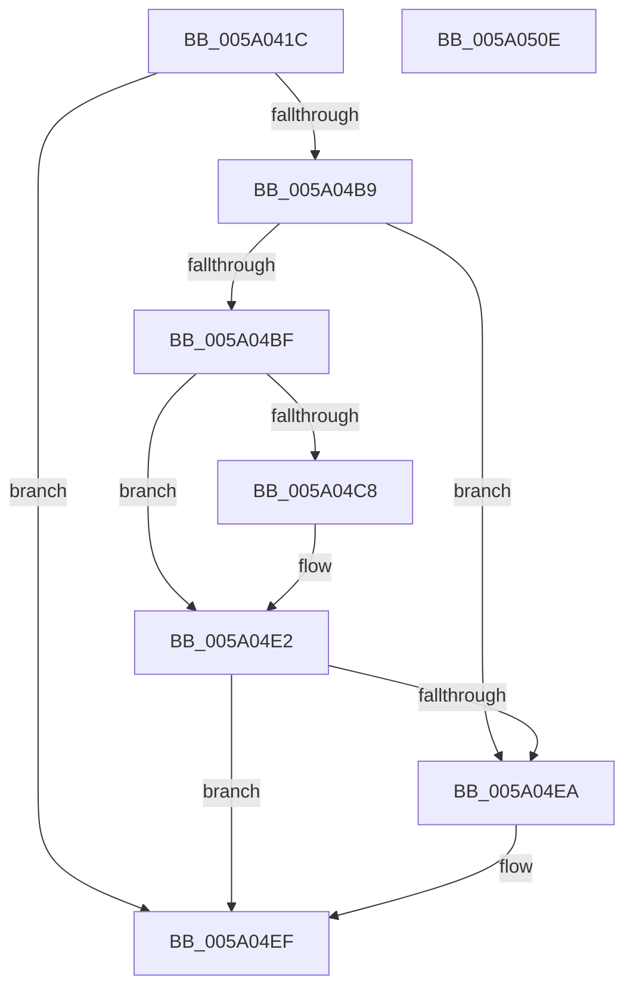

# IopIssueTrEERequest

- RVA: `0x005A041C`–`0x005A050F` (길이 `243` bytes)
- VA: `0x00000001405A041C`
- 실행 섹션: `.text`
- PDB 이름 있음: `예`; PDB Function 태그: `아니요`
- unwind 정보 RVA: `0x000C7D20`
- 디코드: `66`개 명령, `243/243` bytes 표시
- 미해석 바이트: `0` (있으면 어셈블리에 `.byte`로 보존)

> 이 문서는 커널 이미지의 기계어와 PDB 기호를 분석해 생성했습니다. 4번과 5번은 함수 원형과 자료형을 바이너리 사용 방식에서 추정한 C 해석이며 원본 소스 복구 결과는 아닙니다.

## 1. Dependencies

- 직접 호출 지점: **2**; 고유 호출 대상: **2**
- 직접 호출자로 확인된 함수: **4**
- RIP 상대 이미지 참조: **1**

### Outgoing calls
- `0x005A04AE` → [IopIssueSystemEnvironmentRequest](../../page/72/IopIssueSystemEnvironmentRequest_function_00722878.md) (function, `0x00722878`)
- `0x005A04F8` → [_security_check_cookie](../6A/_security_check_cookie_function_006AC640.md) (function, `0x006AC640`)

### Direct callers
- [IopEnumerateEnvironmentVariablesTrEE](../../page/72/IopEnumerateEnvironmentVariablesTrEE_function_007220A0.md) at `0x0072223E`
- [IopEnumerateEnvironmentVariablesTrEE](../../page/72/IopEnumerateEnvironmentVariablesTrEE_function_007220A0.md) at `0x007222F5`
- [IopGetEnvironmentVariableTrEE](../../page/72/IopGetEnvironmentVariableTrEE_function_007226B0.md) at `0x00722792`
- [IopQueryEnvironmentVariableInfoTrEE](../../page/72/IopQueryEnvironmentVariableInfoTrEE_function_00722AC0.md) at `0x00722B34`
- [IopSetEnvironmentVariableTrEE](../../page/72/IopSetEnvironmentVariableTrEE_function_00722CE0.md) at `0x00722DE9`

### Static image references
- `0x005A042F` → RVA `0x00E0A740` (`.data`; read)

## 2. Other-region calls and transfers

- 다른 실행 섹션으로 향하는 call: **1**
  - `0x005A04AE` → [IopIssueSystemEnvironmentRequest](../../page/72/IopIssueSystemEnvironmentRequest_function_00722878.md) (`.text` → `PAGE`)
- 별도 외부 분기/꼬리 이동을 확인하지 못했습니다.

## 3. Assembly (complete function range)

```asm
005A041C  4C 8B DC                        mov r11, rsp
005A041F  49 89 5B 10                     mov qword ptr [r11 + 0x10], rbx
005A0423  55                              push rbp
005A0424  49 8D 6B C9                     lea rbp, [r11 - 0x37]
005A0428  48 81 EC A0 00 00 00            sub rsp, 0xa0
005A042F  48 8B 05 0A A3 86 00            mov rax, qword ptr [rip + 0x86a30a]
005A0436  48 33 C4                        xor rax, rsp
005A0439  48 89 45 27                     mov qword ptr [rbp + 0x27], rax
005A043D  48 8B 5D 7F                     mov rbx, qword ptr [rbp + 0x7f]
005A0441  33 C0                           xor eax, eax
005A0443  83 65 DF 00                     and dword ptr [rbp - 0x21], 0
005A0447  4D 8B D0                        mov r10, r8
005A044A  4C 8B 45 67                     mov r8, qword ptr [rbp + 0x67]
005A044E  48 83 65 E7 00                  and qword ptr [rbp - 0x19], 0
005A0453  83 65 EF 00                     and dword ptr [rbp - 0x11], 0
005A0457  48 89 45 1B                     mov qword ptr [rbp + 0x1b], rax
005A045B  48 89 45 17                     mov qword ptr [rbp + 0x17], rax
005A045F  8B 45 5F                        mov eax, dword ptr [rbp + 0x5f]
005A0462  48 89 45 FF                     mov qword ptr [rbp - 1], rax
005A0466  8B 45 6F                        mov eax, dword ptr [rbp + 0x6f]
005A0469  48 89 45 0F                     mov qword ptr [rbp + 0xf], rax
005A046D  48 8D 45 DF                     lea rax, [rbp - 0x21]
005A0471  49 89 43 98                     mov qword ptr [r11 - 0x68], rax
005A0475  48 8D 45 17                     lea rax, [rbp + 0x17]
005A0479  C7 44 24 38 10 00 00 00         mov dword ptr [rsp + 0x38], 0x10
005A0481  49 89 43 88                     mov qword ptr [r11 - 0x78], rax
005A0485  48 8D 45 E7                     lea rax, [rbp - 0x19]
005A0489  4C 89 45 07                     mov qword ptr [rbp + 7], r8
005A048D  4C 8B C2                        mov r8, rdx
005A0490  89 4D F3                        mov dword ptr [rbp - 0xd], ecx
005A0493  33 D2                           xor edx, edx
005A0495  4C 89 4D F7                     mov qword ptr [rbp - 9], r9
005A0499  B9 04 80 56 00                  mov ecx, 0x568004
005A049E  C7 44 24 28 30 00 00 00         mov dword ptr [rsp + 0x28], 0x30
005A04A6  4D 8B CA                        mov r9, r10
005A04A9  48 89 44 24 20                  mov qword ptr [rsp + 0x20], rax
005A04AE  E8 C5 23 18 00                  call 0x140722878
005A04B3  8B C8                           mov ecx, eax
005A04B5  85 C0                           test eax, eax
005A04B7  78 36                           js 0x1405a04ef
005A04B9  83 7D DF 10                     cmp dword ptr [rbp - 0x21], 0x10
005A04BD  72 2B                           jb 0x1405a04ea
005A04BF  48 8B 55 1F                     mov rdx, qword ptr [rbp + 0x1f]
005A04C3  48 85 DB                        test rbx, rbx
005A04C6  74 1A                           je 0x1405a04e2
005A04C8  B9 FF FF FF FF                  mov ecx, 0xffffffff
005A04CD  48 3B D1                        cmp rdx, rcx
005A04D0  8B C1                           mov eax, ecx
005A04D2  0F 46 C2                        cmovbe eax, edx
005A04D5  48 3B CA                        cmp rcx, rdx
005A04D8  89 03                           mov dword ptr [rbx], eax
005A04DA  1B C9                           sbb ecx, ecx
005A04DC  81 E1 95 00 00 C0               and ecx, 0xc0000095
005A04E2  8B 45 77                        mov eax, dword ptr [rbp + 0x77]
005A04E5  48 3B D0                        cmp rdx, rax
005A04E8  73 05                           jae 0x1405a04ef
005A04EA  B9 86 01 00 C0                  mov ecx, 0xc0000186
005A04EF  8B C1                           mov eax, ecx
005A04F1  48 8B 4D 27                     mov rcx, qword ptr [rbp + 0x27]
005A04F5  48 33 CC                        xor rcx, rsp
005A04F8  E8 43 C1 10 00                  call 0x1406ac640
005A04FD  48 8B 9C 24 B8 00 00 00         mov rbx, qword ptr [rsp + 0xb8]
005A0505  48 81 C4 A0 00 00 00            add rsp, 0xa0
005A050C  5D                              pop rbp
005A050D  C3                              ret
005A050E  CC                              int3
```

## 4. C-style interpretation (structured pseudocode)

```c
__int64 __fastcall IopIssueTrEERequest(int a1, __int64 a2, __int64 a3, __int64 a4)
{
    __int64 result;
    __int64 v_rsp;
    unsigned int v_stack_m70;
    unsigned int v_stack_m80;
    unsigned __int64 v_stack_m88;
    unsigned __int64 v_stack_p10;

    *(unsigned __int64 *)(v_rsp + 16) = v_rbx;
    v_rsp = (v_rsp) - (160);
    result = (*(unsigned __int64 *)(v_rip + 8823562)) ^ (v_rsp);
    *(unsigned __int64 *)(v_rsp - 55 + 39) = result;
    result = 0;
    *(unsigned __int64 *)(v_rsp - 55 + 27) = 0;
    *(unsigned __int64 *)(v_rsp - 55 + 23) = 0;
    *(unsigned __int64 *)(v_rsp - 55 - 1) = (unsigned int)(*(unsigned int *)(v_rsp - 55 + 95));
    *(unsigned __int64 *)(v_rsp - 55 + 15) = (unsigned int)(*(unsigned int *)(v_rsp - 55 + 111));
    *(unsigned __int64 *)(v_rsp - 104) = v_rsp - 55 - 33;
    v_stack_m70 = 16;
    *(unsigned __int64 *)(v_rsp - 120) = v_rsp - 55 + 23;
    *(unsigned __int64 *)(v_rsp - 55 + 7) = *(unsigned __int64 *)(v_rsp - 55 + 103);
    *(unsigned int *)(v_rsp - 55 - 13) = a1;
    a2 = 0;
    *(unsigned __int64 *)(v_rsp - 55 - 9) = a4;
    v_stack_m80 = 48;
    v_stack_m88 = v_rsp - 55 - 25;
    result = IopIssueSystemEnvironmentRequest((unsigned int)(0x568004ULL), a2, a2, a3);
    if (sign_flag) goto loc_005A04EF;
    if ((*(unsigned int *)(v_rsp - 55 - 33)) < 16) goto loc_005A04EA;
    if (*(unsigned __int64 *)(v_rsp - 55 + 127) != 0) {
        a1 = 0xFFFFFFFFULL;
        result = a1;
        if ((*(unsigned __int64 *)(v_rsp - 55 + 31)) <= a1) { result = (unsigned int)(*(unsigned __int64 *)(v_rsp - 55 + 31)); }
        *(unsigned int *)(*(unsigned __int64 *)(v_rsp - 55 + 127)) = (unsigned int)(result);
        a1 = (unsigned int)((a1) & (0xC0000095ULL));
    }
    if ((*(unsigned __int64 *)(v_rsp - 55 + 31)) < ((unsigned int)(*(unsigned int *)(v_rsp - 55 + 119)))) {
        a1 = 0xC0000186ULL;
    }
    a1 = (*(unsigned __int64 *)(v_rsp - 55 + 39)) ^ (v_rsp);
    result = _security_check_cookie(a1, *(unsigned __int64 *)(v_rsp - 55 + 31), a2, a3);
    v_rsp = (v_rsp) + (160);
    return result;
}
```

## 5. (Beta) C Style

```c
int64_t IopIssueTrEERequest(int32_t Arg1, int64_t Arg2, int64_t Arg3, int64_t Arg4)
{
    int64_t result;
    int64_t local_rsp;
    uint32_t v_stack_m70;
    uint32_t v_stack_m80;
    uint64_t v_stack_m88;
    uint64_t v_stack_p10;

    *(uint64_t *)(local_rsp + 0x10) = local_rbx;
    local_rsp = (local_rsp) - (160);
    result = (*(uint64_t *)(v_rip + 0x86A30A)) ^ (local_rsp);
    *(uint64_t *)(local_rsp - 0x37 + 0x27) = result;
    result = 0;
    *(uint64_t *)(local_rsp - 0x37 + 0x1B) = 0;
    *(uint64_t *)(local_rsp - 0x37 + 0x17) = 0;
    *(uint64_t *)(local_rsp - 0x37 - 0x1) = (uint32_t)(*(uint32_t *)(local_rsp - 0x37 + 0x5F));
    *(uint64_t *)(local_rsp - 0x37 + 0xF) = (uint32_t)(*(uint32_t *)(local_rsp - 0x37 + 0x6F));
    *(uint64_t *)(local_rsp - 0x68) = local_rsp - 55 - 33;
    v_stack_m70 = 16;
    *(uint64_t *)(local_rsp - 0x78) = local_rsp - 55 + 23;
    *(uint64_t *)(local_rsp - 0x37 + 0x7) = *(uint64_t *)(local_rsp - 0x37 + 0x67);
    *(uint32_t *)(local_rsp - 0x37 - 0xD) = Arg1;
    Arg2 = 0;
    *(uint64_t *)(local_rsp - 0x37 - 0x9) = Arg4;
    v_stack_m80 = 48;
    v_stack_m88 = local_rsp - 55 - 25;
    result = IopIssueSystemEnvironmentRequest((uint32_t)(0x568004ULL), Arg2, Arg2, Arg3);
    if (sign_flag) goto loc_005A04EF;
    if ((*(uint32_t *)(local_rsp - 0x37 - 0x21)) < 16) goto loc_005A04EA;
    if (*(uint64_t *)(local_rsp - 0x37 + 0x7F) != 0) {
        Arg1 = 0xFFFFFFFFULL;
        result = Arg1;
        if ((*(uint64_t *)(local_rsp - 0x37 + 0x1F)) <= Arg1) { result = (uint32_t)(*(uint64_t *)(local_rsp - 0x37 + 0x1F)); }
        *(uint32_t *)(*(uint64_t *)(local_rsp - 0x37 + 0x7F)) = (uint32_t)(result);
        Arg1 = (uint32_t)((Arg1) & (0xC0000095ULL));
    }
    if ((*(uint64_t *)(local_rsp - 0x37 + 0x1F)) < ((uint32_t)(*(uint32_t *)(local_rsp - 0x37 + 0x77)))) {
        Arg1 = 0xC0000186ULL;
    }
    Arg1 = (*(uint64_t *)(local_rsp - 0x37 + 0x27)) ^ (local_rsp);
    result = _security_check_cookie(Arg1, *(uint64_t *)(local_rsp - 0x37 + 0x1F), Arg2, Arg3);
    local_rsp = (local_rsp) + (160);
    return result;
}
```

## 6. Execution-region graph

[열기: 2D/3D 그래프와 함수 탐색 컨트롤 패널](../../../control-panel.html?section=text&rva=0x005A041C&view=graph)

- 2D 그래프는 위에서 아래로 흐르고, 3D 그래프는 빈 공간을 드래그해 회전합니다. Shift+드래그는 이동, 휠은 확대·축소, 함수 노드 선택은 대상 보고서 이동입니다.

### Static fallback


