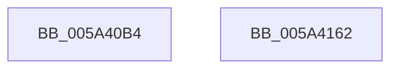

# IopLiveDumpTraceChunkCRCMismatchWrite

- RVA: `0x005A40B4`–`0x005A4163` (길이 `175` bytes)
- VA: `0x00000001405A40B4`
- 실행 섹션: `.text`
- PDB 이름 있음: `예`; PDB Function 태그: `아니요`
- unwind 정보 RVA: `0x000BD7A0`
- 디코드: `39`개 명령, `175/175` bytes 표시
- 미해석 바이트: `0` (있으면 어셈블리에 `.byte`로 보존)

> 이 문서는 커널 이미지의 기계어와 PDB 기호를 분석해 생성했습니다. 4번과 5번은 함수 원형과 자료형을 바이너리 사용 방식에서 추정한 C 해석이며 원본 소스 복구 결과는 아닙니다.

## 1. Dependencies

- 직접 호출 지점: **2**; 고유 호출 대상: **2**
- 직접 호출자로 확인된 함수: **1**
- RIP 상대 이미지 참조: **8**

### Outgoing calls
- `0x005A4148` → [IopLiveDumpTraceEventGeneric](IopLiveDumpTraceEventGeneric_function_005A41E4.md) (function, `0x005A41E4`)
- `0x005A4154` → [_security_check_cookie](../6A/_security_check_cookie_function_006AC640.md) (function, `0x006AC640`)

### Direct callers
- [sub_006EB65A](../6E/Unknown_function_006EB65A.md) at `0x006EB687`

### Static image references
- `0x005A40C2` → RVA `0x00E0A740` (`.data`; read)
- `0x005A40D0` → RVA `0x006CAAA0` (` ?? ::FNODOBFM::`string'`; read)
- `0x005A40DF` → RVA `0x006CAB40` (` ?? ::FNODOBFM::`string'`; read)
- `0x005A40E6` → RVA `0x006CABF0` (` ?? ::FNODOBFM::`string'`; read)
- `0x005A40FA` → RVA `0x006CAC10` (` ?? ::FNODOBFM::`string'`; read)
- `0x005A410D` → RVA `0x006CAAE0` (` ?? ::FNODOBFM::`string'`; read)
- `0x005A4118` → RVA `0x006CAB00` (` ?? ::FNODOBFM::`string'`; read)
- `0x005A4123` → RVA `0x006CAB20` (` ?? ::FNODOBFM::`string'`; read)

## 2. Other-region calls and transfers

- 다른 실행 섹션으로 향하는 call: **0**
- 별도 외부 분기/꼬리 이동을 확인하지 못했습니다.

## 3. Assembly (complete function range)

```asm
005A40B4  40 55                           push rbp
005A40B6  48 8D 6C 24 B9                  lea rbp, [rsp - 0x47]
005A40BB  48 81 EC 90 00 00 00            sub rsp, 0x90
005A40C2  48 8B 05 77 66 86 00            mov rax, qword ptr [rip + 0x866677]
005A40C9  48 33 C4                        xor rax, rsp
005A40CC  48 89 45 37                     mov qword ptr [rbp + 0x37], rax
005A40D0  48 8D 05 C9 69 12 00            lea rax, [rip + 0x1269c9]
005A40D7  48 89 4D D7                     mov qword ptr [rbp - 0x29], rcx
005A40DB  48 89 45 07                     mov qword ptr [rbp + 7], rax
005A40DF  48 8D 0D 5A 6A 12 00            lea rcx, [rip + 0x126a5a]
005A40E6  48 8D 05 03 6B 12 00            lea rax, [rip + 0x126b03]
005A40ED  48 89 55 DF                     mov qword ptr [rbp - 0x21], rdx
005A40F1  48 89 45 0F                     mov qword ptr [rbp + 0xf], rax
005A40F5  BA 06 00 00 00                  mov edx, 6
005A40FA  48 8D 05 0F 6B 12 00            lea rax, [rip + 0x126b0f]
005A4101  4C 89 4D EF                     mov qword ptr [rbp - 0x11], r9
005A4105  48 89 45 17                     mov qword ptr [rbp + 0x17], rax
005A4109  4C 8D 4D D7                     lea r9, [rbp - 0x29]
005A410D  48 8D 05 CC 69 12 00            lea rax, [rip + 0x1269cc]
005A4114  48 89 45 1F                     mov qword ptr [rbp + 0x1f], rax
005A4118  48 8D 05 E1 69 12 00            lea rax, [rip + 0x1269e1]
005A411F  48 89 45 27                     mov qword ptr [rbp + 0x27], rax
005A4123  48 8D 05 F6 69 12 00            lea rax, [rip + 0x1269f6]
005A412A  48 89 45 2F                     mov qword ptr [rbp + 0x2f], rax
005A412E  49 63 C0                        movsxd rax, r8d
005A4131  4C 8D 45 07                     lea r8, [rbp + 7]
005A4135  48 89 45 E7                     mov qword ptr [rbp - 0x19], rax
005A4139  8B 45 77                        mov eax, dword ptr [rbp + 0x77]
005A413C  48 89 45 F7                     mov qword ptr [rbp - 9], rax
005A4140  48 8B 45 7F                     mov rax, qword ptr [rbp + 0x7f]
005A4144  48 89 45 FF                     mov qword ptr [rbp - 1], rax
005A4148  E8 97 00 00 00                  call 0x1405a41e4
005A414D  48 8B 4D 37                     mov rcx, qword ptr [rbp + 0x37]
005A4151  48 33 CC                        xor rcx, rsp
005A4154  E8 E7 84 10 00                  call 0x1406ac640
005A4159  48 81 C4 90 00 00 00            add rsp, 0x90
005A4160  5D                              pop rbp
005A4161  C3                              ret
005A4162  CC                              int3
```

## 4. C-style interpretation (structured pseudocode)

```c
__int64 __fastcall IopLiveDumpTraceChunkCRCMismatchWrite(__int64 a1, __int64 a2, int a3, __int64 a4, unsigned int a5, __int64 a6)
{
    __int64 result;
    __int64 v_rsp;
    unsigned __int64 v_stack_m18;
    unsigned __int64 v_stack_m20;
    unsigned __int64 v_stack_m28;
    unsigned __int64 v_stack_m30;
    unsigned __int64 v_stack_m38;
    unsigned __int64 v_stack_m40;
    unsigned __int64 v_stack_m48;
    unsigned __int64 v_stack_m4F;
    unsigned __int64 v_stack_m50;
    unsigned __int64 v_stack_m58;
    unsigned __int64 v_stack_m60;
    unsigned __int64 v_stack_m68;
    unsigned __int64 v_stack_m70;
    unsigned __int64 v_stack_m78;

    v_rsp = (v_rsp) - (144);
    result = (*(unsigned __int64 *)(v_rip + 8808055)) ^ (v_rsp);
    v_stack_m18 = result;
    v_stack_m78 = a1;
    v_stack_m48 = v_rip + 1206729;
    v_stack_m70 = a2;
    v_stack_m40 = v_rip + 1207043;
    v_stack_m60 = a4;
    v_stack_m38 = v_rip + 1207055;
    v_stack_m30 = v_rip + 1206732;
    v_stack_m28 = v_rip + 1206753;
    v_stack_m20 = v_rip + 1206774;
    v_stack_m68 = (int)(a3);
    v_stack_m58 = (unsigned int)(a5);
    v_stack_m50 = a6;
    result = IopLiveDumpTraceEventGeneric(v_rip + 1206874, 6, v_stack_m48, v_stack_m78);
    a1 = (v_stack_m18) ^ (v_rsp);
    result = _security_check_cookie(a1, 6, v_stack_m48, v_stack_m78);
    v_rsp = (v_rsp) + (144);
    return result;
}
```

## 5. (Beta) C Style

```c
int64_t IopLiveDumpTraceChunkCRCMismatchWrite(int64_t Arg1, int64_t Arg2, int32_t Arg3, int64_t Arg4, uint32_t Arg5, int64_t Arg6)
{
    int64_t result;
    int64_t local_rsp;
    uint64_t v_stack_m18;
    uint64_t v_stack_m20;
    uint64_t v_stack_m28;
    uint64_t v_stack_m30;
    uint64_t v_stack_m38;
    uint64_t v_stack_m40;
    uint64_t v_stack_m48;
    uint64_t v_stack_m4F;
    uint64_t v_stack_m50;
    uint64_t v_stack_m58;
    uint64_t v_stack_m60;
    uint64_t v_stack_m68;
    uint64_t v_stack_m70;
    uint64_t v_stack_m78;

    local_rsp = (local_rsp) - (144);
    result = (*(uint64_t *)(v_rip + 0x866677)) ^ (local_rsp);
    v_stack_m18 = result;
    v_stack_m78 = Arg1;
    v_stack_m48 = v_rip + 1206729;
    v_stack_m70 = Arg2;
    v_stack_m40 = v_rip + 1207043;
    v_stack_m60 = Arg4;
    v_stack_m38 = v_rip + 1207055;
    v_stack_m30 = v_rip + 1206732;
    v_stack_m28 = v_rip + 1206753;
    v_stack_m20 = v_rip + 1206774;
    v_stack_m68 = (int32_t)(Arg3);
    v_stack_m58 = (uint32_t)(Arg5);
    v_stack_m50 = Arg6;
    result = IopLiveDumpTraceEventGeneric(v_rip + 1206874, 6, v_stack_m48, v_stack_m78);
    Arg1 = (v_stack_m18) ^ (local_rsp);
    result = _security_check_cookie(Arg1, 6, v_stack_m48, v_stack_m78);
    local_rsp = (local_rsp) + (144);
    return result;
}
```

## 6. Execution-region graph

[열기: 2D/3D 그래프와 함수 탐색 컨트롤 패널](../../../control-panel.html?section=text&rva=0x005A40B4&view=graph)

- 2D 그래프는 위에서 아래로 흐르고, 3D 그래프는 빈 공간을 드래그해 회전합니다. Shift+드래그는 이동, 휠은 확대·축소, 함수 노드 선택은 대상 보고서 이동입니다.

### Static fallback


