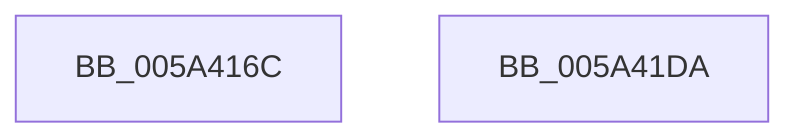

# IopLiveDumpTraceEstimatedPageCountNotAvailable

- RVA: `0x005A416C`–`0x005A41DB` (길이 `111` bytes)
- VA: `0x00000001405A416C`
- 실행 섹션: `.text`
- PDB 이름 있음: `예`; PDB Function 태그: `아니요`
- unwind 정보 RVA: `0x00065FB8`
- 디코드: `25`개 명령, `111/111` bytes 표시
- 미해석 바이트: `0` (있으면 어셈블리에 `.byte`로 보존)

> 이 문서는 커널 이미지의 기계어와 PDB 기호를 분석해 생성했습니다. 4번과 5번은 함수 원형과 자료형을 바이너리 사용 방식에서 추정한 C 해석이며 원본 소스 복구 결과는 아닙니다.

## 1. Dependencies

- 직접 호출 지점: **2**; 고유 호출 대상: **2**
- 직접 호출자로 확인된 함수: **1**
- RIP 상대 이미지 참조: **5**

### Outgoing calls
- `0x005A41C3` → [IopLiveDumpTraceEventGeneric](IopLiveDumpTraceEventGeneric_function_005A41E4.md) (function, `0x005A41E4`)
- `0x005A41D0` → [_security_check_cookie](../6A/_security_check_cookie_function_006AC640.md) (function, `0x006AC640`)

### Direct callers
- [IopLiveDumpAllocateDumpBuffers](../3F/IopLiveDumpAllocateDumpBuffers_function_003F5AE8.md) at `0x003F5E6A`

### Static image references
- `0x005A4173` → RVA `0x00E0A740` (`.data`; read)
- `0x005A4182` → RVA `0x006CAEB0` (` ?? ::FNODOBFM::`string'`; read)
- `0x005A4195` → RVA `0x006CAFB0` (` ?? ::FNODOBFM::`string'`; read)
- `0x005A41A4` → RVA `0x006CB020` (` ?? ::FNODOBFM::`string'`; read)
- `0x005A41AB` → RVA `0x006CAFE0` (` ?? ::FNODOBFM::`string'`; read)

## 2. Other-region calls and transfers

- 다른 실행 섹션으로 향하는 call: **0**
- 별도 외부 분기/꼬리 이동을 확인하지 못했습니다.

## 3. Assembly (complete function range)

```asm
005A416C  4C 8B DC                        mov r11, rsp
005A416F  48 83 EC 68                     sub rsp, 0x68
005A4173  48 8B 05 C6 65 86 00            mov rax, qword ptr [rip + 0x8665c6]
005A417A  48 33 C4                        xor rax, rsp
005A417D  48 89 44 24 50                  mov qword ptr [rsp + 0x50], rax
005A4182  48 8D 05 27 6D 12 00            lea rax, [rip + 0x126d27]
005A4189  49 89 4B B8                     mov qword ptr [r11 - 0x48], rcx
005A418D  49 89 43 D0                     mov qword ptr [r11 - 0x30], rax
005A4191  4D 8D 4B B8                     lea r9, [r11 - 0x48]
005A4195  48 8D 05 14 6E 12 00            lea rax, [rip + 0x126e14]
005A419C  49 89 53 C0                     mov qword ptr [r11 - 0x40], rdx
005A41A0  49 89 43 D8                     mov qword ptr [r11 - 0x28], rax
005A41A4  48 8D 0D 75 6E 12 00            lea rcx, [rip + 0x126e75]
005A41AB  48 8D 05 2E 6E 12 00            lea rax, [rip + 0x126e2e]
005A41B2  4D 89 43 C8                     mov qword ptr [r11 - 0x38], r8
005A41B6  4D 8D 43 D0                     lea r8, [r11 - 0x30]
005A41BA  49 89 43 E0                     mov qword ptr [r11 - 0x20], rax
005A41BE  BA 03 00 00 00                  mov edx, 3
005A41C3  E8 1C 00 00 00                  call 0x1405a41e4
005A41C8  48 8B 4C 24 50                  mov rcx, qword ptr [rsp + 0x50]
005A41CD  48 33 CC                        xor rcx, rsp
005A41D0  E8 6B 84 10 00                  call 0x1406ac640
005A41D5  48 83 C4 68                     add rsp, 0x68
005A41D9  C3                              ret
005A41DA  CC                              int3
```

## 4. C-style interpretation (structured pseudocode)

```c
__int64 __fastcall IopLiveDumpTraceEstimatedPageCountNotAvailable(__int64 a1, __int64 a2, __int64 a3)
{
    __int64 result;
    __int64 v_rsp;
    unsigned __int64 v_stack_m18;

    v_rsp = (v_rsp) - (104);
    result = (*(unsigned __int64 *)(v_rip + 8807878)) ^ (v_rsp);
    v_stack_m18 = result;
    *(unsigned __int64 *)(v_rsp - 72) = a1;
    *(unsigned __int64 *)(v_rsp - 48) = v_rip + 1207591;
    *(unsigned __int64 *)(v_rsp - 64) = a2;
    *(unsigned __int64 *)(v_rsp - 40) = v_rip + 1207828;
    *(unsigned __int64 *)(v_rsp - 56) = a3;
    *(unsigned __int64 *)(v_rsp - 32) = v_rip + 1207854;
    result = IopLiveDumpTraceEventGeneric(v_rip + 1207925, 3, v_rsp - 48, v_rsp - 72);
    a1 = (v_stack_m18) ^ (v_rsp);
    result = _security_check_cookie(a1, 3, v_rsp - 48, v_rsp - 72);
    v_rsp = (v_rsp) + (104);
    return result;
}
```

## 5. (Beta) C Style

```c
int64_t IopLiveDumpTraceEstimatedPageCountNotAvailable(int64_t Arg1, int64_t Arg2, int64_t Arg3)
{
    int64_t result;
    int64_t local_rsp;
    uint64_t v_stack_m18;

    local_rsp = (local_rsp) - (104);
    result = (*(uint64_t *)(v_rip + 0x8665C6)) ^ (local_rsp);
    v_stack_m18 = result;
    *(uint64_t *)(local_rsp - 0x48) = Arg1;
    *(uint64_t *)(local_rsp - 0x30) = v_rip + 1207591;
    *(uint64_t *)(local_rsp - 0x40) = Arg2;
    *(uint64_t *)(local_rsp - 0x28) = v_rip + 1207828;
    *(uint64_t *)(local_rsp - 0x38) = Arg3;
    *(uint64_t *)(local_rsp - 0x20) = v_rip + 1207854;
    result = IopLiveDumpTraceEventGeneric(v_rip + 1207925, 3, local_rsp - 48, local_rsp - 72);
    Arg1 = (v_stack_m18) ^ (local_rsp);
    result = _security_check_cookie(Arg1, 3, local_rsp - 48, local_rsp - 72);
    local_rsp = (local_rsp) + (104);
    return result;
}
```

## 6. Execution-region graph

[열기: 2D/3D 그래프와 함수 탐색 컨트롤 패널](../../../control-panel.html?section=text&rva=0x005A416C&view=graph)

- 2D 그래프는 위에서 아래로 흐르고, 3D 그래프는 빈 공간을 드래그해 회전합니다. Shift+드래그는 이동, 휠은 확대·축소, 함수 노드 선택은 대상 보고서 이동입니다.

### Static fallback


