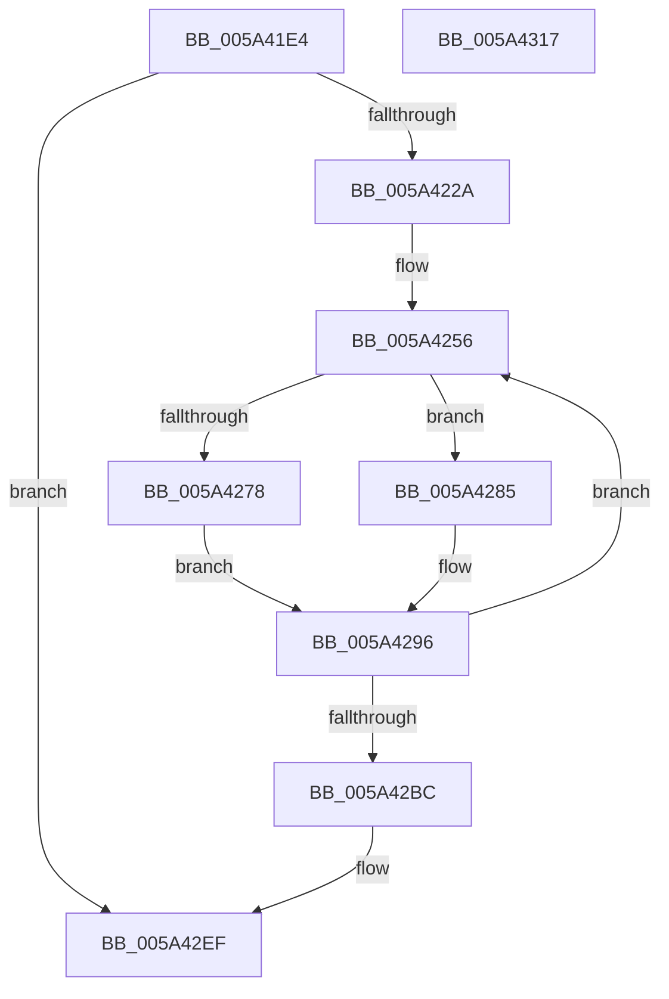

# IopLiveDumpTraceEventGeneric

- RVA: `0x005A41E4`–`0x005A4318` (길이 `308` bytes)
- VA: `0x00000001405A41E4`
- 실행 섹션: `.text`
- PDB 이름 있음: `예`; PDB Function 태그: `아니요`
- unwind 정보 RVA: `0x000C7F34`
- 디코드: `75`개 명령, `308/308` bytes 표시
- 미해석 바이트: `0` (있으면 어셈블리에 `.byte`로 보존)

> 이 문서는 커널 이미지의 기계어와 PDB 기호를 분석해 생성했습니다. 4번과 5번은 함수 원형과 자료형을 바이너리 사용 방식에서 추정한 C 해석이며 원본 소스 복구 결과는 아닙니다.

## 1. Dependencies

- 직접 호출 지점: **7**; 고유 호출 대상: **5**
- 직접 호출자로 확인된 함수: **11**
- RIP 상대 이미지 참조: **4**

### Outgoing calls
- `0x005A421D` → [IopLiveDumpIsTracingEnabled](../4F/IopLiveDumpIsTracingEnabled_function_004FC5AC.md) (function, `0x004FC5AC`)
- `0x005A4237` → [memset](../6C/memset_function_006C6C40.md) (function, `0x006C6C40`)
- `0x005A424A` → [EventDataDescCreateString](EventDataDescCreateString_function_005A4010.md) (function, `0x005A4010`)
- `0x005A427B` → [EventDataDescCreateString](EventDataDescCreateString_function_005A4010.md) (function, `0x005A4010`)
- `0x005A428C` → [EventDataDescCreateString](EventDataDescCreateString_function_005A4010.md) (function, `0x005A4010`)
- `0x005A42EA` → [EtwWriteEx](../25/EtwWriteEx_function_0025F0D0.md) (function, `0x0025F0D0`)
- `0x005A42FA` → [_security_check_cookie](../6A/_security_check_cookie_function_006AC640.md) (function, `0x006AC640`)

### Direct callers
- [IopLiveDumpAllocateFromIOSpace](../59/IopLiveDumpAllocateFromIOSpace_function_00599DEC.md) at `0x00599F36`
- [IopLiveDumpAllocateFromIOSpace](../59/IopLiveDumpAllocateFromIOSpace_function_00599DEC.md) at `0x00599FCC`
- [IopLiveDumpBufferDumpData](../59/IopLiveDumpBufferDumpData_function_0059A938.md) at `0x0059A999`
- [IopLiveDumpBufferDumpData](../59/IopLiveDumpBufferDumpData_function_0059A938.md) at `0x0059AC0B`
- [IopLiveDumpGetCapturePages](../59/IopLiveDumpGetCapturePages_function_0059C254.md) at `0x0059C314`
- [IopLiveDumpGetCapturePagesNoLock](../59/IopLiveDumpGetCapturePagesNoLock_function_0059C344.md) at `0x0059C515`
- [IopLiveDumpMarkLoadedModuleList](../59/IopLiveDumpMarkLoadedModuleList_function_0059CE1C.md) at `0x0059CF2C`
- [IopLiveDumpTraceChunkCRCMismatchWrite](IopLiveDumpTraceChunkCRCMismatchWrite_function_005A40B4.md) at `0x005A4148`
- [IopLiveDumpTraceEstimatedPageCountNotAvailable](IopLiveDumpTraceEstimatedPageCountNotAvailable_function_005A416C.md) at `0x005A41C3`
- [IopLiveDumpTraceIoCaptureLiveDumpEntry](IopLiveDumpTraceIoCaptureLiveDumpEntry_function_005A4320.md) at `0x005A439F`
- [IopLiveDumpTraceRunPageCountLoop](IopLiveDumpTraceRunPageCountLoop_function_005A43E4.md) at `0x005A4468`
- [IopLiveDumpTraceWriteBuffer](IopLiveDumpTraceWriteBuffer_function_005A448C.md) at `0x005A44F8`
- [sub_006EB392](../6E/Unknown_function_006EB392.md) at `0x006EB3CC`

### Static image references
- `0x005A41F9` → RVA `0x00E0A740` (`.data`; read)
- `0x005A4285` → RVA `0x006CAFA0` (` ?? ::FNODOBFM::`string'`; read)
- `0x005A42BC` → RVA `0x00E66228` (`.data`; read)
- `0x005A42DD` → RVA `0x000225D0` (`.rdata`; read)

## 2. Other-region calls and transfers

- 다른 실행 섹션으로 향하는 call: **0**
- 별도 외부 분기/꼬리 이동을 확인하지 못했습니다.

## 3. Assembly (complete function range)

```asm
005A41E4  48 89 5C 24 10                  mov qword ptr [rsp + 0x10], rbx
005A41E9  48 89 6C 24 20                  mov qword ptr [rsp + 0x20], rbp
005A41EE  56                              push rsi
005A41EF  57                              push rdi
005A41F0  41 56                           push r14
005A41F2  48 81 EC 70 01 00 00            sub rsp, 0x170
005A41F9  48 8B 05 40 65 86 00            mov rax, qword ptr [rip + 0x866540]
005A4200  48 33 C4                        xor rax, rsp
005A4203  48 89 84 24 60 01 00 00         mov qword ptr [rsp + 0x160], rax
005A420B  48 83 64 24 40 00               and qword ptr [rsp + 0x40], 0
005A4211  49 8B F9                        mov rdi, r9
005A4214  49 8B F0                        mov rsi, r8
005A4217  44 8B F2                        mov r14d, edx
005A421A  48 8B D9                        mov rbx, rcx
005A421D  E8 8A 83 F5 FF                  call 0x1404fc5ac
005A4222  84 C0                           test al, al
005A4224  0F 84 C5 00 00 00               je 0x1405a42ef
005A422A  33 D2                           xor edx, edx
005A422C  48 8D 4C 24 50                  lea rcx, [rsp + 0x50]
005A4231  41 B8 10 01 00 00               mov r8d, 0x110
005A4237  E8 04 2A 12 00                  call 0x1406c6c40
005A423C  41 B8 40 00 00 00               mov r8d, 0x40
005A4242  48 8D 4C 24 50                  lea rcx, [rsp + 0x50]
005A4247  48 8B D3                        mov rdx, rbx
005A424A  E8 C1 FD FF FF                  call 0x1405a4010
005A424F  BA 01 00 00 00                  mov edx, 1
005A4254  33 DB                           xor ebx, ebx
005A4256  8B C2                           mov eax, edx
005A4258  8D 6A 01                        lea ebp, [rdx + 1]
005A425B  48 C1 E0 04                     shl rax, 4
005A425F  48 8D 4C 24 50                  lea rcx, [rsp + 0x50]
005A4264  44 8B DD                        mov r11d, ebp
005A4267  48 03 C8                        add rcx, rax
005A426A  4D 03 DB                        add r11, r11
005A426D  41 B8 20 00 00 00               mov r8d, 0x20
005A4273  41 3B DE                        cmp ebx, r14d
005A4276  73 0D                           jae 0x1405a4285
005A4278  48 8B 16                        mov rdx, qword ptr [rsi]
005A427B  E8 90 FD FF FF                  call 0x1405a4010
005A4280  48 8B CF                        mov rcx, rdi
005A4283  EB 11                           jmp 0x1405a4296
005A4285  48 8D 15 14 6D 12 00            lea rdx, [rip + 0x126d14]
005A428C  E8 7F FD FF FF                  call 0x1405a4010
005A4291  48 8D 4C 24 40                  lea rcx, [rsp + 0x40]
005A4296  4A 89 4C DC 50                  mov qword ptr [rsp + r11*8 + 0x50], rcx
005A429B  8D 55 01                        lea edx, [rbp + 1]
005A429E  42 C7 44 DC 58 08 00 00 00      mov dword ptr [rsp + r11*8 + 0x58], 8
005A42A7  FF C3                           inc ebx
005A42A9  42 83 64 DC 5C 00               and dword ptr [rsp + r11*8 + 0x5c], 0
005A42AF  48 83 C7 08                     add rdi, 8
005A42B3  48 83 C6 08                     add rsi, 8
005A42B7  83 FB 08                        cmp ebx, 8
005A42BA  72 9A                           jb 0x1405a4256
005A42BC  48 8B 0D 65 1F 8C 00            mov rcx, qword ptr [rip + 0x8c1f65]
005A42C3  48 8D 44 24 50                  lea rax, [rsp + 0x50]
005A42C8  48 89 44 24 38                  mov qword ptr [rsp + 0x38], rax
005A42CD  45 33 C9                        xor r9d, r9d
005A42D0  89 54 24 30                     mov dword ptr [rsp + 0x30], edx
005A42D4  45 33 C0                        xor r8d, r8d
005A42D7  48 83 64 24 28 00               and qword ptr [rsp + 0x28], 0
005A42DD  48 8D 15 EC E2 A7 FF            lea rdx, [rip - 0x581d14]
005A42E4  48 83 64 24 20 00               and qword ptr [rsp + 0x20], 0
005A42EA  E8 E1 AD CB FF                  call 0x14025f0d0
005A42EF  48 8B 8C 24 60 01 00 00         mov rcx, qword ptr [rsp + 0x160]
005A42F7  48 33 CC                        xor rcx, rsp
005A42FA  E8 41 83 10 00                  call 0x1406ac640
005A42FF  4C 8D 9C 24 70 01 00 00         lea r11, [rsp + 0x170]
005A4307  49 8B 5B 28                     mov rbx, qword ptr [r11 + 0x28]
005A430B  49 8B 6B 38                     mov rbp, qword ptr [r11 + 0x38]
005A430F  49 8B E3                        mov rsp, r11
005A4312  41 5E                           pop r14
005A4314  5F                              pop rdi
005A4315  5E                              pop rsi
005A4316  C3                              ret
005A4317  CC                              int3
```

## 4. C-style interpretation (structured pseudocode)

```c
__int64 __fastcall IopLiveDumpTraceEventGeneric(__int64 a1, int a2, __int64 a3, __int64 a4)
{
    __int64 result;
    __int64 v_r11;
    __int64 v_rbx;
    __int64 v_rdi;
    __int64 v_rsi;
    __int64 v_rsp;
    unsigned __int64 v_stack_m138;
    unsigned __int64 v_stack_m148;
    unsigned __int64 v_stack_m150;
    unsigned int v_stack_m158;
    unsigned __int64 v_stack_m160;
    unsigned __int64 v_stack_m168;
    unsigned __int64 v_stack_m18;
    unsigned __int64 v_stack_m28;
    unsigned __int64 v_stack_p10;
    unsigned __int64 v_stack_p20;

    v_stack_p10 = v_rbx;
    v_stack_p20 = v_rbp;
    v_rsp = (v_rsp) - (368);
    result = (*(unsigned __int64 *)(v_rip + 8807744)) ^ (v_rsp);
    v_stack_m28 = result;
    result = IopLiveDumpIsTracingEnabled(a1, a2, a3, a4);
    if ((unsigned __int8)(result) == 0) goto loc_005A42EF;
    a2 = 0;
    result = memset(v_stack_m138, a2, 272, a4);
    result = EventDataDescCreateString(v_stack_m138, a1, 64, a4);
    v_rbx = 0;
loc_005A4256:
    result = (1) << (4);
    a1 = (v_stack_m138) + (result);
    v_r11 = ((unsigned int)((unsigned int)(1 + 1))) + ((unsigned int)((unsigned int)(1 + 1)));
    if (0 >= ((unsigned int)((unsigned int)(a2)))) goto loc_005A4285;
    result = EventDataDescCreateString(a1, *(unsigned __int64 *)(a3), 32, a4);
    goto loc_005A4296;
loc_005A4285:
    result = EventDataDescCreateString(a4, v_rip + 1207572, 32, a4);
loc_005A4296:
    *(unsigned __int64 *)(v_rsp + v_r11 * 8 + 80) = v_stack_m148;
    *(unsigned int *)(v_rsp + v_r11 * 8 + 88) = 8;
    v_rbx = (unsigned int)((v_rbx) + 1);
    v_rdi = (a4) + (8);
    v_rsi = (a3) + (8);
    if (((unsigned int)(v_rbx)) < 8) goto loc_005A4256;
    v_stack_m150 = v_stack_m138;
    a4 = 0;
    v_stack_m158 = (unsigned int)(1 + 1 + 1);
    a3 = 0;
    result = EtwWriteEx(*(unsigned __int64 *)(v_rip + 9183077), v_rip - 5774612, a3, a4);
loc_005A42EF:
    a1 = (v_stack_m28) ^ (v_rsp);
    result = _security_check_cookie(a1, v_rip - 5774612, a3, a4);
    return result;
}
```

## 5. (Beta) C Style

```c
int64_t IopLiveDumpTraceEventGeneric(int64_t Arg1, int32_t Arg2, void *Arg3, int64_t Arg4)
{
    uint8_t *arg3 = (uint8_t *)Arg3;

    int64_t result;
    int64_t local_r11;
    int64_t local_rbx;
    int64_t local_rdi;
    int64_t local_rsi;
    int64_t local_rsp;
    uint64_t v_stack_m138;
    uint64_t v_stack_m148;
    uint64_t v_stack_m150;
    uint32_t v_stack_m158;
    uint64_t v_stack_m160;
    uint64_t v_stack_m168;
    uint64_t v_stack_m18;
    uint64_t v_stack_m28;
    uint64_t v_stack_p10;
    uint64_t v_stack_p20;

    v_stack_p10 = local_rbx;
    v_stack_p20 = local_rbp;
    local_rsp = (local_rsp) - (368);
    result = (*(uint64_t *)(v_rip + 0x866540)) ^ (local_rsp);
    v_stack_m28 = result;
    result = IopLiveDumpIsTracingEnabled(Arg1, Arg2, Arg3, Arg4);
    if ((uint8_t)(result) == 0) goto loc_005A42EF;
    Arg2 = 0;
    result = memset(v_stack_m138, Arg2, 272, Arg4);
    result = EventDataDescCreateString(v_stack_m138, Arg1, 64, Arg4);
    local_rbx = 0;
loc_005A4256:
    result = (1) << (4);
    Arg1 = (v_stack_m138) + (result);
    local_r11 = ((uint32_t)((uint32_t)(1 + 1))) + ((uint32_t)((uint32_t)(1 + 1)));
    if (0 >= ((uint32_t)((uint32_t)(Arg2)))) goto loc_005A4285;
    result = EventDataDescCreateString(Arg1, *(uint64_t *)(arg3), 32, Arg4);
    goto loc_005A4296;
loc_005A4285:
    result = EventDataDescCreateString(Arg4, v_rip + 1207572, 32, Arg4);
loc_005A4296:
    *(uint64_t *)(local_rsp + local_r11 * 8 + 0x50) = v_stack_m148;
    *(uint32_t *)(local_rsp + local_r11 * 8 + 0x58) = 8;
    local_rbx = (uint32_t)((local_rbx) + 1);
    local_rdi = (Arg4) + (8);
    local_rsi = (Arg3) + (8);
    if (((uint32_t)(local_rbx)) < 8) goto loc_005A4256;
    v_stack_m150 = v_stack_m138;
    Arg4 = 0;
    v_stack_m158 = (uint32_t)(1 + 1 + 1);
    Arg3 = 0;
    result = EtwWriteEx(*(uint64_t *)(v_rip + 0x8C1F65), v_rip - 5774612, Arg3, Arg4);
loc_005A42EF:
    Arg1 = (v_stack_m28) ^ (local_rsp);
    result = _security_check_cookie(Arg1, v_rip - 5774612, Arg3, Arg4);
    return result;
}
```

### 관측된 메모리 오프셋

구조체 형식이 확인되지 않은 접근은 인자 기준의 오프셋으로만 기록했습니다.

| 기준 인자 | 오프셋 표현 | 폭 (bit) | 접근 |
|---|---:|---:|---|
| `Arg3` | `+ 0x0` | `64` | `R` |

## 6. Execution-region graph

[열기: 2D/3D 그래프와 함수 탐색 컨트롤 패널](../../../control-panel.html?section=text&rva=0x005A41E4&view=graph)

- 2D 그래프는 위에서 아래로 흐르고, 3D 그래프는 빈 공간을 드래그해 회전합니다. Shift+드래그는 이동, 휠은 확대·축소, 함수 노드 선택은 대상 보고서 이동입니다.

### Static fallback


