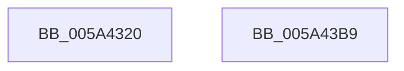

# IopLiveDumpTraceIoCaptureLiveDumpEntry

- RVA: `0x005A4320`–`0x005A43BA` (길이 `154` bytes)
- VA: `0x00000001405A4320`
- 실행 섹션: `.text`
- PDB 이름 있음: `예`; PDB Function 태그: `아니요`
- unwind 정보 RVA: `0x000886E8`
- 디코드: `35`개 명령, `154/154` bytes 표시
- 미해석 바이트: `0` (있으면 어셈블리에 `.byte`로 보존)

> 이 문서는 커널 이미지의 기계어와 PDB 기호를 분석해 생성했습니다. 4번과 5번은 함수 원형과 자료형을 바이너리 사용 방식에서 추정한 C 해석이며 원본 소스 복구 결과는 아닙니다.

## 1. Dependencies

- 직접 호출 지점: **2**; 고유 호출 대상: **2**
- 직접 호출자로 확인된 함수: **1**
- RIP 상대 이미지 참조: **7**

### Outgoing calls
- `0x005A439F` → [IopLiveDumpTraceEventGeneric](IopLiveDumpTraceEventGeneric_function_005A41E4.md) (function, `0x005A41E4`)
- `0x005A43AB` → [_security_check_cookie](../6A/_security_check_cookie_function_006AC640.md) (function, `0x006AC640`)

### Direct callers
- [IoCaptureLiveDump](../4E/IoCaptureLiveDump_function_004E085C.md) at `0x004E090A`

### Static image references
- `0x005A432C` → RVA `0x00E0A740` (`.data`; read)
- `0x005A433A` → RVA `0x006CAC60` (` ?? ::FNODOBFM::`string'`; read)
- `0x005A434E` → RVA `0x006C9D40` (` ?? ::FNODOBFM::`string'`; read)
- `0x005A4361` → RVA `0x006CAC80` (` ?? ::FNODOBFM::`string'`; read)
- `0x005A4374` → RVA `0x006CACB0` (` ?? ::FNODOBFM::`string'`; read)
- `0x005A437F` → RVA `0x006CACE0` (` ?? ::FNODOBFM::`string'`; read)
- `0x005A438C` → RVA `0x006CAC30` (` ?? ::FNODOBFM::`string'`; read)

## 2. Other-region calls and transfers

- 다른 실행 섹션으로 향하는 call: **0**
- 별도 외부 분기/꼬리 이동을 확인하지 못했습니다.

## 3. Assembly (complete function range)

```asm
005A4320  40 55                           push rbp
005A4322  48 8B EC                        mov rbp, rsp
005A4325  48 81 EC 80 00 00 00            sub rsp, 0x80
005A432C  48 8B 05 0D 64 86 00            mov rax, qword ptr [rip + 0x86640d]
005A4333  48 33 C4                        xor rax, rsp
005A4336  48 89 45 F0                     mov qword ptr [rbp - 0x10], rax
005A433A  48 8D 05 1F 69 12 00            lea rax, [rip + 0x12691f]
005A4341  48 89 55 A8                     mov qword ptr [rbp - 0x58], rdx
005A4345  48 89 45 C8                     mov qword ptr [rbp - 0x38], rax
005A4349  BA 05 00 00 00                  mov edx, 5
005A434E  48 8D 05 EB 59 12 00            lea rax, [rip + 0x1259eb]
005A4355  4C 89 45 B0                     mov qword ptr [rbp - 0x50], r8
005A4359  48 89 45 D0                     mov qword ptr [rbp - 0x30], rax
005A435D  4C 8D 45 C8                     lea r8, [rbp - 0x38]
005A4361  48 8D 05 18 69 12 00            lea rax, [rip + 0x126918]
005A4368  4C 89 4D B8                     mov qword ptr [rbp - 0x48], r9
005A436C  48 89 45 D8                     mov qword ptr [rbp - 0x28], rax
005A4370  4C 8D 4D A0                     lea r9, [rbp - 0x60]
005A4374  48 8D 05 35 69 12 00            lea rax, [rip + 0x126935]
005A437B  48 89 45 E0                     mov qword ptr [rbp - 0x20], rax
005A437F  48 8D 05 5A 69 12 00            lea rax, [rip + 0x12695a]
005A4386  48 89 45 E8                     mov qword ptr [rbp - 0x18], rax
005A438A  8B C1                           mov eax, ecx
005A438C  48 8D 0D 9D 68 12 00            lea rcx, [rip + 0x12689d]
005A4393  48 89 45 A0                     mov qword ptr [rbp - 0x60], rax
005A4397  48 8B 45 30                     mov rax, qword ptr [rbp + 0x30]
005A439B  48 89 45 C0                     mov qword ptr [rbp - 0x40], rax
005A439F  E8 40 FE FF FF                  call 0x1405a41e4
005A43A4  48 8B 4D F0                     mov rcx, qword ptr [rbp - 0x10]
005A43A8  48 33 CC                        xor rcx, rsp
005A43AB  E8 90 82 10 00                  call 0x1406ac640
005A43B0  48 81 C4 80 00 00 00            add rsp, 0x80
005A43B7  5D                              pop rbp
005A43B8  C3                              ret
005A43B9  CC                              int3
```

## 4. C-style interpretation (structured pseudocode)

```c
__int64 __fastcall IopLiveDumpTraceIoCaptureLiveDumpEntry(int a1, __int64 a2, __int64 a3, __int64 a4, __int64 a5)
{
    __int64 result;
    __int64 v_rsp;
    unsigned __int64 v_stack_m18;
    unsigned __int64 v_stack_m20;
    unsigned __int64 v_stack_m28;
    unsigned __int64 v_stack_m30;
    unsigned __int64 v_stack_m38;
    unsigned __int64 v_stack_m40;
    unsigned __int64 v_stack_m48;
    unsigned __int64 v_stack_m50;
    unsigned __int64 v_stack_m58;
    unsigned __int64 v_stack_m60;
    unsigned __int64 v_stack_m68;

    v_rsp = (v_rsp) - (128);
    result = (*(unsigned __int64 *)(v_rip + 8807437)) ^ (v_rsp);
    v_stack_m18 = result;
    v_stack_m60 = a2;
    v_stack_m40 = v_rip + 1206559;
    v_stack_m58 = a3;
    v_stack_m38 = v_rip + 1202667;
    v_stack_m50 = a4;
    v_stack_m30 = v_rip + 1206552;
    v_stack_m28 = v_rip + 1206581;
    v_stack_m20 = v_rip + 1206618;
    v_stack_m68 = (unsigned int)(a1);
    v_stack_m48 = a5;
    result = IopLiveDumpTraceEventGeneric(v_rip + 1206429, 5, v_stack_m40, v_stack_m68);
    a1 = (v_stack_m18) ^ (v_rsp);
    result = _security_check_cookie(a1, 5, v_stack_m40, v_stack_m68);
    v_rsp = (v_rsp) + (128);
    return result;
}
```

## 5. (Beta) C Style

```c
int64_t IopLiveDumpTraceIoCaptureLiveDumpEntry(int32_t Arg1, int64_t Arg2, int64_t Arg3, int64_t Arg4, int64_t Arg5)
{
    int64_t result;
    int64_t local_rsp;
    uint64_t v_stack_m18;
    uint64_t v_stack_m20;
    uint64_t v_stack_m28;
    uint64_t v_stack_m30;
    uint64_t v_stack_m38;
    uint64_t v_stack_m40;
    uint64_t v_stack_m48;
    uint64_t v_stack_m50;
    uint64_t v_stack_m58;
    uint64_t v_stack_m60;
    uint64_t v_stack_m68;

    local_rsp = (local_rsp) - (128);
    result = (*(uint64_t *)(v_rip + 0x86640D)) ^ (local_rsp);
    v_stack_m18 = result;
    v_stack_m60 = Arg2;
    v_stack_m40 = v_rip + 1206559;
    v_stack_m58 = Arg3;
    v_stack_m38 = v_rip + 1202667;
    v_stack_m50 = Arg4;
    v_stack_m30 = v_rip + 1206552;
    v_stack_m28 = v_rip + 1206581;
    v_stack_m20 = v_rip + 1206618;
    v_stack_m68 = (uint32_t)(Arg1);
    v_stack_m48 = Arg5;
    result = IopLiveDumpTraceEventGeneric(v_rip + 1206429, 5, v_stack_m40, v_stack_m68);
    Arg1 = (v_stack_m18) ^ (local_rsp);
    result = _security_check_cookie(Arg1, 5, v_stack_m40, v_stack_m68);
    local_rsp = (local_rsp) + (128);
    return result;
}
```

## 6. Execution-region graph

[열기: 2D/3D 그래프와 함수 탐색 컨트롤 패널](../../../control-panel.html?section=text&rva=0x005A4320&view=graph)

- 2D 그래프는 위에서 아래로 흐르고, 3D 그래프는 빈 공간을 드래그해 회전합니다. Shift+드래그는 이동, 휠은 확대·축소, 함수 노드 선택은 대상 보고서 이동입니다.

### Static fallback


