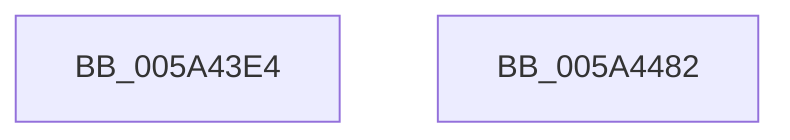

# IopLiveDumpTraceRunPageCountLoop

- RVA: `0x005A43E4`–`0x005A4483` (길이 `159` bytes)
- VA: `0x00000001405A43E4`
- 실행 섹션: `.text`
- PDB 이름 있음: `예`; PDB Function 태그: `아니요`
- unwind 정보 RVA: `0x000886E8`
- 디코드: `37`개 명령, `159/159` bytes 표시
- 미해석 바이트: `0` (있으면 어셈블리에 `.byte`로 보존)

> 이 문서는 커널 이미지의 기계어와 PDB 기호를 분석해 생성했습니다. 4번과 5번은 함수 원형과 자료형을 바이너리 사용 방식에서 추정한 C 해석이며 원본 소스 복구 결과는 아닙니다.

## 1. Dependencies

- 직접 호출 지점: **2**; 고유 호출 대상: **2**
- 직접 호출자로 확인된 함수: **1**
- RIP 상대 이미지 참조: **7**

### Outgoing calls
- `0x005A4468` → [IopLiveDumpTraceEventGeneric](IopLiveDumpTraceEventGeneric_function_005A41E4.md) (function, `0x005A41E4`)
- `0x005A4474` → [_security_check_cookie](../6A/_security_check_cookie_function_006AC640.md) (function, `0x006AC640`)

### Direct callers
- [IopLiveDumpAllocateFromIOSpace](../59/IopLiveDumpAllocateFromIOSpace_function_00599DEC.md) at `0x0059A039`

### Static image references
- `0x005A43F0` → RVA `0x00E0A740` (`.data`; read)
- `0x005A43FE` → RVA `0x006CADB0` (` ?? ::FNODOBFM::`string'`; read)
- `0x005A4411` → RVA `0x006CAF50` (` ?? ::FNODOBFM::`string'`; read)
- `0x005A441C` → RVA `0x006CAF00` (` ?? ::FNODOBFM::`string'`; read)
- `0x005A4427` → RVA `0x006CAE40` (` ?? ::FNODOBFM::`string'`; read)
- `0x005A4432` → RVA `0x006CAE60` (` ?? ::FNODOBFM::`string'`; read)
- `0x005A443F` → RVA `0x006CAE80` (` ?? ::FNODOBFM::`string'`; read)

## 2. Other-region calls and transfers

- 다른 실행 섹션으로 향하는 call: **0**
- 별도 외부 분기/꼬리 이동을 확인하지 못했습니다.

## 3. Assembly (complete function range)

```asm
005A43E4  40 55                           push rbp
005A43E6  48 8B EC                        mov rbp, rsp
005A43E9  48 81 EC 80 00 00 00            sub rsp, 0x80
005A43F0  48 8B 05 49 63 86 00            mov rax, qword ptr [rip + 0x866349]
005A43F7  48 33 C4                        xor rax, rsp
005A43FA  48 89 45 F0                     mov qword ptr [rbp - 0x10], rax
005A43FE  48 8D 05 AB 69 12 00            lea rax, [rip + 0x1269ab]
005A4405  4C 89 4D B8                     mov qword ptr [rbp - 0x48], r9
005A4409  48 89 45 C8                     mov qword ptr [rbp - 0x38], rax
005A440D  4C 8D 4D A0                     lea r9, [rbp - 0x60]
005A4411  48 8D 05 38 6B 12 00            lea rax, [rip + 0x126b38]
005A4418  48 89 45 D0                     mov qword ptr [rbp - 0x30], rax
005A441C  48 8D 05 DD 6A 12 00            lea rax, [rip + 0x126add]
005A4423  48 89 45 D8                     mov qword ptr [rbp - 0x28], rax
005A4427  48 8D 05 12 6A 12 00            lea rax, [rip + 0x126a12]
005A442E  48 89 45 E0                     mov qword ptr [rbp - 0x20], rax
005A4432  48 8D 05 27 6A 12 00            lea rax, [rip + 0x126a27]
005A4439  48 89 45 E8                     mov qword ptr [rbp - 0x18], rax
005A443D  8B C1                           mov eax, ecx
005A443F  48 8D 0D 3A 6A 12 00            lea rcx, [rip + 0x126a3a]
005A4446  48 89 45 A0                     mov qword ptr [rbp - 0x60], rax
005A444A  8B C2                           mov eax, edx
005A444C  BA 05 00 00 00                  mov edx, 5
005A4451  48 89 45 A8                     mov qword ptr [rbp - 0x58], rax
005A4455  41 8B C0                        mov eax, r8d
005A4458  4C 8D 45 C8                     lea r8, [rbp - 0x38]
005A445C  48 89 45 B0                     mov qword ptr [rbp - 0x50], rax
005A4460  48 8B 45 30                     mov rax, qword ptr [rbp + 0x30]
005A4464  48 89 45 C0                     mov qword ptr [rbp - 0x40], rax
005A4468  E8 77 FD FF FF                  call 0x1405a41e4
005A446D  48 8B 4D F0                     mov rcx, qword ptr [rbp - 0x10]
005A4471  48 33 CC                        xor rcx, rsp
005A4474  E8 C7 81 10 00                  call 0x1406ac640
005A4479  48 81 C4 80 00 00 00            add rsp, 0x80
005A4480  5D                              pop rbp
005A4481  C3                              ret
005A4482  CC                              int3
```

## 4. C-style interpretation (structured pseudocode)

```c
__int64 __fastcall IopLiveDumpTraceRunPageCountLoop(int a1, int a2, int a3, __int64 a4, __int64 a5)
{
    __int64 result;
    __int64 v_rsp;
    unsigned __int64 v_stack_m18;
    unsigned __int64 v_stack_m20;
    unsigned __int64 v_stack_m28;
    unsigned __int64 v_stack_m30;
    unsigned __int64 v_stack_m38;
    unsigned __int64 v_stack_m40;
    unsigned __int64 v_stack_m48;
    unsigned __int64 v_stack_m50;
    unsigned __int64 v_stack_m58;
    unsigned __int64 v_stack_m60;
    unsigned __int64 v_stack_m68;

    v_rsp = (v_rsp) - (128);
    result = (*(unsigned __int64 *)(v_rip + 8807241)) ^ (v_rsp);
    v_stack_m18 = result;
    v_stack_m50 = a4;
    v_stack_m40 = v_rip + 1206699;
    v_stack_m38 = v_rip + 1207096;
    v_stack_m30 = v_rip + 1207005;
    v_stack_m28 = v_rip + 1206802;
    v_stack_m20 = v_rip + 1206823;
    v_stack_m68 = (unsigned int)(a1);
    v_stack_m60 = (unsigned int)(a2);
    v_stack_m58 = (unsigned int)(a3);
    v_stack_m48 = a5;
    result = IopLiveDumpTraceEventGeneric(v_rip + 1206842, 5, v_stack_m40, v_stack_m68);
    a1 = (v_stack_m18) ^ (v_rsp);
    result = _security_check_cookie(a1, 5, v_stack_m40, v_stack_m68);
    v_rsp = (v_rsp) + (128);
    return result;
}
```

## 5. (Beta) C Style

```c
int64_t IopLiveDumpTraceRunPageCountLoop(int32_t Arg1, int32_t Arg2, int32_t Arg3, int64_t Arg4, int64_t Arg5)
{
    int64_t result;
    int64_t local_rsp;
    uint64_t v_stack_m18;
    uint64_t v_stack_m20;
    uint64_t v_stack_m28;
    uint64_t v_stack_m30;
    uint64_t v_stack_m38;
    uint64_t v_stack_m40;
    uint64_t v_stack_m48;
    uint64_t v_stack_m50;
    uint64_t v_stack_m58;
    uint64_t v_stack_m60;
    uint64_t v_stack_m68;

    local_rsp = (local_rsp) - (128);
    result = (*(uint64_t *)(v_rip + 0x866349)) ^ (local_rsp);
    v_stack_m18 = result;
    v_stack_m50 = Arg4;
    v_stack_m40 = v_rip + 1206699;
    v_stack_m38 = v_rip + 1207096;
    v_stack_m30 = v_rip + 1207005;
    v_stack_m28 = v_rip + 1206802;
    v_stack_m20 = v_rip + 1206823;
    v_stack_m68 = (uint32_t)(Arg1);
    v_stack_m60 = (uint32_t)(Arg2);
    v_stack_m58 = (uint32_t)(Arg3);
    v_stack_m48 = Arg5;
    result = IopLiveDumpTraceEventGeneric(v_rip + 1206842, 5, v_stack_m40, v_stack_m68);
    Arg1 = (v_stack_m18) ^ (local_rsp);
    result = _security_check_cookie(Arg1, 5, v_stack_m40, v_stack_m68);
    local_rsp = (local_rsp) + (128);
    return result;
}
```

## 6. Execution-region graph

[열기: 2D/3D 그래프와 함수 탐색 컨트롤 패널](../../../control-panel.html?section=text&rva=0x005A43E4&view=graph)

- 2D 그래프는 위에서 아래로 흐르고, 3D 그래프는 빈 공간을 드래그해 회전합니다. Shift+드래그는 이동, 휠은 확대·축소, 함수 노드 선택은 대상 보고서 이동입니다.

### Static fallback


