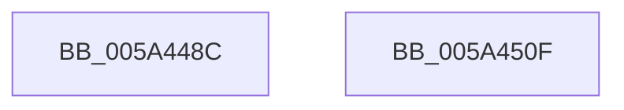

# IopLiveDumpTraceWriteBuffer

- RVA: `0x005A448C`–`0x005A4510` (길이 `132` bytes)
- VA: `0x00000001405A448C`
- 실행 섹션: `.text`
- PDB 이름 있음: `예`; PDB Function 태그: `아니요`
- unwind 정보 RVA: `0x000AF370`
- 디코드: `30`개 명령, `132/132` bytes 표시
- 미해석 바이트: `0` (있으면 어셈블리에 `.byte`로 보존)

> 이 문서는 커널 이미지의 기계어와 PDB 기호를 분석해 생성했습니다. 4번과 5번은 함수 원형과 자료형을 바이너리 사용 방식에서 추정한 C 해석이며 원본 소스 복구 결과는 아닙니다.

## 1. Dependencies

- 직접 호출 지점: **2**; 고유 호출 대상: **2**
- 직접 호출자로 확인된 함수: **1**
- RIP 상대 이미지 참조: **6**

### Outgoing calls
- `0x005A44F8` → [IopLiveDumpTraceEventGeneric](IopLiveDumpTraceEventGeneric_function_005A41E4.md) (function, `0x005A41E4`)
- `0x005A4505` → [_security_check_cookie](../6A/_security_check_cookie_function_006AC640.md) (function, `0x006AC640`)

### Direct callers
- [IopLiveDumpWriteBuffer](../3F/IopLiveDumpWriteBuffer_function_003F6688.md) at `0x003F6744`

### Static image references
- `0x005A4493` → RVA `0x00E0A740` (`.data`; read)
- `0x005A44A2` → RVA `0x006CADD0` (` ?? ::FNODOBFM::`string'`; read)
- `0x005A44B1` → RVA `0x006CAE10` (` ?? ::FNODOBFM::`string'`; read)
- `0x005A44B8` → RVA `0x006CADE0` (` ?? ::FNODOBFM::`string'`; read)
- `0x005A44CB` → RVA `0x006CAB20` (` ?? ::FNODOBFM::`string'`; read)
- `0x005A44D6` → RVA `0x006CADF0` (` ?? ::FNODOBFM::`string'`; read)

## 2. Other-region calls and transfers

- 다른 실행 섹션으로 향하는 call: **0**
- 별도 외부 분기/꼬리 이동을 확인하지 못했습니다.

## 3. Assembly (complete function range)

```asm
005A448C  4C 8B DC                        mov r11, rsp
005A448F  48 83 EC 78                     sub rsp, 0x78
005A4493  48 8B 05 A6 62 86 00            mov rax, qword ptr [rip + 0x8662a6]
005A449A  48 33 C4                        xor rax, rsp
005A449D  48 89 44 24 60                  mov qword ptr [rsp + 0x60], rax
005A44A2  48 8D 05 27 69 12 00            lea rax, [rip + 0x126927]
005A44A9  49 89 4B A8                     mov qword ptr [r11 - 0x58], rcx
005A44AD  49 89 43 C8                     mov qword ptr [r11 - 0x38], rax
005A44B1  48 8D 0D 58 69 12 00            lea rcx, [rip + 0x126958]
005A44B8  48 8D 05 21 69 12 00            lea rax, [rip + 0x126921]
005A44BF  4D 89 43 B8                     mov qword ptr [r11 - 0x48], r8
005A44C3  49 89 43 D0                     mov qword ptr [r11 - 0x30], rax
005A44C7  4D 8D 43 C8                     lea r8, [r11 - 0x38]
005A44CB  48 8D 05 4E 66 12 00            lea rax, [rip + 0x12664e]
005A44D2  49 89 43 D8                     mov qword ptr [r11 - 0x28], rax
005A44D6  48 8D 05 13 69 12 00            lea rax, [rip + 0x126913]
005A44DD  49 89 43 E0                     mov qword ptr [r11 - 0x20], rax
005A44E1  8B C2                           mov eax, edx
005A44E3  BA 04 00 00 00                  mov edx, 4
005A44E8  49 89 43 B0                     mov qword ptr [r11 - 0x50], rax
005A44EC  41 0F B6 C1                     movzx eax, r9b
005A44F0  4D 8D 4B A8                     lea r9, [r11 - 0x58]
005A44F4  49 89 43 C0                     mov qword ptr [r11 - 0x40], rax
005A44F8  E8 E7 FC FF FF                  call 0x1405a41e4
005A44FD  48 8B 4C 24 60                  mov rcx, qword ptr [rsp + 0x60]
005A4502  48 33 CC                        xor rcx, rsp
005A4505  E8 36 81 10 00                  call 0x1406ac640
005A450A  48 83 C4 78                     add rsp, 0x78
005A450E  C3                              ret
005A450F  CC                              int3
```

## 4. C-style interpretation (structured pseudocode)

```c
__int64 __fastcall IopLiveDumpTraceWriteBuffer(__int64 a1, int a2, __int64 a3, unsigned __int8 a4)
{
    __int64 result;
    __int64 v_rsp;
    unsigned __int64 v_stack_m18;

    v_rsp = (v_rsp) - (120);
    result = (*(unsigned __int64 *)(v_rip + 8807078)) ^ (v_rsp);
    v_stack_m18 = result;
    *(unsigned __int64 *)(v_rsp - 88) = a1;
    *(unsigned __int64 *)(v_rsp - 56) = v_rip + 1206567;
    *(unsigned __int64 *)(v_rsp - 72) = a3;
    *(unsigned __int64 *)(v_rsp - 48) = v_rip + 1206561;
    *(unsigned __int64 *)(v_rsp - 40) = v_rip + 1205838;
    *(unsigned __int64 *)(v_rsp - 32) = v_rip + 1206547;
    *(unsigned __int64 *)(v_rsp - 80) = (unsigned int)(a2);
    *(unsigned __int64 *)(v_rsp - 64) = a4;
    result = IopLiveDumpTraceEventGeneric(v_rip + 1206616, 4, v_rsp - 56, v_rsp - 88);
    a1 = (v_stack_m18) ^ (v_rsp);
    result = _security_check_cookie(a1, 4, v_rsp - 56, v_rsp - 88);
    v_rsp = (v_rsp) + (120);
    return result;
}
```

## 5. (Beta) C Style

```c
int64_t IopLiveDumpTraceWriteBuffer(int64_t Arg1, int32_t Arg2, int64_t Arg3, uint8_t Arg4)
{
    int64_t result;
    int64_t local_rsp;
    uint64_t v_stack_m18;

    local_rsp = (local_rsp) - (120);
    result = (*(uint64_t *)(v_rip + 0x8662A6)) ^ (local_rsp);
    v_stack_m18 = result;
    *(uint64_t *)(local_rsp - 0x58) = Arg1;
    *(uint64_t *)(local_rsp - 0x38) = v_rip + 1206567;
    *(uint64_t *)(local_rsp - 0x48) = Arg3;
    *(uint64_t *)(local_rsp - 0x30) = v_rip + 1206561;
    *(uint64_t *)(local_rsp - 0x28) = v_rip + 1205838;
    *(uint64_t *)(local_rsp - 0x20) = v_rip + 1206547;
    *(uint64_t *)(local_rsp - 0x50) = (uint32_t)(Arg2);
    *(uint64_t *)(local_rsp - 0x40) = Arg4;
    result = IopLiveDumpTraceEventGeneric(v_rip + 1206616, 4, local_rsp - 56, local_rsp - 88);
    Arg1 = (v_stack_m18) ^ (local_rsp);
    result = _security_check_cookie(Arg1, 4, local_rsp - 56, local_rsp - 88);
    local_rsp = (local_rsp) + (120);
    return result;
}
```

## 6. Execution-region graph

[열기: 2D/3D 그래프와 함수 탐색 컨트롤 패널](../../../control-panel.html?section=text&rva=0x005A448C&view=graph)

- 2D 그래프는 위에서 아래로 흐르고, 3D 그래프는 빈 공간을 드래그해 회전합니다. Shift+드래그는 이동, 휠은 확대·축소, 함수 노드 선택은 대상 보고서 이동입니다.

### Static fallback


