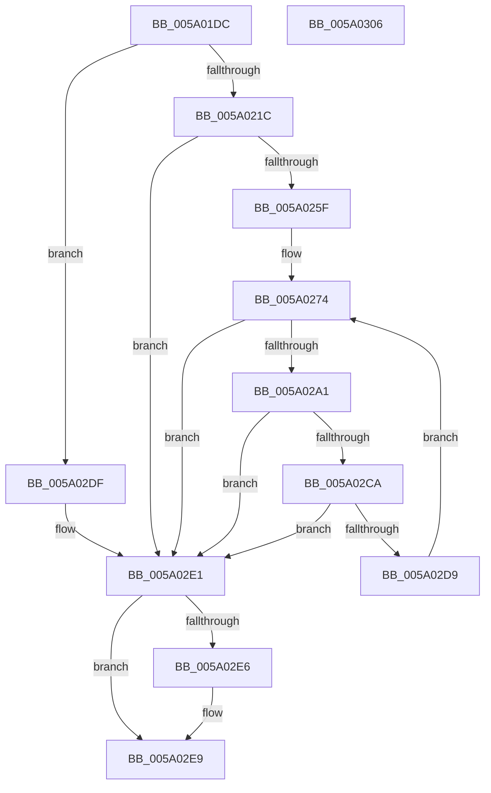

# IopLiveDumpWriteSecondaryData

- RVA: `0x005A01DC`–`0x005A0307` (길이 `299` bytes)
- VA: `0x00000001405A01DC`
- 실행 섹션: `.text`
- PDB 이름 있음: `예`; PDB Function 태그: `아니요`
- unwind 정보 RVA: `0x000C79DC`
- 디코드: `91`개 명령, `299/299` bytes 표시
- 미해석 바이트: `0` (있으면 어셈블리에 `.byte`로 보존)

> 이 문서는 커널 이미지의 기계어와 PDB 기호를 분석해 생성했습니다. 4번과 5번은 함수 원형과 자료형을 바이너리 사용 방식에서 추정한 C 해석이며 원본 소스 복구 결과는 아닙니다.

## 1. Dependencies

- 직접 호출 지점: **4**; 고유 호출 대상: **2**
- 직접 호출자로 확인된 함수: **1**
- RIP 상대 이미지 참조: **2**

### Outgoing calls
- `0x005A0250` → [IopLiveDumpWriteBuffer](../3F/IopLiveDumpWriteBuffer_function_003F6688.md) (function, `0x003F6688`)
- `0x005A0296` → [IopLiveDumpWriteBuffer](../3F/IopLiveDumpWriteBuffer_function_003F6688.md) (function, `0x003F6688`)
- `0x005A02BF` → [IopLiveDumpWriteBuffer](../3F/IopLiveDumpWriteBuffer_function_003F6688.md) (function, `0x003F6688`)
- `0x005A02F2` → [_security_check_cookie](../6A/_security_check_cookie_function_006AC640.md) (function, `0x006AC640`)

### Direct callers
- [sub_006EB65A](../6E/Unknown_function_006EB65A.md) at `0x006EB7C3`

### Static image references
- `0x005A01EE` → RVA `0x00E0A740` (`.data`; read)
- `0x005A021C` → RVA `0x00E0A74C` (`.data`; read)

## 2. Other-region calls and transfers

- 다른 실행 섹션으로 향하는 call: **0**
- 별도 외부 분기/꼬리 이동을 확인하지 못했습니다.

## 3. Assembly (complete function range)

```asm
005A01DC  40 55                           push rbp
005A01DE  53                              push rbx
005A01DF  56                              push rsi
005A01E0  57                              push rdi
005A01E1  41 54                           push r12
005A01E3  41 56                           push r14
005A01E5  41 57                           push r15
005A01E7  48 8B EC                        mov rbp, rsp
005A01EA  48 83 EC 70                     sub rsp, 0x70
005A01EE  48 8B 05 4B A5 86 00            mov rax, qword ptr [rip + 0x86a54b]
005A01F5  48 33 C4                        xor rax, rsp
005A01F8  48 89 45 F0                     mov qword ptr [rbp - 0x10], rax
005A01FC  48 8B 5A 08                     mov rbx, qword ptr [rdx + 8]
005A0200  33 FF                           xor edi, edi
005A0202  0F 57 C0                        xorps xmm0, xmm0
005A0205  49 8B F1                        mov rsi, r9
005A0208  4D 8B E0                        mov r12, r8
005A020B  4C 8B F9                        mov r15, rcx
005A020E  F3 0F 7F 45 D4                  movdqu xmmword ptr [rbp - 0x2c], xmm0
005A0213  48 85 DB                        test rbx, rbx
005A0216  0F 84 C3 00 00 00               je 0x1405a02df
005A021C  8B 05 2A A5 86 00               mov eax, dword ptr [rip + 0x86a52a]
005A0222  44 8D 47 10                     lea r8d, [rdi + 0x10]
005A0226  4C 8B 75 60                     mov r14, qword ptr [rbp + 0x60]
005A022A  48 8D 55 C0                     lea rdx, [rbp - 0x40]
005A022E  40 88 7C 24 28                  mov byte ptr [rsp + 0x28], dil
005A0233  4D 8B CC                        mov r9, r12
005A0236  44 89 45 C8                     mov dword ptr [rbp - 0x38], r8d
005A023A  4C 89 74 24 20                  mov qword ptr [rsp + 0x20], r14
005A023F  C7 45 C0 44 75 6D 70            mov dword ptr [rbp - 0x40], 0x706d7544
005A0246  C7 45 C4 42 6C 6F 62            mov dword ptr [rbp - 0x3c], 0x626f6c42
005A024D  89 45 CC                        mov dword ptr [rbp - 0x34], eax
005A0250  E8 33 64 E5 FF                  call 0x1403f6688
005A0255  8B C8                           mov ecx, eax
005A0257  85 C0                           test eax, eax
005A0259  0F 88 82 00 00 00               js 0x1405a02e1
005A025F  83 65 E8 00                     and dword ptr [rbp - 0x18], 0
005A0263  41 B8 20 00 00 00               mov r8d, 0x20
005A0269  83 65 EC 00                     and dword ptr [rbp - 0x14], 0
005A026D  8B 7D C8                        mov edi, dword ptr [rbp - 0x38]
005A0270  44 89 45 D0                     mov dword ptr [rbp - 0x30], r8d
005A0274  0F 10 03                        movups xmm0, xmmword ptr [rbx]
005A0277  C6 44 24 28 00                  mov byte ptr [rsp + 0x28], 0
005A027C  48 8D 55 D0                     lea rdx, [rbp - 0x30]
005A0280  4D 8B CC                        mov r9, r12
005A0283  4C 89 74 24 20                  mov qword ptr [rsp + 0x20], r14
005A0288  F3 0F 7F 45 D4                  movdqu xmmword ptr [rbp - 0x2c], xmm0
005A028D  8B 43 18                        mov eax, dword ptr [rbx + 0x18]
005A0290  49 8B CF                        mov rcx, r15
005A0293  89 45 E4                        mov dword ptr [rbp - 0x1c], eax
005A0296  E8 ED 63 E5 FF                  call 0x1403f6688
005A029B  8B C8                           mov ecx, eax
005A029D  85 C0                           test eax, eax
005A029F  78 40                           js 0x1405a02e1
005A02A1  8B 45 D0                        mov eax, dword ptr [rbp - 0x30]
005A02A4  4D 8B CC                        mov r9, r12
005A02A7  44 8B 43 18                     mov r8d, dword ptr [rbx + 0x18]
005A02AB  49 8B CF                        mov rcx, r15
005A02AE  48 8B 53 10                     mov rdx, qword ptr [rbx + 0x10]
005A02B2  48 03 F8                        add rdi, rax
005A02B5  C6 44 24 28 00                  mov byte ptr [rsp + 0x28], 0
005A02BA  4C 89 74 24 20                  mov qword ptr [rsp + 0x20], r14
005A02BF  E8 C4 63 E5 FF                  call 0x1403f6688
005A02C4  8B C8                           mov ecx, eax
005A02C6  85 C0                           test eax, eax
005A02C8  78 17                           js 0x1405a02e1
005A02CA  8B 43 18                        mov eax, dword ptr [rbx + 0x18]
005A02CD  48 8B 5B 20                     mov rbx, qword ptr [rbx + 0x20]
005A02D1  48 03 F8                        add rdi, rax
005A02D4  48 85 DB                        test rbx, rbx
005A02D7  74 08                           je 0x1405a02e1
005A02D9  44 8B 45 D0                     mov r8d, dword ptr [rbp - 0x30]
005A02DD  EB 95                           jmp 0x1405a0274
005A02DF  33 C9                           xor ecx, ecx
005A02E1  48 85 F6                        test rsi, rsi
005A02E4  74 03                           je 0x1405a02e9
005A02E6  48 89 3E                        mov qword ptr [rsi], rdi
005A02E9  8B C1                           mov eax, ecx
005A02EB  48 8B 4D F0                     mov rcx, qword ptr [rbp - 0x10]
005A02EF  48 33 CC                        xor rcx, rsp
005A02F2  E8 49 C3 10 00                  call 0x1406ac640
005A02F7  48 83 C4 70                     add rsp, 0x70
005A02FB  41 5F                           pop r15
005A02FD  41 5E                           pop r14
005A02FF  41 5C                           pop r12
005A0301  5F                              pop rdi
005A0302  5E                              pop rsi
005A0303  5B                              pop rbx
005A0304  5D                              pop rbp
005A0305  C3                              ret
005A0306  CC                              int3
```

## 4. C-style interpretation (structured pseudocode)

```c
__int64 __fastcall IopLiveDumpWriteSecondaryData(__int64 a1, __int64 a2, __int64 a3, __int64 a4, __int64 a5)
{
    __int64 result;
    __int64 v_rdi;
    __int64 v_rsp;
    unsigned __int64 v_stack_m48;
    unsigned int v_stack_m4C;
    unsigned int v_stack_m50;
    unsigned int v_stack_m54;
    unsigned __int64 v_stack_m64;
    unsigned int v_stack_m68;
    unsigned int v_stack_m6C;
    unsigned int v_stack_m70;
    unsigned int v_stack_m74;
    unsigned __int64 v_stack_m78;
    unsigned __int8 v_stack_m80;
    unsigned __int64 v_stack_m88;

    v_rsp = (v_rsp) - (112);
    result = (*(unsigned __int64 *)(v_rip + 8824139)) ^ (v_rsp);
    v_stack_m48 = result;
    v_rdi = 0;
    v_stack_m64 = v_xmm0;
    if (*(unsigned __int64 *)(a2 + 8) == 0) goto loc_005A02DF;
    v_stack_m80 = 0;
    v_stack_m70 = (unsigned int)(v_rdi + 16);
    v_stack_m88 = a5;
    v_stack_m78 = 0x706D7544ULL;
    v_stack_m74 = 0x626F6C42ULL;
    v_stack_m6C = (unsigned int)((unsigned int)(*(unsigned int *)(v_rip + 8824106)));
    result = IopLiveDumpWriteBuffer(a1, v_stack_m78, v_rdi + 16, a3);
    if (sign_flag) goto loc_005A02E1;
    v_stack_m68 = 32;
loc_005A0274:
    v_stack_m80 = 0;
    v_stack_m88 = a5;
    v_stack_m64 = v_xmm0;
    v_stack_m54 = (unsigned int)((unsigned int)(*(unsigned int *)(*(unsigned __int64 *)(a2 + 8) + 24)));
    result = IopLiveDumpWriteBuffer(a1, v_stack_m68, 32, a3);
    if (sign_flag) goto loc_005A02E1;
    v_rdi = ((unsigned int)(v_stack_m70)) + ((unsigned int)(v_stack_m68));
    v_stack_m80 = 0;
    v_stack_m88 = a5;
    result = IopLiveDumpWriteBuffer(a1, *(unsigned __int64 *)(*(unsigned __int64 *)(a2 + 8) + 16), (unsigned int)(*(unsigned int *)(*(unsigned __int64 *)(a2 + 8) + 24)), a3);
    if (sign_flag) goto loc_005A02E1;
    v_rdi = (v_rdi) + ((unsigned int)(*(unsigned int *)(*(unsigned __int64 *)(a2 + 8) + 24)));
    if (*(unsigned __int64 *)(*(unsigned __int64 *)(a2 + 8) + 32) == 0) goto loc_005A02E1;
    goto loc_005A0274;
loc_005A02DF:
    a1 = 0;
loc_005A02E1:
    if (a4 != 0) {
        *(unsigned __int64 *)(a4) = v_rdi;
    }
    a1 = (v_stack_m48) ^ (v_rsp);
    result = _security_check_cookie(a1, *(unsigned __int64 *)(*(unsigned __int64 *)(a2 + 8) + 16), (unsigned int)(v_stack_m68), a3);
    v_rsp = (v_rsp) + (112);
    return result;
}
```

## 5. (Beta) C Style

```c
int64_t IopLiveDumpWriteSecondaryData(int64_t Arg1, void *Arg2, int64_t Arg3, int64_t Arg4, int64_t Arg5)
{
    uint8_t *arg2 = (uint8_t *)Arg2;

    int64_t result;
    int64_t local_rdi;
    int64_t local_rsp;
    uint64_t v_stack_m48;
    uint32_t v_stack_m4C;
    uint32_t v_stack_m50;
    uint32_t v_stack_m54;
    uint64_t v_stack_m64;
    uint32_t v_stack_m68;
    uint32_t v_stack_m6C;
    uint32_t v_stack_m70;
    uint32_t v_stack_m74;
    uint64_t v_stack_m78;
    uint8_t v_stack_m80;
    uint64_t v_stack_m88;

    local_rsp = (local_rsp) - (112);
    result = (*(uint64_t *)(v_rip + 0x86A54B)) ^ (local_rsp);
    v_stack_m48 = result;
    local_rdi = 0;
    v_stack_m64 = v_xmm0;
    if (*(uint64_t *)(arg2 + 0x8) == 0) goto loc_005A02DF;
    v_stack_m80 = 0;
    v_stack_m70 = (uint32_t)(local_rdi + 16);
    v_stack_m88 = Arg5;
    v_stack_m78 = 0x706D7544ULL;
    v_stack_m74 = 0x626F6C42ULL;
    v_stack_m6C = (uint32_t)((uint32_t)(*(uint32_t *)(v_rip + 0x86A52A)));
    result = IopLiveDumpWriteBuffer(Arg1, v_stack_m78, local_rdi + 16, Arg3);
    if (sign_flag) goto loc_005A02E1;
    v_stack_m68 = 32;
loc_005A0274:
    v_stack_m80 = 0;
    v_stack_m88 = Arg5;
    v_stack_m64 = v_xmm0;
    v_stack_m54 = (uint32_t)((uint32_t)(*(uint32_t *)(*(uint64_t *)(arg2 + 0x8) + 0x18)));
    result = IopLiveDumpWriteBuffer(Arg1, v_stack_m68, 32, Arg3);
    if (sign_flag) goto loc_005A02E1;
    local_rdi = ((uint32_t)(v_stack_m70)) + ((uint32_t)(v_stack_m68));
    v_stack_m80 = 0;
    v_stack_m88 = Arg5;
    result = IopLiveDumpWriteBuffer(Arg1, *(uint64_t *)(*(uint64_t *)(arg2 + 0x8) + 0x10), (uint32_t)(*(uint32_t *)(*(uint64_t *)(arg2 + 0x8) + 0x18)), Arg3);
    if (sign_flag) goto loc_005A02E1;
    local_rdi = (local_rdi) + ((uint32_t)(*(uint32_t *)(*(uint64_t *)(arg2 + 0x8) + 0x18)));
    if (*(uint64_t *)(*(uint64_t *)(arg2 + 0x8) + 0x20) == 0) goto loc_005A02E1;
    goto loc_005A0274;
loc_005A02DF:
    Arg1 = 0;
loc_005A02E1:
    if (Arg4 != 0) {
        *(uint64_t *)(Arg4) = local_rdi;
    }
    Arg1 = (v_stack_m48) ^ (local_rsp);
    result = _security_check_cookie(Arg1, *(uint64_t *)(*(uint64_t *)(arg2 + 0x8) + 0x10), (uint32_t)(v_stack_m68), Arg3);
    local_rsp = (local_rsp) + (112);
    return result;
}
```

### 관측된 메모리 오프셋

구조체 형식이 확인되지 않은 접근은 인자 기준의 오프셋으로만 기록했습니다.

| 기준 인자 | 오프셋 표현 | 폭 (bit) | 접근 |
|---|---:|---:|---|
| `Arg2` | `+ 0x8` | `64` | `R` |

## 6. Execution-region graph

[열기: 2D/3D 그래프와 함수 탐색 컨트롤 패널](../../../control-panel.html?section=text&rva=0x005A01DC&view=graph)

- 2D 그래프는 위에서 아래로 흐르고, 3D 그래프는 빈 공간을 드래그해 회전합니다. Shift+드래그는 이동, 휠은 확대·축소, 함수 노드 선택은 대상 보고서 이동입니다.

### Static fallback


