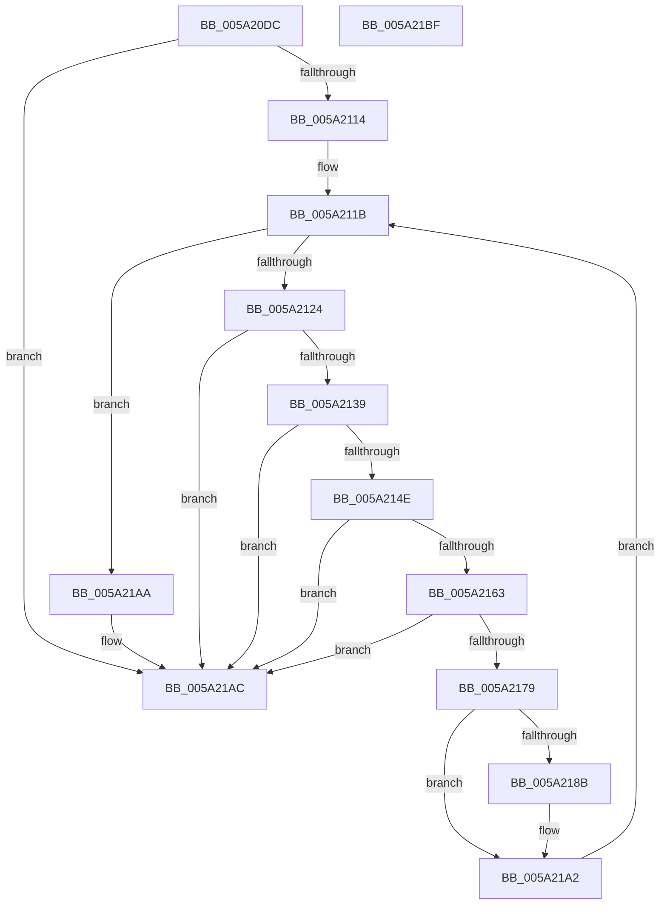

# IopMarkPagesForLoadedDriverInformation

- RVA: `0x005A20DC`–`0x005A21C0` (길이 `228` bytes)
- VA: `0x00000001405A20DC`
- 실행 섹션: `.text`
- PDB 이름 있음: `예`; PDB Function 태그: `아니요`
- unwind 정보 RVA: `0x00061768`
- 디코드: `67`개 명령, `228/228` bytes 표시
- 미해석 바이트: `0` (있으면 어셈블리에 `.byte`로 보존)

> 이 문서는 커널 이미지의 기계어와 PDB 기호를 분석해 생성했습니다. 4번과 5번은 함수 원형과 자료형을 바이너리 사용 방식에서 추정한 C 해석이며 원본 소스 복구 결과는 아닙니다.

## 1. Dependencies

- 직접 호출 지점: **7**; 고유 호출 대상: **2**
- 직접 호출자로 확인된 함수: **1**
- RIP 상대 이미지 참조: **1**

### Outgoing calls
- `0x005A2105` → [MmAddRangeToCrashDump](../67/MmAddRangeToCrashDump_function_0067D8B0.md) (function, `0x0067D8B0`)
- `0x005A2130` → [MmAddRangeToCrashDump](../67/MmAddRangeToCrashDump_function_0067D8B0.md) (function, `0x0067D8B0`)
- `0x005A2145` → [MmAddRangeToCrashDump](../67/MmAddRangeToCrashDump_function_0067D8B0.md) (function, `0x0067D8B0`)
- `0x005A215A` → [MmAddRangeToCrashDump](../67/MmAddRangeToCrashDump_function_0067D8B0.md) (function, `0x0067D8B0`)
- `0x005A216E` → [MmAddRangeToCrashDump](../67/MmAddRangeToCrashDump_function_0067D8B0.md) (function, `0x0067D8B0`)
- `0x005A2181` → [MmGetLoadedModuleImageAdditionalTablesAddress](../3D/MmGetLoadedModuleImageAdditionalTablesAddress_function_003D4CF0.md) (function, `0x003D4CF0`)
- `0x005A2196` → [MmAddRangeToCrashDump](../67/MmAddRangeToCrashDump_function_0067D8B0.md) (function, `0x0067D8B0`)

### Direct callers
- [IopAddMiniDumpPagesToPartialKernelDump](IopAddMiniDumpPagesToPartialKernelDump_function_005A16F8.md) at `0x005A17BE`

### Static image references
- `0x005A20F0` → RVA `0x00EF54C0` (`.data`; read)

## 2. Other-region calls and transfers

- 다른 실행 섹션으로 향하는 call: **0**
- 별도 외부 분기/꼬리 이동을 확인하지 못했습니다.

## 3. Assembly (complete function range)

```asm
005A20DC  48 89 5C 24 08                  mov qword ptr [rsp + 8], rbx
005A20E1  48 89 6C 24 18                  mov qword ptr [rsp + 0x18], rbp
005A20E6  56                              push rsi
005A20E7  57                              push rdi
005A20E8  41 56                           push r14
005A20EA  48 83 EC 20                     sub rsp, 0x20
005A20EE  33 ED                           xor ebp, ebp
005A20F0  4C 8D 35 C9 33 95 00            lea r14, [rip + 0x9533c9]
005A20F7  49 8B D6                        mov rdx, r14
005A20FA  89 6C 24 48                     mov dword ptr [rsp + 0x48], ebp
005A20FE  48 8B F1                        mov rsi, rcx
005A2101  44 8D 45 10                     lea r8d, [rbp + 0x10]
005A2105  E8 A6 B7 0D 00                  call 0x14067d8b0
005A210A  8B F8                           mov edi, eax
005A210C  85 C0                           test eax, eax
005A210E  0F 88 98 00 00 00               js 0x1405a21ac
005A2114  48 8B 1D A5 33 95 00            mov rbx, qword ptr [rip + 0x9533a5]
005A211B  49 3B DE                        cmp rbx, r14
005A211E  0F 84 86 00 00 00               je 0x1405a21aa
005A2124  41 B8 A0 00 00 00               mov r8d, 0xa0
005A212A  48 8B D3                        mov rdx, rbx
005A212D  48 8B CE                        mov rcx, rsi
005A2130  E8 7B B7 0D 00                  call 0x14067d8b0
005A2135  85 C0                           test eax, eax
005A2137  78 73                           js 0x1405a21ac
005A2139  44 0F B7 43 58                  movzx r8d, word ptr [rbx + 0x58]
005A213E  48 8B CE                        mov rcx, rsi
005A2141  48 8B 53 60                     mov rdx, qword ptr [rbx + 0x60]
005A2145  E8 66 B7 0D 00                  call 0x14067d8b0
005A214A  85 C0                           test eax, eax
005A214C  78 5E                           js 0x1405a21ac
005A214E  44 0F B7 43 48                  movzx r8d, word ptr [rbx + 0x48]
005A2153  48 8B CE                        mov rcx, rsi
005A2156  48 8B 53 50                     mov rdx, qword ptr [rbx + 0x50]
005A215A  E8 51 B7 0D 00                  call 0x14067d8b0
005A215F  85 C0                           test eax, eax
005A2161  78 49                           js 0x1405a21ac
005A2163  44 8B 43 40                     mov r8d, dword ptr [rbx + 0x40]
005A2167  48 8B CE                        mov rcx, rsi
005A216A  48 8B 53 30                     mov rdx, qword ptr [rbx + 0x30]
005A216E  E8 3D B7 0D 00                  call 0x14067d8b0
005A2173  8B F8                           mov edi, eax
005A2175  85 C0                           test eax, eax
005A2177  78 33                           js 0x1405a21ac
005A2179  48 8D 54 24 48                  lea rdx, [rsp + 0x48]
005A217E  48 8B CB                        mov rcx, rbx
005A2181  E8 6A 2B E3 FF                  call 0x1403d4cf0
005A2186  48 85 C0                        test rax, rax
005A2189  74 17                           je 0x1405a21a2
005A218B  44 8B 44 24 48                  mov r8d, dword ptr [rsp + 0x48]
005A2190  48 8B D0                        mov rdx, rax
005A2193  48 8B CE                        mov rcx, rsi
005A2196  E8 15 B7 0D 00                  call 0x14067d8b0
005A219B  85 C0                           test eax, eax
005A219D  8B F8                           mov edi, eax
005A219F  0F 48 FD                        cmovs edi, ebp
005A21A2  48 8B 1B                        mov rbx, qword ptr [rbx]
005A21A5  E9 71 FF FF FF                  jmp 0x1405a211b
005A21AA  8B C7                           mov eax, edi
005A21AC  48 8B 5C 24 40                  mov rbx, qword ptr [rsp + 0x40]
005A21B1  48 8B 6C 24 50                  mov rbp, qword ptr [rsp + 0x50]
005A21B6  48 83 C4 20                     add rsp, 0x20
005A21BA  41 5E                           pop r14
005A21BC  5F                              pop rdi
005A21BD  5E                              pop rsi
005A21BE  C3                              ret
005A21BF  CC                              int3
```

## 4. C-style interpretation (structured pseudocode)

```c
__int64 __fastcall IopMarkPagesForLoadedDriverInformation(__int64 a1)
{
    __int64 result;
    __int64 v_rbp;
    __int64 v_rdi;
    __int64 v_rsp;
    unsigned int v_stack_p10;
    unsigned __int64 v_stack_p18;
    unsigned __int64 v_stack_p8;

    v_stack_p8 = v_rbx;
    v_stack_p18 = v_rbp;
    v_rsp = (v_rsp) - (32);
    v_rbp = 0;
    v_stack_p10 = 0;
    result = MmAddRangeToCrashDump(a1, v_rip + 9778121, v_rbp + 16, a4);
    if (sign_flag) goto loc_005A21AC;
loc_005A211B:
    if ((*(unsigned __int64 *)(v_rip + 9778085)) == (v_rip + 9778121)) goto loc_005A21AA;
    result = MmAddRangeToCrashDump(a1, *(unsigned __int64 *)(v_rip + 9778085), 160, a4);
    if (sign_flag) goto loc_005A21AC;
    result = MmAddRangeToCrashDump(a1, *(unsigned __int64 *)(*(unsigned __int64 *)(v_rip + 9778085) + 96), *(unsigned __int16 *)(*(unsigned __int64 *)(v_rip + 9778085) + 88), a4);
    if (sign_flag) goto loc_005A21AC;
    result = MmAddRangeToCrashDump(a1, *(unsigned __int64 *)(*(unsigned __int64 *)(v_rip + 9778085) + 80), *(unsigned __int16 *)(*(unsigned __int64 *)(v_rip + 9778085) + 72), a4);
    if (sign_flag) goto loc_005A21AC;
    result = MmAddRangeToCrashDump(a1, *(unsigned __int64 *)(*(unsigned __int64 *)(v_rip + 9778085) + 48), (unsigned int)(*(unsigned int *)(*(unsigned __int64 *)(v_rip + 9778085) + 64)), a4);
    if (sign_flag) goto loc_005A21AC;
    result = MmGetLoadedModuleImageAdditionalTablesAddress(*(unsigned __int64 *)(v_rip + 9778085), v_stack_p10, (unsigned int)(*(unsigned int *)(*(unsigned __int64 *)(v_rip + 9778085) + 64)), a4);
    v_rdi = (unsigned int)((unsigned int)(result));
    if (result != 0) {
        a3 = v_stack_p10;
        a2 = result;
        a1 = a1;
        result = MmAddRangeToCrashDump(a1, a2, a3, a4);
        v_rdi = (unsigned int)(result);
        if (sign_flag) { v_rdi = 0; }
    }
    goto loc_005A211B;
loc_005A21AA:
loc_005A21AC:
    v_rsp = (v_rsp) + (32);
    return (unsigned int)((unsigned int)(v_rdi));
}
```

## 5. (Beta) C Style

```c
int64_t IopMarkPagesForLoadedDriverInformation(int64_t Arg1)
{
    int64_t result;
    int64_t local_rbp;
    int64_t local_rdi;
    int64_t local_rsp;
    uint32_t v_stack_p10;
    uint64_t v_stack_p18;
    uint64_t v_stack_p8;

    v_stack_p8 = local_rbx;
    v_stack_p18 = local_rbp;
    local_rsp = (local_rsp) - (32);
    local_rbp = 0;
    v_stack_p10 = 0;
    result = MmAddRangeToCrashDump(Arg1, v_rip + 9778121, local_rbp + 16, a4);
    if (sign_flag) goto loc_005A21AC;
loc_005A211B:
    if ((*(uint64_t *)(v_rip + 0x9533A5)) == (v_rip + 9778121)) goto loc_005A21AA;
    result = MmAddRangeToCrashDump(Arg1, *(uint64_t *)(v_rip + 0x9533A5), 160, a4);
    if (sign_flag) goto loc_005A21AC;
    result = MmAddRangeToCrashDump(Arg1, *(uint64_t *)(*(uint64_t *)(v_rip + 0x9533A5) + 0x60), *(uint16_t *)(*(uint64_t *)(v_rip + 0x9533A5) + 0x58), a4);
    if (sign_flag) goto loc_005A21AC;
    result = MmAddRangeToCrashDump(Arg1, *(uint64_t *)(*(uint64_t *)(v_rip + 0x9533A5) + 0x50), *(uint16_t *)(*(uint64_t *)(v_rip + 0x9533A5) + 0x48), a4);
    if (sign_flag) goto loc_005A21AC;
    result = MmAddRangeToCrashDump(Arg1, *(uint64_t *)(*(uint64_t *)(v_rip + 0x9533A5) + 0x30), (uint32_t)(*(uint32_t *)(*(uint64_t *)(v_rip + 0x9533A5) + 0x40)), a4);
    if (sign_flag) goto loc_005A21AC;
    result = MmGetLoadedModuleImageAdditionalTablesAddress(*(uint64_t *)(v_rip + 0x9533A5), v_stack_p10, (uint32_t)(*(uint32_t *)(*(uint64_t *)(v_rip + 0x9533A5) + 0x40)), a4);
    local_rdi = (uint32_t)((uint32_t)(result));
    if (result != 0) {
        a3 = v_stack_p10;
        a2 = result;
        Arg1 = Arg1;
        result = MmAddRangeToCrashDump(Arg1, a2, a3, a4);
        local_rdi = (uint32_t)(result);
        if (sign_flag) { local_rdi = 0; }
    }
    goto loc_005A211B;
loc_005A21AA:
loc_005A21AC:
    local_rsp = (local_rsp) + (32);
    return (uint32_t)((uint32_t)(local_rdi));
}
```

## 6. Execution-region graph

[열기: 2D/3D 그래프와 함수 탐색 컨트롤 패널](../../../control-panel.html?section=text&rva=0x005A20DC&view=graph)

- 2D 그래프는 위에서 아래로 흐르고, 3D 그래프는 빈 공간을 드래그해 회전합니다. Shift+드래그는 이동, 휠은 확대·축소, 함수 노드 선택은 대상 보고서 이동입니다.

### Static fallback


