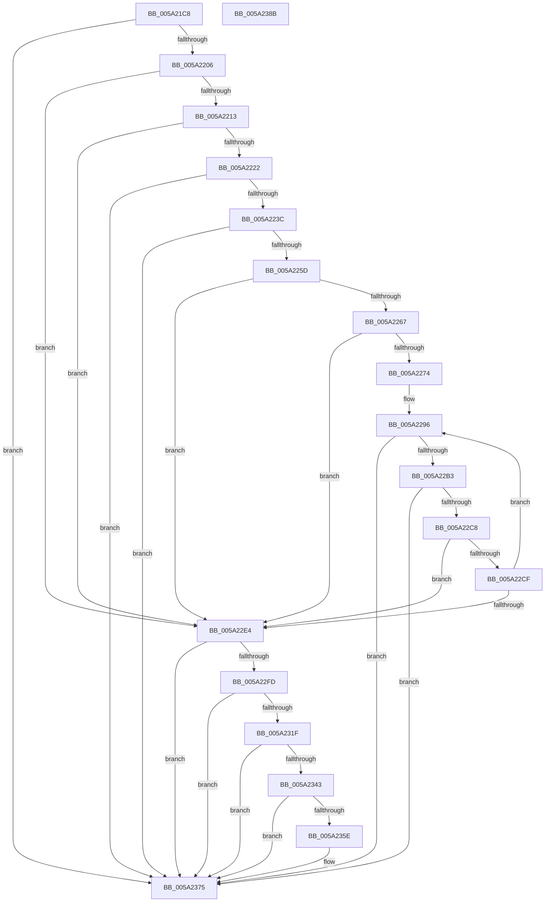

# IopMarkPagesForProcessorData

- RVA: `0x005A21C8`–`0x005A238C` (길이 `452` bytes)
- VA: `0x00000001405A21C8`
- 실행 섹션: `.text`
- PDB 이름 있음: `예`; PDB Function 태그: `아니요`
- unwind 정보 RVA: `0x000BE9D0`
- 디코드: `110`개 명령, `452/452` bytes 표시
- 미해석 바이트: `0` (있으면 어셈블리에 `.byte`로 보존)

> 이 문서는 커널 이미지의 기계어와 PDB 기호를 분석해 생성했습니다. 4번과 5번은 함수 원형과 자료형을 바이너리 사용 방식에서 추정한 C 해석이며 원본 소스 복구 결과는 아닙니다.

## 1. Dependencies

- 직접 호출 지점: **14**; 고유 호출 대상: **5**
- 직접 호출자로 확인된 함수: **1**
- RIP 상대 이미지 참조: **2**

### Outgoing calls
- `0x005A21F9` → [MmAddRangeToCrashDump](../67/MmAddRangeToCrashDump_function_0067D8B0.md) (function, `0x0067D8B0`)
- `0x005A2215` → [MmIsAddressValidEx](../27/MmIsAddressValidEx_function_0027FDD0.md) (function, `0x0027FDD0`)
- `0x005A222F` → [MmAddRangeToCrashDump](../67/MmAddRangeToCrashDump_function_0067D8B0.md) (function, `0x0067D8B0`)
- `0x005A2250` → [MmAddRangeToCrashDump](../67/MmAddRangeToCrashDump_function_0067D8B0.md) (function, `0x0067D8B0`)
- `0x005A227F` → [memset](../6C/memset_function_006C6C40.md) (function, `0x006C6C40`)
- `0x005A2291` → [KeGetNextKernelStackSegment](../41/KeGetNextKernelStackSegment_function_00417410.md) (function, `0x00417410`)
- `0x005A22A6` → [MmAddRangeToCrashDump](../67/MmAddRangeToCrashDump_function_0067D8B0.md) (function, `0x0067D8B0`)
- `0x005A22BB` → [IopAddStackSegmentKernelShadowStackToDump](IopAddStackSegmentKernelShadowStackToDump_function_005A1884.md) (function, `0x005A1884`)
- `0x005A22DB` → [KeGetNextKernelStackSegment](../41/KeGetNextKernelStackSegment_function_00417410.md) (function, `0x00417410`)
- `0x005A22F4` → [MmAddRangeToCrashDump](../67/MmAddRangeToCrashDump_function_0067D8B0.md) (function, `0x0067D8B0`)
- `0x005A2316` → [MmAddRangeToCrashDump](../67/MmAddRangeToCrashDump_function_0067D8B0.md) (function, `0x0067D8B0`)
- `0x005A233A` → [MmAddRangeToCrashDump](../67/MmAddRangeToCrashDump_function_0067D8B0.md) (function, `0x0067D8B0`)
- `0x005A2355` → [MmAddRangeToCrashDump](../67/MmAddRangeToCrashDump_function_0067D8B0.md) (function, `0x0067D8B0`)
- `0x005A2370` → [MmAddRangeToCrashDump](../67/MmAddRangeToCrashDump_function_0067D8B0.md) (function, `0x0067D8B0`)

### Direct callers
- [IopAddLiveDumpPagesToPartialKernelDump](IopAddLiveDumpPagesToPartialKernelDump_function_005A13AC.md) at `0x005A14D3`

### Static image references
- `0x005A21DE` → RVA `0x00FC8C40` (`ALMOSTRO`; read)
- `0x005A225D` → RVA `0x00E0A9B4` (`.data`; read)

## 2. Other-region calls and transfers

- 다른 실행 섹션으로 향하는 call: **0**
- 별도 외부 분기/꼬리 이동을 확인하지 못했습니다.

## 3. Assembly (complete function range)

```asm
005A21C8  48 89 5C 24 08                  mov qword ptr [rsp + 8], rbx
005A21CD  48 89 6C 24 10                  mov qword ptr [rsp + 0x10], rbp
005A21D2  48 89 74 24 18                  mov qword ptr [rsp + 0x18], rsi
005A21D7  57                              push rdi
005A21D8  48 83 EC 60                     sub rsp, 0x60
005A21DC  8B C2                           mov eax, edx
005A21DE  48 8D 1D 5B 6A A2 00            lea rbx, [rip + 0xa26a5b]
005A21E5  41 B8 80 D0 00 00               mov r8d, 0xd080
005A21EB  48 8B F9                        mov rdi, rcx
005A21EE  48 8B 1C C3                     mov rbx, qword ptr [rbx + rax*8]
005A21F2  48 8D 93 80 FE FF FF            lea rdx, [rbx - 0x180]
005A21F9  E8 B2 B6 0D 00                  call 0x14067d8b0
005A21FE  85 C0                           test eax, eax
005A2200  0F 88 6F 01 00 00               js 0x1405a2375
005A2206  48 8B 4B 08                     mov rcx, qword ptr [rbx + 8]
005A220A  48 85 C9                        test rcx, rcx
005A220D  0F 84 D1 00 00 00               je 0x1405a22e4
005A2213  33 D2                           xor edx, edx
005A2215  E8 B6 DB CD FF                  call 0x14027fdd0
005A221A  84 C0                           test al, al
005A221C  0F 84 C2 00 00 00               je 0x1405a22e4
005A2222  48 8B 53 08                     mov rdx, qword ptr [rbx + 8]
005A2226  41 B8 98 07 00 00               mov r8d, 0x798
005A222C  48 8B CF                        mov rcx, rdi
005A222F  E8 7C B6 0D 00                  call 0x14067d8b0
005A2234  85 C0                           test eax, eax
005A2236  0F 88 39 01 00 00               js 0x1405a2375
005A223C  48 8B 43 08                     mov rax, qword ptr [rbx + 8]
005A2240  41 B8 40 08 00 00               mov r8d, 0x840
005A2246  48 8B CF                        mov rcx, rdi
005A2249  48 8B 90 B8 00 00 00            mov rdx, qword ptr [rax + 0xb8]
005A2250  E8 5B B6 0D 00                  call 0x14067d8b0
005A2255  85 C0                           test eax, eax
005A2257  0F 88 18 01 00 00               js 0x1405a2375
005A225D  8B 05 51 87 86 00               mov eax, dword ptr [rip + 0x868751]
005A2263  A8 02                           test al, 2
005A2265  74 7D                           je 0x1405a22e4
005A2267  48 8B 6B 08                     mov rbp, qword ptr [rbx + 8]
005A226B  F7 45 78 00 00 02 00            test dword ptr [rbp + 0x78], 0x20000
005A2272  74 70                           je 0x1405a22e4
005A2274  33 D2                           xor edx, edx
005A2276  48 8D 4C 24 20                  lea rcx, [rsp + 0x20]
005A227B  44 8D 42 40                     lea r8d, [rdx + 0x40]
005A227F  E8 BC 49 12 00                  call 0x1406c6c40
005A2284  41 B0 01                        mov r8b, 1
005A2287  48 8D 54 24 20                  lea rdx, [rsp + 0x20]
005A228C  48 8B CD                        mov rcx, rbp
005A228F  33 F6                           xor esi, esi
005A2291  E8 7A 51 E7 FF                  call 0x140417410
005A2296  48 8B 54 24 28                  mov rdx, qword ptr [rsp + 0x28]
005A229B  48 8B CF                        mov rcx, rdi
005A229E  4C 8B 44 24 20                  mov r8, qword ptr [rsp + 0x20]
005A22A3  4C 2B C2                        sub r8, rdx
005A22A6  E8 05 B6 0D 00                  call 0x14067d8b0
005A22AB  85 C0                           test eax, eax
005A22AD  0F 88 C2 00 00 00               js 0x1405a2375
005A22B3  48 8D 54 24 20                  lea rdx, [rsp + 0x20]
005A22B8  48 8B CF                        mov rcx, rdi
005A22BB  E8 C4 F5 FF FF                  call 0x1405a1884
005A22C0  85 C0                           test eax, eax
005A22C2  0F 88 AD 00 00 00               js 0x1405a2375
005A22C8  FF C6                           inc esi
005A22CA  83 FE 64                        cmp esi, 0x64
005A22CD  73 15                           jae 0x1405a22e4
005A22CF  48 8B 4B 08                     mov rcx, qword ptr [rbx + 8]
005A22D3  48 8D 54 24 20                  lea rdx, [rsp + 0x20]
005A22D8  45 33 C0                        xor r8d, r8d
005A22DB  E8 30 51 E7 FF                  call 0x140417410
005A22E0  84 C0                           test al, al
005A22E2  75 B2                           jne 0x1405a2296
005A22E4  48 8B 93 C0 8F 00 00            mov rdx, qword ptr [rbx + 0x8fc0]
005A22EB  41 B8 D0 04 00 00               mov r8d, 0x4d0
005A22F1  48 8B CF                        mov rcx, rdi
005A22F4  E8 B7 B5 0D 00                  call 0x14067d8b0
005A22F9  85 C0                           test eax, eax
005A22FB  78 78                           js 0x1405a2375
005A22FD  48 8B 83 C0 8F 00 00            mov rax, qword ptr [rbx + 0x8fc0]
005A2304  BE 00 20 00 00                  mov esi, 0x2000
005A2309  44 8B C6                        mov r8d, esi
005A230C  48 8B CF                        mov rcx, rdi
005A230F  48 8B 90 98 00 00 00            mov rdx, qword ptr [rax + 0x98]
005A2316  E8 95 B5 0D 00                  call 0x14067d8b0
005A231B  85 C0                           test eax, eax
005A231D  78 56                           js 0x1405a2375
005A231F  48 8B 83 C0 8F 00 00            mov rax, qword ptr [rbx + 0x8fc0]
005A2326  44 8B C6                        mov r8d, esi
005A2329  48 8B CF                        mov rcx, rdi
005A232C  48 8B 90 F8 00 00 00            mov rdx, qword ptr [rax + 0xf8]
005A2333  48 81 EA 00 10 00 00            sub rdx, 0x1000
005A233A  E8 71 B5 0D 00                  call 0x14067d8b0
005A233F  85 C0                           test eax, eax
005A2341  78 32                           js 0x1405a2375
005A2343  48 8B 93 58 01 00 00            mov rdx, qword ptr [rbx + 0x158]
005A234A  48 8B CF                        mov rcx, rdi
005A234D  44 0F B7 83 56 01 00 00         movzx r8d, word ptr [rbx + 0x156]
005A2355  E8 56 B5 0D 00                  call 0x14067d8b0
005A235A  85 C0                           test eax, eax
005A235C  78 17                           js 0x1405a2375
005A235E  48 8B 93 68 01 00 00            mov rdx, qword ptr [rbx + 0x168]
005A2365  48 8B CF                        mov rcx, rdi
005A2368  44 0F B7 83 66 01 00 00         movzx r8d, word ptr [rbx + 0x166]
005A2370  E8 3B B5 0D 00                  call 0x14067d8b0
005A2375  4C 8D 5C 24 60                  lea r11, [rsp + 0x60]
005A237A  49 8B 5B 10                     mov rbx, qword ptr [r11 + 0x10]
005A237E  49 8B 6B 18                     mov rbp, qword ptr [r11 + 0x18]
005A2382  49 8B 73 20                     mov rsi, qword ptr [r11 + 0x20]
005A2386  49 8B E3                        mov rsp, r11
005A2389  5F                              pop rdi
005A238A  C3                              ret
005A238B  CC                              int3
```

## 4. C-style interpretation (structured pseudocode)

```c
__int64 __fastcall IopMarkPagesForProcessorData(__int64 a1, int a2)
{
    __int64 result;
    __int64 v_rsi;
    __int64 v_rsp;
    unsigned __int64 v_stack_m40;
    unsigned __int64 v_stack_m48;
    unsigned __int64 v_stack_m8;
    unsigned __int64 v_stack_p10;
    unsigned __int64 v_stack_p18;
    unsigned __int64 v_stack_p8;

    v_stack_p8 = v_rbx;
    v_stack_p10 = v_rbp;
    v_stack_p18 = v_rsi;
    v_rsp = (v_rsp) - (96);
    result = MmAddRangeToCrashDump(a1, *(unsigned __int64 *)(v_rip + 10644059 + (unsigned int)(a2) * 8) - 384, (unsigned int)(0xD080ULL), a4);
    if (sign_flag) goto loc_005A2375;
    if (*(unsigned __int64 *)(*(unsigned __int64 *)(v_rip + 10644059 + (unsigned int)(a2) * 8) + 8) == 0) goto loc_005A22E4;
    a2 = 0;
    result = MmIsAddressValidEx(*(unsigned __int64 *)(*(unsigned __int64 *)(v_rip + 10644059 + (unsigned int)(a2) * 8) + 8), a2, (unsigned int)(0xD080ULL), a4);
    if ((unsigned __int8)(result) == 0) goto loc_005A22E4;
    result = MmAddRangeToCrashDump(a1, *(unsigned __int64 *)(*(unsigned __int64 *)(v_rip + 10644059 + (unsigned int)(a2) * 8) + 8), (unsigned int)(0x798ULL), a4);
    if (sign_flag) goto loc_005A2375;
    result = MmAddRangeToCrashDump(a1, *(unsigned __int64 *)(*(unsigned __int64 *)(*(unsigned __int64 *)(v_rip + 10644059 + (unsigned int)(a2) * 8) + 8) + 184), (unsigned int)(0x840ULL), a4);
    if (sign_flag) goto loc_005A2375;
    if ((((unsigned __int8)((unsigned int)(*(unsigned int *)(v_rip + 8816465)))) & (2)) == 0) goto loc_005A22E4;
    if (((*(unsigned int *)(*(unsigned __int64 *)(*(unsigned __int64 *)(v_rip + 10644059 + (unsigned int)(a2) * 8) + 8) + 120)) & (0x20000ULL)) == 0) goto loc_005A22E4;
    a2 = 0;
    result = memset(v_stack_m48, a2, a2 + 64, a4);
    v_rsi = 0;
    result = KeGetNextKernelStackSegment(*(unsigned __int64 *)(*(unsigned __int64 *)(v_rip + 10644059 + (unsigned int)(a2) * 8) + 8), v_stack_m48, 1, a4);
loc_005A2296:
    a3 = (v_stack_m48) - (v_stack_m40);
    result = MmAddRangeToCrashDump(a1, v_stack_m40, a3, a4);
    if (sign_flag) goto loc_005A2375;
    result = IopAddStackSegmentKernelShadowStackToDump(a1, v_stack_m48, a3, a4);
    if (sign_flag) goto loc_005A2375;
    v_rsi = (unsigned int)((v_rsi) + 1);
    if (((unsigned int)(v_rsi)) >= 100) goto loc_005A22E4;
    a3 = 0;
    result = KeGetNextKernelStackSegment(*(unsigned __int64 *)(*(unsigned __int64 *)(v_rip + 10644059 + (unsigned int)(a2) * 8) + 8), v_stack_m48, a3, a4);
    if ((unsigned __int8)(result) != 0) goto loc_005A2296;
loc_005A22E4:
    result = MmAddRangeToCrashDump(a1, *(unsigned __int64 *)(*(unsigned __int64 *)(v_rip + 10644059 + (unsigned int)(a2) * 8) + 36800), (unsigned int)(0x4D0ULL), a4);
    if (sign_flag) goto loc_005A2375;
    result = MmAddRangeToCrashDump(a1, *(unsigned __int64 *)(*(unsigned __int64 *)(*(unsigned __int64 *)(v_rip + 10644059 + (unsigned int)(a2) * 8) + 36800) + 152), (unsigned int)((unsigned int)((unsigned int)(0x2000ULL))), a4);
    if (sign_flag) goto loc_005A2375;
    a2 = (*(unsigned __int64 *)(*(unsigned __int64 *)(*(unsigned __int64 *)(v_rip + 10644059 + (unsigned int)(a2) * 8) + 36800) + 248)) - (0x1000ULL);
    result = MmAddRangeToCrashDump(a1, a2, (unsigned int)((unsigned int)((unsigned int)(0x2000ULL))), a4);
    if (sign_flag) goto loc_005A2375;
    result = MmAddRangeToCrashDump(a1, *(unsigned __int64 *)(*(unsigned __int64 *)(v_rip + 10644059 + (unsigned int)(a2) * 8) + 344), *(unsigned __int16 *)(*(unsigned __int64 *)(v_rip + 10644059 + (unsigned int)(a2) * 8) + 342), a4);
    if (!(sign_flag)) {
        a2 = *(unsigned __int64 *)(*(unsigned __int64 *)(v_rip + 10644059 + (unsigned int)(a2) * 8) + 360);
        a1 = a1;
        a3 = *(unsigned __int16 *)(*(unsigned __int64 *)(v_rip + 10644059 + (unsigned int)(a2) * 8) + 358);
        result = MmAddRangeToCrashDump(a1, a2, a3, a4);
    }
    return result;
}
```

## 5. (Beta) C Style

```c
int64_t IopMarkPagesForProcessorData(int64_t Arg1, int32_t Arg2)
{
    int64_t result;
    int64_t local_rsi;
    int64_t local_rsp;
    uint64_t v_stack_m40;
    uint64_t v_stack_m48;
    uint64_t v_stack_m8;
    uint64_t v_stack_p10;
    uint64_t v_stack_p18;
    uint64_t v_stack_p8;

    v_stack_p8 = local_rbx;
    v_stack_p10 = local_rbp;
    v_stack_p18 = local_rsi;
    local_rsp = (local_rsp) - (96);
    result = MmAddRangeToCrashDump(Arg1, *(uint64_t *)(v_rip + 0xA26A5B + (uint32_t)(Arg2) * 8) - 384, (uint32_t)(0xD080ULL), a4);
    if (sign_flag) goto loc_005A2375;
    if (*(uint64_t *)(*(uint64_t *)(v_rip + 0xA26A5B + (uint32_t)(Arg2) * 8) + 0x8) == 0) goto loc_005A22E4;
    Arg2 = 0;
    result = MmIsAddressValidEx(*(uint64_t *)(*(uint64_t *)(v_rip + 0xA26A5B + (uint32_t)(Arg2) * 8) + 0x8), Arg2, (uint32_t)(0xD080ULL), a4);
    if ((uint8_t)(result) == 0) goto loc_005A22E4;
    result = MmAddRangeToCrashDump(Arg1, *(uint64_t *)(*(uint64_t *)(v_rip + 0xA26A5B + (uint32_t)(Arg2) * 8) + 0x8), (uint32_t)(0x798ULL), a4);
    if (sign_flag) goto loc_005A2375;
    result = MmAddRangeToCrashDump(Arg1, *(uint64_t *)(*(uint64_t *)(*(uint64_t *)(v_rip + 0xA26A5B + (uint32_t)(Arg2) * 8) + 0x8) + 0xB8), (uint32_t)(0x840ULL), a4);
    if (sign_flag) goto loc_005A2375;
    if ((((uint8_t)((uint32_t)(*(uint32_t *)(v_rip + 0x868751)))) & (2)) == 0) goto loc_005A22E4;
    if (((*(uint32_t *)(*(uint64_t *)(*(uint64_t *)(v_rip + 0xA26A5B + (uint32_t)(Arg2) * 8) + 0x8) + 0x78)) & (0x20000ULL)) == 0) goto loc_005A22E4;
    Arg2 = 0;
    result = memset(v_stack_m48, Arg2, Arg2 + 64, a4);
    local_rsi = 0;
    result = KeGetNextKernelStackSegment(*(uint64_t *)(*(uint64_t *)(v_rip + 0xA26A5B + (uint32_t)(Arg2) * 8) + 0x8), v_stack_m48, 1, a4);
loc_005A2296:
    a3 = (v_stack_m48) - (v_stack_m40);
    result = MmAddRangeToCrashDump(Arg1, v_stack_m40, a3, a4);
    if (sign_flag) goto loc_005A2375;
    result = IopAddStackSegmentKernelShadowStackToDump(Arg1, v_stack_m48, a3, a4);
    if (sign_flag) goto loc_005A2375;
    local_rsi = (uint32_t)((local_rsi) + 1);
    if (((uint32_t)(local_rsi)) >= 100) goto loc_005A22E4;
    a3 = 0;
    result = KeGetNextKernelStackSegment(*(uint64_t *)(*(uint64_t *)(v_rip + 0xA26A5B + (uint32_t)(Arg2) * 8) + 0x8), v_stack_m48, a3, a4);
    if ((uint8_t)(result) != 0) goto loc_005A2296;
loc_005A22E4:
    result = MmAddRangeToCrashDump(Arg1, *(uint64_t *)(*(uint64_t *)(v_rip + 0xA26A5B + (uint32_t)(Arg2) * 8) + 0x8FC0), (uint32_t)(0x4D0ULL), a4);
    if (sign_flag) goto loc_005A2375;
    result = MmAddRangeToCrashDump(Arg1, *(uint64_t *)(*(uint64_t *)(*(uint64_t *)(v_rip + 0xA26A5B + (uint32_t)(Arg2) * 8) + 0x8FC0) + 0x98), (uint32_t)((uint32_t)((uint32_t)(0x2000ULL))), a4);
    if (sign_flag) goto loc_005A2375;
    Arg2 = (*(uint64_t *)(*(uint64_t *)(*(uint64_t *)(v_rip + 0xA26A5B + (uint32_t)(Arg2) * 8) + 0x8FC0) + 0xF8)) - (0x1000ULL);
    result = MmAddRangeToCrashDump(Arg1, Arg2, (uint32_t)((uint32_t)((uint32_t)(0x2000ULL))), a4);
    if (sign_flag) goto loc_005A2375;
    result = MmAddRangeToCrashDump(Arg1, *(uint64_t *)(*(uint64_t *)(v_rip + 0xA26A5B + (uint32_t)(Arg2) * 8) + 0x158), *(uint16_t *)(*(uint64_t *)(v_rip + 0xA26A5B + (uint32_t)(Arg2) * 8) + 0x156), a4);
    if (!(sign_flag)) {
        Arg2 = *(uint64_t *)(*(uint64_t *)(v_rip + 0xA26A5B + (uint32_t)(Arg2) * 8) + 0x168);
        Arg1 = Arg1;
        a3 = *(uint16_t *)(*(uint64_t *)(v_rip + 0xA26A5B + (uint32_t)(Arg2) * 8) + 0x166);
        result = MmAddRangeToCrashDump(Arg1, Arg2, a3, a4);
    }
    return result;
}
```

## 6. Execution-region graph

[열기: 2D/3D 그래프와 함수 탐색 컨트롤 패널](../../../control-panel.html?section=text&rva=0x005A21C8&view=graph)

- 2D 그래프는 위에서 아래로 흐르고, 3D 그래프는 빈 공간을 드래그해 회전합니다. Shift+드래그는 이동, 휠은 확대·축소, 함수 노드 선택은 대상 보고서 이동입니다.

### Static fallback


