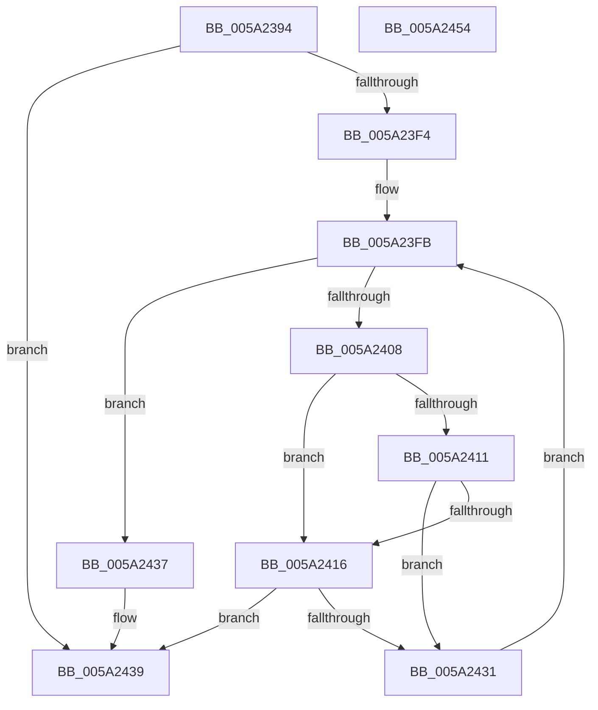

# IopMarkPagesForRunTimeTriageDataBlocks

- RVA: `0x005A2394`–`0x005A2455` (길이 `193` bytes)
- VA: `0x00000001405A2394`
- 실행 섹션: `.text`
- PDB 이름 있음: `예`; PDB Function 태그: `아니요`
- unwind 정보 RVA: `0x0005E6B4`
- 디코드: `53`개 명령, `193/193` bytes 표시
- 미해석 바이트: `0` (있으면 어셈블리에 `.byte`로 보존)

> 이 문서는 커널 이미지의 기계어와 PDB 기호를 분석해 생성했습니다. 4번과 5번은 함수 원형과 자료형을 바이너리 사용 방식에서 추정한 C 해석이며 원본 소스 복구 결과는 아닙니다.

## 1. Dependencies

- 직접 호출 지점: **4**; 고유 호출 대상: **3**
- 직접 호출자로 확인된 함수: **1**
- RIP 상대 이미지 참조: **1**

### Outgoing calls
- `0x005A23C0` → [IopGetMaxValidMemorySizeDown](../59/IopGetMaxValidMemorySizeDown_function_00595618.md) (function, `0x00595618`)
- `0x005A23D3` → [IopGetMaxValidMemorySize](../59/IopGetMaxValidMemorySize_function_0059559C.md) (function, `0x0059559C`)
- `0x005A23E9` → [MmAddRangeToCrashDump](../67/MmAddRangeToCrashDump_function_0067D8B0.md) (function, `0x0067D8B0`)
- `0x005A2426` → [MmAddRangeToCrashDump](../67/MmAddRangeToCrashDump_function_0067D8B0.md) (function, `0x0067D8B0`)

### Direct callers
- [IopAddMiniDumpPagesToPartialKernelDump](IopAddMiniDumpPagesToPartialKernelDump_function_005A16F8.md) at `0x005A17F5`

### Static image references
- `0x005A23F4` → RVA `0x000277A8` (`.rdata`; read)

## 2. Other-region calls and transfers

- 다른 실행 섹션으로 향하는 call: **0**
- 별도 외부 분기/꼬리 이동을 확인하지 못했습니다.

## 3. Assembly (complete function range)

```asm
005A2394  48 8B C4                        mov rax, rsp
005A2397  48 89 58 08                     mov qword ptr [rax + 8], rbx
005A239B  48 89 68 10                     mov qword ptr [rax + 0x10], rbp
005A239F  48 89 70 18                     mov qword ptr [rax + 0x18], rsi
005A23A3  48 89 78 20                     mov qword ptr [rax + 0x20], rdi
005A23A7  41 56                           push r14
005A23A9  48 83 EC 20                     sub rsp, 0x20
005A23AD  48 8B E9                        mov rbp, rcx
005A23B0  49 8B F1                        mov rsi, r9
005A23B3  48 8B 8A F8 00 00 00            mov rcx, qword ptr [rdx + 0xf8]
005A23BA  4D 8B F0                        mov r14, r8
005A23BD  48 8B FA                        mov rdi, rdx
005A23C0  E8 53 32 FF FF                  call 0x140595618
005A23C5  48 8B 8F F8 00 00 00            mov rcx, qword ptr [rdi + 0xf8]
005A23CC  BA 00 01 00 00                  mov edx, 0x100
005A23D1  8B D8                           mov ebx, eax
005A23D3  E8 C4 31 FF FF                  call 0x14059559c
005A23D8  48 8B 97 F8 00 00 00            mov rdx, qword ptr [rdi + 0xf8]
005A23DF  48 8B CD                        mov rcx, rbp
005A23E2  48 2B D3                        sub rdx, rbx
005A23E5  44 8D 04 18                     lea r8d, [rax + rbx]
005A23E9  E8 C2 B4 0D 00                  call 0x14067d8b0
005A23EE  8B C8                           mov ecx, eax
005A23F0  85 C0                           test eax, eax
005A23F2  78 45                           js 0x1405a2439
005A23F4  48 8D 1D AD 53 A8 FF            lea rbx, [rip - 0x57ac53]
005A23FB  0F B7 03                        movzx eax, word ptr [rbx]
005A23FE  BA FF FF 00 00                  mov edx, 0xffff
005A2403  66 3B C2                        cmp ax, dx
005A2406  73 2F                           jae 0x1405a2437
005A2408  48 8B 14 38                     mov rdx, qword ptr [rax + rdi]
005A240C  49 3B D6                        cmp rdx, r14
005A240F  72 05                           jb 0x1405a2416
005A2411  48 3B D6                        cmp rdx, rsi
005A2414  72 1B                           jb 0x1405a2431
005A2416  48 81 E2 00 F0 FF FF            and rdx, 0xfffffffffffff000
005A241D  41 B8 00 10 00 00               mov r8d, 0x1000
005A2423  48 8B CD                        mov rcx, rbp
005A2426  E8 85 B4 0D 00                  call 0x14067d8b0
005A242B  8B C8                           mov ecx, eax
005A242D  85 C0                           test eax, eax
005A242F  78 08                           js 0x1405a2439
005A2431  48 83 C3 02                     add rbx, 2
005A2435  EB C4                           jmp 0x1405a23fb
005A2437  8B C1                           mov eax, ecx
005A2439  48 8B 5C 24 30                  mov rbx, qword ptr [rsp + 0x30]
005A243E  48 8B 6C 24 38                  mov rbp, qword ptr [rsp + 0x38]
005A2443  48 8B 74 24 40                  mov rsi, qword ptr [rsp + 0x40]
005A2448  48 8B 7C 24 48                  mov rdi, qword ptr [rsp + 0x48]
005A244D  48 83 C4 20                     add rsp, 0x20
005A2451  41 5E                           pop r14
005A2453  C3                              ret
005A2454  CC                              int3
```

## 4. C-style interpretation (structured pseudocode)

```c
__int64 __fastcall IopMarkPagesForRunTimeTriageDataBlocks(__int64 a1, __int64 a2, __int64 a3, __int64 a4)
{
    __int64 result;
    __int64 v_rbx;
    __int64 v_rsp;
    unsigned __int64 v_stack_p10;
    unsigned __int64 v_stack_p18;
    unsigned __int64 v_stack_p20;
    unsigned __int64 v_stack_p8;

    *(unsigned __int64 *)(v_rsp + 8) = v_rbx;
    *(unsigned __int64 *)(v_rsp + 16) = v_rbp;
    *(unsigned __int64 *)(v_rsp + 24) = v_rsi;
    *(unsigned __int64 *)(v_rsp + 32) = v_rdi;
    v_rsp = (v_rsp) - (32);
    result = IopGetMaxValidMemorySizeDown(*(unsigned __int64 *)(a2 + 248), a2, a3, a4);
    result = IopGetMaxValidMemorySize(*(unsigned __int64 *)(a2 + 248), 256, a3, a4);
    a2 = (*(unsigned __int64 *)(a2 + 248)) - ((unsigned int)((unsigned int)(result)));
    result = MmAddRangeToCrashDump(a1, a2, result + (unsigned int)((unsigned int)(result)) * 1, a4);
    if (sign_flag) goto loc_005A2439;
loc_005A23FB:
    if (((unsigned __int16)(*(unsigned __int16 *)(v_rip - 5745747))) >= ((unsigned __int16)((unsigned int)(0xFFFFULL)))) goto loc_005A2437;
    if ((*(unsigned __int64 *)(*(unsigned __int16 *)(v_rip - 5745747) + a2 * 1)) < a3) goto loc_005A2416;
    if ((*(unsigned __int64 *)(*(unsigned __int16 *)(v_rip - 5745747) + a2 * 1)) < a4) goto loc_005A2431;
loc_005A2416:
    a2 = (*(unsigned __int64 *)(*(unsigned __int16 *)(v_rip - 5745747) + a2 * 1)) & (0xFFFFFFFFFFFFF000ULL);
    result = MmAddRangeToCrashDump(a1, a2, (unsigned int)(0x1000ULL), a4);
    if (sign_flag) goto loc_005A2439;
loc_005A2431:
    v_rbx = (v_rip - 5745747) + (2);
    goto loc_005A23FB;
loc_005A2437:
loc_005A2439:
    v_rsp = (v_rsp) + (32);
    return (unsigned int)((unsigned int)((unsigned int)((unsigned int)(result))));
}
```

## 5. (Beta) C Style

```c
int64_t IopMarkPagesForRunTimeTriageDataBlocks(int64_t Arg1, void *Arg2, int64_t Arg3, int64_t Arg4)
{
    uint8_t *arg2 = (uint8_t *)Arg2;

    int64_t result;
    int64_t local_rbx;
    int64_t local_rsp;
    uint64_t v_stack_p10;
    uint64_t v_stack_p18;
    uint64_t v_stack_p20;
    uint64_t v_stack_p8;

    *(uint64_t *)(local_rsp + 0x8) = local_rbx;
    *(uint64_t *)(local_rsp + 0x10) = local_rbp;
    *(uint64_t *)(local_rsp + 0x18) = local_rsi;
    *(uint64_t *)(local_rsp + 0x20) = local_rdi;
    local_rsp = (local_rsp) - (32);
    result = IopGetMaxValidMemorySizeDown(*(uint64_t *)(arg2 + 0xF8), Arg2, Arg3, Arg4);
    result = IopGetMaxValidMemorySize(*(uint64_t *)(arg2 + 0xF8), 256, Arg3, Arg4);
    Arg2 = (*(uint64_t *)(arg2 + 0xF8)) - ((uint32_t)((uint32_t)(result)));
    result = MmAddRangeToCrashDump(Arg1, Arg2, result + (uint32_t)((uint32_t)(result)) * 1, Arg4);
    if (sign_flag) goto loc_005A2439;
loc_005A23FB:
    if (((uint16_t)(*(uint16_t *)(v_rip - 0x57AC53))) >= ((uint16_t)((uint32_t)(0xFFFFULL)))) goto loc_005A2437;
    if ((*(uint64_t *)(*(uint16_t *)(v_rip - 0x57AC53) + arg2 * 1)) < Arg3) goto loc_005A2416;
    if ((*(uint64_t *)(*(uint16_t *)(v_rip - 0x57AC53) + arg2 * 1)) < Arg4) goto loc_005A2431;
loc_005A2416:
    Arg2 = (*(uint64_t *)(*(uint16_t *)(v_rip - 0x57AC53) + arg2 * 1)) & (0xFFFFFFFFFFFFF000ULL);
    result = MmAddRangeToCrashDump(Arg1, Arg2, (uint32_t)(0x1000ULL), Arg4);
    if (sign_flag) goto loc_005A2439;
loc_005A2431:
    local_rbx = (v_rip - 5745747) + (2);
    goto loc_005A23FB;
loc_005A2437:
loc_005A2439:
    local_rsp = (local_rsp) + (32);
    return (uint32_t)((uint32_t)((uint32_t)((uint32_t)(result))));
}
```

### 관측된 메모리 오프셋

구조체 형식이 확인되지 않은 접근은 인자 기준의 오프셋으로만 기록했습니다.

| 기준 인자 | 오프셋 표현 | 폭 (bit) | 접근 |
|---|---:|---:|---|
| `Arg2` | `+ 0xF8` | `64` | `R` |

## 6. Execution-region graph

[열기: 2D/3D 그래프와 함수 탐색 컨트롤 패널](../../../control-panel.html?section=text&rva=0x005A2394&view=graph)

- 2D 그래프는 위에서 아래로 흐르고, 3D 그래프는 빈 공간을 드래그해 회전합니다. Shift+드래그는 이동, 휠은 확대·축소, 함수 노드 선택은 대상 보고서 이동입니다.

### Static fallback


