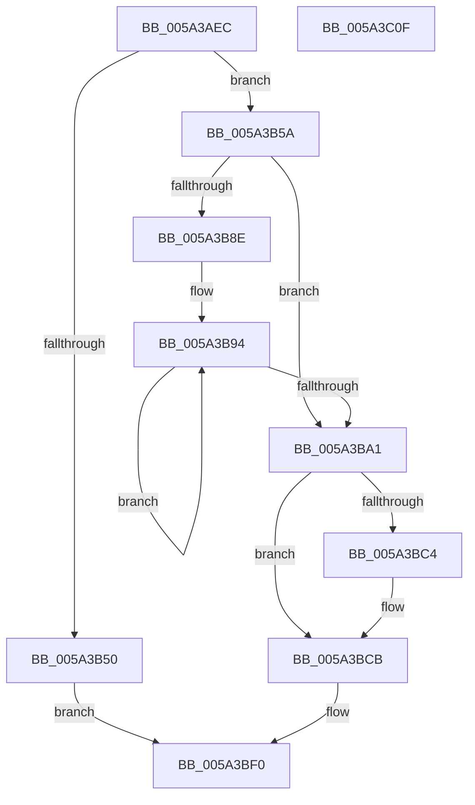

# IopMcCreateBufferEntry

- RVA: `0x005A3AEC`–`0x005A3C10` (길이 `292` bytes)
- VA: `0x00000001405A3AEC`
- 실행 섹션: `.text`
- PDB 이름 있음: `예`; PDB Function 태그: `아니요`
- unwind 정보 RVA: `0x0005FEF8`
- 디코드: `79`개 명령, `292/292` bytes 표시
- 미해석 바이트: `0` (있으면 어셈블리에 `.byte`로 보존)

> 이 문서는 커널 이미지의 기계어와 PDB 기호를 분석해 생성했습니다. 4번과 5번은 함수 원형과 자료형을 바이너리 사용 방식에서 추정한 C 해석이며 원본 소스 복구 결과는 아닙니다.

## 1. Dependencies

- 직접 호출 지점: **3**; 고유 호출 대상: **3**
- 직접 호출자로 확인된 함수: **1**
- RIP 상대 이미지 참조: **4**

### Outgoing calls
- `0x005A3B41` → [ExAllocatePool2](../../poolcode/B8/ExAllocatePool2_function_00B820F0.md) (function, `0x00B820F0`)
- `0x005A3BA8` → [KeAcquireSpinLockRaiseToDpc](../20/KeAcquireSpinLockRaiseToDpc_function_00208470.md) (function, `0x00208470`)
- `0x005A3BE5` → [KeReleaseSpinLock](../39/KeReleaseSpinLock_function_00392BA0.md) (function, `0x00392BA0`)

### Direct callers
- [IopIoRingDispatchRegisterBuffers](../../page/71/IopIoRingDispatchRegisterBuffers_function_0071FC18.md) at `0x0071FF04`

### Static image references
- `0x005A3BA1` → RVA `0x00F8D008` (`.data`; read)
- `0x005A3BAD` → RVA `0x00F8D018` (`.data`; read)
- `0x005A3BB4` → RVA `0x00F8D010` (`.data`; read)
- `0x005A3BD7` → RVA `0x00F8D018` (`.data`; write)

## 2. Other-region calls and transfers

- 다른 실행 섹션으로 향하는 call: **1**
  - `0x005A3B41` → [ExAllocatePool2](../../poolcode/B8/ExAllocatePool2_function_00B820F0.md) (`.text` → `POOLCODE`)
- 별도 외부 분기/꼬리 이동을 확인하지 못했습니다.

## 3. Assembly (complete function range)

```asm
005A3AEC  48 8B C4                        mov rax, rsp
005A3AEF  48 89 58 08                     mov qword ptr [rax + 8], rbx
005A3AF3  48 89 68 10                     mov qword ptr [rax + 0x10], rbp
005A3AF7  48 89 70 18                     mov qword ptr [rax + 0x18], rsi
005A3AFB  48 89 78 20                     mov qword ptr [rax + 0x20], rdi
005A3AFF  41 54                           push r12
005A3B01  41 56                           push r14
005A3B03  41 57                           push r15
005A3B05  48 83 EC 20                     sub rsp, 0x20
005A3B09  4C 8B D1                        mov r10, rcx
005A3B0C  8B FA                           mov edi, edx
005A3B0E  41 81 E2 FF 0F 00 00            and r10d, 0xfff
005A3B15  8B EA                           mov ebp, edx
005A3B17  48 81 C7 FF 0F 00 00            add rdi, 0xfff
005A3B1E  45 8A F8                        mov r15b, r8b
005A3B21  49 03 FA                        add rdi, r10
005A3B24  4C 8B F1                        mov r14, rcx
005A3B27  48 C1 EF 0C                     shr rdi, 0xc
005A3B2B  B9 41 00 00 00                  mov ecx, 0x41
005A3B30  41 B8 4D 63 42 65               mov r8d, 0x6542634d
005A3B36  4D 8B E1                        mov r12, r9
005A3B39  8D 77 03                        lea esi, [rdi + 3]
005A3B3C  C1 E6 05                        shl esi, 5
005A3B3F  8B D6                           mov edx, esi
005A3B41  E8 AA E5 5D 00                  call 0x140b820f0
005A3B46  33 C9                           xor ecx, ecx
005A3B48  48 8B D8                        mov rbx, rax
005A3B4B  48 85 C0                        test rax, rax
005A3B4E  75 0A                           jne 0x1405a3b5a
005A3B50  B8 9A 00 00 C0                  mov eax, 0xc000009a
005A3B55  E9 96 00 00 00                  jmp 0x1405a3bf0
005A3B5A  66 C7 00 02 0C                  mov word ptr [rax], 0xc02
005A3B5F  89 70 04                        mov dword ptr [rax + 4], esi
005A3B62  C7 40 08 01 00 00 00            mov dword ptr [rax + 8], 1
005A3B69  4C 89 70 20                     mov qword ptr [rax + 0x20], r14
005A3B6D  89 68 28                        mov dword ptr [rax + 0x28], ebp
005A3B70  44 88 78 2C                     mov byte ptr [rax + 0x2c], r15b
005A3B74  66 89 48 40                     mov word ptr [rax + 0x40], cx
005A3B78  C6 40 42 06                     mov byte ptr [rax + 0x42], 6
005A3B7C  89 48 44                        mov dword ptr [rax + 0x44], ecx
005A3B7F  48 83 C0 48                     add rax, 0x48
005A3B83  48 89 40 08                     mov qword ptr [rax + 8], rax
005A3B87  48 89 00                        mov qword ptr [rax], rax
005A3B8A  85 FF                           test edi, edi
005A3B8C  74 13                           je 0x1405a3ba1
005A3B8E  48 8D 43 78                     lea rax, [rbx + 0x78]
005A3B92  8B CF                           mov ecx, edi
005A3B94  83 08 FF                        or dword ptr [rax], 0xffffffff
005A3B97  48 8D 40 20                     lea rax, [rax + 0x20]
005A3B9B  48 83 E9 01                     sub rcx, 1
005A3B9F  75 F3                           jne 0x1405a3b94
005A3BA1  48 8D 0D 60 94 9E 00            lea rcx, [rip + 0x9e9460]
005A3BA8  E8 C3 48 C6 FF                  call 0x140208470
005A3BAD  48 8B 15 64 94 9E 00            mov rdx, qword ptr [rip + 0x9e9464]
005A3BB4  4C 8D 05 55 94 9E 00            lea r8, [rip + 0x9e9455]
005A3BBB  48 8D 4B 10                     lea rcx, [rbx + 0x10]
005A3BBF  4C 39 02                        cmp qword ptr [rdx], r8
005A3BC2  74 07                           je 0x1405a3bcb
005A3BC4  B9 03 00 00 00                  mov ecx, 3
005A3BC9  CD 29                           int 0x29
005A3BCB  48 89 51 08                     mov qword ptr [rcx + 8], rdx
005A3BCF  4C 89 01                        mov qword ptr [rcx], r8
005A3BD2  48 89 0A                        mov qword ptr [rdx], rcx
005A3BD5  8A D0                           mov dl, al
005A3BD7  48 89 0D 3A 94 9E 00            mov qword ptr [rip + 0x9e943a], rcx
005A3BDE  48 8D 0D 23 94 9E 00            lea rcx, [rip + 0x9e9423]
005A3BE5  E8 B6 EF DE FF                  call 0x140392ba0
005A3BEA  33 C0                           xor eax, eax
005A3BEC  49 89 1C 24                     mov qword ptr [r12], rbx
005A3BF0  48 8B 5C 24 40                  mov rbx, qword ptr [rsp + 0x40]
005A3BF5  48 8B 6C 24 48                  mov rbp, qword ptr [rsp + 0x48]
005A3BFA  48 8B 74 24 50                  mov rsi, qword ptr [rsp + 0x50]
005A3BFF  48 8B 7C 24 58                  mov rdi, qword ptr [rsp + 0x58]
005A3C04  48 83 C4 20                     add rsp, 0x20
005A3C08  41 5F                           pop r15
005A3C0A  41 5E                           pop r14
005A3C0C  41 5C                           pop r12
005A3C0E  C3                              ret
005A3C0F  CC                              int3
```

## 4. C-style interpretation (structured pseudocode)

```c
__int64 __fastcall IopMcCreateBufferEntry(__int64 a1, int a2, unsigned __int8 a3, __int64 a4)
{
    __int64 result;
    __int64 v_r10;
    __int64 v_rdi;
    __int64 v_rsi;
    __int64 v_rsp;
    unsigned __int64 v_stack_p10;
    unsigned __int64 v_stack_p18;
    unsigned __int64 v_stack_p20;
    unsigned __int64 v_stack_p8;

    *(unsigned __int64 *)(v_rsp + 8) = v_rbx;
    *(unsigned __int64 *)(v_rsp + 16) = v_rbp;
    *(unsigned __int64 *)(v_rsp + 24) = v_rsi;
    *(unsigned __int64 *)(v_rsp + 32) = v_rdi;
    v_rsp = (v_rsp) - (32);
    v_r10 = (unsigned int)((a1) & (0xFFFULL));
    v_rdi = ((unsigned int)(a2)) + (0xFFFULL);
    v_rdi = (v_rdi) + (v_r10);
    v_rdi = (v_rdi) >> (12);
    v_rsi = (unsigned int)((v_rdi + 3) << (5));
    result = ExAllocatePool2(65, (unsigned int)((unsigned int)(v_rsi)), (unsigned int)(0x6542634DULL), a4);
    a1 = 0;
    if (result != 0) goto loc_005A3B5A;
    goto loc_005A3BF0;
loc_005A3B5A:
    *(unsigned __int16 *)((unsigned int)(0xC000009AULL)) = 0xC02ULL;
    *(unsigned int *)((unsigned int)(0xC000009AULL) + 4) = (unsigned int)(v_rsi);
    *(unsigned int *)((unsigned int)(0xC000009AULL) + 8) = 1;
    *(unsigned __int64 *)((unsigned int)(0xC000009AULL) + 32) = 0;
    *(unsigned int *)((unsigned int)(0xC000009AULL) + 40) = (unsigned int)((unsigned int)(a2));
    *(unsigned __int8 *)((unsigned int)(0xC000009AULL) + 44) = a3;
    *(unsigned __int16 *)((unsigned int)(0xC000009AULL) + 64) = 0;
    *(unsigned __int8 *)((unsigned int)(0xC000009AULL) + 66) = 6;
    *(unsigned int *)((unsigned int)(0xC000009AULL) + 68) = 0;
    result = ((unsigned int)(0xC000009AULL)) + (72);
    *(unsigned __int64 *)(result + 8) = result;
    *(unsigned __int64 *)(result) = result;
    if ((unsigned int)(v_rdi) == 0) goto loc_005A3BA1;
loc_005A3B94:
    a1 = ((unsigned int)((unsigned int)(v_rdi))) - (1);
    if (condition_is_not_equal) goto loc_005A3B94;
loc_005A3BA1:
    result = KeAcquireSpinLockRaiseToDpc(v_rip + 10392672, (unsigned int)((unsigned int)(v_rsi)), (unsigned int)(0x6542634DULL), a4);
    if ((*(unsigned __int64 *)(*(unsigned __int64 *)(v_rip + 10392676))) != (v_rip + 10392661)) {
        a1 = 3;
    }
    *(unsigned __int64 *)(a1 + 8) = *(unsigned __int64 *)(v_rip + 10392676);
    *(unsigned __int64 *)(a1) = v_rip + 10392661;
    *(unsigned __int64 *)(*(unsigned __int64 *)(v_rip + 10392676)) = a1;
    *(unsigned __int64 *)(v_rip + 10392634) = a1;
    result = KeReleaseSpinLock(v_rip + 10392611, (unsigned __int8)(result), v_rip + 10392661, a4);
    result = 0;
    *(unsigned __int64 *)(a4) = 0;
loc_005A3BF0:
    v_rsp = (v_rsp) + (32);
    return result;
}
```

## 5. (Beta) C Style

```c
int64_t IopMcCreateBufferEntry(int64_t Arg1, int32_t Arg2, uint8_t Arg3, void *Arg4)
{
    uint8_t *arg4 = (uint8_t *)Arg4;

    int64_t result;
    int64_t local_r10;
    int64_t local_rdi;
    int64_t local_rsi;
    int64_t local_rsp;
    uint64_t v_stack_p10;
    uint64_t v_stack_p18;
    uint64_t v_stack_p20;
    uint64_t v_stack_p8;

    *(uint64_t *)(local_rsp + 0x8) = local_rbx;
    *(uint64_t *)(local_rsp + 0x10) = local_rbp;
    *(uint64_t *)(local_rsp + 0x18) = local_rsi;
    *(uint64_t *)(local_rsp + 0x20) = local_rdi;
    local_rsp = (local_rsp) - (32);
    local_r10 = (uint32_t)((Arg1) & (0xFFFULL));
    local_rdi = ((uint32_t)(Arg2)) + (0xFFFULL);
    local_rdi = (local_rdi) + (local_r10);
    local_rdi = (local_rdi) >> (12);
    local_rsi = (uint32_t)((local_rdi + 3) << (5));
    result = ExAllocatePool2(65, (uint32_t)((uint32_t)(local_rsi)), (uint32_t)(0x6542634DULL), Arg4);
    Arg1 = 0;
    if (result != 0) goto loc_005A3B5A;
    goto loc_005A3BF0;
loc_005A3B5A:
    *(uint16_t *)((uint32_t)(0xC000009AULL)) = 0xC02ULL;
    *(uint32_t *)((uint32_t)(0xC000009AULL) + 0x4) = (uint32_t)(local_rsi);
    *(uint32_t *)((uint32_t)(0xC000009AULL) + 0x8) = 1;
    *(uint64_t *)((uint32_t)(0xC000009AULL) + 0x20) = 0;
    *(uint32_t *)((uint32_t)(0xC000009AULL) + 0x28) = (uint32_t)((uint32_t)(Arg2));
    *(uint8_t *)((uint32_t)(0xC000009AULL) + 0x2C) = Arg3;
    *(uint16_t *)((uint32_t)(0xC000009AULL) + 0x40) = 0;
    *(uint8_t *)((uint32_t)(0xC000009AULL) + 0x42) = 6;
    *(uint32_t *)((uint32_t)(0xC000009AULL) + 0x44) = 0;
    result = ((uint32_t)(0xC000009AULL)) + (72);
    *(uint64_t *)(result + 0x8) = result;
    *(uint64_t *)(result) = result;
    if ((uint32_t)(local_rdi) == 0) goto loc_005A3BA1;
loc_005A3B94:
    Arg1 = ((uint32_t)((uint32_t)(local_rdi))) - (1);
    if (condition_is_not_equal) goto loc_005A3B94;
loc_005A3BA1:
    result = KeAcquireSpinLockRaiseToDpc(v_rip + 10392672, (uint32_t)((uint32_t)(local_rsi)), (uint32_t)(0x6542634DULL), Arg4);
    if ((*(uint64_t *)(*(uint64_t *)(v_rip + 0x9E9464))) != (v_rip + 10392661)) {
        Arg1 = 3;
    }
    *(uint64_t *)(Arg1 + 0x8) = *(uint64_t *)(v_rip + 0x9E9464);
    *(uint64_t *)(Arg1) = v_rip + 10392661;
    *(uint64_t *)(*(uint64_t *)(v_rip + 0x9E9464)) = Arg1;
    *(uint64_t *)(v_rip + 0x9E943A) = Arg1;
    result = KeReleaseSpinLock(v_rip + 10392611, (uint8_t)(result), v_rip + 10392661, Arg4);
    result = 0;
    *(uint64_t *)(arg4) = 0;
loc_005A3BF0:
    local_rsp = (local_rsp) + (32);
    return result;
}
```

### 관측된 메모리 오프셋

구조체 형식이 확인되지 않은 접근은 인자 기준의 오프셋으로만 기록했습니다.

| 기준 인자 | 오프셋 표현 | 폭 (bit) | 접근 |
|---|---:|---:|---|
| `Arg4` | `+ 0x0` | `64` | `W` |

## 6. Execution-region graph

[열기: 2D/3D 그래프와 함수 탐색 컨트롤 패널](../../../control-panel.html?section=text&rva=0x005A3AEC&view=graph)

- 2D 그래프는 위에서 아래로 흐르고, 3D 그래프는 빈 공간을 드래그해 회전합니다. Shift+드래그는 이동, 휠은 확대·축소, 함수 노드 선택은 대상 보고서 이동입니다.

### Static fallback


