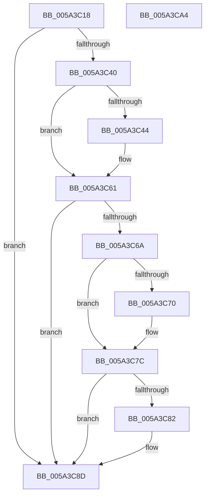

# IopMcDereferenceMdl

- RVA: `0x005A3C18`–`0x005A3CA5` (길이 `141` bytes)
- VA: `0x00000001405A3C18`
- 실행 섹션: `.text`
- PDB 이름 있음: `예`; PDB Function 태그: `아니요`
- unwind 정보 RVA: `0x00066400`
- 디코드: `43`개 명령, `141/141` bytes 표시
- 미해석 바이트: `0` (있으면 어셈블리에 `.byte`로 보존)

> 이 문서는 커널 이미지의 기계어와 PDB 기호를 분석해 생성했습니다. 4번과 5번은 함수 원형과 자료형을 바이너리 사용 방식에서 추정한 C 해석이며 원본 소스 복구 결과는 아닙니다.

## 1. Dependencies

- 직접 호출 지점: **3**; 고유 호출 대상: **3**
- 직접 호출자로 확인된 함수: **2**
- RIP 상대 이미지 참조: **0**

### Outgoing calls
- `0x005A3C5B` → [KeBugCheckEx](../4F/KeBugCheckEx_function_004FD660.md) (function, `0x004FD660`)
- `0x005A3C77` → [KeSetEvent](../33/KeSetEvent_function_0033F310.md) (function, `0x0033F310`)
- `0x005A3C88` → [IopMcTryUnlockMdl](IopMcTryUnlockMdl_function_005A3EE8.md) (function, `0x005A3EE8`)

### Direct callers
- [IopMcReleaseMdl](IopMcReleaseMdl_function_005A3CE8.md) at `0x005A3D5D`
- [sub_00B4A8D2](../../page/B4/Unknown_function_00B4A8D2.md) at `0x00B4A910`

### Static image references
- 디코드된 RIP-relative 메모리 참조가 없습니다.

## 2. Other-region calls and transfers

- 다른 실행 섹션으로 향하는 call: **0**
- 별도 외부 분기/꼬리 이동을 확인하지 못했습니다.

## 3. Assembly (complete function range)

```asm
005A3C18  4C 8B DC                        mov r11, rsp
005A3C1B  49 89 5B 08                     mov qword ptr [r11 + 8], rbx
005A3C1F  49 89 6B 10                     mov qword ptr [r11 + 0x10], rbp
005A3C23  49 89 73 18                     mov qword ptr [r11 + 0x18], rsi
005A3C27  57                              push rdi
005A3C28  48 83 EC 30                     sub rsp, 0x30
005A3C2C  48 8B 69 38                     mov rbp, qword ptr [rcx + 0x38]
005A3C30  48 8B D9                        mov rbx, rcx
005A3C33  83 CF FF                        or edi, 0xffffffff
005A3C36  F0 0F C1 79 30                  lock xadd dword ptr [rcx + 0x30], edi
005A3C3B  83 EF 01                        sub edi, 1
005A3C3E  7F 4D                           jg 0x1405a3c8d
005A3C40  85 FF                           test edi, edi
005A3C42  79 1D                           jns 0x1405a3c61
005A3C44  48 8B 01                        mov rax, qword ptr [rcx]
005A3C47  4C 8B C1                        mov r8, rcx
005A3C4A  B9 F4 01 00 00                  mov ecx, 0x1f4
005A3C4F  4C 63 CF                        movsxd r9, edi
005A3C52  BA 02 00 00 00                  mov edx, 2
005A3C57  49 89 43 E8                     mov qword ptr [r11 - 0x18], rax
005A3C5B  E8 00 9A F5 FF                  call 0x1404fd660
005A3C60  CC                              int3
005A3C61  8B 71 0C                        mov esi, dword ptr [rcx + 0xc]
005A3C64  83 79 30 00                     cmp dword ptr [rcx + 0x30], 0
005A3C68  75 23                           jne 0x1405a3c8d
005A3C6A  40 F6 C6 02                     test sil, 2
005A3C6E  74 0C                           je 0x1405a3c7c
005A3C70  48 83 C1 40                     add rcx, 0x40
005A3C74  45 33 C0                        xor r8d, r8d
005A3C77  E8 94 B6 D9 FF                  call 0x14033f310
005A3C7C  40 F6 C6 01                     test sil, 1
005A3C80  74 0B                           je 0x1405a3c8d
005A3C82  48 8B D5                        mov rdx, rbp
005A3C85  48 8B CB                        mov rcx, rbx
005A3C88  E8 5B 02 00 00                  call 0x1405a3ee8
005A3C8D  48 8B 5C 24 40                  mov rbx, qword ptr [rsp + 0x40]
005A3C92  8B C7                           mov eax, edi
005A3C94  48 8B 6C 24 48                  mov rbp, qword ptr [rsp + 0x48]
005A3C99  48 8B 74 24 50                  mov rsi, qword ptr [rsp + 0x50]
005A3C9E  48 83 C4 30                     add rsp, 0x30
005A3CA2  5F                              pop rdi
005A3CA3  C3                              ret
005A3CA4  CC                              int3
```

## 4. C-style interpretation (structured pseudocode)

```c
__int64 __fastcall IopMcDereferenceMdl(__int64 a1)
{
    __int64 result;
    __int64 v_rdi;
    __int64 v_rsp;
    unsigned __int64 v_stack_p10;
    unsigned __int64 v_stack_p18;
    unsigned __int64 v_stack_p8;

    *(unsigned __int64 *)(v_rsp + 8) = v_rbx;
    *(unsigned __int64 *)(v_rsp + 16) = v_rbp;
    *(unsigned __int64 *)(v_rsp + 24) = v_rsi;
    v_rsp = (v_rsp) - (48);
    v_rdi = (unsigned int)((v_rdi) | (0xFFFFFFFFULL));
    v_rdi = (unsigned int)((v_rdi) - (1));
    if (condition_is_greater) goto loc_005A3C8D;
    if (sign_flag) {
        result = *(unsigned __int64 *)(a1);
        a3 = a1;
        a1 = 500;
        a4 = (int)((unsigned int)(v_rdi));
        a2 = 2;
        *(unsigned __int64 *)(v_rsp - 24) = result;
        result = KeBugCheckEx(a1, a2, a3, a4);
    }
    if ((*(unsigned int *)(a1 + 48)) != 0) goto loc_005A3C8D;
    if ((((unsigned __int8)((unsigned int)(*(unsigned int *)(a1 + 12)))) & (2)) != 0) {
        a1 = (a1) + (64);
        a3 = 0;
        result = KeSetEvent(a1, a2, a3, a4);
    }
    if ((((unsigned __int8)((unsigned int)(*(unsigned int *)(a1 + 12)))) & (1)) != 0) {
        a2 = *(unsigned __int64 *)(a1 + 56);
        a1 = a1;
        result = IopMcTryUnlockMdl(a1, a2, a3, a4);
    }
    v_rsp = (v_rsp) + (48);
    return (unsigned int)((unsigned int)(v_rdi));
}
```

## 5. (Beta) C Style

```c
int64_t IopMcDereferenceMdl(void *Arg1)
{
    uint8_t *arg1 = (uint8_t *)Arg1;

    int64_t result;
    int64_t local_rdi;
    int64_t local_rsp;
    uint64_t v_stack_p10;
    uint64_t v_stack_p18;
    uint64_t v_stack_p8;

    *(uint64_t *)(local_rsp + 0x8) = local_rbx;
    *(uint64_t *)(local_rsp + 0x10) = local_rbp;
    *(uint64_t *)(local_rsp + 0x18) = local_rsi;
    local_rsp = (local_rsp) - (48);
    local_rdi = (uint32_t)((local_rdi) | (0xFFFFFFFFULL));
    local_rdi = (uint32_t)((local_rdi) - (1));
    if (condition_is_greater) goto loc_005A3C8D;
    if (sign_flag) {
        result = *(uint64_t *)(arg1);
        a3 = Arg1;
        Arg1 = 500;
        a4 = (int32_t)((uint32_t)(local_rdi));
        a2 = 2;
        *(uint64_t *)(local_rsp - 0x18) = result;
        result = KeBugCheckEx(Arg1, a2, a3, a4);
    }
    if ((*(uint32_t *)(arg1 + 0x30)) != 0) goto loc_005A3C8D;
    if ((((uint8_t)((uint32_t)(*(uint32_t *)(arg1 + 0xC)))) & (2)) != 0) {
        Arg1 = (Arg1) + (64);
        a3 = 0;
        result = KeSetEvent(Arg1, a2, a3, a4);
    }
    if ((((uint8_t)((uint32_t)(*(uint32_t *)(arg1 + 0xC)))) & (1)) != 0) {
        a2 = *(uint64_t *)(arg1 + 0x38);
        Arg1 = Arg1;
        result = IopMcTryUnlockMdl(Arg1, a2, a3, a4);
    }
    local_rsp = (local_rsp) + (48);
    return (uint32_t)((uint32_t)(local_rdi));
}
```

### 관측된 메모리 오프셋

구조체 형식이 확인되지 않은 접근은 인자 기준의 오프셋으로만 기록했습니다.

| 기준 인자 | 오프셋 표현 | 폭 (bit) | 접근 |
|---|---:|---:|---|
| `Arg1` | `+ 0x0` | `64` | `R` |
| `Arg1` | `+ 0x30` | `32` | `R/W` |
| `Arg1` | `+ 0x38` | `64` | `R` |

## 6. Execution-region graph

[열기: 2D/3D 그래프와 함수 탐색 컨트롤 패널](../../../control-panel.html?section=text&rva=0x005A3C18&view=graph)

- 2D 그래프는 위에서 아래로 흐르고, 3D 그래프는 빈 공간을 드래그해 회전합니다. Shift+드래그는 이동, 휠은 확대·축소, 함수 노드 선택은 대상 보고서 이동입니다.

### Static fallback


