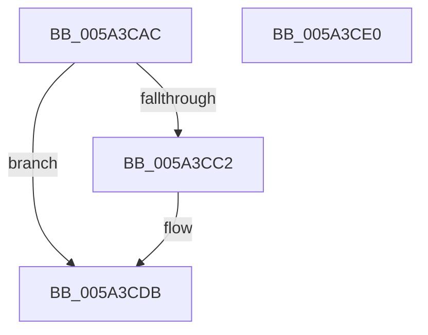

# IopMcReferenceBufferEntry

- RVA: `0x005A3CAC`–`0x005A3CE1` (길이 `53` bytes)
- VA: `0x00000001405A3CAC`
- 실행 섹션: `.text`
- PDB 이름 있음: `예`; PDB Function 태그: `아니요`
- unwind 정보 RVA: `0x0005D2F4`
- 디코드: `17`개 명령, `53/53` bytes 표시
- 미해석 바이트: `0` (있으면 어셈블리에 `.byte`로 보존)

> 이 문서는 커널 이미지의 기계어와 PDB 기호를 분석해 생성했습니다. 4번과 5번은 함수 원형과 자료형을 바이너리 사용 방식에서 추정한 C 해석이며 원본 소스 복구 결과는 아닙니다.

## 1. Dependencies

- 직접 호출 지점: **1**; 고유 호출 대상: **1**
- 직접 호출자로 확인된 함수: **2**
- RIP 상대 이미지 참조: **0**

### Outgoing calls
- `0x005A3CD5` → [KeBugCheckEx](../4F/KeBugCheckEx_function_004FD660.md) (function, `0x004FD660`)

### Direct callers
- [sub_006EFAD4](../6E/Unknown_function_006EFAD4.md) at `0x006EFB33`
- [sub_00B4A8D2](../../page/B4/Unknown_function_00B4A8D2.md) at `0x00B4A900`

### Static image references
- 디코드된 RIP-relative 메모리 참조가 없습니다.

## 2. Other-region calls and transfers

- 다른 실행 섹션으로 향하는 call: **0**
- 별도 외부 분기/꼬리 이동을 확인하지 못했습니다.

## 3. Assembly (complete function range)

```asm
005A3CAC  48 83 EC 38                     sub rsp, 0x38
005A3CB0  BA 01 00 00 00                  mov edx, 1
005A3CB5  8B C2                           mov eax, edx
005A3CB7  F0 0F C1 41 08                  lock xadd dword ptr [rcx + 8], eax
005A3CBC  03 C2                           add eax, edx
005A3CBE  3B C2                           cmp eax, edx
005A3CC0  7F 19                           jg 0x1405a3cdb
005A3CC2  4C 63 C8                        movsxd r9, eax
005A3CC5  4C 8B C1                        mov r8, rcx
005A3CC8  48 8B 01                        mov rax, qword ptr [rcx]
005A3CCB  B9 F4 01 00 00                  mov ecx, 0x1f4
005A3CD0  48 89 44 24 20                  mov qword ptr [rsp + 0x20], rax
005A3CD5  E8 86 99 F5 FF                  call 0x1404fd660
005A3CDA  CC                              int3
005A3CDB  48 83 C4 38                     add rsp, 0x38
005A3CDF  C3                              ret
005A3CE0  CC                              int3
```

## 4. C-style interpretation (structured pseudocode)

```c
__int64 __fastcall IopMcReferenceBufferEntry(__int64 a1)
{
    __int64 result;
    __int64 v_rsp;
    unsigned __int64 v_stack_m18;

    v_rsp = (v_rsp) - (56);
    result = (unsigned int)((1) + (1));
    if (((unsigned int)(result)) <= 1) {
        a4 = (int)((unsigned int)(result));
        a3 = a1;
        result = *(unsigned __int64 *)(a1);
        a1 = 500;
        v_stack_m18 = result;
        result = KeBugCheckEx(a1, 1, a3, a4);
    }
    v_rsp = (v_rsp) + (56);
    return result;
}
```

## 5. (Beta) C Style

```c
int64_t IopMcReferenceBufferEntry(void *Arg1)
{
    uint8_t *arg1 = (uint8_t *)Arg1;

    int64_t result;
    int64_t local_rsp;
    uint64_t v_stack_m18;

    local_rsp = (local_rsp) - (56);
    result = (uint32_t)((1) + (1));
    if (((uint32_t)(result)) <= 1) {
        a4 = (int32_t)((uint32_t)(result));
        a3 = Arg1;
        result = *(uint64_t *)(arg1);
        Arg1 = 500;
        v_stack_m18 = result;
        result = KeBugCheckEx(Arg1, 1, a3, a4);
    }
    local_rsp = (local_rsp) + (56);
    return result;
}
```

### 관측된 메모리 오프셋

구조체 형식이 확인되지 않은 접근은 인자 기준의 오프셋으로만 기록했습니다.

| 기준 인자 | 오프셋 표현 | 폭 (bit) | 접근 |
|---|---:|---:|---|
| `Arg1` | `+ 0x0` | `64` | `R` |
| `Arg1` | `+ 0x8` | `32` | `R/W` |

## 6. Execution-region graph

[열기: 2D/3D 그래프와 함수 탐색 컨트롤 패널](../../../control-panel.html?section=text&rva=0x005A3CAC&view=graph)

- 2D 그래프는 위에서 아래로 흐르고, 3D 그래프는 빈 공간을 드래그해 회전합니다. Shift+드래그는 이동, 휠은 확대·축소, 함수 노드 선택은 대상 보고서 이동입니다.

### Static fallback


