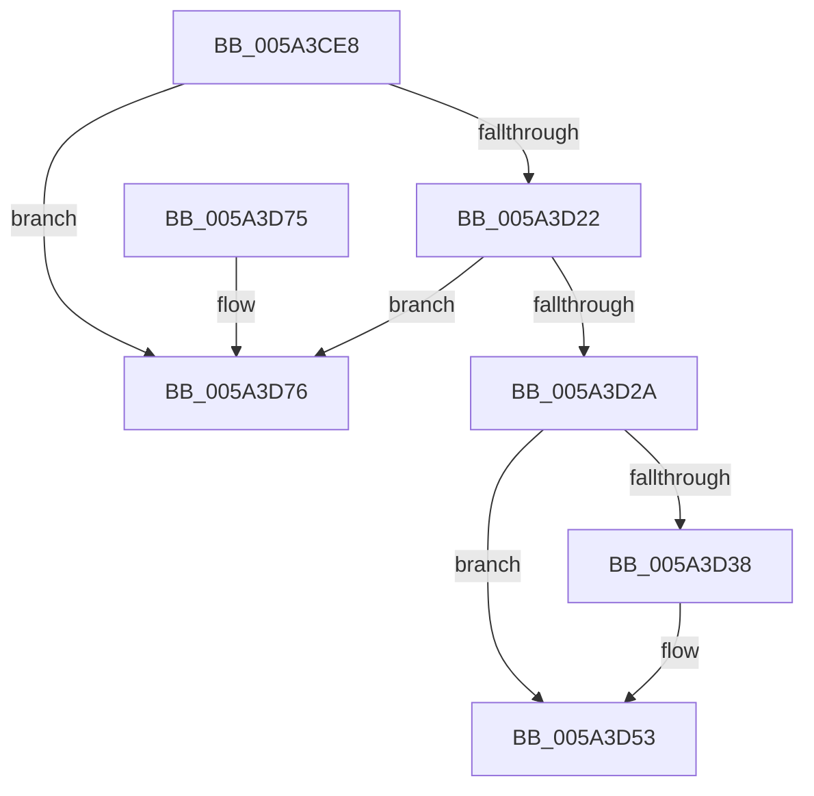

# IopMcReleaseMdl

- RVA: `0x005A3CE8`–`0x005A3D8E` (길이 `166` bytes)
- VA: `0x00000001405A3CE8`
- 실행 섹션: `.text`
- PDB 이름 있음: `예`; PDB Function 태그: `아니요`
- unwind 정보 RVA: `0x000A3580`
- 디코드: `45`개 명령, `166/166` bytes 표시
- 미해석 바이트: `0` (있으면 어셈블리에 `.byte`로 보존)

> 이 문서는 커널 이미지의 기계어와 PDB 기호를 분석해 생성했습니다. 4번과 5번은 함수 원형과 자료형을 바이너리 사용 방식에서 추정한 C 해석이며 원본 소스 복구 결과는 아닙니다.

## 1. Dependencies

- 직접 호출 지점: **5**; 고유 호출 대상: **4**
- 직접 호출자로 확인된 함수: **3**
- RIP 상대 이미지 참조: **0**

### Outgoing calls
- `0x005A3D4D` → [KeBugCheckEx](../4F/KeBugCheckEx_function_004FD660.md) (function, `0x004FD660`)
- `0x005A3D53` → [IoFreeMdl](../29/IoFreeMdl_function_0029EA80.md) (function, `0x0029EA80`)
- `0x005A3D5D` → [IopMcDereferenceMdl](IopMcDereferenceMdl_function_005A3C18.md) (function, `0x005A3C18`)
- `0x005A3D65` → [IopMcDereferenceBufferEntry](../44/IopMcDereferenceBufferEntry_function_00442BE8.md) (function, `0x00442BE8`)
- `0x005A3D88` → [KeBugCheckEx](../4F/KeBugCheckEx_function_004FD660.md) (function, `0x004FD660`)

### Direct callers
- [IopIoRingCompleteIrp](../3E/IopIoRingCompleteIrp_function_003ED13C.md) at `0x003ED1CF`
- [IopIoRingDispatchWrite](../../page/72/IopIoRingDispatchWrite_function_00720248.md) at `0x007203B1`
- [sub_00B4A690](../../page/B4/Unknown_function_00B4A690.md) at `0x00B4A77F`

### Static image references
- 디코드된 RIP-relative 메모리 참조가 없습니다.

## 2. Other-region calls and transfers

- 다른 실행 섹션으로 향하는 call: **0**
- 별도 외부 분기/꼬리 이동을 확인하지 못했습니다.

## 3. Assembly (complete function range)

```asm
005A3CE8  48 89 5C 24 08                  mov qword ptr [rsp + 8], rbx
005A3CED  57                              push rdi
005A3CEE  48 83 EC 30                     sub rsp, 0x30
005A3CF2  44 8B 41 2C                     mov r8d, dword ptr [rcx + 0x2c]
005A3CF6  8B FA                           mov edi, edx
005A3CF8  8B 41 28                        mov eax, dword ptr [rcx + 0x28]
005A3CFB  41 81 E0 FF 0F 00 00            and r8d, 0xfff
005A3D02  48 05 FF 0F 00 00               add rax, 0xfff
005A3D08  4C 03 C0                        add r8, rax
005A3D0B  B8 03 0C 00 00                  mov eax, 0xc03
005A3D10  49 C1 E8 0C                     shr r8, 0xc
005A3D14  49 83 C0 06                     add r8, 6
005A3D18  4E 8D 04 C1                     lea r8, [rcx + r8*8]
005A3D1C  66 41 39 00                     cmp word ptr [r8], ax
005A3D20  75 54                           jne 0x1405a3d76
005A3D22  66 41 83 78 02 10               cmp word ptr [r8 + 2], 0x10
005A3D28  75 4C                           jne 0x1405a3d76
005A3D2A  49 8B 58 08                     mov rbx, qword ptr [r8 + 8]
005A3D2E  B8 02 0C 00 00                  mov eax, 0xc02
005A3D33  66 39 03                        cmp word ptr [rbx], ax
005A3D36  74 1B                           je 0x1405a3d53
005A3D38  4C 8B 0B                        mov r9, qword ptr [rbx]
005A3D3B  BA 04 00 00 00                  mov edx, 4
005A3D40  4C 89 44 24 20                  mov qword ptr [rsp + 0x20], r8
005A3D45  B9 F4 01 00 00                  mov ecx, 0x1f4
005A3D4A  4C 8B C3                        mov r8, rbx
005A3D4D  E8 0E 99 F5 FF                  call 0x1404fd660
005A3D52  CC                              int3
005A3D53  E8 28 AD CF FF                  call 0x14029ea80
005A3D58  8B D7                           mov edx, edi
005A3D5A  48 8B CB                        mov rcx, rbx
005A3D5D  E8 B6 FE FF FF                  call 0x1405a3c18
005A3D62  48 8B CB                        mov rcx, rbx
005A3D65  E8 7E EE E9 FF                  call 0x140442be8
005A3D6A  48 8B 5C 24 40                  mov rbx, qword ptr [rsp + 0x40]
005A3D6F  48 83 C4 30                     add rsp, 0x30
005A3D73  5F                              pop rdi
005A3D74  C3                              ret
005A3D75  CC                              int3
005A3D76  45 8B 08                        mov r9d, dword ptr [r8]
005A3D79  BA 03 00 00 00                  mov edx, 3
005A3D7E  48 89 4C 24 20                  mov qword ptr [rsp + 0x20], rcx
005A3D83  B9 F4 01 00 00                  mov ecx, 0x1f4
005A3D88  E8 D3 98 F5 FF                  call 0x1404fd660
005A3D8D  CC                              int3
```

## 4. C-style interpretation (structured pseudocode)

```c
__int64 __fastcall IopMcReleaseMdl(__int64 a1, int a2)
{
    __int64 result;
    __int64 v_rsp;
    unsigned __int64 v_stack_m18;
    unsigned __int64 v_stack_p20;
    unsigned __int64 v_stack_p8;

    v_stack_p8 = v_rbx;
    v_rsp = (v_rsp) - (48);
    a3 = (unsigned int)(((unsigned int)(*(unsigned int *)(a1 + 44))) & (0xFFFULL));
    result = ((unsigned int)(*(unsigned int *)(a1 + 40))) + (0xFFFULL);
    a3 = (a3) + (result);
    a3 = (a3) >> (12);
    a3 = (a3) + (6);
    if ((*(unsigned __int16 *)(a1 + a3 * 8)) != ((unsigned __int16)((unsigned int)(0xC03ULL)))) goto loc_005A3D76;
    if ((*(unsigned __int16 *)(a1 + a3 * 8 + 2)) != 16) goto loc_005A3D76;
    result = (unsigned int)(0xC02ULL);
    if ((*(unsigned __int16 *)(*(unsigned __int64 *)(a1 + a3 * 8 + 8))) != ((unsigned __int16)((unsigned int)(0xC02ULL)))) {
        a4 = *(unsigned __int64 *)(*(unsigned __int64 *)(a1 + a3 * 8 + 8));
        a2 = 4;
        v_stack_m18 = a1 + a3 * 8;
        a1 = 500;
        a3 = *(unsigned __int64 *)(a1 + a3 * 8 + 8);
        result = KeBugCheckEx(a1, a2, a3, a4);
    }
    result = IoFreeMdl(a1, a2, a3, a4);
    result = IopMcDereferenceMdl(*(unsigned __int64 *)(a1 + a3 * 8 + 8), (unsigned int)((unsigned int)((unsigned int)(a2))), a3, a4);
    result = IopMcDereferenceBufferEntry(*(unsigned __int64 *)(a1 + a3 * 8 + 8), (unsigned int)((unsigned int)((unsigned int)(a2))), a3, a4);
    v_rsp = (v_rsp) + (48);
    return result;
loc_005A3D76:
    v_stack_p20 = *(unsigned __int64 *)(a1 + a3 * 8 + 8);
    result = KeBugCheckEx(500, 3, a3, (unsigned int)(*(unsigned int *)(a3)));
    return result;
}
```

## 5. (Beta) C Style

```c
int64_t IopMcReleaseMdl(void *Arg1, int32_t Arg2)
{
    uint8_t *arg1 = (uint8_t *)Arg1;

    int64_t result;
    int64_t local_rsp;
    uint64_t v_stack_m18;
    uint64_t v_stack_p20;
    uint64_t v_stack_p8;

    v_stack_p8 = local_rbx;
    local_rsp = (local_rsp) - (48);
    a3 = (uint32_t)(((uint32_t)(*(uint32_t *)(arg1 + 0x2C))) & (0xFFFULL));
    result = ((uint32_t)(*(uint32_t *)(arg1 + 0x28))) + (0xFFFULL);
    a3 = (a3) + (result);
    a3 = (a3) >> (12);
    a3 = (a3) + (6);
    if ((*(uint16_t *)(arg1 + a3 * 8)) != ((uint16_t)((uint32_t)(0xC03ULL)))) goto loc_005A3D76;
    if ((*(uint16_t *)(arg1 + a3 * 8 + 0x2)) != 16) goto loc_005A3D76;
    result = (uint32_t)(0xC02ULL);
    if ((*(uint16_t *)(*(uint64_t *)(arg1 + a3 * 8 + 0x8))) != ((uint16_t)((uint32_t)(0xC02ULL)))) {
        a4 = *(uint64_t *)(*(uint64_t *)(arg1 + a3 * 8 + 0x8));
        Arg2 = 4;
        v_stack_m18 = Arg1 + a3 * 8;
        Arg1 = 500;
        a3 = *(uint64_t *)(arg1 + a3 * 8 + 0x8);
        result = KeBugCheckEx(Arg1, Arg2, a3, a4);
    }
    result = IoFreeMdl(Arg1, Arg2, a3, a4);
    result = IopMcDereferenceMdl(*(uint64_t *)(arg1 + a3 * 8 + 0x8), (uint32_t)((uint32_t)((uint32_t)(Arg2))), a3, a4);
    result = IopMcDereferenceBufferEntry(*(uint64_t *)(arg1 + a3 * 8 + 0x8), (uint32_t)((uint32_t)((uint32_t)(Arg2))), a3, a4);
    local_rsp = (local_rsp) + (48);
    return result;
loc_005A3D76:
    v_stack_p20 = *(uint64_t *)(arg1 + a3 * 8 + 0x8);
    result = KeBugCheckEx(500, 3, a3, (uint32_t)(*(uint32_t *)(a3)));
    return result;
}
```

### 관측된 메모리 오프셋

구조체 형식이 확인되지 않은 접근은 인자 기준의 오프셋으로만 기록했습니다.

| 기준 인자 | 오프셋 표현 | 폭 (bit) | 접근 |
|---|---:|---:|---|
| `Arg1` | `+ 0x0` | `16` | `R` |
| `Arg1` | `+ 0x0` | `32` | `R` |
| `Arg1` | `+ 0x0 + r8*8` | `64` | `R` |
| `Arg1` | `+ 0x2` | `16` | `R` |
| `Arg1` | `+ 0x8` | `64` | `R` |
| `Arg1` | `+ 0x28` | `32` | `R` |
| `Arg1` | `+ 0x2C` | `32` | `R` |

## 6. Execution-region graph

[열기: 2D/3D 그래프와 함수 탐색 컨트롤 패널](../../../control-panel.html?section=text&rva=0x005A3CE8&view=graph)

- 2D 그래프는 위에서 아래로 흐르고, 3D 그래프는 빈 공간을 드래그해 회전합니다. Shift+드래그는 이동, 휠은 확대·축소, 함수 노드 선택은 대상 보고서 이동입니다.

### Static fallback


