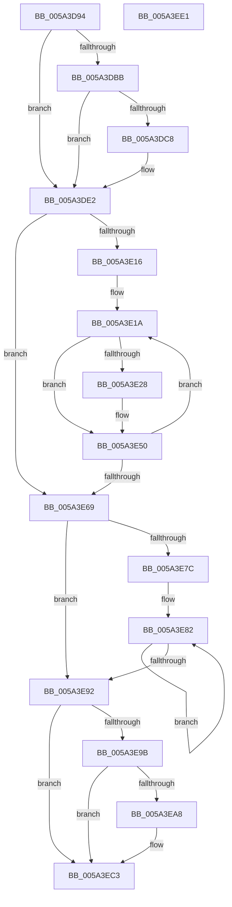

# IopMcRemoveMdlPagesFromTable

- RVA: `0x005A3D94`–`0x005A3EE2` (길이 `334` bytes)
- VA: `0x00000001405A3D94`
- 실행 섹션: `.text`
- PDB 이름 있음: `예`; PDB Function 태그: `아니요`
- unwind 정보 RVA: `0x000BDA48`
- 디코드: `91`개 명령, `334/334` bytes 표시
- 미해석 바이트: `0` (있으면 어셈블리에 `.byte`로 보존)

> 이 문서는 커널 이미지의 기계어와 PDB 기호를 분석해 생성했습니다. 4번과 5번은 함수 원형과 자료형을 바이너리 사용 방식에서 추정한 C 해석이며 원본 소스 복구 결과는 아닙니다.

## 1. Dependencies

- 직접 호출 지점: **9**; 고유 호출 대상: **6**
- 직접 호출자로 확인된 함수: **2**
- RIP 상대 이미지 참조: **3**

### Outgoing calls
- `0x005A3DDC` → [KeBugCheckEx](../4F/KeBugCheckEx_function_004FD660.md) (function, `0x004FD660`)
- `0x005A3E08` → [ExAcquireSpinLockExclusive](../24/ExAcquireSpinLockExclusive_function_00248690.md) (function, `0x00248690`)
- `0x005A3E1F` → [IopMcShouldYield](../4C/IopMcShouldYield_function_004C8480.md) (function, `0x004C8480`)
- `0x005A3E32` → [ExReleaseSpinLockExclusive](../2C/ExReleaseSpinLockExclusive_function_002C0EF0.md) (function, `0x002C0EF0`)
- `0x005A3E3C` → [KeYieldProcessorEx](../3F/KeYieldProcessorEx_function_003FBD00.md) (function, `0x003FBD00`)
- `0x005A3E48` → [ExAcquireSpinLockExclusive](../24/ExAcquireSpinLockExclusive_function_00248690.md) (function, `0x00248690`)
- `0x005A3E5A` → [RtlAvlRemoveNode](../29/RtlAvlRemoveNode_function_00296650.md) (function, `0x00296650`)
- `0x005A3E73` → [ExReleaseSpinLockExclusive](../2C/ExReleaseSpinLockExclusive_function_002C0EF0.md) (function, `0x002C0EF0`)
- `0x005A3EBD` → [KeBugCheckEx](../4F/KeBugCheckEx_function_004FD660.md) (function, `0x004FD660`)

### Direct callers
- [IopMcTryUnlockMdl](IopMcTryUnlockMdl_function_005A3EE8.md) at `0x005A3F10`
- [IopMcCreateBufferEntryMdl](../../page/72/IopMcCreateBufferEntryMdl_function_00722FA8.md) at `0x00723007`

### Static image references
- `0x005A3DAC` → RVA `0x00E66218` (`.data`; read)
- `0x005A3DFD` → RVA `0x00F8D024` (`.data`; read)
- `0x005A3E53` → RVA `0x00F8D028` (`.data`; read)

## 2. Other-region calls and transfers

- 다른 실행 섹션으로 향하는 call: **0**
- 별도 외부 분기/꼬리 이동을 확인하지 못했습니다.

## 3. Assembly (complete function range)

```asm
005A3D94  4C 8B DC                        mov r11, rsp
005A3D97  49 89 5B 08                     mov qword ptr [r11 + 8], rbx
005A3D9B  49 89 6B 10                     mov qword ptr [r11 + 0x10], rbp
005A3D9F  49 89 73 20                     mov qword ptr [r11 + 0x20], rsi
005A3DA3  57                              push rdi
005A3DA4  41 56                           push r14
005A3DA6  41 57                           push r15
005A3DA8  48 83 EC 30                     sub rsp, 0x30
005A3DAC  80 3D 65 24 8C 00 00            cmp byte ptr [rip + 0x8c2465], 0
005A3DB3  48 8B FA                        mov rdi, rdx
005A3DB6  48 8B D9                        mov rbx, rcx
005A3DB9  74 27                           je 0x1405a3de2
005A3DBB  48 8B 49 58                     mov rcx, qword ptr [rcx + 0x58]
005A3DBF  48 8D 42 30                     lea rax, [rdx + 0x30]
005A3DC3  48 3B C8                        cmp rcx, rax
005A3DC6  74 1A                           je 0x1405a3de2
005A3DC8  49 89 4B D8                     mov qword ptr [r11 - 0x28], rcx
005A3DCC  4C 8B CA                        mov r9, rdx
005A3DCF  BA 05 00 00 00                  mov edx, 5
005A3DD4  B9 F4 01 00 00                  mov ecx, 0x1f4
005A3DD9  4C 8B C3                        mov r8, rbx
005A3DDC  E8 7F 98 F5 FF                  call 0x1404fd660
005A3DE1  CC                              int3
005A3DE2  8B 4A 2C                        mov ecx, dword ptr [rdx + 0x2c]
005A3DE5  8B 72 28                        mov esi, dword ptr [rdx + 0x28]
005A3DE8  81 E1 FF 0F 00 00               and ecx, 0xfff
005A3DEE  83 64 24 60 00                  and dword ptr [rsp + 0x60], 0
005A3DF3  48 81 C6 FF 0F 00 00            add rsi, 0xfff
005A3DFA  48 03 F1                        add rsi, rcx
005A3DFD  48 8D 0D 20 92 9E 00            lea rcx, [rip + 0x9e9220]
005A3E04  48 C1 EE 0C                     shr rsi, 0xc
005A3E08  E8 83 48 CA FF                  call 0x140248690
005A3E0D  33 ED                           xor ebp, ebp
005A3E0F  44 8A F8                        mov r15b, al
005A3E12  85 F6                           test esi, esi
005A3E14  74 53                           je 0x1405a3e69
005A3E16  4C 8D 73 60                     lea r14, [rbx + 0x60]
005A3E1A  41 8A D7                        mov dl, r15b
005A3E1D  8B CD                           mov ecx, ebp
005A3E1F  E8 5C 46 F2 FF                  call 0x1404c8480
005A3E24  84 C0                           test al, al
005A3E26  74 28                           je 0x1405a3e50
005A3E28  41 8A D7                        mov dl, r15b
005A3E2B  48 8D 0D F2 91 9E 00            lea rcx, [rip + 0x9e91f2]
005A3E32  E8 B9 D0 D1 FF                  call 0x1402c0ef0
005A3E37  48 8D 4C 24 60                  lea rcx, [rsp + 0x60]
005A3E3C  E8 BF 7E E5 FF                  call 0x1403fbd00
005A3E41  48 8D 0D DC 91 9E 00            lea rcx, [rip + 0x9e91dc]
005A3E48  E8 43 48 CA FF                  call 0x140248690
005A3E4D  44 8A F8                        mov r15b, al
005A3E50  49 8B D6                        mov rdx, r14
005A3E53  48 8D 0D CE 91 9E 00            lea rcx, [rip + 0x9e91ce]
005A3E5A  E8 F1 27 CF FF                  call 0x140296650
005A3E5F  FF C5                           inc ebp
005A3E61  49 83 C6 20                     add r14, 0x20
005A3E65  3B EE                           cmp ebp, esi
005A3E67  72 B1                           jb 0x1405a3e1a
005A3E69  41 8A D7                        mov dl, r15b
005A3E6C  48 8D 0D B1 91 9E 00            lea rcx, [rip + 0x9e91b1]
005A3E73  E8 78 D0 D1 FF                  call 0x1402c0ef0
005A3E78  85 F6                           test esi, esi
005A3E7A  74 16                           je 0x1405a3e92
005A3E7C  48 8D 43 78                     lea rax, [rbx + 0x78]
005A3E80  8B CE                           mov ecx, esi
005A3E82  C7 00 FE FF FF FF               mov dword ptr [rax], 0xfffffffe
005A3E88  48 8D 40 20                     lea rax, [rax + 0x20]
005A3E8C  48 83 E9 01                     sub rcx, 1
005A3E90  75 F0                           jne 0x1405a3e82
005A3E92  80 3D 7F 23 8C 00 00            cmp byte ptr [rip + 0x8c237f], 0
005A3E99  74 28                           je 0x1405a3ec3
005A3E9B  48 8B 4B 58                     mov rcx, qword ptr [rbx + 0x58]
005A3E9F  48 8D 47 30                     lea rax, [rdi + 0x30]
005A3EA3  48 3B C8                        cmp rcx, rax
005A3EA6  74 1B                           je 0x1405a3ec3
005A3EA8  48 89 4C 24 20                  mov qword ptr [rsp + 0x20], rcx
005A3EAD  4C 8B CF                        mov r9, rdi
005A3EB0  B9 F4 01 00 00                  mov ecx, 0x1f4
005A3EB5  4C 8B C3                        mov r8, rbx
005A3EB8  BA 06 00 00 00                  mov edx, 6
005A3EBD  E8 9E 97 F5 FF                  call 0x1404fd660
005A3EC2  CC                              int3
005A3EC3  48 83 63 58 00                  and qword ptr [rbx + 0x58], 0
005A3EC8  48 8B 5C 24 50                  mov rbx, qword ptr [rsp + 0x50]
005A3ECD  48 8B 6C 24 58                  mov rbp, qword ptr [rsp + 0x58]
005A3ED2  48 8B 74 24 68                  mov rsi, qword ptr [rsp + 0x68]
005A3ED7  48 83 C4 30                     add rsp, 0x30
005A3EDB  41 5F                           pop r15
005A3EDD  41 5E                           pop r14
005A3EDF  5F                              pop rdi
005A3EE0  C3                              ret
005A3EE1  CC                              int3
```

## 4. C-style interpretation (structured pseudocode)

```c
__int64 __fastcall IopMcRemoveMdlPagesFromTable(__int64 a1, __int64 a2)
{
    __int64 result;
    __int64 v_r14;
    __int64 v_r15;
    __int64 v_rbp;
    __int64 v_rsi;
    __int64 v_rsp;
    unsigned __int64 v_stack_m28;
    unsigned __int64 v_stack_p10;
    unsigned int v_stack_p18;
    unsigned __int64 v_stack_p20;
    unsigned __int64 v_stack_p8;

    *(unsigned __int64 *)(v_rsp + 8) = v_rbx;
    *(unsigned __int64 *)(v_rsp + 16) = v_rbp;
    *(unsigned __int64 *)(v_rsp + 32) = v_rsi;
    v_rsp = (v_rsp) - (48);
    if ((*(unsigned __int8 *)(v_rip + 9184357)) == 0) goto loc_005A3DE2;
    result = a2 + 48;
    if ((*(unsigned __int64 *)(a1 + 88)) != (a2 + 48)) {
        *(unsigned __int64 *)(v_rsp - 40) = *(unsigned __int64 *)(a1 + 88);
        a4 = a2;
        a2 = 5;
        a1 = 500;
        a3 = a1;
        result = KeBugCheckEx(a1, a2, a3, a4);
    }
    a1 = (unsigned int)(((unsigned int)(*(unsigned int *)(a2 + 44))) & (0xFFFULL));
    v_rsi = ((unsigned int)(*(unsigned int *)(a2 + 40))) + (0xFFFULL);
    v_rsi = (v_rsi) + (a1);
    v_rsi = (v_rsi) >> (12);
    result = ExAcquireSpinLockExclusive(v_rip + 10392096, a2, a3, a4);
    v_rbp = 0;
    if ((unsigned int)(v_rsi) == 0) goto loc_005A3E69;
loc_005A3E1A:
    result = IopMcShouldYield(0, (unsigned __int8)((unsigned __int8)(result)), a3, a4);
    v_r15 = (unsigned __int8)(result);
    if ((unsigned __int8)(result) != 0) {
        a2 = (unsigned __int8)((unsigned __int8)(result));
        a1 = v_rip + 10392050;
        result = ExReleaseSpinLockExclusive(a1, a2, a3, a4);
        a1 = v_stack_p18;
        result = KeYieldProcessorEx(a1, a2, a3, a4);
        a1 = v_rip + 10392028;
        result = ExAcquireSpinLockExclusive(a1, a2, a3, a4);
        v_r15 = (unsigned __int8)(result);
    }
    result = RtlAvlRemoveNode(v_rip + 10392014, a1 + 96, a3, a4);
    v_rbp = (unsigned int)((v_rbp) + 1);
    v_r14 = (a1 + 96) + (32);
    if (((unsigned int)(v_rbp)) < ((unsigned int)(v_rsi))) goto loc_005A3E1A;
loc_005A3E69:
    result = ExReleaseSpinLockExclusive(v_rip + 10391985, (unsigned __int8)(v_r15), a3, a4);
    if ((unsigned int)(v_rsi) == 0) goto loc_005A3E92;
loc_005A3E82:
    *(unsigned int *)(a1 + 120) = 0xFFFFFFFEULL;
    a1 = ((unsigned int)((unsigned int)(v_rsi))) - (1);
    if (condition_is_not_equal) goto loc_005A3E82;
loc_005A3E92:
    if ((*(unsigned __int8 *)(v_rip + 9184127)) == 0) goto loc_005A3EC3;
    result = a2 + 48;
    if ((*(unsigned __int64 *)(a1 + 88)) != (a2 + 48)) {
        v_stack_m28 = *(unsigned __int64 *)(a1 + 88);
        a4 = a2;
        a1 = 500;
        a3 = a1;
        a2 = 6;
        result = KeBugCheckEx(a1, a2, a3, a4);
    }
    v_rsp = (v_rsp) + (48);
    return result;
}
```

## 5. (Beta) C Style

```c
int64_t IopMcRemoveMdlPagesFromTable(void *Arg1, void *Arg2)
{
    uint8_t *arg1 = (uint8_t *)Arg1;
    uint8_t *arg2 = (uint8_t *)Arg2;

    int64_t result;
    int64_t local_r14;
    int64_t local_r15;
    int64_t local_rbp;
    int64_t local_rsi;
    int64_t local_rsp;
    uint64_t v_stack_m28;
    uint64_t v_stack_p10;
    uint32_t v_stack_p18;
    uint64_t v_stack_p20;
    uint64_t v_stack_p8;

    *(uint64_t *)(local_rsp + 0x8) = local_rbx;
    *(uint64_t *)(local_rsp + 0x10) = local_rbp;
    *(uint64_t *)(local_rsp + 0x20) = local_rsi;
    local_rsp = (local_rsp) - (48);
    if ((*(uint8_t *)(v_rip + 0x8C2465)) == 0) goto loc_005A3DE2;
    result = Arg2 + 48;
    if ((*(uint64_t *)(arg1 + 0x58)) != (Arg2 + 48)) {
        *(uint64_t *)(local_rsp - 0x28) = *(uint64_t *)(arg1 + 0x58);
        a4 = Arg2;
        Arg2 = 5;
        Arg1 = 500;
        a3 = Arg1;
        result = KeBugCheckEx(Arg1, Arg2, a3, a4);
    }
    Arg1 = (uint32_t)(((uint32_t)(*(uint32_t *)(arg2 + 0x2C))) & (0xFFFULL));
    local_rsi = ((uint32_t)(*(uint32_t *)(arg2 + 0x28))) + (0xFFFULL);
    local_rsi = (local_rsi) + (Arg1);
    local_rsi = (local_rsi) >> (12);
    result = ExAcquireSpinLockExclusive(v_rip + 10392096, Arg2, a3, a4);
    local_rbp = 0;
    if ((uint32_t)(local_rsi) == 0) goto loc_005A3E69;
loc_005A3E1A:
    result = IopMcShouldYield(0, (uint8_t)((uint8_t)(result)), a3, a4);
    local_r15 = (uint8_t)(result);
    if ((uint8_t)(result) != 0) {
        Arg2 = (uint8_t)((uint8_t)(result));
        Arg1 = v_rip + 10392050;
        result = ExReleaseSpinLockExclusive(Arg1, Arg2, a3, a4);
        Arg1 = v_stack_p18;
        result = KeYieldProcessorEx(Arg1, Arg2, a3, a4);
        Arg1 = v_rip + 10392028;
        result = ExAcquireSpinLockExclusive(Arg1, Arg2, a3, a4);
        local_r15 = (uint8_t)(result);
    }
    result = RtlAvlRemoveNode(v_rip + 10392014, Arg1 + 96, a3, a4);
    local_rbp = (uint32_t)((local_rbp) + 1);
    local_r14 = (Arg1 + 96) + (32);
    if (((uint32_t)(local_rbp)) < ((uint32_t)(local_rsi))) goto loc_005A3E1A;
loc_005A3E69:
    result = ExReleaseSpinLockExclusive(v_rip + 10391985, (uint8_t)(local_r15), a3, a4);
    if ((uint32_t)(local_rsi) == 0) goto loc_005A3E92;
loc_005A3E82:
    *(uint32_t *)(arg1 + 0x78) = 0xFFFFFFFEULL;
    Arg1 = ((uint32_t)((uint32_t)(local_rsi))) - (1);
    if (condition_is_not_equal) goto loc_005A3E82;
loc_005A3E92:
    if ((*(uint8_t *)(v_rip + 0x8C237F)) == 0) goto loc_005A3EC3;
    result = Arg2 + 48;
    if ((*(uint64_t *)(arg1 + 0x58)) != (Arg2 + 48)) {
        v_stack_m28 = *(uint64_t *)(arg1 + 0x58);
        a4 = Arg2;
        Arg1 = 500;
        a3 = Arg1;
        Arg2 = 6;
        result = KeBugCheckEx(Arg1, Arg2, a3, a4);
    }
    local_rsp = (local_rsp) + (48);
    return result;
}
```

### 관측된 메모리 오프셋

구조체 형식이 확인되지 않은 접근은 인자 기준의 오프셋으로만 기록했습니다.

| 기준 인자 | 오프셋 표현 | 폭 (bit) | 접근 |
|---|---:|---:|---|
| `Arg1` | `+ 0x0` | `32` | `W` |
| `Arg1` | `+ 0x20` | `64` | `R` |
| `Arg1` | `+ 0x58` | `64` | `R` |
| `Arg1` | `+ 0x58` | `64` | `R/W` |
| `Arg1` | `+ 0x60` | `64` | `R` |
| `Arg1` | `+ 0x78` | `64` | `R` |
| `Arg2` | `+ 0x30` | `64` | `R` |

## 6. Execution-region graph

[열기: 2D/3D 그래프와 함수 탐색 컨트롤 패널](../../../control-panel.html?section=text&rva=0x005A3D94&view=graph)

- 2D 그래프는 위에서 아래로 흐르고, 3D 그래프는 빈 공간을 드래그해 회전합니다. Shift+드래그는 이동, 휠은 확대·축소, 함수 노드 선택은 대상 보고서 이동입니다.

### Static fallback


