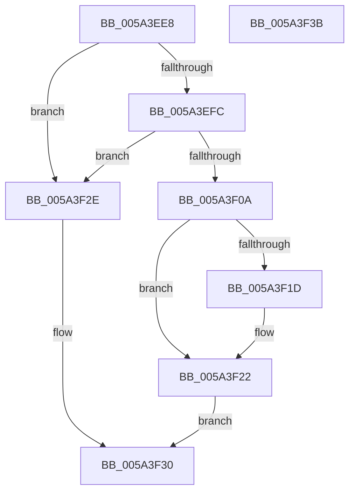

# IopMcTryUnlockMdl

- RVA: `0x005A3EE8`–`0x005A3F3C` (길이 `84` bytes)
- VA: `0x00000001405A3EE8`
- 실행 섹션: `.text`
- PDB 이름 있음: `예`; PDB Function 태그: `아니요`
- unwind 정보 RVA: `0x0005CAAC`
- 디코드: `28`개 명령, `84/84` bytes 표시
- 미해석 바이트: `0` (있으면 어셈블리에 `.byte`로 보존)

> 이 문서는 커널 이미지의 기계어와 PDB 기호를 분석해 생성했습니다. 4번과 5번은 함수 원형과 자료형을 바이너리 사용 방식에서 추정한 C 해석이며 원본 소스 복구 결과는 아닙니다.

## 1. Dependencies

- 직접 호출 지점: **2**; 고유 호출 대상: **2**
- 직접 호출자로 확인된 함수: **3**
- RIP 상대 이미지 참조: **0**

### Outgoing calls
- `0x005A3F10` → [IopMcRemoveMdlPagesFromTable](IopMcRemoveMdlPagesFromTable_function_005A3D94.md) (function, `0x005A3D94`)
- `0x005A3F25` → [IopUnlockAndFreeMdl](../29/IopUnlockAndFreeMdl_function_0029F200.md) (function, `0x0029F200`)

### Direct callers
- [IoTryReleasePages](../44/IoTryReleasePages_function_00442B58.md) at `0x00442BD9`
- [IopMcDereferenceMdl](IopMcDereferenceMdl_function_005A3C18.md) at `0x005A3C88`
- [IopMcWaitAndCleanupBufferEntry](IopMcWaitAndCleanupBufferEntry_function_005A3F44.md) at `0x005A3FA5`

### Static image references
- 디코드된 RIP-relative 메모리 참조가 없습니다.

## 2. Other-region calls and transfers

- 다른 실행 섹션으로 향하는 call: **0**
- 별도 외부 분기/꼬리 이동을 확인하지 못했습니다.

## 3. Assembly (complete function range)

```asm
005A3EE8  48 89 5C 24 08                  mov qword ptr [rsp + 8], rbx
005A3EED  57                              push rdi
005A3EEE  48 83 EC 20                     sub rsp, 0x20
005A3EF2  48 8B D9                        mov rbx, rcx
005A3EF5  33 C9                           xor ecx, ecx
005A3EF7  48 85 D2                        test rdx, rdx
005A3EFA  74 32                           je 0x1405a3f2e
005A3EFC  48 8B C2                        mov rax, rdx
005A3EFF  F0 48 0F B1 4B 38               lock cmpxchg qword ptr [rbx + 0x38], rcx
005A3F05  48 8B F8                        mov rdi, rax
005A3F08  75 24                           jne 0x1405a3f2e
005A3F0A  48 8B D0                        mov rdx, rax
005A3F0D  48 8B CB                        mov rcx, rbx
005A3F10  E8 7F FE FF FF                  call 0x1405a3d94
005A3F15  8B 4B 0C                        mov ecx, dword ptr [rbx + 0xc]
005A3F18  F6 C1 01                        test cl, 1
005A3F1B  74 05                           je 0x1405a3f22
005A3F1D  F0 83 63 0C FE                  lock and dword ptr [rbx + 0xc], 0xfffffffe
005A3F22  48 8B CF                        mov rcx, rdi
005A3F25  E8 D6 B2 CF FF                  call 0x14029f200
005A3F2A  B0 01                           mov al, 1
005A3F2C  EB 02                           jmp 0x1405a3f30
005A3F2E  32 C0                           xor al, al
005A3F30  48 8B 5C 24 30                  mov rbx, qword ptr [rsp + 0x30]
005A3F35  48 83 C4 20                     add rsp, 0x20
005A3F39  5F                              pop rdi
005A3F3A  C3                              ret
005A3F3B  CC                              int3
```

## 4. C-style interpretation (structured pseudocode)

```c
__int64 __fastcall IopMcTryUnlockMdl(__int64 a1, __int64 a2)
{
    __int64 result;
    __int64 v_rsp;
    unsigned __int64 v_stack_p8;

    v_stack_p8 = v_rbx;
    v_rsp = (v_rsp) - (32);
    a1 = 0;
    if (a2 == 0) goto loc_005A3F2E;
    if (a2 != 0) goto loc_005A3F2E;
    result = IopMcRemoveMdlPagesFromTable(0, a2, a3, a4);
    if ((((unsigned __int8)((unsigned int)(*(unsigned int *)(a1 + 12)))) & (1)) != 0) {
    }
    result = IopUnlockAndFreeMdl(a2, a2, a3, a4);
    goto loc_005A3F30;
loc_005A3F2E:
    result = 0;
loc_005A3F30:
    v_rsp = (v_rsp) + (32);
    return result;
}
```

## 5. (Beta) C Style

```c
int64_t IopMcTryUnlockMdl(void *Arg1, int64_t Arg2)
{
    uint8_t *arg1 = (uint8_t *)Arg1;

    int64_t result;
    int64_t local_rsp;
    uint64_t v_stack_p8;

    v_stack_p8 = local_rbx;
    local_rsp = (local_rsp) - (32);
    Arg1 = 0;
    if (Arg2 == 0) goto loc_005A3F2E;
    if (Arg2 != 0) goto loc_005A3F2E;
    result = IopMcRemoveMdlPagesFromTable(0, Arg2, a3, a4);
    if ((((uint8_t)((uint32_t)(*(uint32_t *)(arg1 + 0xC)))) & (1)) != 0) {
    }
    result = IopUnlockAndFreeMdl(Arg2, Arg2, a3, a4);
    goto loc_005A3F30;
loc_005A3F2E:
    result = 0;
loc_005A3F30:
    local_rsp = (local_rsp) + (32);
    return result;
}
```

### 관측된 메모리 오프셋

구조체 형식이 확인되지 않은 접근은 인자 기준의 오프셋으로만 기록했습니다.

| 기준 인자 | 오프셋 표현 | 폭 (bit) | 접근 |
|---|---:|---:|---|
| `Arg1` | `+ 0xC` | `32` | `R` |
| `Arg1` | `+ 0xC` | `32` | `R/W` |
| `Arg1` | `+ 0x38` | `64` | `R` |

## 6. Execution-region graph

[열기: 2D/3D 그래프와 함수 탐색 컨트롤 패널](../../../control-panel.html?section=text&rva=0x005A3EE8&view=graph)

- 2D 그래프는 위에서 아래로 흐르고, 3D 그래프는 빈 공간을 드래그해 회전합니다. Shift+드래그는 이동, 휠은 확대·축소, 함수 노드 선택은 대상 보고서 이동입니다.

### Static fallback


