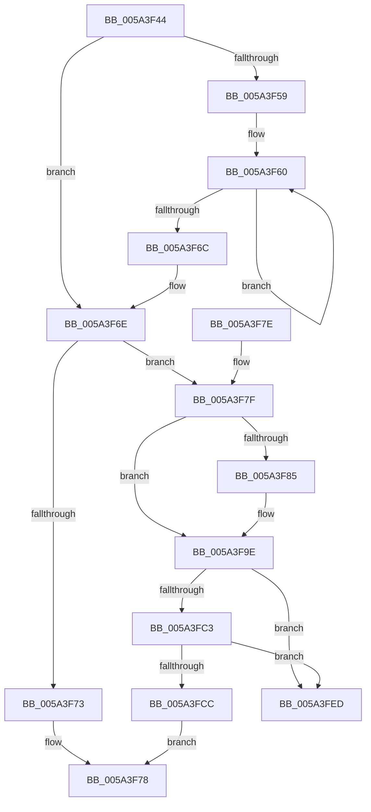

# IopMcWaitAndCleanupBufferEntry

- RVA: `0x005A3F44`–`0x005A3FF4` (길이 `176` bytes)
- VA: `0x00000001405A3F44`
- 실행 섹션: `.text`
- PDB 이름 있음: `예`; PDB Function 태그: `아니요`
- unwind 정보 RVA: `0x000C7E74`
- 디코드: `53`개 명령, `176/176` bytes 표시
- 미해석 바이트: `0` (있으면 어셈블리에 `.byte`로 보존)

> 이 문서는 커널 이미지의 기계어와 PDB 기호를 분석해 생성했습니다. 4번과 5번은 함수 원형과 자료형을 바이너리 사용 방식에서 추정한 C 해석이며 원본 소스 복구 결과는 아닙니다.

## 1. Dependencies

- 직접 호출 지점: **5**; 고유 호출 대상: **5**
- 직접 호출자로 확인된 함수: **2**
- RIP 상대 이미지 참조: **1**

### Outgoing calls
- `0x005A3F99` → [KeWaitForSingleObject](../20/KeWaitForSingleObject_function_0020E6B0.md) (function, `0x0020E6B0`)
- `0x005A3FA5` → [IopMcTryUnlockMdl](IopMcTryUnlockMdl_function_005A3EE8.md) (function, `0x005A3EE8`)
- `0x005A3FB1` → [KeAcquireSpinLockRaiseToDpc](../20/KeAcquireSpinLockRaiseToDpc_function_00208470.md) (function, `0x00208470`)
- `0x005A3FDC` → [KeReleaseSpinLock](../39/KeReleaseSpinLock_function_00392BA0.md) (function, `0x00392BA0`)
- `0x005A3FE4` → [IopMcDereferenceBufferEntry](../44/IopMcDereferenceBufferEntry_function_00442BE8.md) (function, `0x00442BE8`)

### Direct callers
- [IopIoRingCleanupRegBufferArray](../../page/71/IopIoRingCleanupRegBufferArray_function_0071F914.md) at `0x0071F937`
- [IopIoRingDispatchRegisterBuffers](../../page/71/IopIoRingDispatchRegisterBuffers_function_0071FC18.md) at `0x0071FEE0`

### Static image references
- `0x005A3FAA` → RVA `0x00F8D008` (`.data`; read)

## 2. Other-region calls and transfers

- 다른 실행 섹션으로 향하는 call: **0**
- 별도 외부 분기/꼬리 이동을 확인하지 못했습니다.

## 3. Assembly (complete function range)

```asm
005A3F44  40 53                           push rbx
005A3F46  48 83 EC 30                     sub rsp, 0x30
005A3F4A  48 8B D9                        mov rbx, rcx
005A3F4D  8B 49 0C                        mov ecx, dword ptr [rcx + 0xc]
005A3F50  8B C1                           mov eax, ecx
005A3F52  83 E0 06                        and eax, 6
005A3F55  3C 06                           cmp al, 6
005A3F57  74 15                           je 0x1405a3f6e
005A3F59  0F 0D 4B 0C                     prefetchw byte ptr [rbx + 0xc]
005A3F5D  8B 43 0C                        mov eax, dword ptr [rbx + 0xc]
005A3F60  8B C8                           mov ecx, eax
005A3F62  83 C9 06                        or ecx, 6
005A3F65  F0 0F B1 4B 0C                  lock cmpxchg dword ptr [rbx + 0xc], ecx
005A3F6A  75 F4                           jne 0x1405a3f60
005A3F6C  8B C8                           mov ecx, eax
005A3F6E  F6 C1 04                        test cl, 4
005A3F71  74 0C                           je 0x1405a3f7f
005A3F73  B8 FF 00 00 00                  mov eax, 0xff
005A3F78  48 83 C4 30                     add rsp, 0x30
005A3F7C  5B                              pop rbx
005A3F7D  C3                              ret
005A3F7E  CC                              int3
005A3F7F  83 7B 30 00                     cmp dword ptr [rbx + 0x30], 0
005A3F83  7E 19                           jle 0x1405a3f9e
005A3F85  48 83 64 24 20 00               and qword ptr [rsp + 0x20], 0
005A3F8B  48 8D 4B 40                     lea rcx, [rbx + 0x40]
005A3F8F  45 33 C9                        xor r9d, r9d
005A3F92  45 33 C0                        xor r8d, r8d
005A3F95  41 8D 51 29                     lea edx, [r9 + 0x29]
005A3F99  E8 12 A7 C6 FF                  call 0x14020e6b0
005A3F9E  48 8B 53 38                     mov rdx, qword ptr [rbx + 0x38]
005A3FA2  48 8B CB                        mov rcx, rbx
005A3FA5  E8 3E FF FF FF                  call 0x1405a3ee8
005A3FAA  48 8D 0D 57 90 9E 00            lea rcx, [rip + 0x9e9057]
005A3FB1  E8 BA 44 C6 FF                  call 0x140208470
005A3FB6  48 8D 53 10                     lea rdx, [rbx + 0x10]
005A3FBA  4C 8B 0A                        mov r9, qword ptr [rdx]
005A3FBD  49 39 51 08                     cmp qword ptr [r9 + 8], rdx
005A3FC1  75 2A                           jne 0x1405a3fed
005A3FC3  4C 8B 42 08                     mov r8, qword ptr [rdx + 8]
005A3FC7  49 39 10                        cmp qword ptr [r8], rdx
005A3FCA  75 21                           jne 0x1405a3fed
005A3FCC  4D 89 08                        mov qword ptr [r8], r9
005A3FCF  48 8D 0D 32 90 9E 00            lea rcx, [rip + 0x9e9032]
005A3FD6  8A D0                           mov dl, al
005A3FD8  4D 89 41 08                     mov qword ptr [r9 + 8], r8
005A3FDC  E8 BF EB DE FF                  call 0x140392ba0
005A3FE1  48 8B CB                        mov rcx, rbx
005A3FE4  E8 FF EB E9 FF                  call 0x140442be8
005A3FE9  33 C0                           xor eax, eax
005A3FEB  EB 8B                           jmp 0x1405a3f78
005A3FED  B9 03 00 00 00                  mov ecx, 3
005A3FF2  CD 29                           int 0x29
```

## 4. C-style interpretation (structured pseudocode)

```c
__int64 __fastcall IopMcWaitAndCleanupBufferEntry(__int64 a1, __int64 a2, int a3, int a4)
{
    __int64 result;
    __int64 v_rsp;
    unsigned __int64 v_stack_p20;

    v_rsp = (v_rsp) - (48);
    result = (unsigned int)(((unsigned int)((unsigned int)((unsigned int)(*(unsigned int *)(a1 + 12))))) & (6));
    if (((unsigned __int8)(result)) == 6) goto loc_005A3F6E;
loc_005A3F60:
    a1 = (unsigned int)(((unsigned int)((unsigned int)((unsigned int)(*(unsigned int *)(a1 + 12))))) | (6));
    if (condition_is_not_equal) goto loc_005A3F60;
loc_005A3F6E:
    if ((((unsigned __int8)((unsigned int)((unsigned int)((unsigned int)(*(unsigned int *)(a1 + 12)))))) & (4)) == 0) goto loc_005A3F7F;
loc_005A3F78:
    v_rsp = (v_rsp) + (48);
    return 255;
loc_005A3F7F:
    result = 255;
    if ((*(unsigned int *)(a1 + 48)) >= = 0) {
        a1 = a1 + 64;
        a4 = 0;
        a3 = 0;
        a2 = a4 + 41;
        result = KeWaitForSingleObject(a1, a2, a3, a4);
    }
    result = IopMcTryUnlockMdl(a1, *(unsigned __int64 *)(a1 + 56), a3, a4);
    result = KeAcquireSpinLockRaiseToDpc(v_rip + 10391639, *(unsigned __int64 *)(a1 + 56), a3, a4);
    if ((*(unsigned __int64 *)(*(unsigned __int64 *)(a1 + 16) + 8)) != (a1 + 16)) goto loc_005A3FED;
    if ((*(unsigned __int64 *)(*(unsigned __int64 *)(a1 + 16 + 8))) != (a1 + 16)) goto loc_005A3FED;
    *(unsigned __int64 *)(*(unsigned __int64 *)(a1 + 16 + 8)) = *(unsigned __int64 *)(a1 + 16);
    *(unsigned __int64 *)(*(unsigned __int64 *)(a1 + 16) + 8) = *(unsigned __int64 *)(a1 + 16 + 8);
    result = KeReleaseSpinLock(v_rip + 10391602, (unsigned __int8)(result), *(unsigned __int64 *)(a1 + 16 + 8), *(unsigned __int64 *)(a1 + 16));
    result = IopMcDereferenceBufferEntry(a1, (unsigned __int8)(result), *(unsigned __int64 *)(a1 + 16 + 8), *(unsigned __int64 *)(a1 + 16));
    result = 0;
    goto loc_005A3F78;
loc_005A3FED:
    return result;
}
```

## 5. (Beta) C Style

```c
int64_t IopMcWaitAndCleanupBufferEntry(void *Arg1, int64_t Arg2, int32_t Arg3, int32_t Arg4)
{
    uint8_t *arg1 = (uint8_t *)Arg1;

    int64_t result;
    int64_t local_rsp;
    uint64_t v_stack_p20;

    local_rsp = (local_rsp) - (48);
    result = (uint32_t)(((uint32_t)((uint32_t)((uint32_t)(*(uint32_t *)(arg1 + 0xC))))) & (6));
    if (((uint8_t)(result)) == 6) goto loc_005A3F6E;
loc_005A3F60:
    Arg1 = (uint32_t)(((uint32_t)((uint32_t)((uint32_t)(*(uint32_t *)(arg1 + 0xC))))) | (6));
    if (condition_is_not_equal) goto loc_005A3F60;
loc_005A3F6E:
    if ((((uint8_t)((uint32_t)((uint32_t)((uint32_t)(*(uint32_t *)(arg1 + 0xC)))))) & (4)) == 0) goto loc_005A3F7F;
loc_005A3F78:
    local_rsp = (local_rsp) + (48);
    return 255;
loc_005A3F7F:
    result = 255;
    if ((*(uint32_t *)(arg1 + 0x30)) >= = 0) {
        Arg1 = Arg1 + 64;
        Arg4 = 0;
        Arg3 = 0;
        Arg2 = Arg4 + 41;
        result = KeWaitForSingleObject(Arg1, Arg2, Arg3, Arg4);
    }
    result = IopMcTryUnlockMdl(Arg1, *(uint64_t *)(arg1 + 0x38), Arg3, Arg4);
    result = KeAcquireSpinLockRaiseToDpc(v_rip + 10391639, *(uint64_t *)(arg1 + 0x38), Arg3, Arg4);
    if ((*(uint64_t *)(*(uint64_t *)(arg1 + 0x10) + 0x8)) != (Arg1 + 16)) goto loc_005A3FED;
    if ((*(uint64_t *)(*(uint64_t *)(arg1 + 0x10 + 0x8))) != (Arg1 + 16)) goto loc_005A3FED;
    *(uint64_t *)(*(uint64_t *)(arg1 + 0x10 + 0x8)) = *(uint64_t *)(arg1 + 0x10);
    *(uint64_t *)(*(uint64_t *)(arg1 + 0x10) + 0x8) = *(uint64_t *)(arg1 + 0x10 + 0x8);
    result = KeReleaseSpinLock(v_rip + 10391602, (uint8_t)(result), *(uint64_t *)(arg1 + 0x10 + 0x8), *(uint64_t *)(arg1 + 0x10));
    result = IopMcDereferenceBufferEntry(Arg1, (uint8_t)(result), *(uint64_t *)(arg1 + 0x10 + 0x8), *(uint64_t *)(arg1 + 0x10));
    result = 0;
    goto loc_005A3F78;
loc_005A3FED:
    return result;
}
```

### 관측된 메모리 오프셋

구조체 형식이 확인되지 않은 접근은 인자 기준의 오프셋으로만 기록했습니다.

| 기준 인자 | 오프셋 표현 | 폭 (bit) | 접근 |
|---|---:|---:|---|
| `Arg1` | `+ 0x0` | `64` | `R` |
| `Arg1` | `+ 0x8` | `64` | `R` |
| `Arg1` | `+ 0xC` | `8` | `R` |
| `Arg1` | `+ 0xC` | `32` | `R` |
| `Arg1` | `+ 0x10` | `64` | `R` |
| `Arg1` | `+ 0x30` | `32` | `R` |
| `Arg1` | `+ 0x38` | `64` | `R` |
| `Arg1` | `+ 0x40` | `64` | `R` |

## 6. Execution-region graph

[열기: 2D/3D 그래프와 함수 탐색 컨트롤 패널](../../../control-panel.html?section=text&rva=0x005A3F44&view=graph)

- 2D 그래프는 위에서 아래로 흐르고, 3D 그래프는 빈 공간을 드래그해 회전합니다. Shift+드래그는 이동, 휠은 확대·축소, 함수 노드 선택은 대상 보고서 이동입니다.

### Static fallback


