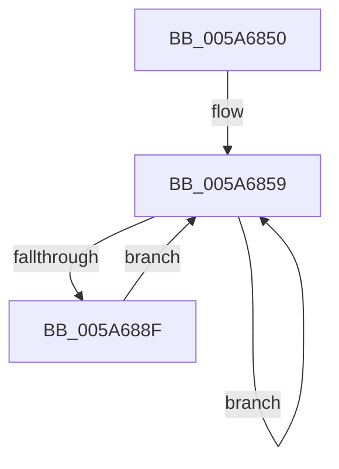

# IopPassiveInterruptRealtimeWorker

- RVA: `0x005A6850`–`0x005A689E` (길이 `78` bytes)
- VA: `0x00000001405A6850`
- 실행 섹션: `.text`
- PDB 이름 있음: `예`; PDB Function 태그: `아니요`
- unwind 정보 RVA: `0x000C8648`
- 디코드: `19`개 명령, `78/78` bytes 표시
- 미해석 바이트: `0` (있으면 어셈블리에 `.byte`로 보존)

> 이 문서는 커널 이미지의 기계어와 PDB 기호를 분석해 생성했습니다. 4번과 5번은 함수 원형과 자료형을 바이너리 사용 방식에서 추정한 C 해석이며 원본 소스 복구 결과는 아닙니다.

## 1. Dependencies

- 직접 호출 지점: **2**; 고유 호출 대상: **2**
- 직접 호출자로 확인된 함수: **0**
- RIP 상대 이미지 참조: **0**

### Outgoing calls
- `0x005A687C` → [KeRemoveQueueEx](../20/KeRemoveQueueEx_function_0020BD30.md) (function, `0x0020BD30`)
- `0x005A6897` → [guard_dispatch_icall](../6B/guard_dispatch_icall_function_006BAAD0.md) (function, `0x006BAAD0`)

### Direct callers
- 이 함수 시작 RVA로 연결되는 직접 call은 확인되지 않았습니다. 간접 호출은 완전히 역산할 수 없습니다.

### Static image references
- 디코드된 RIP-relative 메모리 참조가 없습니다.

## 2. Other-region calls and transfers

- 다른 실행 섹션으로 향하는 call: **0**
- 별도 외부 분기/꼬리 이동을 확인하지 못했습니다.

## 3. Assembly (complete function range)

```asm
005A6850  40 53                           push rbx
005A6852  48 83 EC 30                     sub rsp, 0x30
005A6856  48 8B D9                        mov rbx, rcx
005A6859  48 83 64 24 48 00               and qword ptr [rsp + 0x48], 0
005A685F  48 8D 44 24 48                  lea rax, [rsp + 0x48]
005A6864  C7 44 24 28 01 00 00 00         mov dword ptr [rsp + 0x28], 1
005A686C  45 33 C9                        xor r9d, r9d
005A686F  45 33 C0                        xor r8d, r8d
005A6872  48 89 44 24 20                  mov qword ptr [rsp + 0x20], rax
005A6877  33 D2                           xor edx, edx
005A6879  48 8B CB                        mov rcx, rbx
005A687C  E8 AF 54 C6 FF                  call 0x14020bd30
005A6881  48 8B 4C 24 48                  mov rcx, qword ptr [rsp + 0x48]
005A6886  48 81 F9 80 00 00 00            cmp rcx, 0x80
005A688D  74 CA                           je 0x1405a6859
005A688F  48 8B 41 10                     mov rax, qword ptr [rcx + 0x10]
005A6893  48 8B 49 18                     mov rcx, qword ptr [rcx + 0x18]
005A6897  E8 34 42 11 00                  call 0x1406baad0
005A689C  EB BB                           jmp 0x1405a6859
```

## 4. C-style interpretation (structured pseudocode)

```c
__int64 __fastcall IopPassiveInterruptRealtimeWorker(__int64 a1, int a2, int a3, int a4)
{
    __int64 result;
    __int64 v_rsp;
    unsigned int v_stack_m10;
    unsigned __int64 v_stack_m18;
    unsigned __int64 v_stack_p10;

    v_rsp = (v_rsp) - (48);
loc_005A6859:
    v_stack_m10 = 1;
    a4 = 0;
    a3 = 0;
    v_stack_m18 = v_stack_p10;
    a2 = 0;
    result = KeRemoveQueueEx(a1, a2, a3, a4);
    if (v_stack_p10 == 128) goto loc_005A6859;
    result = guard_dispatch_icall(*(unsigned __int64 *)(v_stack_p10 + 24), a2, a3, a4);
    goto loc_005A6859;
}
```

## 5. (Beta) C Style

```c
int64_t IopPassiveInterruptRealtimeWorker(int64_t Arg1, int32_t Arg2, int32_t Arg3, int32_t Arg4)
{
    int64_t result;
    int64_t local_rsp;
    uint32_t v_stack_m10;
    uint64_t v_stack_m18;
    uint64_t v_stack_p10;

    local_rsp = (local_rsp) - (48);
loc_005A6859:
    v_stack_m10 = 1;
    Arg4 = 0;
    Arg3 = 0;
    v_stack_m18 = v_stack_p10;
    Arg2 = 0;
    result = KeRemoveQueueEx(Arg1, Arg2, Arg3, Arg4);
    if (v_stack_p10 == 128) goto loc_005A6859;
    result = guard_dispatch_icall(*(uint64_t *)(v_stack_p10 + 0x18), Arg2, Arg3, Arg4);
    goto loc_005A6859;
}
```

## 6. Execution-region graph

[열기: 2D/3D 그래프와 함수 탐색 컨트롤 패널](../../../control-panel.html?section=text&rva=0x005A6850&view=graph)

- 2D 그래프는 위에서 아래로 흐르고, 3D 그래프는 빈 공간을 드래그해 회전합니다. Shift+드래그는 이동, 휠은 확대·축소, 함수 노드 선택은 대상 보고서 이동입니다.

### Static fallback


