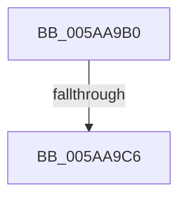

# KasanDriverUnloadImage

- RVA: `0x005AA9B0`–`0x005AA9CD` (길이 `29` bytes)
- VA: `0x00000001405AA9B0`
- 실행 섹션: `.text`
- PDB 이름 있음: `예`; PDB Function 태그: `아니요`
- unwind 정보 RVA: `0x000C95CC`
- 디코드: `6`개 명령, `29/29` bytes 표시
- 미해석 바이트: `0` (있으면 어셈블리에 `.byte`로 보존)

> 이 문서는 커널 이미지의 기계어와 PDB 기호를 분석해 생성했습니다. 4번과 5번은 함수 원형과 자료형을 바이너리 사용 방식에서 추정한 C 해석이며 원본 소스 복구 결과는 아닙니다.

## 1. Dependencies

- 직접 호출 지점: **0**; 고유 호출 대상: **0**
- 직접 호출자로 확인된 함수: **1**
- RIP 상대 이미지 참조: **2**

### Outgoing calls
- 직접 디코드된 call 명령이 없습니다.

### Direct callers
- [MiUnloadSystemImage](../../page/AA/MiUnloadSystemImage_function_00AA2FD4.md) at `0x00AA31C1`

### Static image references
- `0x005AA9B6` → RVA `0x00FCEC68` (`ALMOSTRO`; read)
- `0x005AA9C6` → RVA `0x00F654F8` (`.data`; read)

## 2. Other-region calls and transfers

- 다른 실행 섹션으로 향하는 call: **0**
- call이 아닌 외부 분기/꼬리 이동: **1**
  - `0x005AA9C0` → [sub_005AAB79](Unknown_function_005AAB79.md) (`tail-transfer`)

## 3. Assembly (complete function range)

```asm
005AA9B0  40 53                           push rbx
005AA9B2  48 83 EC 50                     sub rsp, 0x50
005AA9B6  80 3D AB 42 A2 00 00            cmp byte ptr [rip + 0xa242ab], 0
005AA9BD  48 8B D9                        mov rbx, rcx
005AA9C0  0F 84 B3 01 00 00               je 0x1405aab79
005AA9C6  80 3D 2B AB 9B 00 00            cmp byte ptr [rip + 0x9bab2b], 0
```

## 4. C-style interpretation (structured pseudocode)

```c
void __fastcall KasanDriverUnloadImage(__int64 a1)
{
    __int64 v_rsp;

    v_rsp = (v_rsp) - (80);
    return;
}
```

## 5. (Beta) C Style

```c
void KasanDriverUnloadImage(int64_t Arg1)
{
    int64_t local_rsp;

    local_rsp = (local_rsp) - (80);
    return;
}
```

## 6. Execution-region graph

[열기: 2D/3D 그래프와 함수 탐색 컨트롤 패널](../../../control-panel.html?section=text&rva=0x005AA9B0&view=graph)

- 2D 그래프는 위에서 아래로 흐르고, 3D 그래프는 빈 공간을 드래그해 회전합니다. Shift+드래그는 이동, 휠은 확대·축소, 함수 노드 선택은 대상 보고서 이동입니다.

### Static fallback


