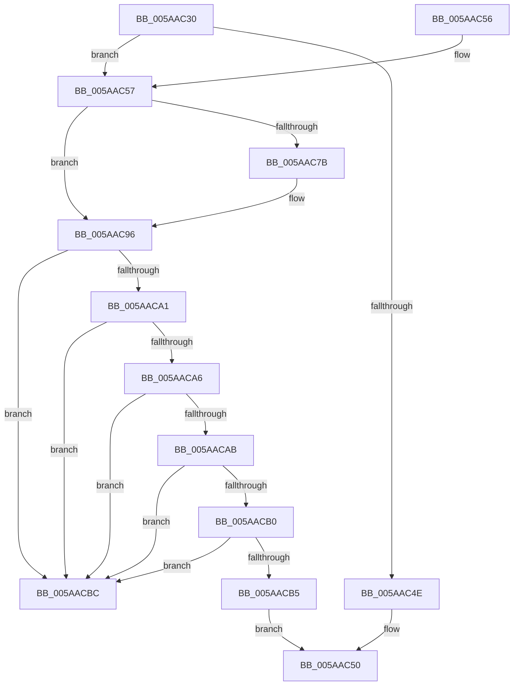

# KasanHibernationGetStackLow

- RVA: `0x005AAC30`–`0x005AACD7` (길이 `167` bytes)
- VA: `0x00000001405AAC30`
- 실행 섹션: `.text`
- PDB 이름 있음: `예`; PDB Function 태그: `아니요`
- unwind 정보 RVA: `0x000C955C`
- 디코드: `50`개 명령, `167/167` bytes 표시
- 미해석 바이트: `0` (있으면 어셈블리에 `.byte`로 보존)

> 이 문서는 커널 이미지의 기계어와 PDB 기호를 분석해 생성했습니다. 4번과 5번은 함수 원형과 자료형을 바이너리 사용 방식에서 추정한 C 해석이며 원본 소스 복구 결과는 아닙니다.

## 1. Dependencies

- 직접 호출 지점: **4**; 고유 호출 대상: **3**
- 직접 호출자로 확인된 함수: **3**
- RIP 상대 이미지 참조: **1**

### Outgoing calls
- `0x005AAC57` → [KeGetCurrentStackPointer](../6B/KeGetCurrentStackPointer_function_006B1070.md) (function, `0x006B1070`)
- `0x005AAC6E` → [KeQueryCurrentStackInformationEx](../2F/KeQueryCurrentStackInformationEx_function_002F7CD0.md) (function, `0x002F7CD0`)
- `0x005AAC90` → [KeBugCheckEx](../4F/KeBugCheckEx_function_004FD660.md) (function, `0x004FD660`)
- `0x005AACD1` → [KeBugCheckEx](../4F/KeBugCheckEx_function_004FD660.md) (function, `0x004FD660`)

### Direct callers
- [HalpSaveProcessorState](../6A/HalpSaveProcessorState_function_006ACBD0.md) at `0x006ACBE3`
- [HalpSetupRealModeResume](../6A/HalpSetupRealModeResume_function_006ACC60.md) at `0x006ACC99`
- [PopSaveHiberContextWrapper](../6B/PopSaveHiberContextWrapper_function_006BA360.md) at `0x006BA37F`

### Static image references
- `0x005AAC38` → RVA `0x00FCEC68` (`ALMOSTRO`; read)

## 2. Other-region calls and transfers

- 다른 실행 섹션으로 향하는 call: **0**
- 별도 외부 분기/꼬리 이동을 확인하지 못했습니다.

## 3. Assembly (complete function range)

```asm
005AAC30  40 53                           push rbx
005AAC32  48 83 EC 30                     sub rsp, 0x30
005AAC36  33 DB                           xor ebx, ebx
005AAC38  38 1D 2A 40 A2 00               cmp byte ptr [rip + 0xa2402a], bl
005AAC3E  89 5C 24 40                     mov dword ptr [rsp + 0x40], ebx
005AAC42  48 89 5C 24 48                  mov qword ptr [rsp + 0x48], rbx
005AAC47  48 89 5C 24 50                  mov qword ptr [rsp + 0x50], rbx
005AAC4C  75 09                           jne 0x1405aac57
005AAC4E  33 C0                           xor eax, eax
005AAC50  48 83 C4 30                     add rsp, 0x30
005AAC54  5B                              pop rbx
005AAC55  C3                              ret
005AAC56  CC                              int3
005AAC57  E8 14 64 10 00                  call 0x1406b1070
005AAC5C  48 8B C8                        mov rcx, rax
005AAC5F  4C 8D 4C 24 50                  lea r9, [rsp + 0x50]
005AAC64  4C 8D 44 24 48                  lea r8, [rsp + 0x48]
005AAC69  48 8D 54 24 40                  lea rdx, [rsp + 0x40]
005AAC6E  E8 5D D0 D4 FF                  call 0x1402f7cd0
005AAC73  44 0F B6 C0                     movzx r8d, al
005AAC77  84 C0                           test al, al
005AAC79  75 1B                           jne 0x1405aac96
005AAC7B  BA 04 00 00 00                  mov edx, 4
005AAC80  48 89 5C 24 20                  mov qword ptr [rsp + 0x20], rbx
005AAC85  44 8B C2                        mov r8d, edx
005AAC88  45 33 C9                        xor r9d, r9d
005AAC8B  B9 F1 01 00 00                  mov ecx, 0x1f1
005AAC90  E8 CB 29 F5 FF                  call 0x1404fd660
005AAC95  CC                              int3
005AAC96  48 63 54 24 40                  movsxd rdx, dword ptr [rsp + 0x40]
005AAC9B  8B CA                           mov ecx, edx
005AAC9D  85 D2                           test edx, edx
005AAC9F  74 1B                           je 0x1405aacbc
005AACA1  83 E9 05                        sub ecx, 5
005AACA4  74 16                           je 0x1405aacbc
005AACA6  83 E9 02                        sub ecx, 2
005AACA9  74 11                           je 0x1405aacbc
005AACAB  83 E9 01                        sub ecx, 1
005AACAE  74 0C                           je 0x1405aacbc
005AACB0  83 F9 01                        cmp ecx, 1
005AACB3  74 07                           je 0x1405aacbc
005AACB5  48 8B 44 24 48                  mov rax, qword ptr [rsp + 0x48]
005AACBA  EB 94                           jmp 0x1405aac50
005AACBC  48 89 54 24 20                  mov qword ptr [rsp + 0x20], rdx
005AACC1  4D 8B C8                        mov r9, r8
005AACC4  BA 04 00 00 00                  mov edx, 4
005AACC9  B9 F1 01 00 00                  mov ecx, 0x1f1
005AACCE  44 8B C2                        mov r8d, edx
005AACD1  E8 8A 29 F5 FF                  call 0x1404fd660
005AACD6  CC                              int3
```

## 4. C-style interpretation (structured pseudocode)

```c
__int64 __fastcall KasanHibernationGetStackLow(void)
{
    __int64 result;
    __int64 v_rbx;
    __int64 v_rsp;
    unsigned __int64 v_stack_p10;
    unsigned __int64 v_stack_p18;
    unsigned __int64 v_stack_p20;
    unsigned __int64 v_stack_p40;
    unsigned __int64 v_stack_p48;
    unsigned __int64 v_stack_p50;
    unsigned int v_stack_p8;

    v_rsp = (v_rsp) - (48);
    v_rbx = 0;
    v_stack_p8 = 0;
    v_stack_p10 = 0;
    v_stack_p18 = 0;
    if ((*(unsigned __int8 *)(v_rip + 10633258)) != 0) goto loc_005AAC57;
    result = 0;
loc_005AAC50:
    v_rsp = (v_rsp) + (48);
    return result;
loc_005AAC57:
    result = KeGetCurrentStackPointer(a1, a2, a3, a4);
    result = KeQueryCurrentStackInformationEx(result, v_stack_p40, v_stack_p48, v_stack_p50);
    if ((unsigned __int8)(result) == 0) {
        a2 = 4;
        v_stack_p20 = 0;
        a3 = (unsigned int)(a2);
        a4 = 0;
        a1 = 497;
        result = KeBugCheckEx(a1, a2, a3, a4);
    }
    if ((unsigned int)((int)(v_stack_p40)) == 0) goto loc_005AACBC;
    a1 = (unsigned int)(((unsigned int)((unsigned int)((int)(v_stack_p40)))) - (5));
    if (condition_is_equal) goto loc_005AACBC;
    a1 = (unsigned int)((a1) - (2));
    if (condition_is_equal) goto loc_005AACBC;
    a1 = (unsigned int)((a1) - (1));
    if (condition_is_equal) goto loc_005AACBC;
    if (((unsigned int)(a1)) == 1) goto loc_005AACBC;
    goto loc_005AAC50;
loc_005AACBC:
    v_stack_p20 = (int)(v_stack_p40);
    result = KeBugCheckEx(497, 4, 4, a3);
    return result;
}
```

## 5. (Beta) C Style

```c
void KasanHibernationGetStackLow(void)
{
    int64_t result;
    int64_t local_rbx;
    int64_t local_rsp;
    uint64_t v_stack_p10;
    uint64_t v_stack_p18;
    uint64_t v_stack_p20;
    uint64_t v_stack_p40;
    uint64_t v_stack_p48;
    uint64_t v_stack_p50;
    uint32_t v_stack_p8;

    local_rsp = (local_rsp) - (48);
    local_rbx = 0;
    v_stack_p8 = 0;
    v_stack_p10 = 0;
    v_stack_p18 = 0;
    if ((*(uint8_t *)(v_rip + 0xA2402A)) != 0) goto loc_005AAC57;
    result = 0;
loc_005AAC50:
    local_rsp = (local_rsp) + (48);
    return result;
loc_005AAC57:
    result = KeGetCurrentStackPointer(a1, a2, a3, a4);
    result = KeQueryCurrentStackInformationEx(result, v_stack_p40, v_stack_p48, v_stack_p50);
    if ((uint8_t)(result) == 0) {
        a2 = 4;
        v_stack_p20 = 0;
        a3 = (uint32_t)(a2);
        a4 = 0;
        a1 = 497;
        result = KeBugCheckEx(a1, a2, a3, a4);
    }
    if ((uint32_t)((int32_t)(v_stack_p40)) == 0) goto loc_005AACBC;
    a1 = (uint32_t)(((uint32_t)((uint32_t)((int32_t)(v_stack_p40)))) - (5));
    if (condition_is_equal) goto loc_005AACBC;
    a1 = (uint32_t)((a1) - (2));
    if (condition_is_equal) goto loc_005AACBC;
    a1 = (uint32_t)((a1) - (1));
    if (condition_is_equal) goto loc_005AACBC;
    if (((uint32_t)(a1)) == 1) goto loc_005AACBC;
    goto loc_005AAC50;
loc_005AACBC:
    v_stack_p20 = (int32_t)(v_stack_p40);
    result = KeBugCheckEx(497, 4, 4, a3);
    return result;
}
```

## 6. Execution-region graph

[열기: 2D/3D 그래프와 함수 탐색 컨트롤 패널](../../../control-panel.html?section=text&rva=0x005AAC30&view=graph)

- 2D 그래프는 위에서 아래로 흐르고, 3D 그래프는 빈 공간을 드래그해 회전합니다. Shift+드래그는 이동, 휠은 확대·축소, 함수 노드 선택은 대상 보고서 이동입니다.

### Static fallback


