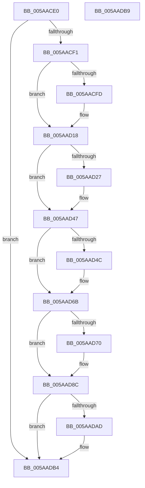

# KasanHibernationResume

- RVA: `0x005AACE0`–`0x005AADBA` (길이 `218` bytes)
- VA: `0x00000001405AACE0`
- 실행 섹션: `.text`
- PDB 이름 있음: `예`; PDB Function 태그: `아니요`
- unwind 정보 RVA: `0x0005D2F4`
- 디코드: `54`개 명령, `218/218` bytes 표시
- 미해석 바이트: `0` (있으면 어셈블리에 `.byte`로 보존)

> 이 문서는 커널 이미지의 기계어와 PDB 기호를 분석해 생성했습니다. 4번과 5번은 함수 원형과 자료형을 바이너리 사용 방식에서 추정한 C 해석이며 원본 소스 복구 결과는 아닙니다.

## 1. Dependencies

- 직접 호출 지점: **5**; 고유 호출 대상: **2**
- 직접 호출자로 확인된 함수: **2**
- RIP 상대 이미지 참조: **2**

### Outgoing calls
- `0x005AAD12` → [KeBugCheckEx](../4F/KeBugCheckEx_function_004FD660.md) (function, `0x004FD660`)
- `0x005AAD41` → [KeBugCheckEx](../4F/KeBugCheckEx_function_004FD660.md) (function, `0x004FD660`)
- `0x005AAD65` → [KeBugCheckEx](../4F/KeBugCheckEx_function_004FD660.md) (function, `0x004FD660`)
- `0x005AAD86` → [KeBugCheckEx](../4F/KeBugCheckEx_function_004FD660.md) (function, `0x004FD660`)
- `0x005AADAF` → [memset](../6C/memset_function_006C6C40.md) (function, `0x006C6C40`)

### Direct callers
- [HalpResumePoint](../6A/HalpResumePoint_function_006ACDE0.md) at `0x006ACDEE`
- [PopSaveHiberContextWrapper](../6B/PopSaveHiberContextWrapper_function_006BA360.md) at `0x006BA39D`

### Static image references
- `0x005AACE4` → RVA `0x00FCEC68` (`ALMOSTRO`; read)
- `0x005AADA1` → RVA `0x00FC6ED8` (`ALMOSTRO`; read)

## 2. Other-region calls and transfers

- 다른 실행 섹션으로 향하는 call: **0**
- 별도 외부 분기/꼬리 이동을 확인하지 못했습니다.

## 3. Assembly (complete function range)

```asm
005AACE0  48 83 EC 38                     sub rsp, 0x38
005AACE4  80 3D 7D 3F A2 00 00            cmp byte ptr [rip + 0xa23f7d], 0
005AACEB  0F 84 C3 00 00 00               je 0x1405aadb4
005AACF1  4C 8B C2                        mov r8, rdx
005AACF4  4C 2B C1                        sub r8, rcx
005AACF7  41 F6 C0 07                     test r8b, 7
005AACFB  74 1B                           je 0x1405aad18
005AACFD  48 89 54 24 20                  mov qword ptr [rsp + 0x20], rdx
005AAD02  4C 8B C9                        mov r9, rcx
005AAD05  BA 04 00 00 00                  mov edx, 4
005AAD0A  B9 F1 01 00 00                  mov ecx, 0x1f1
005AAD0F  44 8B C2                        mov r8d, edx
005AAD12  E8 49 29 F5 FF                  call 0x1404fd660
005AAD17  CC                              int3
005AAD18  48 B8 00 00 00 00 00 80 FF FF   movabs rax, 0xffff800000000000
005AAD22  48 3B C8                        cmp rcx, rax
005AAD25  73 20                           jae 0x1405aad47
005AAD27  BA 02 00 00 00                  mov edx, 2
005AAD2C  48 C7 44 24 20 00 00 00 00      mov qword ptr [rsp + 0x20], 0
005AAD35  4C 8B C9                        mov r9, rcx
005AAD38  B9 F1 01 00 00                  mov ecx, 0x1f1
005AAD3D  44 8D 42 FF                     lea r8d, [rdx - 1]
005AAD41  E8 1A 29 F5 FF                  call 0x1404fd660
005AAD46  CC                              int3
005AAD47  F6 C1 07                        test cl, 7
005AAD4A  74 1F                           je 0x1405aad6b
005AAD4C  BA 02 00 00 00                  mov edx, 2
005AAD51  48 C7 44 24 20 08 00 00 00      mov qword ptr [rsp + 0x20], 8
005AAD5A  4C 8B C9                        mov r9, rcx
005AAD5D  44 8B C2                        mov r8d, edx
005AAD60  B9 F1 01 00 00                  mov ecx, 0x1f1
005AAD65  E8 F6 28 F5 FF                  call 0x1404fd660
005AAD6A  CC                              int3
005AAD6B  48 3B D1                        cmp rdx, rcx
005AAD6E  73 1C                           jae 0x1405aad8c
005AAD70  BA 02 00 00 00                  mov edx, 2
005AAD75  4C 89 44 24 20                  mov qword ptr [rsp + 0x20], r8
005AAD7A  4C 8B C9                        mov r9, rcx
005AAD7D  B9 F1 01 00 00                  mov ecx, 0x1f1
005AAD82  44 8D 42 01                     lea r8d, [rdx + 1]
005AAD86  E8 D5 28 F5 FF                  call 0x1404fd660
005AAD8B  CC                              int3
005AAD8C  48 B8 00 00 00 00 00 80 00 00   movabs rax, 0x800000000000
005AAD96  49 C1 E8 03                     shr r8, 3
005AAD9A  48 03 C8                        add rcx, rax
005AAD9D  48 C1 E9 03                     shr rcx, 3
005AADA1  48 03 0D 30 C1 A1 00            add rcx, qword ptr [rip + 0xa1c130]
005AADA8  4D 85 C0                        test r8, r8
005AADAB  74 07                           je 0x1405aadb4
005AADAD  33 D2                           xor edx, edx
005AADAF  E8 8C BE 11 00                  call 0x1406c6c40
005AADB4  48 83 C4 38                     add rsp, 0x38
005AADB8  C3                              ret
005AADB9  CC                              int3
```

## 4. C-style interpretation (structured pseudocode)

```c
__int64 __fastcall KasanHibernationResume(__int64 a1, __int64 a2)
{
    __int64 result;
    __int64 v_rsp;
    unsigned __int64 v_stack_m18;

    v_rsp = (v_rsp) - (56);
    if ((*(unsigned __int8 *)(v_rip + 10633085)) == 0) goto loc_005AADB4;
    a3 = (a2) - (a1);
    if ((((unsigned __int8)(a3)) & (7)) != 0) {
        v_stack_m18 = a2;
        a4 = a1;
        a2 = 4;
        a1 = 497;
        a3 = (unsigned int)(a2);
        result = KeBugCheckEx(a1, a2, a3, a4);
    }
    if (a1 < result) {
        a2 = 2;
        v_stack_m18 = 0;
        a4 = a1;
        a1 = 497;
        a3 = a2 - 1;
        result = KeBugCheckEx(a1, a2, a3, a4);
    }
    if ((((unsigned __int8)(a1)) & (7)) != 0) {
        a2 = 2;
        v_stack_m18 = 8;
        a4 = a1;
        a3 = (unsigned int)(a2);
        a1 = 497;
        result = KeBugCheckEx(a1, a2, a3, a4);
    }
    if (a2 < a1) {
        a2 = 2;
        v_stack_m18 = a3;
        a4 = a1;
        a1 = 497;
        a3 = a2 + 1;
        result = KeBugCheckEx(a1, a2, a3, a4);
    }
    a3 = (a3) >> (3);
    a1 = (a1) + (result);
    a1 = (a1) >> (3);
    a1 = (a1) + (*(unsigned __int64 *)(v_rip + 10600752));
    if (a3 != 0) {
        a2 = 0;
        result = memset(a1, a2, a3, a4);
    }
    v_rsp = (v_rsp) + (56);
    return result;
}
```

## 5. (Beta) C Style

```c
int64_t KasanHibernationResume(int64_t Arg1, int64_t Arg2)
{
    int64_t result;
    int64_t local_rsp;
    uint64_t v_stack_m18;

    local_rsp = (local_rsp) - (56);
    if ((*(uint8_t *)(v_rip + 0xA23F7D)) == 0) goto loc_005AADB4;
    a3 = (Arg2) - (Arg1);
    if ((((uint8_t)(a3)) & (7)) != 0) {
        v_stack_m18 = Arg2;
        a4 = Arg1;
        Arg2 = 4;
        Arg1 = 497;
        a3 = (uint32_t)(Arg2);
        result = KeBugCheckEx(Arg1, Arg2, a3, a4);
    }
    if (Arg1 < result) {
        Arg2 = 2;
        v_stack_m18 = 0;
        a4 = Arg1;
        Arg1 = 497;
        a3 = Arg2 - 1;
        result = KeBugCheckEx(Arg1, Arg2, a3, a4);
    }
    if ((((uint8_t)(Arg1)) & (7)) != 0) {
        Arg2 = 2;
        v_stack_m18 = 8;
        a4 = Arg1;
        a3 = (uint32_t)(Arg2);
        Arg1 = 497;
        result = KeBugCheckEx(Arg1, Arg2, a3, a4);
    }
    if (Arg2 < Arg1) {
        Arg2 = 2;
        v_stack_m18 = a3;
        a4 = Arg1;
        Arg1 = 497;
        a3 = Arg2 + 1;
        result = KeBugCheckEx(Arg1, Arg2, a3, a4);
    }
    a3 = (a3) >> (3);
    Arg1 = (Arg1) + (result);
    Arg1 = (Arg1) >> (3);
    Arg1 = (Arg1) + (*(uint64_t *)(v_rip + 0xA1C130));
    if (a3 != 0) {
        Arg2 = 0;
        result = memset(Arg1, Arg2, a3, a4);
    }
    local_rsp = (local_rsp) + (56);
    return result;
}
```

## 6. Execution-region graph

[열기: 2D/3D 그래프와 함수 탐색 컨트롤 패널](../../../control-panel.html?section=text&rva=0x005AACE0&view=graph)

- 2D 그래프는 위에서 아래로 흐르고, 3D 그래프는 빈 공간을 드래그해 회전합니다. Shift+드래그는 이동, 휠은 확대·축소, 함수 노드 선택은 대상 보고서 이동입니다.

### Static fallback


