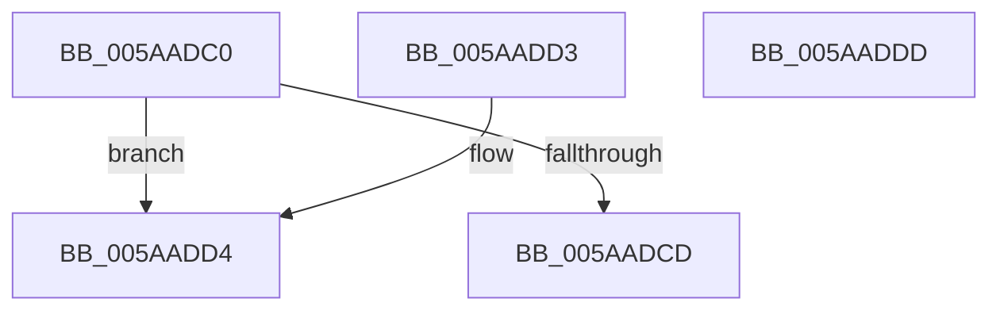

# KasanUnloadInfoCompare

- RVA: `0x005AADC0`–`0x005AADDE` (길이 `30` bytes)
- VA: `0x00000001405AADC0`
- 실행 섹션: `.text`
- PDB 이름 있음: `예`; PDB Function 태그: `아니요`
- unwind 정보 RVA: `0x000DB714`
- 디코드: `12`개 명령, `30/30` bytes 표시
- 미해석 바이트: `0` (있으면 어셈블리에 `.byte`로 보존)

> 이 문서는 커널 이미지의 기계어와 PDB 기호를 분석해 생성했습니다. 4번과 5번은 함수 원형과 자료형을 바이너리 사용 방식에서 추정한 C 해석이며 원본 소스 복구 결과는 아닙니다.

## 1. Dependencies

- 직접 호출 지점: **0**; 고유 호출 대상: **0**
- 직접 호출자로 확인된 함수: **2**
- RIP 상대 이미지 참조: **0**

### Outgoing calls
- 직접 디코드된 call 명령이 없습니다.

### Direct callers
- [KasanDriverLoadImageInternal](../4C/KasanDriverLoadImageInternal_function_004C2840.md) at `0x004C2D1E`
- [sub_005AAA29](Unknown_function_005AAA29.md) at `0x005AAA43`

### Static image references
- 디코드된 RIP-relative 메모리 참조가 없습니다.

## 2. Other-region calls and transfers

- 다른 실행 섹션으로 향하는 call: **0**
- 별도 외부 분기/꼬리 이동을 확인하지 못했습니다.

## 3. Assembly (complete function range)

```asm
005AADC0  48 8B 42 18                     mov rax, qword ptr [rdx + 0x18]
005AADC4  48 8B 50 30                     mov rdx, qword ptr [rax + 0x30]
005AADC8  48 3B CA                        cmp rcx, rdx
005AADCB  73 07                           jae 0x1405aadd4
005AADCD  B8 FF FF FF FF                  mov eax, 0xffffffff
005AADD2  C3                              ret
005AADD3  CC                              int3
005AADD4  33 C0                           xor eax, eax
005AADD6  48 3B CA                        cmp rcx, rdx
005AADD9  0F 95 C0                        setne al
005AADDC  C3                              ret
005AADDD  CC                              int3
```

## 4. C-style interpretation (structured pseudocode)

```c
__int64 __fastcall KasanUnloadInfoCompare(__int64 a1, __int64 a2)
{
    __int64 result;

    if (a1 >= (*(unsigned __int64 *)(*(unsigned __int64 *)(a2 + 24) + 48))) goto loc_005AADD4;
    return (unsigned int)(0xFFFFFFFFULL);
loc_005AADD4:
    result = 0;
    result = (a1 != (*(unsigned __int64 *)(*(unsigned __int64 *)(a2 + 24) + 48))) ? 1 : 0;
    return result;
}
```

## 5. (Beta) C Style

```c
int64_t KasanUnloadInfoCompare(int64_t Arg1, void *Arg2)
{
    uint8_t *arg2 = (uint8_t *)Arg2;

    int64_t result;

    if (Arg1 >= (*(uint64_t *)(*(uint64_t *)(arg2 + 0x18) + 0x30))) goto loc_005AADD4;
    return (uint32_t)(0xFFFFFFFFULL);
loc_005AADD4:
    result = 0;
    result = (Arg1 != (*(uint64_t *)(*(uint64_t *)(arg2 + 0x18) + 0x30))) ? 1 : 0;
    return result;
}
```

### 관측된 메모리 오프셋

구조체 형식이 확인되지 않은 접근은 인자 기준의 오프셋으로만 기록했습니다.

| 기준 인자 | 오프셋 표현 | 폭 (bit) | 접근 |
|---|---:|---:|---|
| `Arg2` | `+ 0x18` | `64` | `R` |

## 6. Execution-region graph

[열기: 2D/3D 그래프와 함수 탐색 컨트롤 패널](../../../control-panel.html?section=text&rva=0x005AADC0&view=graph)

- 2D 그래프는 위에서 아래로 흐르고, 3D 그래프는 빈 공간을 드래그해 회전합니다. Shift+드래그는 이동, 휠은 확대·축소, 함수 노드 선택은 대상 보고서 이동입니다.

### Static fallback


