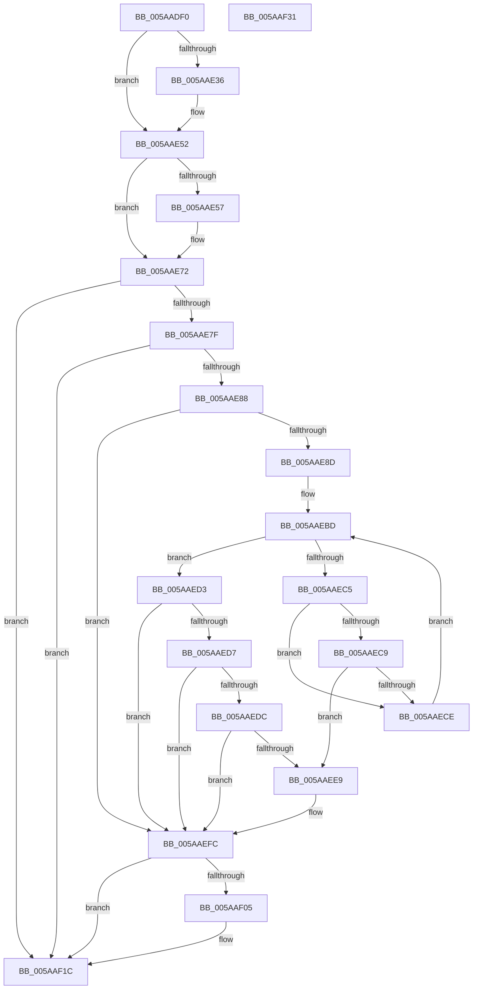

# KasanValidateAddress

- RVA: `0x005AADF0`–`0x005AAF32` (길이 `322` bytes)
- VA: `0x00000001405AADF0`
- 실행 섹션: `.text`
- PDB 이름 있음: `예`; PDB Function 태그: `아니요`
- unwind 정보 RVA: `0x00066400`
- 디코드: `88`개 명령, `322/322` bytes 표시
- 미해석 바이트: `0` (있으면 어셈블리에 `.byte`로 보존)

> 이 문서는 커널 이미지의 기계어와 PDB 기호를 분석해 생성했습니다. 4번과 5번은 함수 원형과 자료형을 바이너리 사용 방식에서 추정한 C 해석이며 원본 소스 복구 결과는 아닙니다.

## 1. Dependencies

- 직접 호출 지점: **4**; 고유 호출 대상: **3**
- 직접 호출자로 확인된 함수: **0**
- RIP 상대 이미지 참조: **3**

### Outgoing calls
- `0x005AAE4C` → [KeBugCheckEx](../4F/KeBugCheckEx_function_004FD660.md) (function, `0x004FD660`)
- `0x005AAE6C` → [KeBugCheckEx](../4F/KeBugCheckEx_function_004FD660.md) (function, `0x004FD660`)
- `0x005AAEF7` → [KasaniReport](KasaniReport_function_005AB0B0.md) (function, `0x005AB0B0`)
- `0x005AAF17` → [KcsanValidateAddress](KcsanValidateAddress_function_005AF5E0.md) (function, `0x005AF5E0`)

### Direct callers
- 이 함수 시작 RVA로 연결되는 직접 call은 확인되지 않았습니다. 간접 호출은 완전히 역산할 수 없습니다.

### Static image references
- `0x005AAE72` → RVA `0x00FCEC6A` (`ALMOSTRO`; read)
- `0x005AAEAB` → RVA `0x00FC6ED8` (`ALMOSTRO`; read)
- `0x005AAEFC` → RVA `0x00F8A7E8` (`.data`; read)

## 2. Other-region calls and transfers

- 다른 실행 섹션으로 향하는 call: **0**
- 별도 외부 분기/꼬리 이동을 확인하지 못했습니다.

## 3. Assembly (complete function range)

```asm
005AADF0  48 89 5C 24 08                  mov qword ptr [rsp + 8], rbx
005AADF5  48 89 6C 24 10                  mov qword ptr [rsp + 0x10], rbp
005AADFA  48 89 74 24 18                  mov qword ptr [rsp + 0x18], rsi
005AADFF  57                              push rdi
005AAE00  48 83 EC 30                     sub rsp, 0x30
005AAE04  45 33 D2                        xor r10d, r10d
005AAE07  48 8B D9                        mov rbx, rcx
005AAE0A  48 03 CA                        add rcx, rdx
005AAE0D  41 8B C2                        mov eax, r10d
005AAE10  48 8B FA                        mov rdi, rdx
005AAE13  49 8B F1                        mov rsi, r9
005AAE16  48 BA 00 00 00 00 00 80 FF FF   movabs rdx, 0xffff800000000000
005AAE20  41 0F B6 E8                     movzx ebp, r8b
005AAE24  48 3B CA                        cmp rcx, rdx
005AAE27  0F 93 C0                        setae al
005AAE2A  48 3B DA                        cmp rbx, rdx
005AAE2D  41 0F 93 C2                     setae r10b
005AAE31  44 3B D0                        cmp r10d, eax
005AAE34  74 1C                           je 0x1405aae52
005AAE36  BA 03 00 00 00                  mov edx, 3
005AAE3B  48 89 7C 24 20                  mov qword ptr [rsp + 0x20], rdi
005AAE40  4C 8B CB                        mov r9, rbx
005AAE43  B9 F1 01 00 00                  mov ecx, 0x1f1
005AAE48  44 8D 42 FE                     lea r8d, [rdx - 2]
005AAE4C  E8 0F 28 F5 FF                  call 0x1404fd660
005AAE51  CC                              int3
005AAE52  48 3B CB                        cmp rcx, rbx
005AAE55  73 1B                           jae 0x1405aae72
005AAE57  BA 03 00 00 00                  mov edx, 3
005AAE5C  48 89 7C 24 20                  mov qword ptr [rsp + 0x20], rdi
005AAE61  44 8B C2                        mov r8d, edx
005AAE64  4C 8B CB                        mov r9, rbx
005AAE67  B9 F1 01 00 00                  mov ecx, 0x1f1
005AAE6C  E8 EF 27 F5 FF                  call 0x1404fd660
005AAE71  CC                              int3
005AAE72  80 3D F1 3D A2 00 00            cmp byte ptr [rip + 0xa23df1], 0
005AAE79  0F 84 9D 00 00 00               je 0x1405aaf1c
005AAE7F  48 3B DA                        cmp rbx, rdx
005AAE82  0F 82 94 00 00 00               jb 0x1405aaf1c
005AAE88  48 85 FF                        test rdi, rdi
005AAE8B  74 6F                           je 0x1405aaefc
005AAE8D  48 BA 00 00 00 00 00 80 00 00   movabs rdx, 0x800000000000
005AAE97  49 B8 FF FF FF FF FF 7F 00 00   movabs r8, 0x7fffffffffff
005AAEA1  48 03 D3                        add rdx, rbx
005AAEA4  4C 03 C1                        add r8, rcx
005AAEA7  48 C1 EA 03                     shr rdx, 3
005AAEAB  48 03 15 26 C0 A1 00            add rdx, qword ptr [rip + 0xa1c026]
005AAEB2  49 C1 E8 03                     shr r8, 3
005AAEB6  4C 03 05 1B C0 A1 00            add r8, qword ptr [rip + 0xa1c01b]
005AAEBD  0F B6 0A                        movzx ecx, byte ptr [rdx]
005AAEC0  49 3B D0                        cmp rdx, r8
005AAEC3  73 0E                           jae 0x1405aaed3
005AAEC5  84 C9                           test cl, cl
005AAEC7  74 05                           je 0x1405aaece
005AAEC9  80 F9 08                        cmp cl, 8
005AAECC  7C 1B                           jl 0x1405aaee9
005AAECE  48 FF C2                        inc rdx
005AAED1  EB EA                           jmp 0x1405aaebd
005AAED3  84 C9                           test cl, cl
005AAED5  74 25                           je 0x1405aaefc
005AAED7  80 F9 08                        cmp cl, 8
005AAEDA  7D 20                           jge 0x1405aaefc
005AAEDC  8D 47 FF                        lea eax, [rdi - 1]
005AAEDF  02 C3                           add al, bl
005AAEE1  24 07                           and al, 7
005AAEE3  FE C0                           inc al
005AAEE5  3A C1                           cmp al, cl
005AAEE7  7E 13                           jle 0x1405aaefc
005AAEE9  88 4C 24 20                     mov byte ptr [rsp + 0x20], cl
005AAEED  44 0F B6 C5                     movzx r8d, bpl
005AAEF1  48 8B CB                        mov rcx, rbx
005AAEF4  48 8B D7                        mov rdx, rdi
005AAEF7  E8 B4 01 00 00                  call 0x1405ab0b0
005AAEFC  80 3D E5 F8 9D 00 00            cmp byte ptr [rip + 0x9df8e5], 0
005AAF03  74 17                           je 0x1405aaf1c
005AAF05  45 33 C9                        xor r9d, r9d
005AAF08  48 89 74 24 20                  mov qword ptr [rsp + 0x20], rsi
005AAF0D  44 0F B6 C5                     movzx r8d, bpl
005AAF11  48 8B D7                        mov rdx, rdi
005AAF14  48 8B CB                        mov rcx, rbx
005AAF17  E8 C4 46 00 00                  call 0x1405af5e0
005AAF1C  48 8B 5C 24 40                  mov rbx, qword ptr [rsp + 0x40]
005AAF21  48 8B 6C 24 48                  mov rbp, qword ptr [rsp + 0x48]
005AAF26  48 8B 74 24 50                  mov rsi, qword ptr [rsp + 0x50]
005AAF2B  48 83 C4 30                     add rsp, 0x30
005AAF2F  5F                              pop rdi
005AAF30  C3                              ret
005AAF31  CC                              int3
```

## 4. C-style interpretation (structured pseudocode)

```c
__int64 __fastcall KasanValidateAddress(__int64 a1, __int64 a2, unsigned __int8 a3, __int64 a4)
{
    __int64 result;
    __int64 v_r10;
    __int64 v_rsp;
    unsigned __int64 v_stack_m18;
    unsigned __int64 v_stack_p10;
    unsigned __int64 v_stack_p18;
    unsigned __int64 v_stack_p8;

    v_stack_p8 = v_rbx;
    v_stack_p10 = v_rbp;
    v_stack_p18 = v_rsi;
    v_rsp = (v_rsp) - (48);
    v_r10 = 0;
    a1 = (a1) + (a2);
    result = (a1 >= a2) ? 1 : 0;
    v_r10 = (a1 >= a2) ? 1 : 0;
    if (((unsigned int)(v_r10)) != ((unsigned int)(result))) {
        a2 = 3;
        v_stack_m18 = a2;
        a4 = a1;
        a1 = 497;
        a3 = a2 - 2;
        result = KeBugCheckEx(a1, a2, a3, a4);
    }
    if (a1 < a1) {
        a2 = 3;
        v_stack_m18 = a2;
        a3 = (unsigned int)(a2);
        a4 = a1;
        a1 = 497;
        result = KeBugCheckEx(a1, a2, a3, a4);
    }
    if ((*(unsigned __int8 *)(v_rip + 10632689)) == 0) goto loc_005AAF1C;
    if (a1 < a2) goto loc_005AAF1C;
    if (a2 == 0) goto loc_005AAEFC;
    a2 = (a2) + (a1);
    a3 = (a3) + (a1);
    a2 = (a2) >> (3);
    a2 = (a2) + (*(unsigned __int64 *)(v_rip + 10600486));
    a3 = (a3) >> (3);
    a3 = (a3) + (*(unsigned __int64 *)(v_rip + 10600475));
loc_005AAEBD:
    if (a2 >= a3) goto loc_005AAED3;
    if ((unsigned __int8)(*(unsigned __int8 *)(a2)) == 0) goto loc_005AAECE;
    if (((unsigned __int8)(*(unsigned __int8 *)(a2))) < 8) goto loc_005AAEE9;
loc_005AAECE:
    a2 = (a2) + 1;
    goto loc_005AAEBD;
loc_005AAED3:
    if ((unsigned __int8)(*(unsigned __int8 *)(a2)) == 0) goto loc_005AAEFC;
    if (((unsigned __int8)(*(unsigned __int8 *)(a2))) >= 8) goto loc_005AAEFC;
    result = (unsigned __int8)((a2 - 1) + ((unsigned __int8)(a1)));
    result = (unsigned __int8)((result) & (7));
    result = (unsigned __int8)((result) + 1);
    if (((unsigned __int8)(result)) >= = ((unsigned __int8)(*(unsigned __int8 *)(a2)))) {
        v_stack_m18 = (unsigned __int8)(*(unsigned __int8 *)(a2));
        a3 = a3;
        a1 = a1;
        a2 = a2;
        result = KasaniReport(a1, a2, a3, a4);
    }
    if ((*(unsigned __int8 *)(v_rip + 10352869)) != 0) {
        a4 = 0;
        v_stack_m18 = 0;
        a3 = a3;
        a2 = a2;
        a1 = a1;
        result = KcsanValidateAddress(a1, a2, a3, a4);
    }
    v_rsp = (v_rsp) + (48);
    return result;
}
```

## 5. (Beta) C Style

```c
int64_t KasanValidateAddress(int64_t Arg1, int64_t Arg2, uint8_t Arg3, int64_t Arg4)
{
    int64_t result;
    int64_t local_r10;
    int64_t local_rsp;
    uint64_t v_stack_m18;
    uint64_t v_stack_p10;
    uint64_t v_stack_p18;
    uint64_t v_stack_p8;

    v_stack_p8 = local_rbx;
    v_stack_p10 = local_rbp;
    v_stack_p18 = local_rsi;
    local_rsp = (local_rsp) - (48);
    local_r10 = 0;
    Arg1 = (Arg1) + (Arg2);
    result = (Arg1 >= Arg2) ? 1 : 0;
    local_r10 = (Arg1 >= Arg2) ? 1 : 0;
    if (((uint32_t)(local_r10)) != ((uint32_t)(result))) {
        Arg2 = 3;
        v_stack_m18 = Arg2;
        Arg4 = Arg1;
        Arg1 = 497;
        Arg3 = Arg2 - 2;
        result = KeBugCheckEx(Arg1, Arg2, Arg3, Arg4);
    }
    if (Arg1 < Arg1) {
        Arg2 = 3;
        v_stack_m18 = Arg2;
        Arg3 = (uint32_t)(Arg2);
        Arg4 = Arg1;
        Arg1 = 497;
        result = KeBugCheckEx(Arg1, Arg2, Arg3, Arg4);
    }
    if ((*(uint8_t *)(v_rip + 0xA23DF1)) == 0) goto loc_005AAF1C;
    if (Arg1 < Arg2) goto loc_005AAF1C;
    if (Arg2 == 0) goto loc_005AAEFC;
    Arg2 = (Arg2) + (Arg1);
    Arg3 = (Arg3) + (Arg1);
    Arg2 = (Arg2) >> (3);
    Arg2 = (Arg2) + (*(uint64_t *)(v_rip + 0xA1C026));
    Arg3 = (Arg3) >> (3);
    Arg3 = (Arg3) + (*(uint64_t *)(v_rip + 0xA1C01B));
loc_005AAEBD:
    if (Arg2 >= Arg3) goto loc_005AAED3;
    if ((uint8_t)(*(uint8_t *)(Arg2)) == 0) goto loc_005AAECE;
    if (((uint8_t)(*(uint8_t *)(Arg2))) < 8) goto loc_005AAEE9;
loc_005AAECE:
    Arg2 = (Arg2) + 1;
    goto loc_005AAEBD;
loc_005AAED3:
    if ((uint8_t)(*(uint8_t *)(Arg2)) == 0) goto loc_005AAEFC;
    if (((uint8_t)(*(uint8_t *)(Arg2))) >= 8) goto loc_005AAEFC;
    result = (uint8_t)((Arg2 - 1) + ((uint8_t)(Arg1)));
    result = (uint8_t)((result) & (7));
    result = (uint8_t)((result) + 1);
    if (((uint8_t)(result)) >= = ((uint8_t)(*(uint8_t *)(Arg2)))) {
        v_stack_m18 = (uint8_t)(*(uint8_t *)(Arg2));
        Arg3 = Arg3;
        Arg1 = Arg1;
        Arg2 = Arg2;
        result = KasaniReport(Arg1, Arg2, Arg3, Arg4);
    }
    if ((*(uint8_t *)(v_rip + 0x9DF8E5)) != 0) {
        Arg4 = 0;
        v_stack_m18 = 0;
        Arg3 = Arg3;
        Arg2 = Arg2;
        Arg1 = Arg1;
        result = KcsanValidateAddress(Arg1, Arg2, Arg3, Arg4);
    }
    local_rsp = (local_rsp) + (48);
    return result;
}
```

## 6. Execution-region graph

[열기: 2D/3D 그래프와 함수 탐색 컨트롤 패널](../../../control-panel.html?section=text&rva=0x005AADF0&view=graph)

- 2D 그래프는 위에서 아래로 흐르고, 3D 그래프는 빈 공간을 드래그해 회전합니다. Shift+드래그는 이동, 휠은 확대·축소, 함수 노드 선택은 대상 보고서 이동입니다.

### Static fallback


