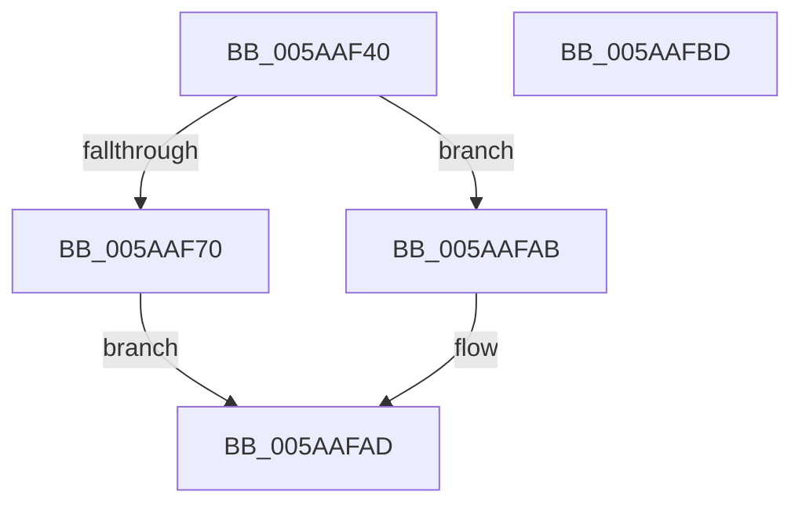

# KasaniBuildPc

- RVA: `0x005AAF40`–`0x005AAFBE` (길이 `126` bytes)
- VA: `0x00000001405AAF40`
- 실행 섹션: `.text`
- PDB 이름 있음: `예`; PDB Function 태그: `아니요`
- unwind 정보 RVA: `0x00086C28`
- 디코드: `33`개 명령, `126/126` bytes 표시
- 미해석 바이트: `0` (있으면 어셈블리에 `.byte`로 보존)

> 이 문서는 커널 이미지의 기계어와 PDB 기호를 분석해 생성했습니다. 4번과 5번은 함수 원형과 자료형을 바이너리 사용 방식에서 추정한 C 해석이며 원본 소스 복구 결과는 아닙니다.

## 1. Dependencies

- 직접 호출 지점: **2**; 고유 호출 대상: **2**
- 직접 호출자로 확인된 함수: **3**
- RIP 상대 이미지 참조: **0**

### Outgoing calls
- `0x005AAF66` → [memset](../6C/memset_function_006C6C40.md) (function, `0x006C6C40`)
- `0x005AAF9F` → [KasaniGetModuleFromAddress](KasaniGetModuleFromAddress_function_005AAFD0.md) (function, `0x005AAFD0`)

### Direct callers
- [KasaniSendReport](KasaniSendReport_function_005AB2E0.md) at `0x005AB33D`
- [KasaniSendReport](KasaniSendReport_function_005AB2E0.md) at `0x005AB359`
- [KcsaniSendReport](KcsaniSendReport_function_005AF980.md) at `0x005AF9D3`
- [sub_005AF9E0](Unknown_function_005AF9E0.md) at `0x005AFA0F`
- [sub_005AF9E0](Unknown_function_005AF9E0.md) at `0x005AFA48`

### Static image references
- 디코드된 RIP-relative 메모리 참조가 없습니다.

## 2. Other-region calls and transfers

- 다른 실행 섹션으로 향하는 call: **0**
- 별도 외부 분기/꼬리 이동을 확인하지 못했습니다.

## 3. Assembly (complete function range)

```asm
005AAF40  48 89 5C 24 08                  mov qword ptr [rsp + 8], rbx
005AAF45  48 89 74 24 10                  mov qword ptr [rsp + 0x10], rsi
005AAF4A  57                              push rdi
005AAF4B  48 83 EC 40                     sub rsp, 0x40
005AAF4F  48 8B DA                        mov rbx, rdx
005AAF52  48 8B F9                        mov rdi, rcx
005AAF55  33 F6                           xor esi, esi
005AAF57  48 8B CB                        mov rcx, rbx
005AAF5A  33 D2                           xor edx, edx
005AAF5C  89 74 24 34                     mov dword ptr [rsp + 0x34], esi
005AAF60  41 B8 8C 00 00 00               mov r8d, 0x8c
005AAF66  E8 D5 BC 11 00                  call 0x1406c6c40
005AAF6B  48 85 FF                        test rdi, rdi
005AAF6E  74 3B                           je 0x1405aafab
005AAF70  48 8D 83 88 00 00 00            lea rax, [rbx + 0x88]
005AAF77  C7 44 24 30 00 00 80 00         mov dword ptr [rsp + 0x30], 0x800000
005AAF7F  4C 8D 8B 84 00 00 00            lea r9, [rbx + 0x84]
005AAF86  48 89 44 24 20                  mov qword ptr [rsp + 0x20], rax
005AAF8B  4C 8D 83 80 00 00 00            lea r8, [rbx + 0x80]
005AAF92  48 89 5C 24 38                  mov qword ptr [rsp + 0x38], rbx
005AAF97  48 8D 54 24 30                  lea rdx, [rsp + 0x30]
005AAF9C  48 8B CF                        mov rcx, rdi
005AAF9F  E8 2C 00 00 00                  call 0x1405aafd0
005AAFA4  85 C0                           test eax, eax
005AAFA6  0F 99 C0                        setns al
005AAFA9  EB 02                           jmp 0x1405aafad
005AAFAB  B0 01                           mov al, 1
005AAFAD  48 8B 5C 24 50                  mov rbx, qword ptr [rsp + 0x50]
005AAFB2  48 8B 74 24 58                  mov rsi, qword ptr [rsp + 0x58]
005AAFB7  48 83 C4 40                     add rsp, 0x40
005AAFBB  5F                              pop rdi
005AAFBC  C3                              ret
005AAFBD  CC                              int3
```

## 4. C-style interpretation (structured pseudocode)

```c
__int64 __fastcall KasaniBuildPc(__int64 a1, __int64 a2)
{
    __int64 result;
    __int64 v_rsi;
    __int64 v_rsp;
    unsigned __int64 v_stack_m10;
    unsigned int v_stack_m14;
    unsigned int v_stack_m18;
    unsigned __int64 v_stack_m28;
    unsigned __int64 v_stack_p10;
    unsigned __int64 v_stack_p8;

    v_stack_p8 = v_rbx;
    v_stack_p10 = v_rsi;
    v_rsp = (v_rsp) - (64);
    v_rsi = 0;
    a2 = 0;
    v_stack_m14 = 0;
    result = memset(a2, a2, 140, a4);
    if (a1 == 0) goto loc_005AAFAB;
    v_stack_m18 = 0x800000ULL;
    v_stack_m28 = a2 + 136;
    v_stack_m10 = 0;
    result = KasaniGetModuleFromAddress(a1, v_stack_m18, a2 + 128, a2 + 132);
    result = (!sign_flag) ? 1 : 0;
    goto loc_005AAFAD;
loc_005AAFAB:
loc_005AAFAD:
    v_rsp = (v_rsp) + (64);
    return 1;
}
```

## 5. (Beta) C Style

```c
int64_t KasaniBuildPc(int64_t Arg1, void *Arg2)
{
    uint8_t *arg2 = (uint8_t *)Arg2;

    int64_t result;
    int64_t local_rsi;
    int64_t local_rsp;
    uint64_t v_stack_m10;
    uint32_t v_stack_m14;
    uint32_t v_stack_m18;
    uint64_t v_stack_m28;
    uint64_t v_stack_p10;
    uint64_t v_stack_p8;

    v_stack_p8 = local_rbx;
    v_stack_p10 = local_rsi;
    local_rsp = (local_rsp) - (64);
    local_rsi = 0;
    Arg2 = 0;
    v_stack_m14 = 0;
    result = memset(Arg2, Arg2, 140, a4);
    if (Arg1 == 0) goto loc_005AAFAB;
    v_stack_m18 = 0x800000ULL;
    v_stack_m28 = Arg2 + 136;
    v_stack_m10 = 0;
    result = KasaniGetModuleFromAddress(Arg1, v_stack_m18, Arg2 + 128, Arg2 + 132);
    result = (!sign_flag) ? 1 : 0;
    goto loc_005AAFAD;
loc_005AAFAB:
loc_005AAFAD:
    local_rsp = (local_rsp) + (64);
    return 1;
}
```

### 관측된 메모리 오프셋

구조체 형식이 확인되지 않은 접근은 인자 기준의 오프셋으로만 기록했습니다.

| 기준 인자 | 오프셋 표현 | 폭 (bit) | 접근 |
|---|---:|---:|---|
| `Arg2` | `+ 0x80` | `64` | `R` |
| `Arg2` | `+ 0x84` | `64` | `R` |
| `Arg2` | `+ 0x88` | `64` | `R` |

## 6. Execution-region graph

[열기: 2D/3D 그래프와 함수 탐색 컨트롤 패널](../../../control-panel.html?section=text&rva=0x005AAF40&view=graph)

- 2D 그래프는 위에서 아래로 흐르고, 3D 그래프는 빈 공간을 드래그해 회전합니다. Shift+드래그는 이동, 휠은 확대·축소, 함수 노드 선택은 대상 보고서 이동입니다.

### Static fallback


