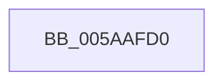

# KasaniGetModuleFromAddress

- RVA: `0x005AAFD0`–`0x005AB009` (길이 `57` bytes)
- VA: `0x00000001405AAFD0`
- 실행 섹션: `.text`
- PDB 이름 있음: `예`; PDB Function 태그: `아니요`
- unwind 정보 RVA: `0x000C958C`
- 디코드: `17`개 명령, `57/57` bytes 표시
- 미해석 바이트: `0` (있으면 어셈블리에 `.byte`로 보존)

> 이 문서는 커널 이미지의 기계어와 PDB 기호를 분석해 생성했습니다. 4번과 5번은 함수 원형과 자료형을 바이너리 사용 방식에서 추정한 C 해석이며 원본 소스 복구 결과는 아닙니다.

## 1. Dependencies

- 직접 호출 지점: **1**; 고유 호출 대상: **1**
- 직접 호출자로 확인된 함수: **1**
- RIP 상대 이미지 참조: **0**

### Outgoing calls
- `0x005AAFFC` → [MiLockLoadedDataTableEntry](../2A/MiLockLoadedDataTableEntry_function_002A38F4.md) (function, `0x002A38F4`)

### Direct callers
- [KasaniBuildPc](KasaniBuildPc_function_005AAF40.md) at `0x005AAF9F`

### Static image references
- 디코드된 RIP-relative 메모리 참조가 없습니다.

## 2. Other-region calls and transfers

- 다른 실행 섹션으로 향하는 call: **0**
- call이 아닌 외부 분기/꼬리 이동: **1**
  - `0x005AB007` → [sub_005AB06E + 0x10](Unknown_function_005AB06E.md) (`tail-transfer`)

## 3. Assembly (complete function range)

```asm
005AAFD0  48 89 5C 24 10                  mov qword ptr [rsp + 0x10], rbx
005AAFD5  48 89 74 24 18                  mov qword ptr [rsp + 0x18], rsi
005AAFDA  48 89 7C 24 20                  mov qword ptr [rsp + 0x20], rdi
005AAFDF  41 54                           push r12
005AAFE1  41 56                           push r14
005AAFE3  41 57                           push r15
005AAFE5  48 83 EC 20                     sub rsp, 0x20
005AAFE9  4C 8B E2                        mov r12, rdx
005AAFEC  4D 8B F1                        mov r14, r9
005AAFEF  33 D2                           xor edx, edx
005AAFF1  4D 8B F8                        mov r15, r8
005AAFF4  48 8B F9                        mov rdi, rcx
005AAFF7  BE 01 00 00 C0                  mov esi, 0xc0000001
005AAFFC  E8 F3 88 CF FF                  call 0x1402a38f4
005AB001  48 8B D8                        mov rbx, rax
005AB004  48 85 C0                        test rax, rax
005AB007  74 75                           je 0x1405ab07e
```

## 4. C-style interpretation (structured pseudocode)

```c
__int64 __fastcall KasaniGetModuleFromAddress(__int64 a1, __int64 a2, __int64 a3, __int64 a4)
{
    __int64 result;
    __int64 v_rsp;
    unsigned __int64 v_stack_p10;
    unsigned __int64 v_stack_p18;
    unsigned __int64 v_stack_p20;

    v_stack_p10 = v_rbx;
    v_stack_p18 = v_rsi;
    v_stack_p20 = v_rdi;
    v_rsp = (v_rsp) - (32);
    a2 = 0;
    result = MiLockLoadedDataTableEntry(a1, a2, a3, a4);
}
```

## 5. (Beta) C Style

```c
int64_t KasaniGetModuleFromAddress(int64_t Arg1, int64_t Arg2, int64_t Arg3, int64_t Arg4)
{
    int64_t result;
    int64_t local_rsp;
    uint64_t v_stack_p10;
    uint64_t v_stack_p18;
    uint64_t v_stack_p20;

    v_stack_p10 = local_rbx;
    v_stack_p18 = local_rsi;
    v_stack_p20 = local_rdi;
    local_rsp = (local_rsp) - (32);
    Arg2 = 0;
    result = MiLockLoadedDataTableEntry(Arg1, Arg2, Arg3, Arg4);
}
```

## 6. Execution-region graph

[열기: 2D/3D 그래프와 함수 탐색 컨트롤 패널](../../../control-panel.html?section=text&rva=0x005AAFD0&view=graph)

- 2D 그래프는 위에서 아래로 흐르고, 3D 그래프는 빈 공간을 드래그해 회전합니다. Shift+드래그는 이동, 휠은 확대·축소, 함수 노드 선택은 대상 보고서 이동입니다.

### Static fallback


