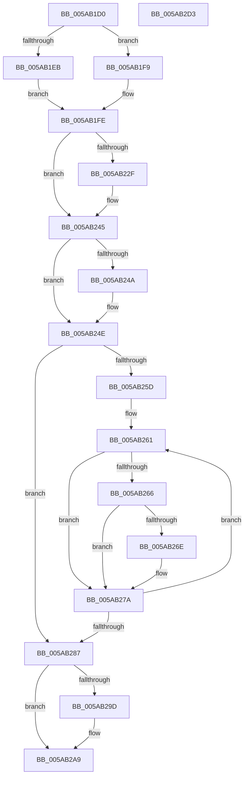

# KasaniReportTelemetry

- RVA: `0x005AB1D0`–`0x005AB2D4` (길이 `260` bytes)
- VA: `0x00000001405AB1D0`
- 실행 섹션: `.text`
- PDB 이름 있음: `예`; PDB Function 태그: `아니요`
- unwind 정보 RVA: `0x00060BC4`
- 디코드: `63`개 명령, `260/260` bytes 표시
- 미해석 바이트: `0` (있으면 어셈블리에 `.byte`로 보존)

> 이 문서는 커널 이미지의 기계어와 PDB 기호를 분석해 생성했습니다. 4번과 5번은 함수 원형과 자료형을 바이너리 사용 방식에서 추정한 C 해석이며 원본 소스 복구 결과는 아닙니다.

## 1. Dependencies

- 직접 호출 지점: **6**; 고유 호출 대상: **6**
- 직접 호출자로 확인된 함수: **2**
- RIP 상대 이미지 참조: **4**

### Outgoing calls
- `0x005AB21B` → [KeAbPreAcquire](../21/KeAbPreAcquire_function_00210230.md) (function, `0x00210230`)
- `0x005AB240` → [ExfAcquirePushLockExclusiveEx](../20/ExfAcquirePushLockExclusiveEx_function_0020FC90.md) (function, `0x0020FC90`)
- `0x005AB272` → [KasaniSendReport](KasaniSendReport_function_005AB2E0.md) (function, `0x005AB2E0`)
- `0x005AB2A4` → [ExfTryToWakePushLock](../26/ExfTryToWakePushLock_function_00265DD0.md) (function, `0x00265DD0`)
- `0x005AB2B0` → [KeAbPostRelease](../2E/KeAbPostRelease_function_002E1600.md) (function, `0x002E1600`)
- `0x005AB2BE` → [KeLeaveCriticalRegionThread](../25/KeLeaveCriticalRegionThread_function_0025EFF0.md) (function, `0x0025EFF0`)

### Direct callers
- [sub_005AA9CD](Unknown_function_005AA9CD.md) at `0x005AA9EC`
- [KasaniTelemetryThread](KasaniTelemetryThread_function_005ABEC0.md) at `0x005ABEDB`

### Static image references
- `0x005AB1DF` → RVA `0x00FCEC78` (`ALMOSTRO`; read)
- `0x005AB1EB` → RVA `0x00F8A540` (`.data`; read)
- `0x005AB207` → RVA `0x00F8A520` (`.data`; read)
- `0x005AB220` → RVA `0x00F8A520` (`.data`; read/write)

## 2. Other-region calls and transfers

- 다른 실행 섹션으로 향하는 call: **0**
- 별도 외부 분기/꼬리 이동을 확인하지 못했습니다.

## 3. Assembly (complete function range)

```asm
005AB1D0  48 89 5C 24 08                  mov qword ptr [rsp + 8], rbx
005AB1D5  48 89 74 24 10                  mov qword ptr [rsp + 0x10], rsi
005AB1DA  57                              push rdi
005AB1DB  48 83 EC 20                     sub rsp, 0x20
005AB1DF  48 8B 1D 92 3A A2 00            mov rbx, qword ptr [rip + 0xa23a92]
005AB1E6  48 85 DB                        test rbx, rbx
005AB1E9  75 0E                           jne 0x1405ab1f9
005AB1EB  48 8D 1D 4E F3 9D 00            lea rbx, [rip + 0x9df34e]
005AB1F2  BF 04 00 00 00                  mov edi, 4
005AB1F7  EB 05                           jmp 0x1405ab1fe
005AB1F9  BF 40 00 00 00                  mov edi, 0x40
005AB1FE  65 48 8B 04 25 88 01 00 00      mov rax, qword ptr gs:[0x188]
005AB207  48 8D 0D 12 F3 9D 00            lea rcx, [rip + 0x9df312]
005AB20E  45 33 C0                        xor r8d, r8d
005AB211  33 D2                           xor edx, edx
005AB213  66 FF 88 E4 01 00 00            dec word ptr [rax + 0x1e4]
005AB21A  90                              nop
005AB21B  E8 10 50 C6 FF                  call 0x140210230
005AB220  F0 48 0F BA 2D F6 F2 9D 00 00   lock bts qword ptr [rip + 0x9df2f6], 0
005AB22A  48 8B F0                        mov rsi, rax
005AB22D  73 16                           jae 0x1405ab245
005AB22F  4C 8D 05 EA F2 9D 00            lea r8, [rip + 0x9df2ea]
005AB236  48 8B D0                        mov rdx, rax
005AB239  48 8D 0D E0 F2 9D 00            lea rcx, [rip + 0x9df2e0]
005AB240  E8 4B 4A C6 FF                  call 0x14020fc90
005AB245  48 85 F6                        test rsi, rsi
005AB248  74 04                           je 0x1405ab24e
005AB24A  C6 46 0A 01                     mov byte ptr [rsi + 0xa], 1
005AB24E  8B 03                           mov eax, dword ptr [rbx]
005AB250  3B C7                           cmp eax, edi
005AB252  0F 4E F8                        cmovle edi, eax
005AB255  48 63 FF                        movsxd rdi, edi
005AB258  48 85 FF                        test rdi, rdi
005AB25B  7E 2A                           jle 0x1405ab287
005AB25D  48 83 C3 2A                     add rbx, 0x2a
005AB261  80 3B 00                        cmp byte ptr [rbx], 0
005AB264  75 14                           jne 0x1405ab27a
005AB266  0F B6 43 FF                     movzx eax, byte ptr [rbx - 1]
005AB26A  84 C0                           test al, al
005AB26C  74 0C                           je 0x1405ab27a
005AB26E  48 8D 4B DE                     lea rcx, [rbx - 0x22]
005AB272  E8 69 00 00 00                  call 0x1405ab2e0
005AB277  C6 03 01                        mov byte ptr [rbx], 1
005AB27A  48 81 C3 A8 00 00 00            add rbx, 0xa8
005AB281  48 83 EF 01                     sub rdi, 1
005AB285  75 DA                           jne 0x1405ab261
005AB287  48 C7 C0 FF FF FF FF            mov rax, 0xffffffffffffffff
005AB28E  F0 48 0F C1 05 89 F2 9D 00      lock xadd qword ptr [rip + 0x9df289], rax
005AB297  24 06                           and al, 6
005AB299  3C 02                           cmp al, 2
005AB29B  75 0C                           jne 0x1405ab2a9
005AB29D  48 8D 0D 7C F2 9D 00            lea rcx, [rip + 0x9df27c]
005AB2A4  E8 27 AB CB FF                  call 0x140265dd0
005AB2A9  48 8D 0D 70 F2 9D 00            lea rcx, [rip + 0x9df270]
005AB2B0  E8 4B 63 D3 FF                  call 0x1402e1600
005AB2B5  65 48 8B 0C 25 88 01 00 00      mov rcx, qword ptr gs:[0x188]
005AB2BE  E8 2D 3D CB FF                  call 0x14025eff0
005AB2C3  48 8B 5C 24 30                  mov rbx, qword ptr [rsp + 0x30]
005AB2C8  48 8B 74 24 38                  mov rsi, qword ptr [rsp + 0x38]
005AB2CD  48 83 C4 20                     add rsp, 0x20
005AB2D1  5F                              pop rdi
005AB2D2  C3                              ret
005AB2D3  CC                              int3
```

## 4. C-style interpretation (structured pseudocode)

```c
__int64 __fastcall KasaniReportTelemetry(__int64 a1, int a2, int a3)
{
    __int64 result;
    __int64 v_rbx;
    __int64 v_rdi;
    __int64 v_rsp;
    unsigned __int64 v_stack_p10;
    unsigned __int64 v_stack_p8;

    v_stack_p8 = v_rbx;
    v_stack_p10 = v_rsi;
    v_rsp = (v_rsp) - (32);
    if (*(unsigned __int64 *)(v_rip + 10631826) != 0) goto loc_005AB1F9;
    goto loc_005AB1FE;
loc_005AB1F9:
loc_005AB1FE:
    a3 = 0;
    a2 = 0;
    result = KeAbPreAcquire(v_rip + 10351378, a2, a3, a4);
    if (!(condition_is_above_or_equal)) {
        a3 = v_rip + 10351338;
        a2 = result;
        a1 = v_rip + 10351328;
        result = ExfAcquirePushLockExclusiveEx(a1, a2, a3, a4);
    }
    if (result != 0) {
        *(unsigned __int8 *)(result + 10) = 1;
    }
    v_rdi = 64;
    if (((unsigned int)((unsigned int)(*(unsigned int *)(v_rip + 10351438)))) <= 64) { v_rdi = (unsigned int)((unsigned int)(*(unsigned int *)(v_rip + 10351438))); }
    if (condition_is_less_or_equal) goto loc_005AB287;
    v_rbx = (v_rip + 10351438) + (42);
loc_005AB261:
    if ((*(unsigned __int8 *)(v_rbx)) != 0) goto loc_005AB27A;
    result = *(unsigned __int8 *)(v_rbx - 1);
    if ((unsigned __int8)(*(unsigned __int8 *)(v_rbx - 1)) != 0) {
        a1 = v_rbx - 34;
        result = KasaniSendReport(a1, a2, a3, a4);
        *(unsigned __int8 *)(v_rbx) = 1;
    }
    v_rbx = (v_rbx) + (168);
    v_rdi = ((int)((unsigned int)(v_rdi))) - (1);
    if (condition_is_not_equal) goto loc_005AB261;
loc_005AB287:
    result = (unsigned __int8)((-1) & (6));
    if (((unsigned __int8)(result)) == 2) {
        a1 = v_rip + 10351228;
        result = ExfTryToWakePushLock(a1, a2, a3, a4);
    }
    result = KeAbPostRelease(v_rip + 10351216, a2, a3, a4);
    result = KeLeaveCriticalRegionThread(*(unsigned __int64 *)(gs_base + (0 + 392)), a2, a3, a4);
    v_rsp = (v_rsp) + (32);
    return result;
}
```

## 5. (Beta) C Style

```c
int64_t KasaniReportTelemetry(int64_t Arg1, int32_t Arg2, int32_t Arg3)
{
    int64_t result;
    int64_t local_rbx;
    int64_t local_rdi;
    int64_t local_rsp;
    uint64_t v_stack_p10;
    uint64_t v_stack_p8;

    v_stack_p8 = local_rbx;
    v_stack_p10 = local_rsi;
    local_rsp = (local_rsp) - (32);
    if (*(uint64_t *)(v_rip + 0xA23A92) != 0) goto loc_005AB1F9;
    goto loc_005AB1FE;
loc_005AB1F9:
loc_005AB1FE:
    Arg3 = 0;
    Arg2 = 0;
    result = KeAbPreAcquire(v_rip + 10351378, Arg2, Arg3, a4);
    if (!(condition_is_above_or_equal)) {
        Arg3 = v_rip + 10351338;
        Arg2 = result;
        Arg1 = v_rip + 10351328;
        result = ExfAcquirePushLockExclusiveEx(Arg1, Arg2, Arg3, a4);
    }
    if (result != 0) {
        *(uint8_t *)(result + 0xA) = 1;
    }
    local_rdi = 64;
    if (((uint32_t)((uint32_t)(*(uint32_t *)(v_rip + 0x9DF34E)))) <= 64) { local_rdi = (uint32_t)((uint32_t)(*(uint32_t *)(v_rip + 0x9DF34E))); }
    if (condition_is_less_or_equal) goto loc_005AB287;
    local_rbx = (v_rip + 10351438) + (42);
loc_005AB261:
    if ((*(uint8_t *)(local_rbx)) != 0) goto loc_005AB27A;
    result = *(uint8_t *)(local_rbx - 0x1);
    if ((uint8_t)(*(uint8_t *)(local_rbx - 0x1)) != 0) {
        Arg1 = local_rbx - 34;
        result = KasaniSendReport(Arg1, Arg2, Arg3, a4);
        *(uint8_t *)(local_rbx) = 1;
    }
    local_rbx = (local_rbx) + (168);
    local_rdi = ((int32_t)((uint32_t)(local_rdi))) - (1);
    if (condition_is_not_equal) goto loc_005AB261;
loc_005AB287:
    result = (uint8_t)((-1) & (6));
    if (((uint8_t)(result)) == 2) {
        Arg1 = v_rip + 10351228;
        result = ExfTryToWakePushLock(Arg1, Arg2, Arg3, a4);
    }
    result = KeAbPostRelease(v_rip + 10351216, Arg2, Arg3, a4);
    result = KeLeaveCriticalRegionThread(*(uint64_t *)(gs_base + (0 + 0x188)), Arg2, Arg3, a4);
    local_rsp = (local_rsp) + (32);
    return result;
}
```

## 6. Execution-region graph

[열기: 2D/3D 그래프와 함수 탐색 컨트롤 패널](../../../control-panel.html?section=text&rva=0x005AB1D0&view=graph)

- 2D 그래프는 위에서 아래로 흐르고, 3D 그래프는 빈 공간을 드래그해 회전합니다. Shift+드래그는 이동, 휠은 확대·축소, 함수 노드 선택은 대상 보고서 이동입니다.

### Static fallback


