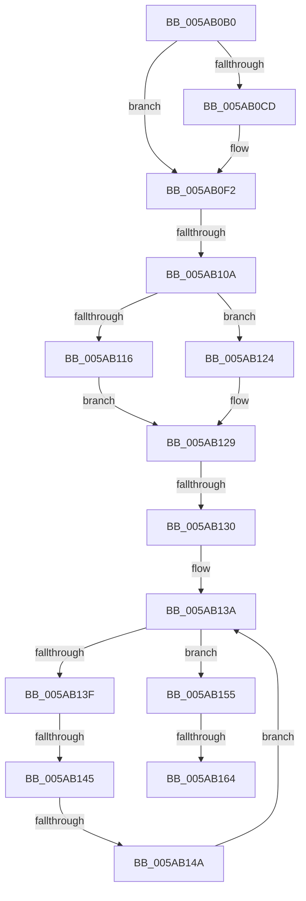

# KasaniReport

- RVA: `0x005AB0B0`–`0x005AB166` (길이 `182` bytes)
- VA: `0x00000001405AB0B0`
- 실행 섹션: `.text`
- PDB 이름 있음: `예`; PDB Function 태그: `아니요`
- unwind 정보 RVA: `0x000C96BC`
- 디코드: `49`개 명령, `182/182` bytes 표시
- 미해석 바이트: `0` (있으면 어셈블리에 `.byte`로 보존)

> 이 문서는 커널 이미지의 기계어와 PDB 기호를 분석해 생성했습니다. 4번과 5번은 함수 원형과 자료형을 바이너리 사용 방식에서 추정한 C 해석이며 원본 소스 복구 결과는 아닙니다.

## 1. Dependencies

- 직접 호출 지점: **1**; 고유 호출 대상: **1**
- 직접 호출자로 확인된 함수: **48**
- RIP 상대 이미지 참조: **3**

### Outgoing calls
- `0x005AB0EC` → [KeBugCheckEx](../4F/KeBugCheckEx_function_004FD660.md) (function, `0x004FD660`)

### Direct callers
- [KasanValidateAddress](KasanValidateAddress_function_005AADF0.md) at `0x005AAEF7`
- [_asan_load1](_asan_load1_function_005AC270.md) at `0x005AC2DB`
- [_asan_load16](_asan_load16_function_005AC320.md) at `0x005AC511`
- [_asan_load16_volatile](_asan_load16_volatile_function_005AC550.md) at `0x005AC741`
- [_asan_load1_volatile](_asan_load1_volatile_function_005AC780.md) at `0x005AC7EB`
- [_asan_load2](_asan_load2_function_005AC830.md) at `0x005AC8DC`
- [_asan_load2_volatile](_asan_load2_volatile_function_005AC920.md) at `0x005AC9CC`
- [_asan_load4](_asan_load4_function_005ACA10.md) at `0x005ACAF3`
- [_asan_load4_volatile](_asan_load4_volatile_function_005ACB30.md) at `0x005ACC13`
- [_asan_load8](_asan_load8_function_005ACC50.md) at `0x005ACD66`
- [_asan_load8_volatile](_asan_load8_volatile_function_005ACDA0.md) at `0x005ACEB6`
- [_asan_loadN](_asan_loadN_function_005ACEF0.md) at `0x005ACF9E`
- [_asan_loadN_volatile](_asan_loadN_volatile_function_005ACFE0.md) at `0x005AD08E`
- [_asan_memcpy](_asan_memcpy_function_005AD0D0.md) at `0x005AD192`
- [_asan_memcpy](_asan_memcpy_function_005AD0D0.md) at `0x005AD234`
- [_asan_memset](_asan_memset_function_005AD290.md) at `0x005AD345`
- [_asan_report_load1](_asan_report_load1_function_005AD3A0.md) at `0x005AD3B5`
- [_asan_report_load16](_asan_report_load16_function_005AD3D0.md) at `0x005AD3E5`
- [_asan_report_load2](_asan_report_load2_function_005AD400.md) at `0x005AD415`
- [_asan_report_load4](_asan_report_load4_function_005AD430.md) at `0x005AD445`
- [_asan_report_load8](_asan_report_load8_function_005AD460.md) at `0x005AD475`
- [_asan_report_loadN](_asan_report_loadN_function_005AD490.md) at `0x005AD4A1`
- [_asan_report_store1](_asan_report_store1_function_005AD4C0.md) at `0x005AD4D6`
- [_asan_report_store16](_asan_report_store16_function_005AD4F0.md) at `0x005AD506`
- [_asan_report_store2](_asan_report_store2_function_005AD520.md) at `0x005AD536`
- [_asan_report_store4](_asan_report_store4_function_005AD550.md) at `0x005AD566`
- [_asan_report_store8](_asan_report_store8_function_005AD580.md) at `0x005AD596`
- [_asan_report_storeN](_asan_report_storeN_function_005AD5B0.md) at `0x005AD5C1`
- [_asan_store1](_asan_store1_function_005AD600.md) at `0x005AD66C`
- [_asan_store16](_asan_store16_function_005AD6B0.md) at `0x005AD8A2`
- [_asan_store16_volatile](_asan_store16_volatile_function_005AD8E0.md) at `0x005ADAD2`
- [_asan_store1_volatile](_asan_store1_volatile_function_005ADB10.md) at `0x005ADB7C`
- [_asan_store2](_asan_store2_function_005ADBC0.md) at `0x005ADC6D`
- [_asan_store2_volatile](_asan_store2_volatile_function_005ADCB0.md) at `0x005ADD5D`
- [_asan_store4](_asan_store4_function_005ADDA0.md) at `0x005ADE84`
- [_asan_store4_volatile](_asan_store4_volatile_function_005ADEC0.md) at `0x005ADFA4`
- [_asan_store8](_asan_store8_function_005ADFE0.md) at `0x005AE0F7`
- [_asan_store8_volatile](_asan_store8_volatile_function_005AE130.md) at `0x005AE247`
- [_asan_storeN](_asan_storeN_function_005AE280.md) at `0x005AE32E`
- [_asan_storeN_volatile](_asan_storeN_volatile_function_005AE370.md) at `0x005AE41E`
- [_asan_wrap_memchr](_asan_wrap_memchr_function_005AE460.md) at `0x005AE515`
- [_asan_wrap_memcmp](_asan_wrap_memcmp_function_005AE570.md) at `0x005AE633`
- [_asan_wrap_memcmp](_asan_wrap_memcmp_function_005AE570.md) at `0x005AE6D5`
- [_asan_wrap_strcat](_asan_wrap_strcat_function_005AE730.md) at `0x005AE7C1`
- [_asan_wrap_strcat](_asan_wrap_strcat_function_005AE730.md) at `0x005AE854`
- [_asan_wrap_strcat](_asan_wrap_strcat_function_005AE730.md) at `0x005AE91C`
- [_asan_wrap_strcmp](_asan_wrap_strcmp_function_005AE990.md) at `0x005AEA27`
- [_asan_wrap_strcmp](_asan_wrap_strcmp_function_005AE990.md) at `0x005AEAB5`
- [_asan_wrap_strcpy](_asan_wrap_strcpy_function_005AEB30.md) at `0x005AEBC1`
- [_asan_wrap_strcpy](_asan_wrap_strcpy_function_005AEB30.md) at `0x005AEC7B`
- [_asan_wrap_strlen](_asan_wrap_strlen_function_005AECE0.md) at `0x005AED6D`
- [_asan_wrap_strncmp](_asan_wrap_strncmp_function_005AEDD0.md) at `0x005AEE66`
- [_asan_wrap_strncmp](_asan_wrap_strncmp_function_005AEDD0.md) at `0x005AEEF2`
- [_asan_wrap_strncpy](_asan_wrap_strncpy_function_005AEF60.md) at `0x005AEFF7`
- [_asan_wrap_strncpy](_asan_wrap_strncpy_function_005AEF60.md) at `0x005AF0AD`
- [_asan_wrap_wcslen](_asan_wrap_wcslen_function_005AF110.md) at `0x005AF1F6`

### Static image references
- `0x005AB0BA` → RVA `0x00FCEC69` (`ALMOSTRO`; read)
- `0x005AB10A` → RVA `0x00FCEC78` (`ALMOSTRO`; read)
- `0x005AB116` → RVA `0x00F8A540` (`.data`; read)

## 2. Other-region calls and transfers

- 다른 실행 섹션으로 향하는 call: **0**
- call이 아닌 외부 분기/꼬리 이동: **5**
  - `0x005AB104` → [sub_005AB1AB + 0x12](Unknown_function_005AB1AB.md) (`tail-transfer`)
  - `0x005AB12E` → [sub_005AB1AB](Unknown_function_005AB1AB.md) (`tail-transfer`)
  - `0x005AB143` → [sub_005AB1AB](Unknown_function_005AB1AB.md) (`tail-transfer`)
  - `0x005AB148` → [sub_005AB1AB](Unknown_function_005AB1AB.md) (`tail-transfer`)
  - `0x005AB162` → [sub_005AB1AB](Unknown_function_005AB1AB.md) (`tail-transfer`)

## 3. Assembly (complete function range)

```asm
005AB0B0  48 89 74 24 10                  mov qword ptr [rsp + 0x10], rsi
005AB0B5  57                              push rdi
005AB0B6  48 83 EC 30                     sub rsp, 0x30
005AB0BA  80 3D A8 3B A2 00 00            cmp byte ptr [rip + 0xa23ba8], 0
005AB0C1  48 8B F2                        mov rsi, rdx
005AB0C4  41 0F B6 F8                     movzx edi, r8b
005AB0C8  4C 8B D1                        mov r10, rcx
005AB0CB  75 25                           jne 0x1405ab0f2
005AB0CD  0F B6 44 24 60                  movzx eax, byte ptr [rsp + 0x60]
005AB0D2  44 8B C7                        mov r8d, edi
005AB0D5  49 C1 E0 08                     shl r8, 8
005AB0D9  4C 0B C0                        or r8, rax
005AB0DC  4C 89 44 24 20                  mov qword ptr [rsp + 0x20], r8
005AB0E1  4C 8B C2                        mov r8, rdx
005AB0E4  48 8B D1                        mov rdx, rcx
005AB0E7  B9 F2 01 00 00                  mov ecx, 0x1f2
005AB0EC  E8 6F 25 F5 FF                  call 0x1404fd660
005AB0F1  CC                              int3
005AB0F2  65 48 8B 04 25 88 01 00 00      mov rax, qword ptr gs:[0x188]
005AB0FB  F0 0F BA A8 00 02 00 00 00      lock bts dword ptr [rax + 0x200], 0
005AB104  0F 82 B3 00 00 00               jb 0x1405ab1bd
005AB10A  48 8B 15 67 3B A2 00            mov rdx, qword ptr [rip + 0xa23b67]
005AB111  48 85 D2                        test rdx, rdx
005AB114  75 0E                           jne 0x1405ab124
005AB116  48 8D 15 23 F4 9D 00            lea rdx, [rip + 0x9df423]
005AB11D  B9 04 00 00 00                  mov ecx, 4
005AB122  EB 05                           jmp 0x1405ab129
005AB124  B9 40 00 00 00                  mov ecx, 0x40
005AB129  48 63 02                        movsxd rax, dword ptr [rdx]
005AB12C  3B C1                           cmp eax, ecx
005AB12E  7F 7B                           jg 0x1405ab1ab
005AB130  4C 8B D8                        mov r11, rax
005AB133  45 33 C0                        xor r8d, r8d
005AB136  48 8D 42 08                     lea rax, [rdx + 8]
005AB13A  4D 3B C3                        cmp r8, r11
005AB13D  7D 16                           jge 0x1405ab155
005AB13F  4C 39 48 18                     cmp qword ptr [rax + 0x18], r9
005AB143  74 66                           je 0x1405ab1ab
005AB145  4C 39 10                        cmp qword ptr [rax], r10
005AB148  74 61                           je 0x1405ab1ab
005AB14A  49 FF C0                        inc r8
005AB14D  48 05 A8 00 00 00               add rax, 0xa8
005AB153  EB E5                           jmp 0x1405ab13a
005AB155  B8 01 00 00 00                  mov eax, 1
005AB15A  F0 0F C1 02                     lock xadd dword ptr [rdx], eax
005AB15E  FF C0                           inc eax
005AB160  3B C1                           cmp eax, ecx
005AB162  7F 47                           jg 0x1405ab1ab
005AB164  FF C8                           dec eax
```

## 4. C-style interpretation (structured pseudocode)

```c
__int64 __fastcall KasaniReport(__int64 a1, __int64 a2, unsigned __int8 a3, __int64 a4, unsigned __int8 a5)
{
    __int64 result;
    __int64 v_rsp;
    unsigned __int64 v_stack_m18;
    unsigned __int64 v_stack_p10;

    v_stack_p10 = v_rsi;
    v_rsp = (v_rsp) - (48);
    if ((*(unsigned __int8 *)(v_rip + 10632104)) == 0) {
        result = a5;
        a3 = a3;
        a3 = (a3) << (8);
        a3 = (a3) | (result);
        v_stack_m18 = a3;
        a3 = a2;
        a2 = a1;
        a1 = 498;
        result = KeBugCheckEx(a1, a2, a3, a4);
    }
    if (*(unsigned __int64 *)(v_rip + 10632039) != 0) goto loc_005AB124;
    goto loc_005AB129;
loc_005AB124:
loc_005AB129:
    a3 = 0;
loc_005AB13A:
    if (0 >= ((int)(*(unsigned int *)(v_rip + 10351651)))) goto loc_005AB155;
    a3 = (a3) + 1;
    result = (v_rip + 10351651 + 8) + (168);
    goto loc_005AB13A;
loc_005AB155:
    result = (unsigned int)((1) + 1);
    result = (unsigned int)((result) - 1);
    return result;
}
```

## 5. (Beta) C Style

```c
int64_t KasaniReport(int64_t Arg1, int64_t Arg2, uint8_t Arg3, int64_t Arg4, uint8_t Arg5)
{
    int64_t result;
    int64_t local_rsp;
    uint64_t v_stack_m18;
    uint64_t v_stack_p10;

    v_stack_p10 = local_rsi;
    local_rsp = (local_rsp) - (48);
    if ((*(uint8_t *)(v_rip + 0xA23BA8)) == 0) {
        result = Arg5;
        Arg3 = Arg3;
        Arg3 = (Arg3) << (8);
        Arg3 = (Arg3) | (result);
        v_stack_m18 = Arg3;
        Arg3 = Arg2;
        Arg2 = Arg1;
        Arg1 = 498;
        result = KeBugCheckEx(Arg1, Arg2, Arg3, Arg4);
    }
    if (*(uint64_t *)(v_rip + 0xA23B67) != 0) goto loc_005AB124;
    goto loc_005AB129;
loc_005AB124:
loc_005AB129:
    Arg3 = 0;
loc_005AB13A:
    if (0 >= ((int32_t)(*(uint32_t *)(v_rip + 0x9DF423)))) goto loc_005AB155;
    Arg3 = (Arg3) + 1;
    result = (v_rip + 10351651 + 8) + (168);
    goto loc_005AB13A;
loc_005AB155:
    result = (uint32_t)((1) + 1);
    result = (uint32_t)((result) - 1);
    return result;
}
```

## 6. Execution-region graph

[열기: 2D/3D 그래프와 함수 탐색 컨트롤 패널](../../../control-panel.html?section=text&rva=0x005AB0B0&view=graph)

- 2D 그래프는 위에서 아래로 흐르고, 3D 그래프는 빈 공간을 드래그해 회전합니다. Shift+드래그는 이동, 휠은 확대·축소, 함수 노드 선택은 대상 보고서 이동입니다.

### Static fallback


