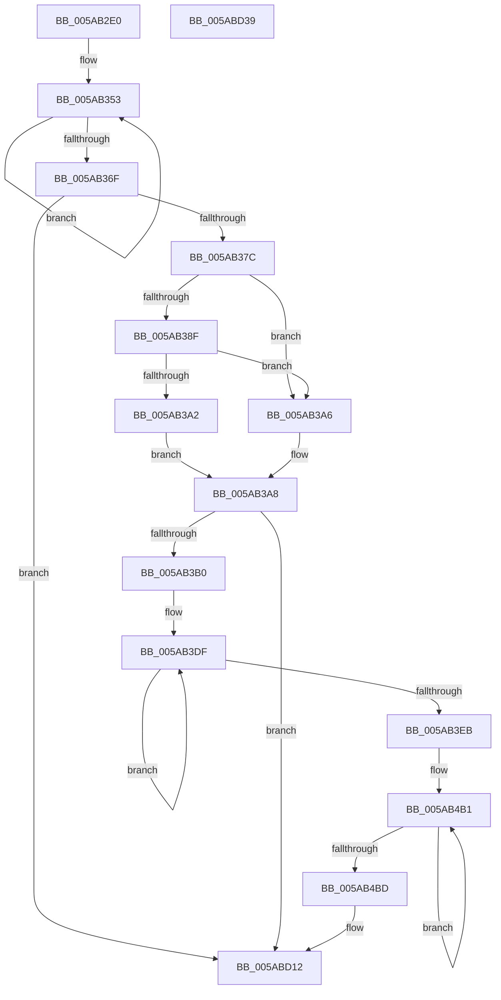

# KasaniSendReport

- RVA: `0x005AB2E0`–`0x005ABD3A` (길이 `2,650` bytes)
- VA: `0x00000001405AB2E0`
- 실행 섹션: `.text`
- PDB 이름 있음: `예`; PDB Function 태그: `아니요`
- unwind 정보 RVA: `0x000C9568`
- 디코드: `443`개 명령, `2,650/2,650` bytes 표시
- 미해석 바이트: `0` (있으면 어셈블리에 `.byte`로 보존)

> 이 문서는 커널 이미지의 기계어와 PDB 기호를 분석해 생성했습니다. 4번과 5번은 함수 원형과 자료형을 바이너리 사용 방식에서 추정한 C 해석이며 원본 소스 복구 결과는 아닙니다.

## 1. Dependencies

- 직접 호출 지점: **22**; 고유 호출 대상: **5**
- 직접 호출자로 확인된 함수: **1**
- RIP 상대 이미지 참조: **10**

### Outgoing calls
- `0x005AB31D` → [memset](../6C/memset_function_006C6C40.md) (function, `0x006C6C40`)
- `0x005AB331` → [memset](../6C/memset_function_006C6C40.md) (function, `0x006C6C40`)
- `0x005AB33D` → [KasaniBuildPc](KasaniBuildPc_function_005AAF40.md) (function, `0x005AAF40`)
- `0x005AB359` → [KasaniBuildPc](KasaniBuildPc_function_005AAF40.md) (function, `0x005AAF40`)
- `0x005AB56F` → [tlgCreate1Sz_wchar_t](../42/tlgCreate1Sz_wchar_t_function_00426198.md) (function, `0x00426198`)
- `0x005AB5E5` → [tlgCreate1Sz_wchar_t](../42/tlgCreate1Sz_wchar_t_function_00426198.md) (function, `0x00426198`)
- `0x005AB65B` → [tlgCreate1Sz_wchar_t](../42/tlgCreate1Sz_wchar_t_function_00426198.md) (function, `0x00426198`)
- `0x005AB6D1` → [tlgCreate1Sz_wchar_t](../42/tlgCreate1Sz_wchar_t_function_00426198.md) (function, `0x00426198`)
- `0x005AB741` → [tlgCreate1Sz_wchar_t](../42/tlgCreate1Sz_wchar_t_function_00426198.md) (function, `0x00426198`)
- `0x005AB7B1` → [tlgCreate1Sz_wchar_t](../42/tlgCreate1Sz_wchar_t_function_00426198.md) (function, `0x00426198`)
- `0x005AB821` → [tlgCreate1Sz_wchar_t](../42/tlgCreate1Sz_wchar_t_function_00426198.md) (function, `0x00426198`)
- `0x005AB891` → [tlgCreate1Sz_wchar_t](../42/tlgCreate1Sz_wchar_t_function_00426198.md) (function, `0x00426198`)
- `0x005AB901` → [tlgCreate1Sz_wchar_t](../42/tlgCreate1Sz_wchar_t_function_00426198.md) (function, `0x00426198`)
- `0x005AB971` → [tlgCreate1Sz_wchar_t](../42/tlgCreate1Sz_wchar_t_function_00426198.md) (function, `0x00426198`)
- `0x005AB9E1` → [tlgCreate1Sz_wchar_t](../42/tlgCreate1Sz_wchar_t_function_00426198.md) (function, `0x00426198`)
- `0x005ABA51` → [tlgCreate1Sz_wchar_t](../42/tlgCreate1Sz_wchar_t_function_00426198.md) (function, `0x00426198`)
- `0x005ABAC1` → [tlgCreate1Sz_wchar_t](../42/tlgCreate1Sz_wchar_t_function_00426198.md) (function, `0x00426198`)
- `0x005ABB31` → [tlgCreate1Sz_wchar_t](../42/tlgCreate1Sz_wchar_t_function_00426198.md) (function, `0x00426198`)
- `0x005ABBA1` → [tlgCreate1Sz_wchar_t](../42/tlgCreate1Sz_wchar_t_function_00426198.md) (function, `0x00426198`)
- `0x005ABC11` → [tlgCreate1Sz_wchar_t](../42/tlgCreate1Sz_wchar_t_function_00426198.md) (function, `0x00426198`)
- `0x005ABD0D` → [EtwWriteEx](../25/EtwWriteEx_function_0025F0D0.md) (function, `0x0025F0D0`)
- `0x005ABD1C` → [_security_check_cookie](../6A/_security_check_cookie_function_006AC640.md) (function, `0x006AC640`)

### Direct callers
- [KasaniReportTelemetry](KasaniReportTelemetry_function_005AB1D0.md) at `0x005AB272`

### Static image references
- `0x005AB2FD` → RVA `0x00E0A740` (`.data`; read)
- `0x005AB36F` → RVA `0x00E07020` (`.data`; read)
- `0x005AB386` → RVA `0x00E07030` (`.data`; read)
- `0x005AB38F` → RVA `0x00E07038` (`.data`; read)
- `0x005ABC4F` → RVA `0x00047692` (`.rdata`; read)
- `0x005ABC59` → RVA `0x00E07028` (`.data`; read)
- `0x005ABC9F` → RVA `0x0004769C` (`.rdata`; read)
- `0x005ABCB7` → RVA `0x0005BCFD` (`.rdata`; read)
- `0x005ABCC8` → RVA `0x00043590` (`.rdata`; read)
- `0x005ABCE8` → RVA `0x00E07040` (`.data`; read)

## 2. Other-region calls and transfers

- 다른 실행 섹션으로 향하는 call: **0**
- 별도 외부 분기/꼬리 이동을 확인하지 못했습니다.

## 3. Assembly (complete function range)

```asm
005AB2E0  48 89 5C 24 10                  mov qword ptr [rsp + 0x10], rbx
005AB2E5  48 89 74 24 18                  mov qword ptr [rsp + 0x18], rsi
005AB2EA  55                              push rbp
005AB2EB  57                              push rdi
005AB2EC  41 56                           push r14
005AB2EE  48 8D AC 24 F0 F0 FF FF         lea rbp, [rsp - 0xf10]
005AB2F6  48 81 EC 10 10 00 00            sub rsp, 0x1010
005AB2FD  48 8B 05 3C F4 85 00            mov rax, qword ptr [rip + 0x85f43c]
005AB304  48 33 C4                        xor rax, rsp
005AB307  48 89 85 00 0F 00 00            mov qword ptr [rbp + 0xf00], rax
005AB30E  48 8B D9                        mov rbx, rcx
005AB311  33 D2                           xor edx, edx
005AB313  48 8D 4D 40                     lea rcx, [rbp + 0x40]
005AB317  41 B8 8C 00 00 00               mov r8d, 0x8c
005AB31D  E8 1E B9 11 00                  call 0x1406c6c40
005AB322  33 D2                           xor edx, edx
005AB324  48 8D 8D D0 00 00 00            lea rcx, [rbp + 0xd0]
005AB32B  41 B8 8C 00 00 00               mov r8d, 0x8c
005AB331  E8 0A B9 11 00                  call 0x1406c6c40
005AB336  48 8B 0B                        mov rcx, qword ptr [rbx]
005AB339  48 8D 55 40                     lea rdx, [rbp + 0x40]
005AB33D  E8 FE FB FF FF                  call 0x1405aaf40
005AB342  48 8D BD 40 06 00 00            lea rdi, [rbp + 0x640]
005AB349  41 BE 10 00 00 00               mov r14d, 0x10
005AB34F  48 8D 73 28                     lea rsi, [rbx + 0x28]
005AB353  48 8B 0E                        mov rcx, qword ptr [rsi]
005AB356  48 8B D7                        mov rdx, rdi
005AB359  E8 E2 FB FF FF                  call 0x1405aaf40
005AB35E  48 81 C7 8C 00 00 00            add rdi, 0x8c
005AB365  48 8D 76 08                     lea rsi, [rsi + 8]
005AB369  49 83 EE 01                     sub r14, 1
005AB36D  75 E4                           jne 0x1405ab353
005AB36F  83 3D AA BC 85 00 05            cmp dword ptr [rip + 0x85bcaa], 5
005AB376  0F 86 96 09 00 00               jbe 0x1405abd12
005AB37C  49 BA 00 00 00 00 00 40 00 00   movabs r10, 0x400000000000
005AB386  4C 85 15 A3 BC 85 00            test qword ptr [rip + 0x85bca3], r10
005AB38D  74 17                           je 0x1405ab3a6
005AB38F  48 8B 05 A2 BC 85 00            mov rax, qword ptr [rip + 0x85bca2]
005AB396  49 23 C2                        and rax, r10
005AB399  48 3B 05 98 BC 85 00            cmp rax, qword ptr [rip + 0x85bc98]
005AB3A0  75 04                           jne 0x1405ab3a6
005AB3A2  B0 01                           mov al, 1
005AB3A4  EB 02                           jmp 0x1405ab3a8
005AB3A6  32 C0                           xor al, al
005AB3A8  84 C0                           test al, al
005AB3AA  0F 84 62 09 00 00               je 0x1405abd12
005AB3B0  48 8D 45 20                     lea rax, [rbp + 0x20]
005AB3B4  48 C7 45 20 00 00 00 02         mov qword ptr [rbp + 0x20], 0x2000000
005AB3BC  48 C7 C1 FF FF FF FF            mov rcx, 0xffffffffffffffff
005AB3C3  48 89 85 80 01 00 00            mov qword ptr [rbp + 0x180], rax
005AB3CA  48 8B C1                        mov rax, rcx
005AB3CD  48 C7 85 88 01 00 00 08 00 00 00  mov qword ptr [rbp + 0x188], 8
005AB3D8  45 33 C9                        xor r9d, r9d
005AB3DB  48 8D 55 40                     lea rdx, [rbp + 0x40]
005AB3DF  66 44 39 4C 42 02               cmp word ptr [rdx + rax*2 + 2], r9w
005AB3E5  48 8D 40 01                     lea rax, [rax + 1]
005AB3E9  75 F4                           jne 0x1405ab3df
005AB3EB  8D 04 45 02 00 00 00            lea eax, [rax*2 + 2]
005AB3F2  44 89 8D 9C 01 00 00            mov dword ptr [rbp + 0x19c], r9d
005AB3F9  89 85 98 01 00 00               mov dword ptr [rbp + 0x198], eax
005AB3FF  48 8D 55 40                     lea rdx, [rbp + 0x40]
005AB403  8B 85 C0 00 00 00               mov eax, dword ptr [rbp + 0xc0]
005AB409  89 44 24 44                     mov dword ptr [rsp + 0x44], eax
005AB40D  48 8D 44 24 44                  lea rax, [rsp + 0x44]
005AB412  48 89 85 A0 01 00 00            mov qword ptr [rbp + 0x1a0], rax
005AB419  8B 85 C4 00 00 00               mov eax, dword ptr [rbp + 0xc4]
005AB41F  89 44 24 48                     mov dword ptr [rsp + 0x48], eax
005AB423  48 8D 44 24 48                  lea rax, [rsp + 0x48]
005AB428  48 89 85 B0 01 00 00            mov qword ptr [rbp + 0x1b0], rax
005AB42F  8B 85 C8 00 00 00               mov eax, dword ptr [rbp + 0xc8]
005AB435  89 44 24 4C                     mov dword ptr [rsp + 0x4c], eax
005AB439  48 8D 44 24 4C                  lea rax, [rsp + 0x4c]
005AB43E  48 89 85 C0 01 00 00            mov qword ptr [rbp + 0x1c0], rax
005AB445  48 8B 43 08                     mov rax, qword ptr [rbx + 8]
005AB449  48 89 45 28                     mov qword ptr [rbp + 0x28], rax
005AB44D  48 8D 45 28                     lea rax, [rbp + 0x28]
005AB451  48 89 85 D0 01 00 00            mov qword ptr [rbp + 0x1d0], rax
005AB458  0F B6 43 10                     movzx eax, byte ptr [rbx + 0x10]
005AB45C  88 44 24 40                     mov byte ptr [rsp + 0x40], al
005AB460  48 8D 44 24 40                  lea rax, [rsp + 0x40]
005AB465  48 89 85 E0 01 00 00            mov qword ptr [rbp + 0x1e0], rax
005AB46C  48 8D 85 D0 00 00 00            lea rax, [rbp + 0xd0]
005AB473  48 89 95 90 01 00 00            mov qword ptr [rbp + 0x190], rdx
005AB47A  48 C7 85 A8 01 00 00 04 00 00 00  mov qword ptr [rbp + 0x1a8], 4
005AB485  48 C7 85 B8 01 00 00 04 00 00 00  mov qword ptr [rbp + 0x1b8], 4
005AB490  48 C7 85 C8 01 00 00 04 00 00 00  mov qword ptr [rbp + 0x1c8], 4
005AB49B  48 C7 85 D8 01 00 00 08 00 00 00  mov qword ptr [rbp + 0x1d8], 8
005AB4A6  48 C7 85 E8 01 00 00 01 00 00 00  mov qword ptr [rbp + 0x1e8], 1
005AB4B1  66 44 39 4C 48 02               cmp word ptr [rax + rcx*2 + 2], r9w
005AB4B7  48 8D 49 01                     lea rcx, [rcx + 1]
005AB4BB  75 F4                           jne 0x1405ab4b1
005AB4BD  8D 04 4D 02 00 00 00            lea eax, [rcx*2 + 2]
005AB4C4  44 89 8D FC 01 00 00            mov dword ptr [rbp + 0x1fc], r9d
005AB4CB  89 85 F8 01 00 00               mov dword ptr [rbp + 0x1f8], eax
005AB4D1  48 8D 8D D0 00 00 00            lea rcx, [rbp + 0xd0]
005AB4D8  8B 85 50 01 00 00               mov eax, dword ptr [rbp + 0x150]
005AB4DE  48 8D 95 40 06 00 00            lea rdx, [rbp + 0x640]
005AB4E5  89 44 24 50                     mov dword ptr [rsp + 0x50], eax
005AB4E9  48 8D 44 24 50                  lea rax, [rsp + 0x50]
005AB4EE  48 89 85 00 02 00 00            mov qword ptr [rbp + 0x200], rax
005AB4F5  8B 85 54 01 00 00               mov eax, dword ptr [rbp + 0x154]
005AB4FB  89 44 24 54                     mov dword ptr [rsp + 0x54], eax
005AB4FF  48 8D 44 24 54                  lea rax, [rsp + 0x54]
005AB504  48 89 85 10 02 00 00            mov qword ptr [rbp + 0x210], rax
005AB50B  8B 85 58 01 00 00               mov eax, dword ptr [rbp + 0x158]
005AB511  89 44 24 58                     mov dword ptr [rsp + 0x58], eax
005AB515  48 8D 44 24 58                  lea rax, [rsp + 0x58]
005AB51A  48 89 85 20 02 00 00            mov qword ptr [rbp + 0x220], rax
005AB521  0F B6 43 20                     movzx eax, byte ptr [rbx + 0x20]
005AB525  88 44 24 41                     mov byte ptr [rsp + 0x41], al
005AB529  48 8D 44 24 41                  lea rax, [rsp + 0x41]
005AB52E  48 89 8D F0 01 00 00            mov qword ptr [rbp + 0x1f0], rcx
005AB535  48 8D 8D 40 02 00 00            lea rcx, [rbp + 0x240]
005AB53C  48 89 85 30 02 00 00            mov qword ptr [rbp + 0x230], rax
005AB543  48 C7 85 08 02 00 00 04 00 00 00  mov qword ptr [rbp + 0x208], 4
005AB54E  48 C7 85 18 02 00 00 04 00 00 00  mov qword ptr [rbp + 0x218], 4
005AB559  48 C7 85 28 02 00 00 04 00 00 00  mov qword ptr [rbp + 0x228], 4
005AB564  48 C7 85 38 02 00 00 01 00 00 00  mov qword ptr [rbp + 0x238], 1
005AB56F  E8 24 AC E7 FF                  call 0x140426198
005AB574  8B 8D C0 06 00 00               mov ecx, dword ptr [rbp + 0x6c0]
005AB57A  48 8D 44 24 5C                  lea rax, [rsp + 0x5c]
005AB57F  48 89 85 50 02 00 00            mov qword ptr [rbp + 0x250], rax
005AB586  48 8D 95 CC 06 00 00            lea rdx, [rbp + 0x6cc]
005AB58D  8B 85 C4 06 00 00               mov eax, dword ptr [rbp + 0x6c4]
005AB593  89 44 24 60                     mov dword ptr [rsp + 0x60], eax
005AB597  48 8D 44 24 60                  lea rax, [rsp + 0x60]
005AB59C  48 89 85 60 02 00 00            mov qword ptr [rbp + 0x260], rax
005AB5A3  8B 85 C8 06 00 00               mov eax, dword ptr [rbp + 0x6c8]
005AB5A9  89 44 24 64                     mov dword ptr [rsp + 0x64], eax
005AB5AD  48 8D 44 24 64                  lea rax, [rsp + 0x64]
005AB5B2  89 4C 24 5C                     mov dword ptr [rsp + 0x5c], ecx
005AB5B6  48 8D 8D 80 02 00 00            lea rcx, [rbp + 0x280]
005AB5BD  48 89 85 70 02 00 00            mov qword ptr [rbp + 0x270], rax
005AB5C4  48 C7 85 58 02 00 00 04 00 00 00  mov qword ptr [rbp + 0x258], 4
005AB5CF  48 C7 85 68 02 00 00 04 00 00 00  mov qword ptr [rbp + 0x268], 4
005AB5DA  48 C7 85 78 02 00 00 04 00 00 00  mov qword ptr [rbp + 0x278], 4
005AB5E5  E8 AE AB E7 FF                  call 0x140426198
005AB5EA  8B 8D 4C 07 00 00               mov ecx, dword ptr [rbp + 0x74c]
005AB5F0  48 8D 44 24 68                  lea rax, [rsp + 0x68]
005AB5F5  48 89 85 90 02 00 00            mov qword ptr [rbp + 0x290], rax
005AB5FC  48 8D 95 58 07 00 00            lea rdx, [rbp + 0x758]
005AB603  8B 85 50 07 00 00               mov eax, dword ptr [rbp + 0x750]
005AB609  89 44 24 6C                     mov dword ptr [rsp + 0x6c], eax
005AB60D  48 8D 44 24 6C                  lea rax, [rsp + 0x6c]
005AB612  48 89 85 A0 02 00 00            mov qword ptr [rbp + 0x2a0], rax
005AB619  8B 85 54 07 00 00               mov eax, dword ptr [rbp + 0x754]
005AB61F  89 44 24 70                     mov dword ptr [rsp + 0x70], eax
005AB623  48 8D 44 24 70                  lea rax, [rsp + 0x70]
005AB628  89 4C 24 68                     mov dword ptr [rsp + 0x68], ecx
005AB62C  48 8D 8D C0 02 00 00            lea rcx, [rbp + 0x2c0]
005AB633  48 89 85 B0 02 00 00            mov qword ptr [rbp + 0x2b0], rax
005AB63A  48 C7 85 98 02 00 00 04 00 00 00  mov qword ptr [rbp + 0x298], 4
005AB645  48 C7 85 A8 02 00 00 04 00 00 00  mov qword ptr [rbp + 0x2a8], 4
005AB650  48 C7 85 B8 02 00 00 04 00 00 00  mov qword ptr [rbp + 0x2b8], 4
005AB65B  E8 38 AB E7 FF                  call 0x140426198
005AB660  8B 8D D8 07 00 00               mov ecx, dword ptr [rbp + 0x7d8]
005AB666  48 8D 44 24 74                  lea rax, [rsp + 0x74]
005AB66B  48 89 85 D0 02 00 00            mov qword ptr [rbp + 0x2d0], rax
005AB672  48 8D 95 E4 07 00 00            lea rdx, [rbp + 0x7e4]
005AB679  8B 85 DC 07 00 00               mov eax, dword ptr [rbp + 0x7dc]
005AB67F  89 44 24 78                     mov dword ptr [rsp + 0x78], eax
005AB683  48 8D 44 24 78                  lea rax, [rsp + 0x78]
005AB688  48 89 85 E0 02 00 00            mov qword ptr [rbp + 0x2e0], rax
005AB68F  8B 85 E0 07 00 00               mov eax, dword ptr [rbp + 0x7e0]
005AB695  89 44 24 7C                     mov dword ptr [rsp + 0x7c], eax
005AB699  48 8D 44 24 7C                  lea rax, [rsp + 0x7c]
005AB69E  89 4C 24 74                     mov dword ptr [rsp + 0x74], ecx
005AB6A2  48 8D 8D 00 03 00 00            lea rcx, [rbp + 0x300]
005AB6A9  48 89 85 F0 02 00 00            mov qword ptr [rbp + 0x2f0], rax
005AB6B0  48 C7 85 D8 02 00 00 04 00 00 00  mov qword ptr [rbp + 0x2d8], 4
005AB6BB  48 C7 85 E8 02 00 00 04 00 00 00  mov qword ptr [rbp + 0x2e8], 4
005AB6C6  48 C7 85 F8 02 00 00 04 00 00 00  mov qword ptr [rbp + 0x2f8], 4
005AB6D1  E8 C2 AA E7 FF                  call 0x140426198
005AB6D6  8B 8D 64 08 00 00               mov ecx, dword ptr [rbp + 0x864]
005AB6DC  48 8D 45 80                     lea rax, [rbp - 0x80]
005AB6E0  48 89 85 10 03 00 00            mov qword ptr [rbp + 0x310], rax
005AB6E7  48 8D 95 70 08 00 00            lea rdx, [rbp + 0x870]
005AB6EE  8B 85 68 08 00 00               mov eax, dword ptr [rbp + 0x868]
005AB6F4  89 45 84                        mov dword ptr [rbp - 0x7c], eax
005AB6F7  48 8D 45 84                     lea rax, [rbp - 0x7c]
005AB6FB  48 89 85 20 03 00 00            mov qword ptr [rbp + 0x320], rax
005AB702  8B 85 6C 08 00 00               mov eax, dword ptr [rbp + 0x86c]
005AB708  89 45 88                        mov dword ptr [rbp - 0x78], eax
005AB70B  48 8D 45 88                     lea rax, [rbp - 0x78]
005AB70F  89 4D 80                        mov dword ptr [rbp - 0x80], ecx
005AB712  48 8D 8D 40 03 00 00            lea rcx, [rbp + 0x340]
005AB719  48 89 85 30 03 00 00            mov qword ptr [rbp + 0x330], rax
005AB720  48 C7 85 18 03 00 00 04 00 00 00  mov qword ptr [rbp + 0x318], 4
005AB72B  48 C7 85 28 03 00 00 04 00 00 00  mov qword ptr [rbp + 0x328], 4
005AB736  48 C7 85 38 03 00 00 04 00 00 00  mov qword ptr [rbp + 0x338], 4
005AB741  E8 52 AA E7 FF                  call 0x140426198
005AB746  8B 8D F0 08 00 00               mov ecx, dword ptr [rbp + 0x8f0]
005AB74C  48 8D 45 8C                     lea rax, [rbp - 0x74]
005AB750  48 89 85 50 03 00 00            mov qword ptr [rbp + 0x350], rax
005AB757  48 8D 95 FC 08 00 00            lea rdx, [rbp + 0x8fc]
005AB75E  8B 85 F4 08 00 00               mov eax, dword ptr [rbp + 0x8f4]
005AB764  89 45 90                        mov dword ptr [rbp - 0x70], eax
005AB767  48 8D 45 90                     lea rax, [rbp - 0x70]
005AB76B  48 89 85 60 03 00 00            mov qword ptr [rbp + 0x360], rax
005AB772  8B 85 F8 08 00 00               mov eax, dword ptr [rbp + 0x8f8]
005AB778  89 45 94                        mov dword ptr [rbp - 0x6c], eax
005AB77B  48 8D 45 94                     lea rax, [rbp - 0x6c]
005AB77F  89 4D 8C                        mov dword ptr [rbp - 0x74], ecx
005AB782  48 8D 8D 80 03 00 00            lea rcx, [rbp + 0x380]
005AB789  48 89 85 70 03 00 00            mov qword ptr [rbp + 0x370], rax
005AB790  48 C7 85 58 03 00 00 04 00 00 00  mov qword ptr [rbp + 0x358], 4
005AB79B  48 C7 85 68 03 00 00 04 00 00 00  mov qword ptr [rbp + 0x368], 4
005AB7A6  48 C7 85 78 03 00 00 04 00 00 00  mov qword ptr [rbp + 0x378], 4
005AB7B1  E8 E2 A9 E7 FF                  call 0x140426198
005AB7B6  8B 8D 7C 09 00 00               mov ecx, dword ptr [rbp + 0x97c]
005AB7BC  48 8D 45 98                     lea rax, [rbp - 0x68]
005AB7C0  48 89 85 90 03 00 00            mov qword ptr [rbp + 0x390], rax
005AB7C7  48 8D 95 88 09 00 00            lea rdx, [rbp + 0x988]
005AB7CE  8B 85 80 09 00 00               mov eax, dword ptr [rbp + 0x980]
005AB7D4  89 45 9C                        mov dword ptr [rbp - 0x64], eax
005AB7D7  48 8D 45 9C                     lea rax, [rbp - 0x64]
005AB7DB  48 89 85 A0 03 00 00            mov qword ptr [rbp + 0x3a0], rax
005AB7E2  8B 85 84 09 00 00               mov eax, dword ptr [rbp + 0x984]
005AB7E8  89 45 A0                        mov dword ptr [rbp - 0x60], eax
005AB7EB  48 8D 45 A0                     lea rax, [rbp - 0x60]
005AB7EF  89 4D 98                        mov dword ptr [rbp - 0x68], ecx
005AB7F2  48 8D 8D C0 03 00 00            lea rcx, [rbp + 0x3c0]
005AB7F9  48 89 85 B0 03 00 00            mov qword ptr [rbp + 0x3b0], rax
005AB800  48 C7 85 98 03 00 00 04 00 00 00  mov qword ptr [rbp + 0x398], 4
005AB80B  48 C7 85 A8 03 00 00 04 00 00 00  mov qword ptr [rbp + 0x3a8], 4
005AB816  48 C7 85 B8 03 00 00 04 00 00 00  mov qword ptr [rbp + 0x3b8], 4
005AB821  E8 72 A9 E7 FF                  call 0x140426198
005AB826  8B 8D 08 0A 00 00               mov ecx, dword ptr [rbp + 0xa08]
005AB82C  48 8D 45 A4                     lea rax, [rbp - 0x5c]
005AB830  48 89 85 D0 03 00 00            mov qword ptr [rbp + 0x3d0], rax
005AB837  48 8D 95 14 0A 00 00            lea rdx, [rbp + 0xa14]
005AB83E  8B 85 0C 0A 00 00               mov eax, dword ptr [rbp + 0xa0c]
005AB844  89 45 A8                        mov dword ptr [rbp - 0x58], eax
005AB847  48 8D 45 A8                     lea rax, [rbp - 0x58]
005AB84B  48 89 85 E0 03 00 00            mov qword ptr [rbp + 0x3e0], rax
005AB852  8B 85 10 0A 00 00               mov eax, dword ptr [rbp + 0xa10]
005AB858  89 45 AC                        mov dword ptr [rbp - 0x54], eax
005AB85B  48 8D 45 AC                     lea rax, [rbp - 0x54]
005AB85F  89 4D A4                        mov dword ptr [rbp - 0x5c], ecx
005AB862  48 8D 8D 00 04 00 00            lea rcx, [rbp + 0x400]
005AB869  48 89 85 F0 03 00 00            mov qword ptr [rbp + 0x3f0], rax
005AB870  48 C7 85 D8 03 00 00 04 00 00 00  mov qword ptr [rbp + 0x3d8], 4
005AB87B  48 C7 85 E8 03 00 00 04 00 00 00  mov qword ptr [rbp + 0x3e8], 4
005AB886  48 C7 85 F8 03 00 00 04 00 00 00  mov qword ptr [rbp + 0x3f8], 4
005AB891  E8 02 A9 E7 FF                  call 0x140426198
005AB896  8B 8D 94 0A 00 00               mov ecx, dword ptr [rbp + 0xa94]
005AB89C  48 8D 45 B0                     lea rax, [rbp - 0x50]
005AB8A0  48 89 85 10 04 00 00            mov qword ptr [rbp + 0x410], rax
005AB8A7  8B 85 98 0A 00 00               mov eax, dword ptr [rbp + 0xa98]
005AB8AD  89 45 B4                        mov dword ptr [rbp - 0x4c], eax
005AB8B0  48 8D 45 B4                     lea rax, [rbp - 0x4c]
005AB8B4  89 4D B0                        mov dword ptr [rbp - 0x50], ecx
005AB8B7  48 C7 85 18 04 00 00 04 00 00 00  mov qword ptr [rbp + 0x418], 4
005AB8C2  48 89 85 20 04 00 00            mov qword ptr [rbp + 0x420], rax
005AB8C9  48 8D 95 A0 0A 00 00            lea rdx, [rbp + 0xaa0]
005AB8D0  8B 85 9C 0A 00 00               mov eax, dword ptr [rbp + 0xa9c]
005AB8D6  48 8D 8D 40 04 00 00            lea rcx, [rbp + 0x440]
005AB8DD  89 45 B8                        mov dword ptr [rbp - 0x48], eax
005AB8E0  48 8D 45 B8                     lea rax, [rbp - 0x48]
005AB8E4  48 89 85 30 04 00 00            mov qword ptr [rbp + 0x430], rax
005AB8EB  48 C7 85 28 04 00 00 04 00 00 00  mov qword ptr [rbp + 0x428], 4
005AB8F6  48 C7 85 38 04 00 00 04 00 00 00  mov qword ptr [rbp + 0x438], 4
005AB901  E8 92 A8 E7 FF                  call 0x140426198
005AB906  8B 8D 20 0B 00 00               mov ecx, dword ptr [rbp + 0xb20]
005AB90C  48 8D 45 BC                     lea rax, [rbp - 0x44]
005AB910  48 89 85 50 04 00 00            mov qword ptr [rbp + 0x450], rax
005AB917  48 8D 95 2C 0B 00 00            lea rdx, [rbp + 0xb2c]
005AB91E  8B 85 24 0B 00 00               mov eax, dword ptr [rbp + 0xb24]
005AB924  89 45 C0                        mov dword ptr [rbp - 0x40], eax
005AB927  48 8D 45 C0                     lea rax, [rbp - 0x40]
005AB92B  48 89 85 60 04 00 00            mov qword ptr [rbp + 0x460], rax
005AB932  8B 85 28 0B 00 00               mov eax, dword ptr [rbp + 0xb28]
005AB938  89 45 C4                        mov dword ptr [rbp - 0x3c], eax
005AB93B  48 8D 45 C4                     lea rax, [rbp - 0x3c]
005AB93F  89 4D BC                        mov dword ptr [rbp - 0x44], ecx
005AB942  48 8D 8D 80 04 00 00            lea rcx, [rbp + 0x480]
005AB949  48 89 85 70 04 00 00            mov qword ptr [rbp + 0x470], rax
005AB950  48 C7 85 58 04 00 00 04 00 00 00  mov qword ptr [rbp + 0x458], 4
005AB95B  48 C7 85 68 04 00 00 04 00 00 00  mov qword ptr [rbp + 0x468], 4
005AB966  48 C7 85 78 04 00 00 04 00 00 00  mov qword ptr [rbp + 0x478], 4
005AB971  E8 22 A8 E7 FF                  call 0x140426198
005AB976  8B 8D AC 0B 00 00               mov ecx, dword ptr [rbp + 0xbac]
005AB97C  48 8D 45 C8                     lea rax, [rbp - 0x38]
005AB980  48 89 85 90 04 00 00            mov qword ptr [rbp + 0x490], rax
005AB987  48 8D 95 B8 0B 00 00            lea rdx, [rbp + 0xbb8]
005AB98E  8B 85 B0 0B 00 00               mov eax, dword ptr [rbp + 0xbb0]
005AB994  89 45 CC                        mov dword ptr [rbp - 0x34], eax
005AB997  48 8D 45 CC                     lea rax, [rbp - 0x34]
005AB99B  48 89 85 A0 04 00 00            mov qword ptr [rbp + 0x4a0], rax
005AB9A2  8B 85 B4 0B 00 00               mov eax, dword ptr [rbp + 0xbb4]
005AB9A8  89 45 D0                        mov dword ptr [rbp - 0x30], eax
005AB9AB  48 8D 45 D0                     lea rax, [rbp - 0x30]
005AB9AF  89 4D C8                        mov dword ptr [rbp - 0x38], ecx
005AB9B2  48 8D 8D C0 04 00 00            lea rcx, [rbp + 0x4c0]
005AB9B9  48 89 85 B0 04 00 00            mov qword ptr [rbp + 0x4b0], rax
005AB9C0  48 C7 85 98 04 00 00 04 00 00 00  mov qword ptr [rbp + 0x498], 4
005AB9CB  48 C7 85 A8 04 00 00 04 00 00 00  mov qword ptr [rbp + 0x4a8], 4
005AB9D6  48 C7 85 B8 04 00 00 04 00 00 00  mov qword ptr [rbp + 0x4b8], 4
005AB9E1  E8 B2 A7 E7 FF                  call 0x140426198
005AB9E6  8B 8D 38 0C 00 00               mov ecx, dword ptr [rbp + 0xc38]
005AB9EC  48 8D 45 D4                     lea rax, [rbp - 0x2c]
005AB9F0  48 89 85 D0 04 00 00            mov qword ptr [rbp + 0x4d0], rax
005AB9F7  48 8D 95 44 0C 00 00            lea rdx, [rbp + 0xc44]
005AB9FE  8B 85 3C 0C 00 00               mov eax, dword ptr [rbp + 0xc3c]
005ABA04  89 45 D8                        mov dword ptr [rbp - 0x28], eax
005ABA07  48 8D 45 D8                     lea rax, [rbp - 0x28]
005ABA0B  48 89 85 E0 04 00 00            mov qword ptr [rbp + 0x4e0], rax
005ABA12  8B 85 40 0C 00 00               mov eax, dword ptr [rbp + 0xc40]
005ABA18  89 45 DC                        mov dword ptr [rbp - 0x24], eax
005ABA1B  48 8D 45 DC                     lea rax, [rbp - 0x24]
005ABA1F  89 4D D4                        mov dword ptr [rbp - 0x2c], ecx
005ABA22  48 8D 8D 00 05 00 00            lea rcx, [rbp + 0x500]
005ABA29  48 89 85 F0 04 00 00            mov qword ptr [rbp + 0x4f0], rax
005ABA30  48 C7 85 D8 04 00 00 04 00 00 00  mov qword ptr [rbp + 0x4d8], 4
005ABA3B  48 C7 85 E8 04 00 00 04 00 00 00  mov qword ptr [rbp + 0x4e8], 4
005ABA46  48 C7 85 F8 04 00 00 04 00 00 00  mov qword ptr [rbp + 0x4f8], 4
005ABA51  E8 42 A7 E7 FF                  call 0x140426198
005ABA56  8B 8D C4 0C 00 00               mov ecx, dword ptr [rbp + 0xcc4]
005ABA5C  48 8D 45 E0                     lea rax, [rbp - 0x20]
005ABA60  48 89 85 10 05 00 00            mov qword ptr [rbp + 0x510], rax
005ABA67  48 8D 95 D0 0C 00 00            lea rdx, [rbp + 0xcd0]
005ABA6E  8B 85 C8 0C 00 00               mov eax, dword ptr [rbp + 0xcc8]
005ABA74  89 45 E4                        mov dword ptr [rbp - 0x1c], eax
005ABA77  48 8D 45 E4                     lea rax, [rbp - 0x1c]
005ABA7B  48 89 85 20 05 00 00            mov qword ptr [rbp + 0x520], rax
005ABA82  8B 85 CC 0C 00 00               mov eax, dword ptr [rbp + 0xccc]
005ABA88  89 45 E8                        mov dword ptr [rbp - 0x18], eax
005ABA8B  48 8D 45 E8                     lea rax, [rbp - 0x18]
005ABA8F  89 4D E0                        mov dword ptr [rbp - 0x20], ecx
005ABA92  48 8D 8D 40 05 00 00            lea rcx, [rbp + 0x540]
005ABA99  48 89 85 30 05 00 00            mov qword ptr [rbp + 0x530], rax
005ABAA0  48 C7 85 18 05 00 00 04 00 00 00  mov qword ptr [rbp + 0x518], 4
005ABAAB  48 C7 85 28 05 00 00 04 00 00 00  mov qword ptr [rbp + 0x528], 4
005ABAB6  48 C7 85 38 05 00 00 04 00 00 00  mov qword ptr [rbp + 0x538], 4
005ABAC1  E8 D2 A6 E7 FF                  call 0x140426198
005ABAC6  8B 8D 50 0D 00 00               mov ecx, dword ptr [rbp + 0xd50]
005ABACC  48 8D 45 EC                     lea rax, [rbp - 0x14]
005ABAD0  48 89 85 50 05 00 00            mov qword ptr [rbp + 0x550], rax
005ABAD7  48 8D 95 5C 0D 00 00            lea rdx, [rbp + 0xd5c]
005ABADE  8B 85 54 0D 00 00               mov eax, dword ptr [rbp + 0xd54]
005ABAE4  89 45 F0                        mov dword ptr [rbp - 0x10], eax
005ABAE7  48 8D 45 F0                     lea rax, [rbp - 0x10]
005ABAEB  48 89 85 60 05 00 00            mov qword ptr [rbp + 0x560], rax
005ABAF2  8B 85 58 0D 00 00               mov eax, dword ptr [rbp + 0xd58]
005ABAF8  89 45 F4                        mov dword ptr [rbp - 0xc], eax
005ABAFB  48 8D 45 F4                     lea rax, [rbp - 0xc]
005ABAFF  89 4D EC                        mov dword ptr [rbp - 0x14], ecx
005ABB02  48 8D 8D 80 05 00 00            lea rcx, [rbp + 0x580]
005ABB09  48 89 85 70 05 00 00            mov qword ptr [rbp + 0x570], rax
005ABB10  48 C7 85 58 05 00 00 04 00 00 00  mov qword ptr [rbp + 0x558], 4
005ABB1B  48 C7 85 68 05 00 00 04 00 00 00  mov qword ptr [rbp + 0x568], 4
005ABB26  48 C7 85 78 05 00 00 04 00 00 00  mov qword ptr [rbp + 0x578], 4
005ABB31  E8 62 A6 E7 FF                  call 0x140426198
005ABB36  8B 8D DC 0D 00 00               mov ecx, dword ptr [rbp + 0xddc]
005ABB3C  48 8D 45 F8                     lea rax, [rbp - 8]
005ABB40  48 89 85 90 05 00 00            mov qword ptr [rbp + 0x590], rax
005ABB47  48 8D 95 E8 0D 00 00            lea rdx, [rbp + 0xde8]
005ABB4E  8B 85 E0 0D 00 00               mov eax, dword ptr [rbp + 0xde0]
005ABB54  89 45 FC                        mov dword ptr [rbp - 4], eax
005ABB57  48 8D 45 FC                     lea rax, [rbp - 4]
005ABB5B  48 89 85 A0 05 00 00            mov qword ptr [rbp + 0x5a0], rax
005ABB62  8B 85 E4 0D 00 00               mov eax, dword ptr [rbp + 0xde4]
005ABB68  89 45 00                        mov dword ptr [rbp], eax
005ABB6B  48 8D 45 00                     lea rax, [rbp]
005ABB6F  89 4D F8                        mov dword ptr [rbp - 8], ecx
005ABB72  48 8D 8D C0 05 00 00            lea rcx, [rbp + 0x5c0]
005ABB79  48 89 85 B0 05 00 00            mov qword ptr [rbp + 0x5b0], rax
005ABB80  48 C7 85 98 05 00 00 04 00 00 00  mov qword ptr [rbp + 0x598], 4
005ABB8B  48 C7 85 A8 05 00 00 04 00 00 00  mov qword ptr [rbp + 0x5a8], 4
005ABB96  48 C7 85 B8 05 00 00 04 00 00 00  mov qword ptr [rbp + 0x5b8], 4
005ABBA1  E8 F2 A5 E7 FF                  call 0x140426198
005ABBA6  8B 8D 68 0E 00 00               mov ecx, dword ptr [rbp + 0xe68]
005ABBAC  48 8D 45 04                     lea rax, [rbp + 4]
005ABBB0  48 89 85 D0 05 00 00            mov qword ptr [rbp + 0x5d0], rax
005ABBB7  48 8D 95 74 0E 00 00            lea rdx, [rbp + 0xe74]
005ABBBE  8B 85 6C 0E 00 00               mov eax, dword ptr [rbp + 0xe6c]
005ABBC4  89 45 08                        mov dword ptr [rbp + 8], eax
005ABBC7  48 8D 45 08                     lea rax, [rbp + 8]
005ABBCB  48 89 85 E0 05 00 00            mov qword ptr [rbp + 0x5e0], rax
005ABBD2  8B 85 70 0E 00 00               mov eax, dword ptr [rbp + 0xe70]
005ABBD8  89 45 0C                        mov dword ptr [rbp + 0xc], eax
005ABBDB  48 8D 45 0C                     lea rax, [rbp + 0xc]
005ABBDF  89 4D 04                        mov dword ptr [rbp + 4], ecx
005ABBE2  48 8D 8D 00 06 00 00            lea rcx, [rbp + 0x600]
005ABBE9  48 89 85 F0 05 00 00            mov qword ptr [rbp + 0x5f0], rax
005ABBF0  48 C7 85 D8 05 00 00 04 00 00 00  mov qword ptr [rbp + 0x5d8], 4
005ABBFB  48 C7 85 E8 05 00 00 04 00 00 00  mov qword ptr [rbp + 0x5e8], 4
005ABC06  48 C7 85 F8 05 00 00 04 00 00 00  mov qword ptr [rbp + 0x5f8], 4
005ABC11  E8 82 A5 E7 FF                  call 0x140426198
005ABC16  8B 8D F4 0E 00 00               mov ecx, dword ptr [rbp + 0xef4]
005ABC1C  48 8D 45 10                     lea rax, [rbp + 0x10]
005ABC20  48 89 85 10 06 00 00            mov qword ptr [rbp + 0x610], rax
005ABC27  8B 85 F8 0E 00 00               mov eax, dword ptr [rbp + 0xef8]
005ABC2D  89 45 14                        mov dword ptr [rbp + 0x14], eax
005ABC30  48 8D 45 14                     lea rax, [rbp + 0x14]
005ABC34  48 89 85 20 06 00 00            mov qword ptr [rbp + 0x620], rax
005ABC3B  8B 85 FC 0E 00 00               mov eax, dword ptr [rbp + 0xefc]
005ABC41  89 45 18                        mov dword ptr [rbp + 0x18], eax
005ABC44  48 8D 45 18                     lea rax, [rbp + 0x18]
005ABC48  48 89 85 30 06 00 00            mov qword ptr [rbp + 0x630], rax
005ABC4F  0F B7 05 3C BA A9 FF            movzx eax, word ptr [rip - 0x5645c4]
005ABC56  89 45 34                        mov dword ptr [rbp + 0x34], eax
005ABC59  48 8B 05 C8 B3 85 00            mov rax, qword ptr [rip + 0x85b3c8]
005ABC60  48 89 85 60 01 00 00            mov qword ptr [rbp + 0x160], rax
005ABC67  89 4D 10                        mov dword ptr [rbp + 0x10], ecx
005ABC6A  48 C7 85 18 06 00 00 04 00 00 00  mov qword ptr [rbp + 0x618], 4
005ABC75  48 C7 85 28 06 00 00 04 00 00 00  mov qword ptr [rbp + 0x628], 4
005ABC80  48 C7 85 38 06 00 00 04 00 00 00  mov qword ptr [rbp + 0x638], 4
005ABC8B  C7 45 30 00 00 00 0B            mov dword ptr [rbp + 0x30], 0xb000000
005ABC92  4C 89 55 38                     mov qword ptr [rbp + 0x38], r10
005ABC96  0F B7 00                        movzx eax, word ptr [rax]
005ABC99  89 85 68 01 00 00               mov dword ptr [rbp + 0x168], eax
005ABC9F  48 8D 05 F6 B9 A9 FF            lea rax, [rip - 0x56460a]
005ABCA6  48 89 85 70 01 00 00            mov qword ptr [rbp + 0x170], rax
005ABCAD  C7 85 6C 01 00 00 02 00 00 00   mov dword ptr [rbp + 0x16c], 2
005ABCB7  48 8D 05 3F 00 AB FF            lea rax, [rip - 0x54ffc1]
005ABCBE  C7 85 78 01 00 00 4C 03 00 00   mov dword ptr [rbp + 0x178], 0x34c
005ABCC8  48 8D 0D C1 78 A9 FF            lea rcx, [rip - 0x56873f]
005ABCCF  C7 85 7C 01 00 00 01 00 00 00   mov dword ptr [rbp + 0x17c], 1
005ABCD9  2B C1                           sub eax, ecx
005ABCDB  48 8D 55 30                     lea rdx, [rbp + 0x30]
005ABCDF  89 45 1C                        mov dword ptr [rbp + 0x1c], eax
005ABCE2  45 33 C0                        xor r8d, r8d
005ABCE5  8B 45 1C                        mov eax, dword ptr [rbp + 0x1c]
005ABCE8  48 8B 0D 51 B3 85 00            mov rcx, qword ptr [rip + 0x85b351]
005ABCEF  48 8D 85 60 01 00 00            lea rax, [rbp + 0x160]
005ABCF6  48 89 44 24 38                  mov qword ptr [rsp + 0x38], rax
005ABCFB  C7 44 24 30 4E 00 00 00         mov dword ptr [rsp + 0x30], 0x4e
005ABD03  4C 89 4C 24 28                  mov qword ptr [rsp + 0x28], r9
005ABD08  4C 89 4C 24 20                  mov qword ptr [rsp + 0x20], r9
005ABD0D  E8 BE 33 CB FF                  call 0x14025f0d0
005ABD12  48 8B 8D 00 0F 00 00            mov rcx, qword ptr [rbp + 0xf00]
005ABD19  48 33 CC                        xor rcx, rsp
005ABD1C  E8 1F 09 10 00                  call 0x1406ac640
005ABD21  4C 8D 9C 24 10 10 00 00         lea r11, [rsp + 0x1010]
005ABD29  49 8B 5B 28                     mov rbx, qword ptr [r11 + 0x28]
005ABD2D  49 8B 73 30                     mov rsi, qword ptr [r11 + 0x30]
005ABD31  49 8B E3                        mov rsp, r11
005ABD34  41 5E                           pop r14
005ABD36  5F                              pop rdi
005ABD37  5D                              pop rbp
005ABD38  C3                              ret
005ABD39  CC                              int3
```

## 4. C-style interpretation (structured pseudocode)

```c
__int64 __fastcall KasaniSendReport(__int64 a1, int a2, __int64 a3, int a4)
{
    __int64 result;
    __int64 v_r14;
    __int64 v_rdi;
    __int64 v_rsp;
    unsigned __int64 v_stack_m1000;
    unsigned __int64 v_stack_m1008;
    unsigned __int64 v_stack_m140;
    unsigned int v_stack_m144;
    unsigned int v_stack_m148;
    unsigned int v_stack_m14C;
    unsigned __int64 v_stack_m18;
    unsigned __int64 v_stack_m1CC;
    unsigned int v_stack_m1D0;
    unsigned int v_stack_m1D4;
    unsigned int v_stack_m1D8;
    unsigned __int64 v_stack_m258;
    unsigned int v_stack_m25C;
    unsigned int v_stack_m260;
    unsigned int v_stack_m264;
    unsigned __int64 v_stack_m28;
    unsigned int v_stack_m2C;
    unsigned __int64 v_stack_m2E4;
    unsigned int v_stack_m2E8;
    unsigned int v_stack_m2EC;
    unsigned int v_stack_m2F0;
    unsigned int v_stack_m30;
    unsigned int v_stack_m34;
    unsigned __int64 v_stack_m370;
    unsigned int v_stack_m374;
    unsigned int v_stack_m378;
    unsigned int v_stack_m37C;
    unsigned __int64 v_stack_m3FC;
    unsigned int v_stack_m400;
    unsigned int v_stack_m404;
    unsigned int v_stack_m408;
    unsigned __int64 v_stack_m488;
    unsigned int v_stack_m48C;
    unsigned int v_stack_m490;
    unsigned int v_stack_m494;
    unsigned __int64 v_stack_m514;
    unsigned int v_stack_m518;
    unsigned int v_stack_m51C;
    unsigned int v_stack_m520;
    unsigned __int64 v_stack_m5A0;
    unsigned int v_stack_m5A4;
    unsigned int v_stack_m5A8;
    unsigned int v_stack_m5AC;
    unsigned __int64 v_stack_m62C;
    unsigned int v_stack_m630;
    unsigned int v_stack_m634;
    unsigned int v_stack_m638;
    unsigned __int64 v_stack_m6B8;
    unsigned int v_stack_m6BC;
    unsigned int v_stack_m6C0;
    unsigned int v_stack_m6C4;
    unsigned __int64 v_stack_m744;
    unsigned int v_stack_m748;
    unsigned int v_stack_m74C;
    unsigned int v_stack_m750;
    unsigned __int64 v_stack_m7D0;
    unsigned int v_stack_m7D4;
    unsigned int v_stack_m7D8;
    unsigned int v_stack_m7DC;
    unsigned __int64 v_stack_m85C;
    unsigned int v_stack_m860;
    unsigned int v_stack_m864;
    unsigned int v_stack_m868;
    unsigned __int64 v_stack_m8E8;
    unsigned __int64 v_stack_m8F0;
    unsigned __int64 v_stack_m8F8;
    unsigned __int64 v_stack_m900;
    unsigned __int64 v_stack_m908;
    unsigned __int64 v_stack_m910;
    unsigned __int64 v_stack_m918;
    unsigned __int64 v_stack_m928;
    unsigned __int64 v_stack_m930;
    unsigned __int64 v_stack_m938;
    unsigned __int64 v_stack_m940;
    unsigned __int64 v_stack_m948;
    unsigned __int64 v_stack_m950;
    unsigned __int64 v_stack_m958;
    unsigned __int64 v_stack_m968;
    unsigned __int64 v_stack_m970;
    unsigned __int64 v_stack_m978;
    unsigned __int64 v_stack_m980;
    unsigned __int64 v_stack_m988;
    unsigned __int64 v_stack_m990;
    unsigned __int64 v_stack_m998;
    unsigned __int64 v_stack_m9A8;
    unsigned __int64 v_stack_m9B0;
    unsigned __int64 v_stack_m9B8;
    unsigned __int64 v_stack_m9C0;
    unsigned __int64 v_stack_m9C8;
    unsigned __int64 v_stack_m9D0;
    unsigned __int64 v_stack_m9D8;
    unsigned __int64 v_stack_m9E8;
    unsigned __int64 v_stack_m9F0;
    unsigned __int64 v_stack_m9F8;
    unsigned __int64 v_stack_mA00;
    unsigned __int64 v_stack_mA08;
    unsigned __int64 v_stack_mA10;
    unsigned __int64 v_stack_mA18;
    unsigned __int64 v_stack_mA28;
    unsigned __int64 v_stack_mA30;
    unsigned __int64 v_stack_mA38;
    unsigned __int64 v_stack_mA40;
    unsigned __int64 v_stack_mA48;
    unsigned __int64 v_stack_mA50;
    unsigned __int64 v_stack_mA58;
    unsigned __int64 v_stack_mA68;
    unsigned __int64 v_stack_mA70;
    unsigned __int64 v_stack_mA78;
    unsigned __int64 v_stack_mA80;
    unsigned __int64 v_stack_mA88;
    unsigned __int64 v_stack_mA90;
    unsigned __int64 v_stack_mA98;
    unsigned __int64 v_stack_mAA8;
    unsigned __int64 v_stack_mAB0;
    unsigned __int64 v_stack_mAB8;
    unsigned __int64 v_stack_mAC0;
    unsigned __int64 v_stack_mAC8;
    unsigned __int64 v_stack_mAD0;
    unsigned __int64 v_stack_mAD8;
    unsigned __int64 v_stack_mAE8;
    unsigned __int64 v_stack_mAF0;
    unsigned __int64 v_stack_mAF8;
    unsigned __int64 v_stack_mB00;
    unsigned __int64 v_stack_mB08;
    unsigned __int64 v_stack_mB10;
    unsigned __int64 v_stack_mB18;
    unsigned __int64 v_stack_mB28;
    unsigned __int64 v_stack_mB30;
    unsigned __int64 v_stack_mB38;
    unsigned __int64 v_stack_mB4;
    unsigned __int64 v_stack_mB40;
    unsigned __int64 v_stack_mB48;
    unsigned __int64 v_stack_mB50;
    unsigned __int64 v_stack_mB58;
    unsigned __int64 v_stack_mB68;
    unsigned __int64 v_stack_mB70;
    unsigned __int64 v_stack_mB78;
    unsigned int v_stack_mB8;
    unsigned __int64 v_stack_mB80;
    unsigned __int64 v_stack_mB88;
    unsigned __int64 v_stack_mB90;
    unsigned __int64 v_stack_mB98;
    unsigned __int64 v_stack_mBA8;
    unsigned __int64 v_stack_mBB0;
    unsigned __int64 v_stack_mBB8;
    unsigned int v_stack_mBC;
    unsigned __int64 v_stack_mBC0;
    unsigned __int64 v_stack_mBC8;
    unsigned __int64 v_stack_mBD0;
    unsigned __int64 v_stack_mBD8;
    unsigned __int64 v_stack_mBE8;
    unsigned __int64 v_stack_mBF0;
    unsigned __int64 v_stack_mBF8;
    unsigned int v_stack_mC0;
    unsigned __int64 v_stack_mC00;
    unsigned __int64 v_stack_mC08;
    unsigned __int64 v_stack_mC10;
    unsigned __int64 v_stack_mC18;
    unsigned __int64 v_stack_mC28;
    unsigned __int64 v_stack_mC30;
    unsigned __int64 v_stack_mC38;
    unsigned __int64 v_stack_mC40;
    unsigned __int64 v_stack_mC48;
    unsigned __int64 v_stack_mC50;
    unsigned __int64 v_stack_mC58;
    unsigned __int64 v_stack_mC68;
    unsigned __int64 v_stack_mC70;
    unsigned __int64 v_stack_mC78;
    unsigned __int64 v_stack_mC80;
    unsigned __int64 v_stack_mC88;
    unsigned __int64 v_stack_mC90;
    unsigned __int64 v_stack_mC98;
    unsigned __int64 v_stack_mCA8;
    unsigned __int64 v_stack_mCB0;
    unsigned __int64 v_stack_mCB8;
    unsigned __int64 v_stack_mCC0;
    unsigned __int64 v_stack_mCC8;
    unsigned __int64 v_stack_mCD0;
    unsigned __int64 v_stack_mCD8;
    unsigned __int64 v_stack_mCE8;
    unsigned __int64 v_stack_mCF0;
    unsigned __int64 v_stack_mCF8;
    unsigned __int64 v_stack_mD00;
    unsigned __int64 v_stack_mD08;
    unsigned __int64 v_stack_mD10;
    unsigned __int64 v_stack_mD18;
    unsigned __int64 v_stack_mD20;
    unsigned __int64 v_stack_mD28;
    unsigned int v_stack_mD2C;
    unsigned int v_stack_mD30;
    unsigned __int64 v_stack_mD38;
    unsigned __int64 v_stack_mD40;
    unsigned __int64 v_stack_mD48;
    unsigned __int64 v_stack_mD50;
    unsigned __int64 v_stack_mD58;
    unsigned __int64 v_stack_mD60;
    unsigned __int64 v_stack_mD68;
    unsigned __int64 v_stack_mD70;
    unsigned __int64 v_stack_mD78;
    unsigned __int64 v_stack_mD80;
    unsigned __int64 v_stack_mD88;
    unsigned int v_stack_mD8C;
    unsigned int v_stack_mD90;
    unsigned __int64 v_stack_mD98;
    unsigned __int64 v_stack_mDA0;
    unsigned __int64 v_stack_mDA8;
    unsigned int v_stack_mDAC;
    unsigned int v_stack_mDB0;
    unsigned __int64 v_stack_mDB8;
    unsigned int v_stack_mDBC;
    unsigned int v_stack_mDC0;
    unsigned __int64 v_stack_mDC8;
    unsigned int v_stack_mDD0;
    unsigned int v_stack_mDD4;
    unsigned int v_stack_mDD8;
    unsigned __int64 v_stack_mE58;
    unsigned int v_stack_mE60;
    unsigned int v_stack_mE64;
    unsigned int v_stack_mE68;
    unsigned __int64 v_stack_mEE8;
    unsigned __int64 v_stack_mEF0;
    unsigned int v_stack_mEF4;
    unsigned int v_stack_mEF8;
    unsigned __int64 v_stack_mF00;
    unsigned __int64 v_stack_mF08;
    unsigned int v_stack_mF0C;
    unsigned int v_stack_mF10;
    unsigned int v_stack_mF14;
    unsigned __int64 v_stack_mF18;
    unsigned int v_stack_mF1C;
    unsigned int v_stack_mF20;
    unsigned __int64 v_stack_mF24;
    unsigned __int64 v_stack_mF28;
    unsigned int v_stack_mF2C;
    unsigned __int64 v_stack_mF30;
    unsigned int v_stack_mF34;
    unsigned int v_stack_mF38;
    unsigned __int64 v_stack_mF3C;
    unsigned int v_stack_mF40;
    unsigned int v_stack_mF44;
    unsigned __int64 v_stack_mF48;
    unsigned int v_stack_mF4C;
    unsigned int v_stack_mF50;
    unsigned __int64 v_stack_mF54;
    unsigned int v_stack_mF58;
    unsigned int v_stack_mF5C;
    unsigned __int64 v_stack_mF60;
    unsigned int v_stack_mF64;
    unsigned int v_stack_mF68;
    unsigned __int64 v_stack_mF6C;
    unsigned int v_stack_mF70;
    unsigned int v_stack_mF74;
    unsigned __int64 v_stack_mF78;
    unsigned int v_stack_mF7C;
    unsigned int v_stack_mF80;
    unsigned __int64 v_stack_mF84;
    unsigned int v_stack_mF88;
    unsigned int v_stack_mF8C;
    unsigned __int64 v_stack_mF90;
    unsigned int v_stack_mF94;
    unsigned int v_stack_mF98;
    unsigned __int64 v_stack_mF9C;
    unsigned int v_stack_mFA0;
    unsigned int v_stack_mFA4;
    unsigned __int64 v_stack_mFA8;
    unsigned int v_stack_mFAC;
    unsigned int v_stack_mFB0;
    unsigned __int64 v_stack_mFB4;
    unsigned int v_stack_mFB8;
    unsigned int v_stack_mFBC;
    unsigned __int64 v_stack_mFC0;
    unsigned int v_stack_mFC4;
    unsigned int v_stack_mFC8;
    unsigned __int64 v_stack_mFCC;
    unsigned int v_stack_mFD0;
    unsigned int v_stack_mFD4;
    unsigned int v_stack_mFD8;
    unsigned int v_stack_mFDC;
    unsigned int v_stack_mFE0;
    unsigned int v_stack_mFE4;
    unsigned __int8 v_stack_mFE7;
    unsigned __int8 v_stack_mFE8;
    unsigned __int64 v_stack_mFF0;
    unsigned int v_stack_mFF8;
    unsigned __int64 v_stack_p10;
    unsigned __int64 v_stack_p18;

    v_stack_p10 = v_rbx;
    v_stack_p18 = v_rsi;
    v_rsp = (v_rsp) - (0x1010ULL);
    result = (*(unsigned __int64 *)(v_rip + 8778812)) ^ (v_rsp);
    v_stack_m28 = result;
    a2 = 0;
    result = memset(v_stack_mEE8, a2, 140, a4);
    a2 = 0;
    result = memset(v_stack_mE58, a2, 140, a4);
    result = KasaniBuildPc(*(unsigned __int64 *)(a1), v_stack_mEE8, 140, a4);
loc_005AB353:
    result = KasaniBuildPc(*(unsigned __int64 *)(a1 + 40), v_stack_m8E8, 140, a4);
    v_rdi = (v_stack_m8E8) + (140);
    v_r14 = (16) - (1);
    if (condition_is_not_equal) goto loc_005AB353;
    if ((*(unsigned int *)(v_rip + 8764586)) <= 5) goto loc_005ABD12;
    if (((*(unsigned __int64 *)(v_rip + 8764579)) & (v_r10)) == 0) goto loc_005AB3A6;
    result = (*(unsigned __int64 *)(v_rip + 8764578)) & (v_r10);
    if (result != (*(unsigned __int64 *)(v_rip + 8764568))) goto loc_005AB3A6;
    goto loc_005AB3A8;
loc_005AB3A6:
    result = 0;
loc_005AB3A8:
    if (0 == 0) goto loc_005ABD12;
    v_stack_mF08 = 0x2000000ULL;
    v_stack_mDA8 = v_stack_mF08;
    v_stack_mDA0 = 8;
    a4 = 0;
loc_005AB3DF:
    if ((*(unsigned __int16 *)(v_stack_mEE8 + -1 * 2 + 2)) != 0) goto loc_005AB3DF;
    v_stack_mD8C = 0;
    v_stack_mD90 = (unsigned int)(-1 + 1 * 2 + 2);
    v_stack_mFE4 = (unsigned int)((unsigned int)(v_stack_mE68));
    v_stack_mD88 = v_stack_mFE4;
    v_stack_mFE0 = (unsigned int)((unsigned int)(v_stack_mE64));
    v_stack_mD78 = v_stack_mFE0;
    v_stack_mFDC = (unsigned int)((unsigned int)(v_stack_mE60));
    v_stack_mD68 = v_stack_mFDC;
    v_stack_mF00 = *(unsigned __int64 *)(a1 + 8);
    v_stack_mD58 = v_stack_mF00;
    v_stack_mFE8 = (unsigned __int8)(*(unsigned __int8 *)(a1 + 16));
    v_stack_mD48 = v_stack_mFE8;
    v_stack_mD98 = v_stack_mEE8;
    v_stack_mD80 = 4;
    v_stack_mD70 = 4;
    v_stack_mD60 = 4;
    v_stack_mD50 = 8;
    v_stack_mD40 = 1;
loc_005AB4B1:
    if ((*(unsigned __int16 *)(v_stack_mE58 + -1 * 2 + 2)) != 0) goto loc_005AB4B1;
    v_stack_mD2C = 0;
    v_stack_mD30 = (unsigned int)(-1 + 1 * 2 + 2);
    v_stack_mFD8 = (unsigned int)((unsigned int)(v_stack_mDD8));
    v_stack_mD28 = v_stack_mFD8;
    v_stack_mFD4 = (unsigned int)((unsigned int)(v_stack_mDD4));
    v_stack_mD18 = v_stack_mFD4;
    v_stack_mFD0 = (unsigned int)((unsigned int)(v_stack_mDD0));
    v_stack_mD08 = v_stack_mFD0;
    v_stack_mFE7 = (unsigned __int8)(*(unsigned __int8 *)(a1 + 32));
    v_stack_mD38 = v_stack_mE58;
    v_stack_mCF8 = v_stack_mFE7;
    v_stack_mD20 = 4;
    v_stack_mD10 = 4;
    v_stack_mD00 = 4;
    v_stack_mCF0 = 1;
    result = tlgCreate1Sz_wchar_t(v_stack_mCE8, v_stack_m8E8, 140, a4);
    v_stack_mCD8 = v_stack_mFCC;
    v_stack_mFC8 = (unsigned int)((unsigned int)(v_stack_m864));
    v_stack_mCC8 = v_stack_mFC8;
    v_stack_mFC4 = (unsigned int)((unsigned int)(v_stack_m860));
    v_stack_mFCC = (unsigned int)((unsigned int)(v_stack_m868));
    v_stack_mCB8 = v_stack_mFC4;
    v_stack_mCD0 = 4;
    v_stack_mCC0 = 4;
    v_stack_mCB0 = 4;
    result = tlgCreate1Sz_wchar_t(v_stack_mCA8, v_stack_m85C, 140, a4);
    v_stack_mC98 = v_stack_mFC0;
    v_stack_mFBC = (unsigned int)((unsigned int)(v_stack_m7D8));
    v_stack_mC88 = v_stack_mFBC;
    v_stack_mFB8 = (unsigned int)((unsigned int)(v_stack_m7D4));
    v_stack_mFC0 = (unsigned int)((unsigned int)(v_stack_m7DC));
    v_stack_mC78 = v_stack_mFB8;
    v_stack_mC90 = 4;
    v_stack_mC80 = 4;
    v_stack_mC70 = 4;
    result = tlgCreate1Sz_wchar_t(v_stack_mC68, v_stack_m7D0, 140, a4);
    v_stack_mC58 = v_stack_mFB4;
    v_stack_mFB0 = (unsigned int)((unsigned int)(v_stack_m74C));
    v_stack_mC48 = v_stack_mFB0;
    v_stack_mFAC = (unsigned int)((unsigned int)(v_stack_m748));
    v_stack_mFB4 = (unsigned int)((unsigned int)(v_stack_m750));
    v_stack_mC38 = v_stack_mFAC;
    v_stack_mC50 = 4;
    v_stack_mC40 = 4;
    v_stack_mC30 = 4;
    result = tlgCreate1Sz_wchar_t(v_stack_mC28, v_stack_m744, 140, a4);
    v_stack_mC18 = v_stack_mFA8;
    v_stack_mFA4 = (unsigned int)((unsigned int)(v_stack_m6C0));
    v_stack_mC08 = v_stack_mFA4;
    v_stack_mFA0 = (unsigned int)((unsigned int)(v_stack_m6BC));
    v_stack_mFA8 = (unsigned int)((unsigned int)(v_stack_m6C4));
    v_stack_mBF8 = v_stack_mFA0;
    v_stack_mC10 = 4;
    v_stack_mC00 = 4;
    v_stack_mBF0 = 4;
    result = tlgCreate1Sz_wchar_t(v_stack_mBE8, v_stack_m6B8, 140, a4);
    v_stack_mBD8 = v_stack_mF9C;
    v_stack_mF98 = (unsigned int)((unsigned int)(v_stack_m634));
    v_stack_mBC8 = v_stack_mF98;
    v_stack_mF94 = (unsigned int)((unsigned int)(v_stack_m630));
    v_stack_mF9C = (unsigned int)((unsigned int)(v_stack_m638));
    v_stack_mBB8 = v_stack_mF94;
    v_stack_mBD0 = 4;
    v_stack_mBC0 = 4;
    v_stack_mBB0 = 4;
    result = tlgCreate1Sz_wchar_t(v_stack_mBA8, v_stack_m62C, 140, a4);
    v_stack_mB98 = v_stack_mF90;
    v_stack_mF8C = (unsigned int)((unsigned int)(v_stack_m5A8));
    v_stack_mB88 = v_stack_mF8C;
    v_stack_mF88 = (unsigned int)((unsigned int)(v_stack_m5A4));
    v_stack_mF90 = (unsigned int)((unsigned int)(v_stack_m5AC));
    v_stack_mB78 = v_stack_mF88;
    v_stack_mB90 = 4;
    v_stack_mB80 = 4;
    v_stack_mB70 = 4;
    result = tlgCreate1Sz_wchar_t(v_stack_mB68, v_stack_m5A0, 140, a4);
    v_stack_mB58 = v_stack_mF84;
    v_stack_mF80 = (unsigned int)((unsigned int)(v_stack_m51C));
    v_stack_mB48 = v_stack_mF80;
    v_stack_mF7C = (unsigned int)((unsigned int)(v_stack_m518));
    v_stack_mF84 = (unsigned int)((unsigned int)(v_stack_m520));
    v_stack_mB38 = v_stack_mF7C;
    v_stack_mB50 = 4;
    v_stack_mB40 = 4;
    v_stack_mB30 = 4;
    result = tlgCreate1Sz_wchar_t(v_stack_mB28, v_stack_m514, 140, a4);
    v_stack_mB18 = v_stack_mF78;
    v_stack_mF74 = (unsigned int)((unsigned int)(v_stack_m490));
    v_stack_mF78 = (unsigned int)((unsigned int)(v_stack_m494));
    v_stack_mB10 = 4;
    v_stack_mB08 = v_stack_mF74;
    v_stack_mF70 = (unsigned int)((unsigned int)(v_stack_m48C));
    v_stack_mAF8 = v_stack_mF70;
    v_stack_mB00 = 4;
    v_stack_mAF0 = 4;
    result = tlgCreate1Sz_wchar_t(v_stack_mAE8, v_stack_m488, 140, a4);
    v_stack_mAD8 = v_stack_mF6C;
    v_stack_mF68 = (unsigned int)((unsigned int)(v_stack_m404));
    v_stack_mAC8 = v_stack_mF68;
    v_stack_mF64 = (unsigned int)((unsigned int)(v_stack_m400));
    v_stack_mF6C = (unsigned int)((unsigned int)(v_stack_m408));
    v_stack_mAB8 = v_stack_mF64;
    v_stack_mAD0 = 4;
    v_stack_mAC0 = 4;
    v_stack_mAB0 = 4;
    result = tlgCreate1Sz_wchar_t(v_stack_mAA8, v_stack_m3FC, 140, a4);
    v_stack_mA98 = v_stack_mF60;
    v_stack_mF5C = (unsigned int)((unsigned int)(v_stack_m378));
    v_stack_mA88 = v_stack_mF5C;
    v_stack_mF58 = (unsigned int)((unsigned int)(v_stack_m374));
    v_stack_mF60 = (unsigned int)((unsigned int)(v_stack_m37C));
    v_stack_mA78 = v_stack_mF58;
    v_stack_mA90 = 4;
    v_stack_mA80 = 4;
    v_stack_mA70 = 4;
    result = tlgCreate1Sz_wchar_t(v_stack_mA68, v_stack_m370, 140, a4);
    v_stack_mA58 = v_stack_mF54;
    v_stack_mF50 = (unsigned int)((unsigned int)(v_stack_m2EC));
    v_stack_mA48 = v_stack_mF50;
    v_stack_mF4C = (unsigned int)((unsigned int)(v_stack_m2E8));
    v_stack_mF54 = (unsigned int)((unsigned int)(v_stack_m2F0));
    v_stack_mA38 = v_stack_mF4C;
    v_stack_mA50 = 4;
    v_stack_mA40 = 4;
    v_stack_mA30 = 4;
    result = tlgCreate1Sz_wchar_t(v_stack_mA28, v_stack_m2E4, 140, a4);
    v_stack_mA18 = v_stack_mF48;
    v_stack_mF44 = (unsigned int)((unsigned int)(v_stack_m260));
    v_stack_mA08 = v_stack_mF44;
    v_stack_mF40 = (unsigned int)((unsigned int)(v_stack_m25C));
    v_stack_mF48 = (unsigned int)((unsigned int)(v_stack_m264));
    v_stack_m9F8 = v_stack_mF40;
    v_stack_mA10 = 4;
    v_stack_mA00 = 4;
    v_stack_m9F0 = 4;
    result = tlgCreate1Sz_wchar_t(v_stack_m9E8, v_stack_m258, 140, a4);
    v_stack_m9D8 = v_stack_mF3C;
    v_stack_mF38 = (unsigned int)((unsigned int)(v_stack_m1D4));
    v_stack_m9C8 = v_stack_mF38;
    v_stack_mF34 = (unsigned int)((unsigned int)(v_stack_m1D0));
    v_stack_mF3C = (unsigned int)((unsigned int)(v_stack_m1D8));
    v_stack_m9B8 = v_stack_mF34;
    v_stack_m9D0 = 4;
    v_stack_m9C0 = 4;
    v_stack_m9B0 = 4;
    result = tlgCreate1Sz_wchar_t(v_stack_m9A8, v_stack_m1CC, 140, a4);
    v_stack_m998 = v_stack_mF30;
    v_stack_mF2C = (unsigned int)((unsigned int)(v_stack_m148));
    v_stack_m988 = v_stack_mF2C;
    v_stack_mF28 = (unsigned int)((unsigned int)(v_stack_m144));
    v_stack_mF30 = (unsigned int)((unsigned int)(v_stack_m14C));
    v_stack_m978 = v_stack_mF28;
    v_stack_m990 = 4;
    v_stack_m980 = 4;
    v_stack_m970 = 4;
    result = tlgCreate1Sz_wchar_t(v_stack_m968, v_stack_m140, 140, a4);
    v_stack_m958 = v_stack_mF24;
    v_stack_mF20 = (unsigned int)((unsigned int)(v_stack_mBC));
    v_stack_m948 = v_stack_mF20;
    v_stack_mF1C = (unsigned int)((unsigned int)(v_stack_mB8));
    v_stack_mF24 = (unsigned int)((unsigned int)(v_stack_mC0));
    v_stack_m938 = v_stack_mF1C;
    v_stack_m950 = 4;
    v_stack_m940 = 4;
    v_stack_m930 = 4;
    result = tlgCreate1Sz_wchar_t(v_stack_m928, v_stack_mB4, 140, a4);
    v_stack_m918 = v_stack_mF18;
    v_stack_mF14 = (unsigned int)((unsigned int)(v_stack_m30));
    v_stack_m908 = v_stack_mF14;
    v_stack_mF10 = (unsigned int)((unsigned int)(v_stack_m2C));
    v_stack_m8F8 = v_stack_mF10;
    v_stack_mEF4 = (unsigned int)(*(unsigned __int16 *)(v_rip - 5653956));
    v_stack_mDC8 = *(unsigned __int64 *)(v_rip + 8762312);
    v_stack_mF18 = (unsigned int)((unsigned int)(v_stack_m34));
    v_stack_m910 = 4;
    v_stack_m900 = 4;
    v_stack_m8F0 = 4;
    v_stack_mEF8 = 0xB000000ULL;
    v_stack_mEF0 = v_r10;
    v_stack_mDC0 = (unsigned int)(*(unsigned __int16 *)(*(unsigned __int64 *)(v_rip + 8762312)));
    v_stack_mDB8 = v_rip - 5654026;
    v_stack_mDBC = 2;
    v_stack_mDB0 = 844;
    v_stack_mDAC = 1;
    result = (unsigned int)((v_rip - 5570497) - ((unsigned int)(v_rip - 5670719)));
    v_stack_mF0C = (unsigned int)(result);
    a3 = 0;
    v_stack_mFF0 = v_stack_mDC8;
    v_stack_mFF8 = 78;
    v_stack_m1000 = 0;
    v_stack_m1008 = 0;
    result = EtwWriteEx(*(unsigned __int64 *)(v_rip + 8762193), v_stack_mEF8, a3, a4);
loc_005ABD12:
    a1 = (v_stack_m28) ^ (v_rsp);
    result = _security_check_cookie(a1, v_stack_mEF8, a3, a4);
    return result;
}
```

## 5. (Beta) C Style

```c
int64_t KasaniSendReport(void *Arg1, int32_t Arg2, int64_t Arg3, int32_t Arg4)
{
    uint8_t *arg1 = (uint8_t *)Arg1;

    int64_t result;
    int64_t local_r14;
    int64_t local_rdi;
    int64_t local_rsp;
    uint64_t v_stack_m1000;
    uint64_t v_stack_m1008;
    uint64_t v_stack_m140;
    uint32_t v_stack_m144;
    uint32_t v_stack_m148;
    uint32_t v_stack_m14C;
    uint64_t v_stack_m18;
    uint64_t v_stack_m1CC;
    uint32_t v_stack_m1D0;
    uint32_t v_stack_m1D4;
    uint32_t v_stack_m1D8;
    uint64_t v_stack_m258;
    uint32_t v_stack_m25C;
    uint32_t v_stack_m260;
    uint32_t v_stack_m264;
    uint64_t v_stack_m28;
    uint32_t v_stack_m2C;
    uint64_t v_stack_m2E4;
    uint32_t v_stack_m2E8;
    uint32_t v_stack_m2EC;
    uint32_t v_stack_m2F0;
    uint32_t v_stack_m30;
    uint32_t v_stack_m34;
    uint64_t v_stack_m370;
    uint32_t v_stack_m374;
    uint32_t v_stack_m378;
    uint32_t v_stack_m37C;
    uint64_t v_stack_m3FC;
    uint32_t v_stack_m400;
    uint32_t v_stack_m404;
    uint32_t v_stack_m408;
    uint64_t v_stack_m488;
    uint32_t v_stack_m48C;
    uint32_t v_stack_m490;
    uint32_t v_stack_m494;
    uint64_t v_stack_m514;
    uint32_t v_stack_m518;
    uint32_t v_stack_m51C;
    uint32_t v_stack_m520;
    uint64_t v_stack_m5A0;
    uint32_t v_stack_m5A4;
    uint32_t v_stack_m5A8;
    uint32_t v_stack_m5AC;
    uint64_t v_stack_m62C;
    uint32_t v_stack_m630;
    uint32_t v_stack_m634;
    uint32_t v_stack_m638;
    uint64_t v_stack_m6B8;
    uint32_t v_stack_m6BC;
    uint32_t v_stack_m6C0;
    uint32_t v_stack_m6C4;
    uint64_t v_stack_m744;
    uint32_t v_stack_m748;
    uint32_t v_stack_m74C;
    uint32_t v_stack_m750;
    uint64_t v_stack_m7D0;
    uint32_t v_stack_m7D4;
    uint32_t v_stack_m7D8;
    uint32_t v_stack_m7DC;
    uint64_t v_stack_m85C;
    uint32_t v_stack_m860;
    uint32_t v_stack_m864;
    uint32_t v_stack_m868;
    uint64_t v_stack_m8E8;
    uint64_t v_stack_m8F0;
    uint64_t v_stack_m8F8;
    uint64_t v_stack_m900;
    uint64_t v_stack_m908;
    uint64_t v_stack_m910;
    uint64_t v_stack_m918;
    uint64_t v_stack_m928;
    uint64_t v_stack_m930;
    uint64_t v_stack_m938;
    uint64_t v_stack_m940;
    uint64_t v_stack_m948;
    uint64_t v_stack_m950;
    uint64_t v_stack_m958;
    uint64_t v_stack_m968;
    uint64_t v_stack_m970;
    uint64_t v_stack_m978;
    uint64_t v_stack_m980;
    uint64_t v_stack_m988;
    uint64_t v_stack_m990;
    uint64_t v_stack_m998;
    uint64_t v_stack_m9A8;
    uint64_t v_stack_m9B0;
    uint64_t v_stack_m9B8;
    uint64_t v_stack_m9C0;
    uint64_t v_stack_m9C8;
    uint64_t v_stack_m9D0;
    uint64_t v_stack_m9D8;
    uint64_t v_stack_m9E8;
    uint64_t v_stack_m9F0;
    uint64_t v_stack_m9F8;
    uint64_t v_stack_mA00;
    uint64_t v_stack_mA08;
    uint64_t v_stack_mA10;
    uint64_t v_stack_mA18;
    uint64_t v_stack_mA28;
    uint64_t v_stack_mA30;
    uint64_t v_stack_mA38;
    uint64_t v_stack_mA40;
    uint64_t v_stack_mA48;
    uint64_t v_stack_mA50;
    uint64_t v_stack_mA58;
    uint64_t v_stack_mA68;
    uint64_t v_stack_mA70;
    uint64_t v_stack_mA78;
    uint64_t v_stack_mA80;
    uint64_t v_stack_mA88;
    uint64_t v_stack_mA90;
    uint64_t v_stack_mA98;
    uint64_t v_stack_mAA8;
    uint64_t v_stack_mAB0;
    uint64_t v_stack_mAB8;
    uint64_t v_stack_mAC0;
    uint64_t v_stack_mAC8;
    uint64_t v_stack_mAD0;
    uint64_t v_stack_mAD8;
    uint64_t v_stack_mAE8;
    uint64_t v_stack_mAF0;
    uint64_t v_stack_mAF8;
    uint64_t v_stack_mB00;
    uint64_t v_stack_mB08;
    uint64_t v_stack_mB10;
    uint64_t v_stack_mB18;
    uint64_t v_stack_mB28;
    uint64_t v_stack_mB30;
    uint64_t v_stack_mB38;
    uint64_t v_stack_mB4;
    uint64_t v_stack_mB40;
    uint64_t v_stack_mB48;
    uint64_t v_stack_mB50;
    uint64_t v_stack_mB58;
    uint64_t v_stack_mB68;
    uint64_t v_stack_mB70;
    uint64_t v_stack_mB78;
    uint32_t v_stack_mB8;
    uint64_t v_stack_mB80;
    uint64_t v_stack_mB88;
    uint64_t v_stack_mB90;
    uint64_t v_stack_mB98;
    uint64_t v_stack_mBA8;
    uint64_t v_stack_mBB0;
    uint64_t v_stack_mBB8;
    uint32_t v_stack_mBC;
    uint64_t v_stack_mBC0;
    uint64_t v_stack_mBC8;
    uint64_t v_stack_mBD0;
    uint64_t v_stack_mBD8;
    uint64_t v_stack_mBE8;
    uint64_t v_stack_mBF0;
    uint64_t v_stack_mBF8;
    uint32_t v_stack_mC0;
    uint64_t v_stack_mC00;
    uint64_t v_stack_mC08;
    uint64_t v_stack_mC10;
    uint64_t v_stack_mC18;
    uint64_t v_stack_mC28;
    uint64_t v_stack_mC30;
    uint64_t v_stack_mC38;
    uint64_t v_stack_mC40;
    uint64_t v_stack_mC48;
    uint64_t v_stack_mC50;
    uint64_t v_stack_mC58;
    uint64_t v_stack_mC68;
    uint64_t v_stack_mC70;
    uint64_t v_stack_mC78;
    uint64_t v_stack_mC80;
    uint64_t v_stack_mC88;
    uint64_t v_stack_mC90;
    uint64_t v_stack_mC98;
    uint64_t v_stack_mCA8;
    uint64_t v_stack_mCB0;
    uint64_t v_stack_mCB8;
    uint64_t v_stack_mCC0;
    uint64_t v_stack_mCC8;
    uint64_t v_stack_mCD0;
    uint64_t v_stack_mCD8;
    uint64_t v_stack_mCE8;
    uint64_t v_stack_mCF0;
    uint64_t v_stack_mCF8;
    uint64_t v_stack_mD00;
    uint64_t v_stack_mD08;
    uint64_t v_stack_mD10;
    uint64_t v_stack_mD18;
    uint64_t v_stack_mD20;
    uint64_t v_stack_mD28;
    uint32_t v_stack_mD2C;
    uint32_t v_stack_mD30;
    uint64_t v_stack_mD38;
    uint64_t v_stack_mD40;
    uint64_t v_stack_mD48;
    uint64_t v_stack_mD50;
    uint64_t v_stack_mD58;
    uint64_t v_stack_mD60;
    uint64_t v_stack_mD68;
    uint64_t v_stack_mD70;
    uint64_t v_stack_mD78;
    uint64_t v_stack_mD80;
    uint64_t v_stack_mD88;
    uint32_t v_stack_mD8C;
    uint32_t v_stack_mD90;
    uint64_t v_stack_mD98;
    uint64_t v_stack_mDA0;
    uint64_t v_stack_mDA8;
    uint32_t v_stack_mDAC;
    uint32_t v_stack_mDB0;
    uint64_t v_stack_mDB8;
    uint32_t v_stack_mDBC;
    uint32_t v_stack_mDC0;
    uint64_t v_stack_mDC8;
    uint32_t v_stack_mDD0;
    uint32_t v_stack_mDD4;
    uint32_t v_stack_mDD8;
    uint64_t v_stack_mE58;
    uint32_t v_stack_mE60;
    uint32_t v_stack_mE64;
    uint32_t v_stack_mE68;
    uint64_t v_stack_mEE8;
    uint64_t v_stack_mEF0;
    uint32_t v_stack_mEF4;
    uint32_t v_stack_mEF8;
    uint64_t v_stack_mF00;
    uint64_t v_stack_mF08;
    uint32_t v_stack_mF0C;
    uint32_t v_stack_mF10;
    uint32_t v_stack_mF14;
    uint64_t v_stack_mF18;
    uint32_t v_stack_mF1C;
    uint32_t v_stack_mF20;
    uint64_t v_stack_mF24;
    uint64_t v_stack_mF28;
    uint32_t v_stack_mF2C;
    uint64_t v_stack_mF30;
    uint32_t v_stack_mF34;
    uint32_t v_stack_mF38;
    uint64_t v_stack_mF3C;
    uint32_t v_stack_mF40;
    uint32_t v_stack_mF44;
    uint64_t v_stack_mF48;
    uint32_t v_stack_mF4C;
    uint32_t v_stack_mF50;
    uint64_t v_stack_mF54;
    uint32_t v_stack_mF58;
    uint32_t v_stack_mF5C;
    uint64_t v_stack_mF60;
    uint32_t v_stack_mF64;
    uint32_t v_stack_mF68;
    uint64_t v_stack_mF6C;
    uint32_t v_stack_mF70;
    uint32_t v_stack_mF74;
    uint64_t v_stack_mF78;
    uint32_t v_stack_mF7C;
    uint32_t v_stack_mF80;
    uint64_t v_stack_mF84;
    uint32_t v_stack_mF88;
    uint32_t v_stack_mF8C;
    uint64_t v_stack_mF90;
    uint32_t v_stack_mF94;
    uint32_t v_stack_mF98;
    uint64_t v_stack_mF9C;
    uint32_t v_stack_mFA0;
    uint32_t v_stack_mFA4;
    uint64_t v_stack_mFA8;
    uint32_t v_stack_mFAC;
    uint32_t v_stack_mFB0;
    uint64_t v_stack_mFB4;
    uint32_t v_stack_mFB8;
    uint32_t v_stack_mFBC;
    uint64_t v_stack_mFC0;
    uint32_t v_stack_mFC4;
    uint32_t v_stack_mFC8;
    uint64_t v_stack_mFCC;
    uint32_t v_stack_mFD0;
    uint32_t v_stack_mFD4;
    uint32_t v_stack_mFD8;
    uint32_t v_stack_mFDC;
    uint32_t v_stack_mFE0;
    uint32_t v_stack_mFE4;
    uint8_t v_stack_mFE7;
    uint8_t v_stack_mFE8;
    uint64_t v_stack_mFF0;
    uint32_t v_stack_mFF8;
    uint64_t v_stack_p10;
    uint64_t v_stack_p18;

    v_stack_p10 = local_rbx;
    v_stack_p18 = local_rsi;
    local_rsp = (local_rsp) - (0x1010ULL);
    result = (*(uint64_t *)(v_rip + 0x85F43C)) ^ (local_rsp);
    v_stack_m28 = result;
    Arg2 = 0;
    result = memset(v_stack_mEE8, Arg2, 140, Arg4);
    Arg2 = 0;
    result = memset(v_stack_mE58, Arg2, 140, Arg4);
    result = KasaniBuildPc(*(uint64_t *)(arg1), v_stack_mEE8, 140, Arg4);
loc_005AB353:
    result = KasaniBuildPc(*(uint64_t *)(arg1 + 0x28), v_stack_m8E8, 140, Arg4);
    local_rdi = (v_stack_m8E8) + (140);
    local_r14 = (16) - (1);
    if (condition_is_not_equal) goto loc_005AB353;
    if ((*(uint32_t *)(v_rip + 0x85BCAA)) <= 5) goto loc_005ABD12;
    if (((*(uint64_t *)(v_rip + 0x85BCA3)) & (local_r10)) == 0) goto loc_005AB3A6;
    result = (*(uint64_t *)(v_rip + 0x85BCA2)) & (local_r10);
    if (result != (*(uint64_t *)(v_rip + 0x85BC98))) goto loc_005AB3A6;
    goto loc_005AB3A8;
loc_005AB3A6:
    result = 0;
loc_005AB3A8:
    if (0 == 0) goto loc_005ABD12;
    v_stack_mF08 = 0x2000000ULL;
    v_stack_mDA8 = v_stack_mF08;
    v_stack_mDA0 = 8;
    Arg4 = 0;
loc_005AB3DF:
    if ((*(uint16_t *)(v_stack_mEE8 + - 0x1 * 2 + 0x2)) != 0) goto loc_005AB3DF;
    v_stack_mD8C = 0;
    v_stack_mD90 = (uint32_t)(-1 + 1 * 2 + 2);
    v_stack_mFE4 = (uint32_t)((uint32_t)(v_stack_mE68));
    v_stack_mD88 = v_stack_mFE4;
    v_stack_mFE0 = (uint32_t)((uint32_t)(v_stack_mE64));
    v_stack_mD78 = v_stack_mFE0;
    v_stack_mFDC = (uint32_t)((uint32_t)(v_stack_mE60));
    v_stack_mD68 = v_stack_mFDC;
    v_stack_mF00 = *(uint64_t *)(arg1 + 0x8);
    v_stack_mD58 = v_stack_mF00;
    v_stack_mFE8 = (uint8_t)(*(uint8_t *)(arg1 + 0x10));
    v_stack_mD48 = v_stack_mFE8;
    v_stack_mD98 = v_stack_mEE8;
    v_stack_mD80 = 4;
    v_stack_mD70 = 4;
    v_stack_mD60 = 4;
    v_stack_mD50 = 8;
    v_stack_mD40 = 1;
loc_005AB4B1:
    if ((*(uint16_t *)(v_stack_mE58 + - 0x1 * 2 + 0x2)) != 0) goto loc_005AB4B1;
    v_stack_mD2C = 0;
    v_stack_mD30 = (uint32_t)(-1 + 1 * 2 + 2);
    v_stack_mFD8 = (uint32_t)((uint32_t)(v_stack_mDD8));
    v_stack_mD28 = v_stack_mFD8;
    v_stack_mFD4 = (uint32_t)((uint32_t)(v_stack_mDD4));
    v_stack_mD18 = v_stack_mFD4;
    v_stack_mFD0 = (uint32_t)((uint32_t)(v_stack_mDD0));
    v_stack_mD08 = v_stack_mFD0;
    v_stack_mFE7 = (uint8_t)(*(uint8_t *)(arg1 + 0x20));
    v_stack_mD38 = v_stack_mE58;
    v_stack_mCF8 = v_stack_mFE7;
    v_stack_mD20 = 4;
    v_stack_mD10 = 4;
    v_stack_mD00 = 4;
    v_stack_mCF0 = 1;
    result = tlgCreate1Sz_wchar_t(v_stack_mCE8, v_stack_m8E8, 140, Arg4);
    v_stack_mCD8 = v_stack_mFCC;
    v_stack_mFC8 = (uint32_t)((uint32_t)(v_stack_m864));
    v_stack_mCC8 = v_stack_mFC8;
    v_stack_mFC4 = (uint32_t)((uint32_t)(v_stack_m860));
    v_stack_mFCC = (uint32_t)((uint32_t)(v_stack_m868));
    v_stack_mCB8 = v_stack_mFC4;
    v_stack_mCD0 = 4;
    v_stack_mCC0 = 4;
    v_stack_mCB0 = 4;
    result = tlgCreate1Sz_wchar_t(v_stack_mCA8, v_stack_m85C, 140, Arg4);
    v_stack_mC98 = v_stack_mFC0;
    v_stack_mFBC = (uint32_t)((uint32_t)(v_stack_m7D8));
    v_stack_mC88 = v_stack_mFBC;
    v_stack_mFB8 = (uint32_t)((uint32_t)(v_stack_m7D4));
    v_stack_mFC0 = (uint32_t)((uint32_t)(v_stack_m7DC));
    v_stack_mC78 = v_stack_mFB8;
    v_stack_mC90 = 4;
    v_stack_mC80 = 4;
    v_stack_mC70 = 4;
    result = tlgCreate1Sz_wchar_t(v_stack_mC68, v_stack_m7D0, 140, Arg4);
    v_stack_mC58 = v_stack_mFB4;
    v_stack_mFB0 = (uint32_t)((uint32_t)(v_stack_m74C));
    v_stack_mC48 = v_stack_mFB0;
    v_stack_mFAC = (uint32_t)((uint32_t)(v_stack_m748));
    v_stack_mFB4 = (uint32_t)((uint32_t)(v_stack_m750));
    v_stack_mC38 = v_stack_mFAC;
    v_stack_mC50 = 4;
    v_stack_mC40 = 4;
    v_stack_mC30 = 4;
    result = tlgCreate1Sz_wchar_t(v_stack_mC28, v_stack_m744, 140, Arg4);
    v_stack_mC18 = v_stack_mFA8;
    v_stack_mFA4 = (uint32_t)((uint32_t)(v_stack_m6C0));
    v_stack_mC08 = v_stack_mFA4;
    v_stack_mFA0 = (uint32_t)((uint32_t)(v_stack_m6BC));
    v_stack_mFA8 = (uint32_t)((uint32_t)(v_stack_m6C4));
    v_stack_mBF8 = v_stack_mFA0;
    v_stack_mC10 = 4;
    v_stack_mC00 = 4;
    v_stack_mBF0 = 4;
    result = tlgCreate1Sz_wchar_t(v_stack_mBE8, v_stack_m6B8, 140, Arg4);
    v_stack_mBD8 = v_stack_mF9C;
    v_stack_mF98 = (uint32_t)((uint32_t)(v_stack_m634));
    v_stack_mBC8 = v_stack_mF98;
    v_stack_mF94 = (uint32_t)((uint32_t)(v_stack_m630));
    v_stack_mF9C = (uint32_t)((uint32_t)(v_stack_m638));
    v_stack_mBB8 = v_stack_mF94;
    v_stack_mBD0 = 4;
    v_stack_mBC0 = 4;
    v_stack_mBB0 = 4;
    result = tlgCreate1Sz_wchar_t(v_stack_mBA8, v_stack_m62C, 140, Arg4);
    v_stack_mB98 = v_stack_mF90;
    v_stack_mF8C = (uint32_t)((uint32_t)(v_stack_m5A8));
    v_stack_mB88 = v_stack_mF8C;
    v_stack_mF88 = (uint32_t)((uint32_t)(v_stack_m5A4));
    v_stack_mF90 = (uint32_t)((uint32_t)(v_stack_m5AC));
    v_stack_mB78 = v_stack_mF88;
    v_stack_mB90 = 4;
    v_stack_mB80 = 4;
    v_stack_mB70 = 4;
    result = tlgCreate1Sz_wchar_t(v_stack_mB68, v_stack_m5A0, 140, Arg4);
    v_stack_mB58 = v_stack_mF84;
    v_stack_mF80 = (uint32_t)((uint32_t)(v_stack_m51C));
    v_stack_mB48 = v_stack_mF80;
    v_stack_mF7C = (uint32_t)((uint32_t)(v_stack_m518));
    v_stack_mF84 = (uint32_t)((uint32_t)(v_stack_m520));
    v_stack_mB38 = v_stack_mF7C;
    v_stack_mB50 = 4;
    v_stack_mB40 = 4;
    v_stack_mB30 = 4;
    result = tlgCreate1Sz_wchar_t(v_stack_mB28, v_stack_m514, 140, Arg4);
    v_stack_mB18 = v_stack_mF78;
    v_stack_mF74 = (uint32_t)((uint32_t)(v_stack_m490));
    v_stack_mF78 = (uint32_t)((uint32_t)(v_stack_m494));
    v_stack_mB10 = 4;
    v_stack_mB08 = v_stack_mF74;
    v_stack_mF70 = (uint32_t)((uint32_t)(v_stack_m48C));
    v_stack_mAF8 = v_stack_mF70;
    v_stack_mB00 = 4;
    v_stack_mAF0 = 4;
    result = tlgCreate1Sz_wchar_t(v_stack_mAE8, v_stack_m488, 140, Arg4);
    v_stack_mAD8 = v_stack_mF6C;
    v_stack_mF68 = (uint32_t)((uint32_t)(v_stack_m404));
    v_stack_mAC8 = v_stack_mF68;
    v_stack_mF64 = (uint32_t)((uint32_t)(v_stack_m400));
    v_stack_mF6C = (uint32_t)((uint32_t)(v_stack_m408));
    v_stack_mAB8 = v_stack_mF64;
    v_stack_mAD0 = 4;
    v_stack_mAC0 = 4;
    v_stack_mAB0 = 4;
    result = tlgCreate1Sz_wchar_t(v_stack_mAA8, v_stack_m3FC, 140, Arg4);
    v_stack_mA98 = v_stack_mF60;
    v_stack_mF5C = (uint32_t)((uint32_t)(v_stack_m378));
    v_stack_mA88 = v_stack_mF5C;
    v_stack_mF58 = (uint32_t)((uint32_t)(v_stack_m374));
    v_stack_mF60 = (uint32_t)((uint32_t)(v_stack_m37C));
    v_stack_mA78 = v_stack_mF58;
    v_stack_mA90 = 4;
    v_stack_mA80 = 4;
    v_stack_mA70 = 4;
    result = tlgCreate1Sz_wchar_t(v_stack_mA68, v_stack_m370, 140, Arg4);
    v_stack_mA58 = v_stack_mF54;
    v_stack_mF50 = (uint32_t)((uint32_t)(v_stack_m2EC));
    v_stack_mA48 = v_stack_mF50;
    v_stack_mF4C = (uint32_t)((uint32_t)(v_stack_m2E8));
    v_stack_mF54 = (uint32_t)((uint32_t)(v_stack_m2F0));
    v_stack_mA38 = v_stack_mF4C;
    v_stack_mA50 = 4;
    v_stack_mA40 = 4;
    v_stack_mA30 = 4;
    result = tlgCreate1Sz_wchar_t(v_stack_mA28, v_stack_m2E4, 140, Arg4);
    v_stack_mA18 = v_stack_mF48;
    v_stack_mF44 = (uint32_t)((uint32_t)(v_stack_m260));
    v_stack_mA08 = v_stack_mF44;
    v_stack_mF40 = (uint32_t)((uint32_t)(v_stack_m25C));
    v_stack_mF48 = (uint32_t)((uint32_t)(v_stack_m264));
    v_stack_m9F8 = v_stack_mF40;
    v_stack_mA10 = 4;
    v_stack_mA00 = 4;
    v_stack_m9F0 = 4;
    result = tlgCreate1Sz_wchar_t(v_stack_m9E8, v_stack_m258, 140, Arg4);
    v_stack_m9D8 = v_stack_mF3C;
    v_stack_mF38 = (uint32_t)((uint32_t)(v_stack_m1D4));
    v_stack_m9C8 = v_stack_mF38;
    v_stack_mF34 = (uint32_t)((uint32_t)(v_stack_m1D0));
    v_stack_mF3C = (uint32_t)((uint32_t)(v_stack_m1D8));
    v_stack_m9B8 = v_stack_mF34;
    v_stack_m9D0 = 4;
    v_stack_m9C0 = 4;
    v_stack_m9B0 = 4;
    result = tlgCreate1Sz_wchar_t(v_stack_m9A8, v_stack_m1CC, 140, Arg4);
    v_stack_m998 = v_stack_mF30;
    v_stack_mF2C = (uint32_t)((uint32_t)(v_stack_m148));
    v_stack_m988 = v_stack_mF2C;
    v_stack_mF28 = (uint32_t)((uint32_t)(v_stack_m144));
    v_stack_mF30 = (uint32_t)((uint32_t)(v_stack_m14C));
    v_stack_m978 = v_stack_mF28;
    v_stack_m990 = 4;
    v_stack_m980 = 4;
    v_stack_m970 = 4;
    result = tlgCreate1Sz_wchar_t(v_stack_m968, v_stack_m140, 140, Arg4);
    v_stack_m958 = v_stack_mF24;
    v_stack_mF20 = (uint32_t)((uint32_t)(v_stack_mBC));
    v_stack_m948 = v_stack_mF20;
    v_stack_mF1C = (uint32_t)((uint32_t)(v_stack_mB8));
    v_stack_mF24 = (uint32_t)((uint32_t)(v_stack_mC0));
    v_stack_m938 = v_stack_mF1C;
    v_stack_m950 = 4;
    v_stack_m940 = 4;
    v_stack_m930 = 4;
    result = tlgCreate1Sz_wchar_t(v_stack_m928, v_stack_mB4, 140, Arg4);
    v_stack_m918 = v_stack_mF18;
    v_stack_mF14 = (uint32_t)((uint32_t)(v_stack_m30));
    v_stack_m908 = v_stack_mF14;
    v_stack_mF10 = (uint32_t)((uint32_t)(v_stack_m2C));
    v_stack_m8F8 = v_stack_mF10;
    v_stack_mEF4 = (uint32_t)(*(uint16_t *)(v_rip - 0x5645C4));
    v_stack_mDC8 = *(uint64_t *)(v_rip + 0x85B3C8);
    v_stack_mF18 = (uint32_t)((uint32_t)(v_stack_m34));
    v_stack_m910 = 4;
    v_stack_m900 = 4;
    v_stack_m8F0 = 4;
    v_stack_mEF8 = 0xB000000ULL;
    v_stack_mEF0 = local_r10;
    v_stack_mDC0 = (uint32_t)(*(uint16_t *)(*(uint64_t *)(v_rip + 0x85B3C8)));
    v_stack_mDB8 = v_rip - 5654026;
    v_stack_mDBC = 2;
    v_stack_mDB0 = 844;
    v_stack_mDAC = 1;
    result = (uint32_t)((v_rip - 5570497) - ((uint32_t)(v_rip - 5670719)));
    v_stack_mF0C = (uint32_t)(result);
    Arg3 = 0;
    v_stack_mFF0 = v_stack_mDC8;
    v_stack_mFF8 = 78;
    v_stack_m1000 = 0;
    v_stack_m1008 = 0;
    result = EtwWriteEx(*(uint64_t *)(v_rip + 0x85B351), v_stack_mEF8, Arg3, Arg4);
loc_005ABD12:
    Arg1 = (v_stack_m28) ^ (local_rsp);
    result = _security_check_cookie(Arg1, v_stack_mEF8, Arg3, Arg4);
    return result;
}
```

### 관측된 메모리 오프셋

구조체 형식이 확인되지 않은 접근은 인자 기준의 오프셋으로만 기록했습니다.

| 기준 인자 | 오프셋 표현 | 폭 (bit) | 접근 |
|---|---:|---:|---|
| `Arg1` | `+ 0x0` | `64` | `R` |
| `Arg1` | `+ 0x8` | `64` | `R` |
| `Arg1` | `+ 0x10` | `8` | `R` |
| `Arg1` | `+ 0x20` | `8` | `R` |
| `Arg1` | `+ 0x28` | `64` | `R` |

## 6. Execution-region graph

[열기: 2D/3D 그래프와 함수 탐색 컨트롤 패널](../../../control-panel.html?section=text&rva=0x005AB2E0&view=graph)

- 2D 그래프는 위에서 아래로 흐르고, 3D 그래프는 빈 공간을 드래그해 회전합니다. Shift+드래그는 이동, 휠은 확대·축소, 함수 노드 선택은 대상 보고서 이동입니다.

### Static fallback


