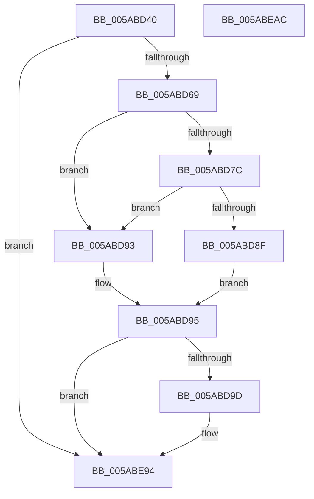

# KasaniSendTelemetryDriver

- RVA: `0x005ABD40`–`0x005ABEAD` (길이 `365` bytes)
- VA: `0x00000001405ABD40`
- 실행 섹션: `.text`
- PDB 이름 있음: `예`; PDB Function 태그: `아니요`
- unwind 정보 RVA: `0x00073604`
- 디코드: `65`개 명령, `365/365` bytes 표시
- 미해석 바이트: `0` (있으면 어셈블리에 `.byte`로 보존)

> 이 문서는 커널 이미지의 기계어와 PDB 기호를 분석해 생성했습니다. 4번과 5번은 함수 원형과 자료형을 바이너리 사용 방식에서 추정한 C 해석이며 원본 소스 복구 결과는 아닙니다.

## 1. Dependencies

- 직접 호출 지점: **2**; 고유 호출 대상: **2**
- 직접 호출자로 확인된 함수: **2**
- RIP 상대 이미지 참조: **10**

### Outgoing calls
- `0x005ABE8F` → [EtwWriteEx](../25/EtwWriteEx_function_0025F0D0.md) (function, `0x0025F0D0`)
- `0x005ABE9F` → [_security_check_cookie](../6A/_security_check_cookie_function_006AC640.md) (function, `0x006AC640`)

### Direct callers
- [KasanDriverLoadImageInternal](../4C/KasanDriverLoadImageInternal_function_004C2840.md) at `0x004C2D83`
- [sub_00C368E9](../../init/C3/Unknown_function_00C368E9.md) at `0x00C36A36`

### Static image references
- `0x005ABD47` → RVA `0x00E0A740` (`.data`; read)
- `0x005ABD59` → RVA `0x00E07020` (`.data`; read)
- `0x005ABD73` → RVA `0x00E07030` (`.data`; read)
- `0x005ABD7C` → RVA `0x00E07038` (`.data`; read)
- `0x005ABDC8` → RVA `0x0004765B` (`.rdata`; read)
- `0x005ABDD3` → RVA `0x00E07028` (`.data`; read)
- `0x005ABDE6` → RVA `0x00043590` (`.rdata`; read)
- `0x005ABE37` → RVA `0x00047665` (`.rdata`; read)
- `0x005ABE43` → RVA `0x0005BCFD` (`.rdata`; read)
- `0x005ABE6C` → RVA `0x00E07040` (`.data`; read)

## 2. Other-region calls and transfers

- 다른 실행 섹션으로 향하는 call: **0**
- 별도 외부 분기/꼬리 이동을 확인하지 못했습니다.

## 3. Assembly (complete function range)

```asm
005ABD40  48 81 EC C8 00 00 00            sub rsp, 0xc8
005ABD47  48 8B 05 F2 E9 85 00            mov rax, qword ptr [rip + 0x85e9f2]
005ABD4E  48 33 C4                        xor rax, rsp
005ABD51  48 89 84 24 B0 00 00 00         mov qword ptr [rsp + 0xb0], rax
005ABD59  83 3D C0 B2 85 00 05            cmp dword ptr [rip + 0x85b2c0], 5
005ABD60  4C 8B C1                        mov r8, rcx
005ABD63  0F 86 2B 01 00 00               jbe 0x1405abe94
005ABD69  49 BA 00 00 00 00 00 40 00 00   movabs r10, 0x400000000000
005ABD73  4C 85 15 B6 B2 85 00            test qword ptr [rip + 0x85b2b6], r10
005ABD7A  74 17                           je 0x1405abd93
005ABD7C  48 8B 05 B5 B2 85 00            mov rax, qword ptr [rip + 0x85b2b5]
005ABD83  49 23 C2                        and rax, r10
005ABD86  48 3B 05 AB B2 85 00            cmp rax, qword ptr [rip + 0x85b2ab]
005ABD8D  75 04                           jne 0x1405abd93
005ABD8F  B0 01                           mov al, 1
005ABD91  EB 02                           jmp 0x1405abd95
005ABD93  32 C0                           xor al, al
005ABD95  84 C0                           test al, al
005ABD97  0F 84 F7 00 00 00               je 0x1405abe94
005ABD9D  0F B7 49 58                     movzx ecx, word ptr [rcx + 0x58]
005ABDA1  48 8D 44 24 48                  lea rax, [rsp + 0x48]
005ABDA6  48 89 84 24 80 00 00 00         mov qword ptr [rsp + 0x80], rax
005ABDAE  48 8D 94 24 A8 00 00 00         lea rdx, [rsp + 0xa8]
005ABDB6  49 8B 40 60                     mov rax, qword ptr [r8 + 0x60]
005ABDBA  45 33 C9                        xor r9d, r9d
005ABDBD  48 89 84 24 A0 00 00 00         mov qword ptr [rsp + 0xa0], rax
005ABDC5  45 33 C0                        xor r8d, r8d
005ABDC8  0F B7 05 8C B8 A9 FF            movzx eax, word ptr [rip - 0x564774]
005ABDCF  89 44 24 54                     mov dword ptr [rsp + 0x54], eax
005ABDD3  48 8B 05 4E B2 85 00            mov rax, qword ptr [rip + 0x85b24e]
005ABDDA  48 89 44 24 60                  mov qword ptr [rsp + 0x60], rax
005ABDDF  89 8C 24 A8 00 00 00            mov dword ptr [rsp + 0xa8], ecx
005ABDE6  48 8D 0D A3 77 A9 FF            lea rcx, [rip - 0x56885d]
005ABDED  48 89 94 24 90 00 00 00         mov qword ptr [rsp + 0x90], rdx
005ABDF5  48 8D 54 24 50                  lea rdx, [rsp + 0x50]
005ABDFA  48 C7 44 24 48 00 00 00 02      mov qword ptr [rsp + 0x48], 0x2000000
005ABE03  48 C7 84 24 88 00 00 00 08 00 00 00  mov qword ptr [rsp + 0x88], 8
005ABE0F  48 C7 84 24 98 00 00 00 02 00 00 00  mov qword ptr [rsp + 0x98], 2
005ABE1B  44 89 8C 24 AC 00 00 00         mov dword ptr [rsp + 0xac], r9d
005ABE23  C7 44 24 50 00 00 00 0B         mov dword ptr [rsp + 0x50], 0xb000000
005ABE2B  4C 89 54 24 58                  mov qword ptr [rsp + 0x58], r10
005ABE30  0F B7 00                        movzx eax, word ptr [rax]
005ABE33  89 44 24 68                     mov dword ptr [rsp + 0x68], eax
005ABE37  48 8D 05 27 B8 A9 FF            lea rax, [rip - 0x5647d9]
005ABE3E  48 89 44 24 70                  mov qword ptr [rsp + 0x70], rax
005ABE43  48 8D 05 B3 FE AA FF            lea rax, [rip - 0x55014d]
005ABE4A  2B C1                           sub eax, ecx
005ABE4C  C7 44 24 6C 02 00 00 00         mov dword ptr [rsp + 0x6c], 2
005ABE54  C7 44 24 78 2B 00 00 00         mov dword ptr [rsp + 0x78], 0x2b
005ABE5C  C7 44 24 7C 01 00 00 00         mov dword ptr [rsp + 0x7c], 1
005ABE64  89 44 24 40                     mov dword ptr [rsp + 0x40], eax
005ABE68  8B 44 24 40                     mov eax, dword ptr [rsp + 0x40]
005ABE6C  48 8B 0D CD B1 85 00            mov rcx, qword ptr [rip + 0x85b1cd]
005ABE73  48 8D 44 24 60                  lea rax, [rsp + 0x60]
005ABE78  48 89 44 24 38                  mov qword ptr [rsp + 0x38], rax
005ABE7D  C7 44 24 30 05 00 00 00         mov dword ptr [rsp + 0x30], 5
005ABE85  4C 89 4C 24 28                  mov qword ptr [rsp + 0x28], r9
005ABE8A  4C 89 4C 24 20                  mov qword ptr [rsp + 0x20], r9
005ABE8F  E8 3C 32 CB FF                  call 0x14025f0d0
005ABE94  48 8B 8C 24 B0 00 00 00         mov rcx, qword ptr [rsp + 0xb0]
005ABE9C  48 33 CC                        xor rcx, rsp
005ABE9F  E8 9C 07 10 00                  call 0x1406ac640
005ABEA4  48 81 C4 C8 00 00 00            add rsp, 0xc8
005ABEAB  C3                              ret
005ABEAC  CC                              int3
```

## 4. C-style interpretation (structured pseudocode)

```c
__int64 __fastcall KasaniSendTelemetryDriver(__int64 a1, __int64 a2, __int64 a3, int a4)
{
    __int64 result;
    __int64 v_rsp;
    unsigned __int64 v_stack_m18;
    unsigned int v_stack_m1C;
    unsigned __int64 v_stack_m20;
    unsigned __int64 v_stack_m28;
    unsigned __int64 v_stack_m30;
    unsigned __int64 v_stack_m38;
    unsigned __int64 v_stack_m40;
    unsigned __int64 v_stack_m48;
    unsigned int v_stack_m4C;
    unsigned int v_stack_m50;
    unsigned __int64 v_stack_m58;
    unsigned int v_stack_m5C;
    unsigned int v_stack_m60;
    unsigned __int64 v_stack_m68;
    unsigned __int64 v_stack_m70;
    unsigned int v_stack_m74;
    unsigned __int64 v_stack_m78;
    unsigned __int64 v_stack_m80;
    unsigned int v_stack_m88;
    unsigned __int64 v_stack_m90;
    unsigned int v_stack_m98;
    unsigned __int64 v_stack_mA0;
    unsigned __int64 v_stack_mA8;

    v_rsp = (v_rsp) - (200);
    result = (*(unsigned __int64 *)(v_rip + 8776178)) ^ (v_rsp);
    v_stack_m18 = result;
    if ((*(unsigned int *)(v_rip + 8762048)) <= 5) goto loc_005ABE94;
    if (((*(unsigned __int64 *)(v_rip + 8762038)) & (v_r10)) == 0) goto loc_005ABD93;
    result = (*(unsigned __int64 *)(v_rip + 8762037)) & (v_r10);
    if (result != (*(unsigned __int64 *)(v_rip + 8762027))) goto loc_005ABD93;
    goto loc_005ABD95;
loc_005ABD93:
    result = 0;
loc_005ABD95:
    if (0 != 0) {
        a1 = *(unsigned __int16 *)(a1 + 88);
        result = v_stack_m80;
        v_stack_m48 = result;
        a2 = v_stack_m20;
        result = *(unsigned __int64 *)(a1 + 96);
        a4 = 0;
        v_stack_m28 = result;
        a3 = 0;
        result = *(unsigned __int16 *)(v_rip - 5654388);
        v_stack_m74 = (unsigned int)(result);
        result = *(unsigned __int64 *)(v_rip + 8761934);
        v_stack_m68 = result;
        v_stack_m20 = (unsigned int)(a1);
        a1 = v_rip - 5671005;
        v_stack_m38 = a2;
        a2 = v_stack_m78;
        v_stack_m80 = 0x2000000ULL;
        v_stack_m40 = 8;
        v_stack_m30 = 2;
        v_stack_m1C = 0;
        v_stack_m78 = 0xB000000ULL;
        v_stack_m70 = v_r10;
        result = *(unsigned __int16 *)(result);
        v_stack_m60 = (unsigned int)(result);
        result = v_rip - 5654489;
        v_stack_m58 = result;
        result = v_rip - 5570893;
        result = (unsigned int)((result) - ((unsigned int)(a1)));
        v_stack_m5C = 2;
        v_stack_m50 = 43;
        v_stack_m4C = 1;
        v_stack_m88 = (unsigned int)(result);
        result = v_stack_m88;
        a1 = *(unsigned __int64 *)(v_rip + 8761805);
        result = v_stack_m68;
        v_stack_m90 = result;
        v_stack_m98 = 5;
        v_stack_mA0 = 0;
        v_stack_mA8 = 0;
        result = EtwWriteEx(a1, a2, a3, a4);
    }
    a1 = (v_stack_m18) ^ (v_rsp);
    result = _security_check_cookie(a1, a2, a3, a4);
    v_rsp = (v_rsp) + (200);
    return result;
}
```

## 5. (Beta) C Style

```c
int64_t KasaniSendTelemetryDriver(void *Arg1, int64_t Arg2, int64_t Arg3, int32_t Arg4)
{
    uint8_t *arg1 = (uint8_t *)Arg1;

    int64_t result;
    int64_t local_rsp;
    uint64_t v_stack_m18;
    uint32_t v_stack_m1C;
    uint64_t v_stack_m20;
    uint64_t v_stack_m28;
    uint64_t v_stack_m30;
    uint64_t v_stack_m38;
    uint64_t v_stack_m40;
    uint64_t v_stack_m48;
    uint32_t v_stack_m4C;
    uint32_t v_stack_m50;
    uint64_t v_stack_m58;
    uint32_t v_stack_m5C;
    uint32_t v_stack_m60;
    uint64_t v_stack_m68;
    uint64_t v_stack_m70;
    uint32_t v_stack_m74;
    uint64_t v_stack_m78;
    uint64_t v_stack_m80;
    uint32_t v_stack_m88;
    uint64_t v_stack_m90;
    uint32_t v_stack_m98;
    uint64_t v_stack_mA0;
    uint64_t v_stack_mA8;

    local_rsp = (local_rsp) - (200);
    result = (*(uint64_t *)(v_rip + 0x85E9F2)) ^ (local_rsp);
    v_stack_m18 = result;
    if ((*(uint32_t *)(v_rip + 0x85B2C0)) <= 5) goto loc_005ABE94;
    if (((*(uint64_t *)(v_rip + 0x85B2B6)) & (local_r10)) == 0) goto loc_005ABD93;
    result = (*(uint64_t *)(v_rip + 0x85B2B5)) & (local_r10);
    if (result != (*(uint64_t *)(v_rip + 0x85B2AB))) goto loc_005ABD93;
    goto loc_005ABD95;
loc_005ABD93:
    result = 0;
loc_005ABD95:
    if (0 != 0) {
        Arg1 = *(uint16_t *)(arg1 + 0x58);
        result = v_stack_m80;
        v_stack_m48 = result;
        Arg2 = v_stack_m20;
        result = *(uint64_t *)(arg1 + 0x60);
        Arg4 = 0;
        v_stack_m28 = result;
        Arg3 = 0;
        result = *(uint16_t *)(v_rip - 0x564774);
        v_stack_m74 = (uint32_t)(result);
        result = *(uint64_t *)(v_rip + 0x85B24E);
        v_stack_m68 = result;
        v_stack_m20 = (uint32_t)(Arg1);
        Arg1 = v_rip - 5671005;
        v_stack_m38 = Arg2;
        Arg2 = v_stack_m78;
        v_stack_m80 = 0x2000000ULL;
        v_stack_m40 = 8;
        v_stack_m30 = 2;
        v_stack_m1C = 0;
        v_stack_m78 = 0xB000000ULL;
        v_stack_m70 = local_r10;
        result = *(uint16_t *)(result);
        v_stack_m60 = (uint32_t)(result);
        result = v_rip - 5654489;
        v_stack_m58 = result;
        result = v_rip - 5570893;
        result = (uint32_t)((result) - ((uint32_t)(Arg1)));
        v_stack_m5C = 2;
        v_stack_m50 = 43;
        v_stack_m4C = 1;
        v_stack_m88 = (uint32_t)(result);
        result = v_stack_m88;
        Arg1 = *(uint64_t *)(v_rip + 0x85B1CD);
        result = v_stack_m68;
        v_stack_m90 = result;
        v_stack_m98 = 5;
        v_stack_mA0 = 0;
        v_stack_mA8 = 0;
        result = EtwWriteEx(Arg1, Arg2, Arg3, Arg4);
    }
    Arg1 = (v_stack_m18) ^ (local_rsp);
    result = _security_check_cookie(Arg1, Arg2, Arg3, Arg4);
    local_rsp = (local_rsp) + (200);
    return result;
}
```

### 관측된 메모리 오프셋

구조체 형식이 확인되지 않은 접근은 인자 기준의 오프셋으로만 기록했습니다.

| 기준 인자 | 오프셋 표현 | 폭 (bit) | 접근 |
|---|---:|---:|---|
| `Arg1` | `+ 0x58` | `16` | `R` |
| `Arg1` | `+ 0x60` | `64` | `R` |

## 6. Execution-region graph

[열기: 2D/3D 그래프와 함수 탐색 컨트롤 패널](../../../control-panel.html?section=text&rva=0x005ABD40&view=graph)

- 2D 그래프는 위에서 아래로 흐르고, 3D 그래프는 빈 공간을 드래그해 회전합니다. Shift+드래그는 이동, 휠은 확대·축소, 함수 노드 선택은 대상 보고서 이동입니다.

### Static fallback


