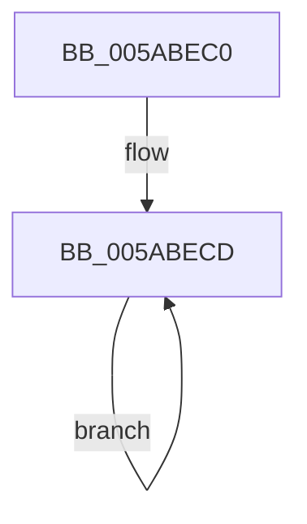

# KasaniTelemetryThread

- RVA: `0x005ABEC0`–`0x005ABEE2` (길이 `34` bytes)
- VA: `0x00000001405ABEC0`
- 실행 섹션: `.text`
- PDB 이름 있음: `예`; PDB Function 태그: `아니요`
- unwind 정보 RVA: `0x0007E574`
- 디코드: `8`개 명령, `34/34` bytes 표시
- 미해석 바이트: `0` (있으면 어셈블리에 `.byte`로 보존)

> 이 문서는 커널 이미지의 기계어와 PDB 기호를 분석해 생성했습니다. 4번과 5번은 함수 원형과 자료형을 바이너리 사용 방식에서 추정한 C 해석이며 원본 소스 복구 결과는 아닙니다.

## 1. Dependencies

- 직접 호출 지점: **2**; 고유 호출 대상: **2**
- 직접 호출자로 확인된 함수: **0**
- RIP 상대 이미지 참조: **0**

### Outgoing calls
- `0x005ABED6` → [KeDelayExecutionThread](../20/KeDelayExecutionThread_function_00209550.md) (function, `0x00209550`)
- `0x005ABEDB` → [KasaniReportTelemetry](KasaniReportTelemetry_function_005AB1D0.md) (function, `0x005AB1D0`)

### Direct callers
- 이 함수 시작 RVA로 연결되는 직접 call은 확인되지 않았습니다. 간접 호출은 완전히 역산할 수 없습니다.

### Static image references
- 디코드된 RIP-relative 메모리 참조가 없습니다.

## 2. Other-region calls and transfers

- 다른 실행 섹션으로 향하는 call: **0**
- 별도 외부 분기/꼬리 이동을 확인하지 못했습니다.

## 3. Assembly (complete function range)

```asm
005ABEC0  48 83 EC 28                     sub rsp, 0x28
005ABEC4  48 C7 44 24 38 80 0F 05 FD      mov qword ptr [rsp + 0x38], 0xfffffffffd050f80
005ABECD  4C 8D 44 24 38                  lea r8, [rsp + 0x38]
005ABED2  33 D2                           xor edx, edx
005ABED4  33 C9                           xor ecx, ecx
005ABED6  E8 75 D6 C5 FF                  call 0x140209550
005ABEDB  E8 F0 F2 FF FF                  call 0x1405ab1d0
005ABEE0  EB EB                           jmp 0x1405abecd
```

## 4. C-style interpretation (structured pseudocode)

```c
__int64 __fastcall KasaniTelemetryThread(int a1, int a2)
{
    __int64 result;
    __int64 v_rsp;
    unsigned __int64 v_stack_p10;

    v_rsp = (v_rsp) - (40);
    v_stack_p10 = 0xFFFFFFFFFD050F80ULL;
loc_005ABECD:
    a2 = 0;
    a1 = 0;
    result = KeDelayExecutionThread(a1, a2, v_stack_p10, a4);
    result = KasaniReportTelemetry(a1, a2, v_stack_p10, a4);
    goto loc_005ABECD;
}
```

## 5. (Beta) C Style

```c
int64_t KasaniTelemetryThread(int32_t Arg1, int32_t Arg2)
{
    int64_t result;
    int64_t local_rsp;
    uint64_t v_stack_p10;

    local_rsp = (local_rsp) - (40);
    v_stack_p10 = 0xFFFFFFFFFD050F80ULL;
loc_005ABECD:
    Arg2 = 0;
    Arg1 = 0;
    result = KeDelayExecutionThread(Arg1, Arg2, v_stack_p10, a4);
    result = KasaniReportTelemetry(Arg1, Arg2, v_stack_p10, a4);
    goto loc_005ABECD;
}
```

## 6. Execution-region graph

[열기: 2D/3D 그래프와 함수 탐색 컨트롤 패널](../../../control-panel.html?section=text&rva=0x005ABEC0&view=graph)

- 2D 그래프는 위에서 아래로 흐르고, 3D 그래프는 빈 공간을 드래그해 회전합니다. Shift+드래그는 이동, 휠은 확대·축소, 함수 노드 선택은 대상 보고서 이동입니다.

### Static fallback


