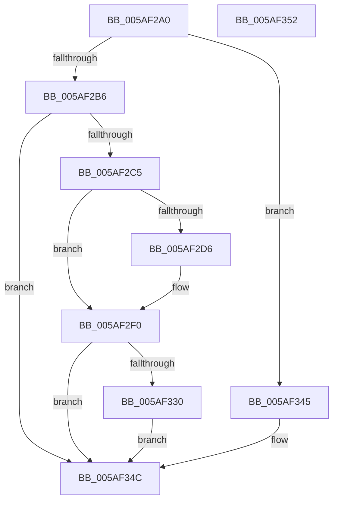

# KcsanInitSystem

- RVA: `0x005AF2A0`–`0x005AF353` (길이 `179` bytes)
- VA: `0x00000001405AF2A0`
- 실행 섹션: `.text`
- PDB 이름 있음: `예`; PDB Function 태그: `아니요`
- unwind 정보 RVA: `0x000697A4`
- 디코드: `45`개 명령, `179/179` bytes 표시
- 미해석 바이트: `0` (있으면 어셈블리에 `.byte`로 보존)

> 이 문서는 커널 이미지의 기계어와 PDB 기호를 분석해 생성했습니다. 4번과 5번은 함수 원형과 자료형을 바이너리 사용 방식에서 추정한 C 해석이며 원본 소스 복구 결과는 아닙니다.

## 1. Dependencies

- 직접 호출 지점: **5**; 고유 호출 대상: **5**
- 직접 호출자로 확인된 함수: **1**
- RIP 상대 이미지 참조: **6**

### Outgoing calls
- `0x005AF2C5` → [MmKcsanGetIgnoredRangeList](../67/MmKcsanGetIgnoredRangeList_function_0067FD68.md) (function, `0x0067FD68`)
- `0x005AF2EA` → [KeBugCheckEx](../4F/KeBugCheckEx_function_004FD660.md) (function, `0x004FD660`)
- `0x005AF2FC` → [TraceLoggingRegisterEx_EtwRegister_EtwSetInformation](../../page/92/TraceLoggingRegisterEx_EtwRegister_EtwSetInformation_function_009208A0.md) (function, `0x009208A0`)
- `0x005AF327` → [PsCreateSystemThread](../../page/9E/PsCreateSystemThread_function_009ED0D0.md) (function, `0x009ED0D0`)
- `0x005AF337` → [ObCloseHandle](../../page/8A/ObCloseHandle_function_008A1870.md) (function, `0x008A1870`)

### Direct callers
- [sub_00C36ACC](../../init/C3/Unknown_function_00C36ACC.md) at `0x00C36ACF`

### Static image references
- `0x005AF2B6` → RVA `0x00FC6A80` (`ALMOSTRO`; read)
- `0x005AF2CA` → RVA `0x00FCEC70` (`ALMOSTRO`; write)
- `0x005AF2F3` → RVA `0x00E07058` (`.data`; read)
- `0x005AF301` → RVA `0x005B0410` (`KcsaniTelemetryThread`; read)
- `0x005AF33C` → RVA `0x00F8A7E8` (`.data`; write)
- `0x005AF345` → RVA `0x00F654F0` (`.data`; write)

## 2. Other-region calls and transfers

- 다른 실행 섹션으로 향하는 call: **3**
  - `0x005AF2FC` → [TraceLoggingRegisterEx_EtwRegister_EtwSetInformation](../../page/92/TraceLoggingRegisterEx_EtwRegister_EtwSetInformation_function_009208A0.md) (`.text` → `PAGE`)
  - `0x005AF327` → [PsCreateSystemThread](../../page/9E/PsCreateSystemThread_function_009ED0D0.md) (`.text` → `PAGE`)
  - `0x005AF337` → [ObCloseHandle](../../page/8A/ObCloseHandle_function_008A1870.md) (`.text` → `PAGE`)
- 별도 외부 분기/꼬리 이동을 확인하지 못했습니다.

## 3. Assembly (complete function range)

```asm
005AF2A0  40 53                           push rbx
005AF2A2  48 83 EC 40                     sub rsp, 0x40
005AF2A6  33 DB                           xor ebx, ebx
005AF2A8  48 89 5C 24 58                  mov qword ptr [rsp + 0x58], rbx
005AF2AD  83 F9 01                        cmp ecx, 1
005AF2B0  0F 84 8F 00 00 00               je 0x1405af345
005AF2B6  8B 05 C4 77 A1 00               mov eax, dword ptr [rip + 0xa177c4]
005AF2BC  83 F8 01                        cmp eax, 1
005AF2BF  0F 84 87 00 00 00               je 0x1405af34c
005AF2C5  E8 9E 0A 0D 00                  call 0x14067fd68
005AF2CA  48 89 05 9F F9 A1 00            mov qword ptr [rip + 0xa1f99f], rax
005AF2D1  48 85 C0                        test rax, rax
005AF2D4  75 1A                           jne 0x1405af2f0
005AF2D6  45 33 C9                        xor r9d, r9d
005AF2D9  48 89 5C 24 20                  mov qword ptr [rsp + 0x20], rbx
005AF2DE  8D 53 04                        lea edx, [rbx + 4]
005AF2E1  B9 F1 01 00 00                  mov ecx, 0x1f1
005AF2E6  44 8D 43 09                     lea r8d, [rbx + 9]
005AF2EA  E8 71 E3 F4 FF                  call 0x1404fd660
005AF2EF  CC                              int3
005AF2F0  45 33 C0                        xor r8d, r8d
005AF2F3  48 8D 0D 5E 7D 85 00            lea rcx, [rip + 0x857d5e]
005AF2FA  33 D2                           xor edx, edx
005AF2FC  E8 9F 15 37 00                  call 0x1409208a0
005AF301  48 8D 05 08 11 00 00            lea rax, [rip + 0x1108]
005AF308  48 89 5C 24 30                  mov qword ptr [rsp + 0x30], rbx
005AF30D  48 89 44 24 28                  mov qword ptr [rsp + 0x28], rax
005AF312  48 8D 4C 24 58                  lea rcx, [rsp + 0x58]
005AF317  45 33 C9                        xor r9d, r9d
005AF31A  48 89 5C 24 20                  mov qword ptr [rsp + 0x20], rbx
005AF31F  45 33 C0                        xor r8d, r8d
005AF322  BA FF FF 1F 00                  mov edx, 0x1fffff
005AF327  E8 A4 DD 43 00                  call 0x1409ed0d0
005AF32C  85 C0                           test eax, eax
005AF32E  78 1C                           js 0x1405af34c
005AF330  48 8B 4C 24 58                  mov rcx, qword ptr [rsp + 0x58]
005AF335  33 D2                           xor edx, edx
005AF337  E8 34 25 2F 00                  call 0x1408a1870
005AF33C  C6 05 A5 B4 9D 00 01            mov byte ptr [rip + 0x9db4a5], 1
005AF343  EB 07                           jmp 0x1405af34c
005AF345  48 89 1D A4 61 9B 00            mov qword ptr [rip + 0x9b61a4], rbx
005AF34C  48 83 C4 40                     add rsp, 0x40
005AF350  5B                              pop rbx
005AF351  C3                              ret
005AF352  CC                              int3
```

## 4. C-style interpretation (structured pseudocode)

```c
__int64 __fastcall KcsanInitSystem(int a1, __int64 a2, __int64 a3, int a4)
{
    __int64 result;
    __int64 v_rbx;
    __int64 v_rsp;
    unsigned __int64 v_stack_m18;
    unsigned __int64 v_stack_m20;
    unsigned __int64 v_stack_m28;
    unsigned __int64 v_stack_p10;

    v_rsp = (v_rsp) - (64);
    v_rbx = 0;
    v_stack_p10 = 0;
    if (a1 == 1) goto loc_005AF345;
    if (((unsigned int)((unsigned int)(*(unsigned int *)(v_rip + 10581956)))) == 1) goto loc_005AF34C;
    result = MmKcsanGetIgnoredRangeList(a1, a2, a3, a4);
    *(unsigned __int64 *)(v_rip + 10615199) = result;
    if (result == 0) {
        a4 = 0;
        v_stack_m28 = 0;
        a2 = v_rbx + 4;
        a1 = 497;
        a3 = v_rbx + 9;
        result = KeBugCheckEx(a1, a2, a3, a4);
    }
    a3 = 0;
    a2 = 0;
    result = TraceLoggingRegisterEx_EtwRegister_EtwSetInformation(v_rip + 8748382, a2, a3, a4);
    v_stack_m18 = 0;
    v_stack_m20 = v_rip + 4360;
    a4 = 0;
    v_stack_m28 = 0;
    a3 = 0;
    result = PsCreateSystemThread(v_stack_p10, (unsigned int)(0x1FFFFFULL), a3, a4);
    if (sign_flag) goto loc_005AF34C;
    a2 = 0;
    result = ObCloseHandle(v_stack_p10, a2, a3, a4);
    *(unsigned __int8 *)(v_rip + 10335397) = 1;
    goto loc_005AF34C;
loc_005AF345:
    *(unsigned __int64 *)(v_rip + 10183076) = 0;
loc_005AF34C:
    v_rsp = (v_rsp) + (64);
    return result;
}
```

## 5. (Beta) C Style

```c
int64_t KcsanInitSystem(int32_t Arg1, int64_t Arg2, int64_t Arg3, int32_t Arg4)
{
    int64_t result;
    int64_t local_rbx;
    int64_t local_rsp;
    uint64_t v_stack_m18;
    uint64_t v_stack_m20;
    uint64_t v_stack_m28;
    uint64_t v_stack_p10;

    local_rsp = (local_rsp) - (64);
    local_rbx = 0;
    v_stack_p10 = 0;
    if (Arg1 == 1) goto loc_005AF345;
    if (((uint32_t)((uint32_t)(*(uint32_t *)(v_rip + 0xA177C4)))) == 1) goto loc_005AF34C;
    result = MmKcsanGetIgnoredRangeList(Arg1, Arg2, Arg3, Arg4);
    *(uint64_t *)(v_rip + 0xA1F99F) = result;
    if (result == 0) {
        Arg4 = 0;
        v_stack_m28 = 0;
        Arg2 = local_rbx + 4;
        Arg1 = 497;
        Arg3 = local_rbx + 9;
        result = KeBugCheckEx(Arg1, Arg2, Arg3, Arg4);
    }
    Arg3 = 0;
    Arg2 = 0;
    result = TraceLoggingRegisterEx_EtwRegister_EtwSetInformation(v_rip + 8748382, Arg2, Arg3, Arg4);
    v_stack_m18 = 0;
    v_stack_m20 = v_rip + 4360;
    Arg4 = 0;
    v_stack_m28 = 0;
    Arg3 = 0;
    result = PsCreateSystemThread(v_stack_p10, (uint32_t)(0x1FFFFFULL), Arg3, Arg4);
    if (sign_flag) goto loc_005AF34C;
    Arg2 = 0;
    result = ObCloseHandle(v_stack_p10, Arg2, Arg3, Arg4);
    *(uint8_t *)(v_rip + 0x9DB4A5) = 1;
    goto loc_005AF34C;
loc_005AF345:
    *(uint64_t *)(v_rip + 0x9B61A4) = 0;
loc_005AF34C:
    local_rsp = (local_rsp) + (64);
    return result;
}
```

## 6. Execution-region graph

[열기: 2D/3D 그래프와 함수 탐색 컨트롤 패널](../../../control-panel.html?section=text&rva=0x005AF2A0&view=graph)

- 2D 그래프는 위에서 아래로 흐르고, 3D 그래프는 빈 공간을 드래그해 회전합니다. Shift+드래그는 이동, 휠은 확대·축소, 함수 노드 선택은 대상 보고서 이동입니다.

### Static fallback


