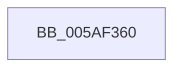

# KcsanReportTelemetry

- RVA: `0x005AF360`–`0x005AF38C` (길이 `44` bytes)
- VA: `0x00000001405AF360`
- 실행 섹션: `.text`
- PDB 이름 있음: `예`; PDB Function 태그: `아니요`
- unwind 정보 RVA: `0x000C97BC`
- 디코드: `7`개 명령, `44/44` bytes 표시
- 미해석 바이트: `0` (있으면 어셈블리에 `.byte`로 보존)

> 이 문서는 커널 이미지의 기계어와 PDB 기호를 분석해 생성했습니다. 4번과 5번은 함수 원형과 자료형을 바이너리 사용 방식에서 추정한 C 해석이며 원본 소스 복구 결과는 아닙니다.

## 1. Dependencies

- 직접 호출 지점: **0**; 고유 호출 대상: **0**
- 직접 호출자로 확인된 함수: **2**
- RIP 상대 이미지 참조: **2**

### Outgoing calls
- 직접 디코드된 call 명령이 없습니다.

### Direct callers
- [sub_005AA9CD](Unknown_function_005AA9CD.md) at `0x005AA9DE`
- [KcsaniTelemetryThread](../5B/KcsaniTelemetryThread_function_005B0410.md) at `0x005B042B`

### Static image references
- `0x005AF367` → RVA `0x00E0A740` (`.data`; read)
- `0x005AF382` → RVA `0x00F654F0` (`.data`; read)

## 2. Other-region calls and transfers

- 다른 실행 섹션으로 향하는 call: **0**
- 별도 외부 분기/꼬리 이동을 확인하지 못했습니다.

## 3. Assembly (complete function range)

```asm
005AF360  48 81 EC B8 00 00 00            sub rsp, 0xb8
005AF367  48 8B 05 D2 B3 85 00            mov rax, qword ptr [rip + 0x85b3d2]
005AF36E  48 33 C4                        xor rax, rsp
005AF371  48 89 84 24 A0 00 00 00         mov qword ptr [rsp + 0xa0], rax
005AF379  65 48 8B 04 25 88 01 00 00      mov rax, qword ptr gs:[0x188]
005AF382  48 8D 0D 67 61 9B 00            lea rcx, [rip + 0x9b6167]
005AF389  45 33 C0                        xor r8d, r8d
```

## 4. C-style interpretation (structured pseudocode)

```c
__int64 __fastcall KcsanReportTelemetry(__int64 a1, __int64 a2, int a3)
{
    __int64 result;
    __int64 v_rsp;
    unsigned __int64 v_stack_m18;

    v_rsp = (v_rsp) - (184);
    result = (*(unsigned __int64 *)(v_rip + 8762322)) ^ (v_rsp);
    v_stack_m18 = result;
    a3 = 0;
    return *(unsigned __int64 *)(gs_base + (0 + 392));
}
```

## 5. (Beta) C Style

```c
int64_t KcsanReportTelemetry(int64_t Arg1, int64_t Arg2, int32_t Arg3)
{
    int64_t result;
    int64_t local_rsp;
    uint64_t v_stack_m18;

    local_rsp = (local_rsp) - (184);
    result = (*(uint64_t *)(v_rip + 0x85B3D2)) ^ (local_rsp);
    v_stack_m18 = result;
    Arg3 = 0;
    return *(uint64_t *)(gs_base + (0 + 0x188));
}
```

## 6. Execution-region graph

[열기: 2D/3D 그래프와 함수 탐색 컨트롤 패널](../../../control-panel.html?section=text&rva=0x005AF360&view=graph)

- 2D 그래프는 위에서 아래로 흐르고, 3D 그래프는 빈 공간을 드래그해 회전합니다. Shift+드래그는 이동, 휠은 확대·축소, 함수 노드 선택은 대상 보고서 이동입니다.

### Static fallback


