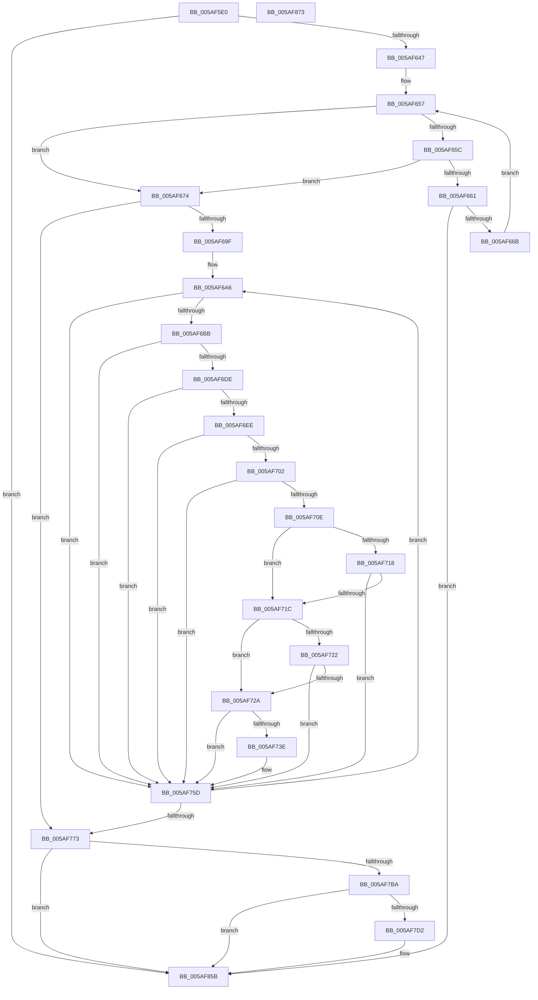

# KcsanValidateAddress

- RVA: `0x005AF5E0`–`0x005AF874` (길이 `660` bytes)
- VA: `0x00000001405AF5E0`
- 실행 섹션: `.text`
- PDB 이름 있음: `예`; PDB Function 태그: `아니요`
- unwind 정보 RVA: `0x000C981C`
- 디코드: `152`개 명령, `660/660` bytes 표시
- 미해석 바이트: `0` (있으면 어셈블리에 `.byte`로 보존)

> 이 문서는 커널 이미지의 기계어와 PDB 기호를 분석해 생성했습니다. 4번과 5번은 함수 원형과 자료형을 바이너리 사용 방식에서 추정한 C 해석이며 원본 소스 복구 결과는 아닙니다.

## 1. Dependencies

- 직접 호출 지점: **2**; 고유 호출 대상: **2**
- 직접 호출자로 확인된 함수: **36**
- RIP 상대 이미지 참조: **5**

### Outgoing calls
- `0x005AF746` → [KcsaniInsertInDatabase](KcsaniInsertInDatabase_function_005AF880.md) (function, `0x005AF880`)
- `0x005AF822` → [KeStallExecutionProcessor](../44/KeStallExecutionProcessor_function_0044F620.md) (function, `0x0044F620`)

### Direct callers
- [KasanValidateAddress](KasanValidateAddress_function_005AADF0.md) at `0x005AAF17`
- [_asan_load1](_asan_load1_function_005AC270.md) at `0x005AC2FB`
- [_asan_load16](_asan_load16_function_005AC320.md) at `0x005AC531`
- [_asan_load16_volatile](_asan_load16_volatile_function_005AC550.md) at `0x005AC761`
- [_asan_load1_volatile](_asan_load1_volatile_function_005AC780.md) at `0x005AC80B`
- [_asan_load2](_asan_load2_function_005AC830.md) at `0x005AC8FC`
- [_asan_load2_volatile](_asan_load2_volatile_function_005AC920.md) at `0x005AC9EC`
- [_asan_load4](_asan_load4_function_005ACA10.md) at `0x005ACB13`
- [_asan_load4_volatile](_asan_load4_volatile_function_005ACB30.md) at `0x005ACC33`
- [_asan_load8](_asan_load8_function_005ACC50.md) at `0x005ACD86`
- [_asan_load8_volatile](_asan_load8_volatile_function_005ACDA0.md) at `0x005ACED6`
- [_asan_loadN](_asan_loadN_function_005ACEF0.md) at `0x005ACFBD`
- [_asan_loadN_volatile](_asan_loadN_volatile_function_005ACFE0.md) at `0x005AD0AD`
- [_asan_memcpy](_asan_memcpy_function_005AD0D0.md) at `0x005AD1B1`
- [_asan_memcpy](_asan_memcpy_function_005AD0D0.md) at `0x005AD253`
- [_asan_memset](_asan_memset_function_005AD290.md) at `0x005AD364`
- [_asan_store1](_asan_store1_function_005AD600.md) at `0x005AD68C`
- [_asan_store16](_asan_store16_function_005AD6B0.md) at `0x005AD8C2`
- [_asan_store16_volatile](_asan_store16_volatile_function_005AD8E0.md) at `0x005ADAF4`
- [_asan_store1_volatile](_asan_store1_volatile_function_005ADB10.md) at `0x005ADB9E`
- [_asan_store2](_asan_store2_function_005ADBC0.md) at `0x005ADC8D`
- [_asan_store2_volatile](_asan_store2_volatile_function_005ADCB0.md) at `0x005ADD7F`
- [_asan_store4](_asan_store4_function_005ADDA0.md) at `0x005ADEA4`
- [_asan_store4_volatile](_asan_store4_volatile_function_005ADEC0.md) at `0x005ADFC6`
- [_asan_store8](_asan_store8_function_005ADFE0.md) at `0x005AE117`
- [_asan_store8_volatile](_asan_store8_volatile_function_005AE130.md) at `0x005AE269`
- [_asan_storeN](_asan_storeN_function_005AE280.md) at `0x005AE34D`
- [_asan_storeN_volatile](_asan_storeN_volatile_function_005AE370.md) at `0x005AE43E`
- [_asan_wrap_memchr](_asan_wrap_memchr_function_005AE460.md) at `0x005AE534`
- [_asan_wrap_memcmp](_asan_wrap_memcmp_function_005AE570.md) at `0x005AE652`
- [_asan_wrap_memcmp](_asan_wrap_memcmp_function_005AE570.md) at `0x005AE6F4`
- [_asan_wrap_strcat](_asan_wrap_strcat_function_005AE730.md) at `0x005AE7E1`
- [_asan_wrap_strcat](_asan_wrap_strcat_function_005AE730.md) at `0x005AE874`
- [_asan_wrap_strcat](_asan_wrap_strcat_function_005AE730.md) at `0x005AE93B`
- [_asan_wrap_strcmp](_asan_wrap_strcmp_function_005AE990.md) at `0x005AEA47`
- [_asan_wrap_strcmp](_asan_wrap_strcmp_function_005AE990.md) at `0x005AEAD5`
- [_asan_wrap_strcpy](_asan_wrap_strcpy_function_005AEB30.md) at `0x005AEBE1`
- [_asan_wrap_strcpy](_asan_wrap_strcpy_function_005AEB30.md) at `0x005AEC9A`
- [_asan_wrap_strlen](_asan_wrap_strlen_function_005AECE0.md) at `0x005AED8D`
- [_asan_wrap_strncmp](_asan_wrap_strncmp_function_005AEDD0.md) at `0x005AEE86`
- [_asan_wrap_strncmp](_asan_wrap_strncmp_function_005AEDD0.md) at `0x005AEF12`
- [_asan_wrap_strncpy](_asan_wrap_strncpy_function_005AEF60.md) at `0x005AF017`
- [_asan_wrap_strncpy](_asan_wrap_strncpy_function_005AEF60.md) at `0x005AF0CC`
- [_asan_wrap_wcslen](_asan_wrap_wcslen_function_005AF110.md) at `0x005AF216`

### Static image references
- `0x005AF5EE` → RVA `0x00FC6ED8` (`ALMOSTRO`; read)
- `0x005AF647` → RVA `0x00FCEC70` (`ALMOSTRO`; read)
- `0x005AF681` → RVA `0x00FC6A80` (`ALMOSTRO`; read)
- `0x005AF69F` → RVA `0x00E3EE68` (`.data`; read)
- `0x005AF7EE` → RVA `0x00E3EE40` (`.data`; read)

## 2. Other-region calls and transfers

- 다른 실행 섹션으로 향하는 call: **0**
- 별도 외부 분기/꼬리 이동을 확인하지 못했습니다.

## 3. Assembly (complete function range)

```asm
005AF5E0  40 55                           push rbp
005AF5E2  48 81 EC 80 00 00 00            sub rsp, 0x80
005AF5E9  48 8D 6C 24 20                  lea rbp, [rsp + 0x20]
005AF5EE  48 8B 05 E3 78 A1 00            mov rax, qword ptr [rip + 0xa178e3]
005AF5F5  4C 8B DA                        mov r11, rdx
005AF5F8  0F 57 C0                        xorps xmm0, xmm0
005AF5FB  48 89 5D 78                     mov qword ptr [rbp + 0x78], rbx
005AF5FF  0F 57 C9                        xorps xmm1, xmm1
005AF602  48 89 B5 80 00 00 00            mov qword ptr [rbp + 0x80], rsi
005AF609  48 BA 00 00 00 00 00 80 00 00   movabs rdx, 0x800000000000
005AF613  48 89 BD 88 00 00 00            mov qword ptr [rbp + 0x88], rdi
005AF61A  48 03 D1                        add rdx, rcx
005AF61D  45 0F B6 D0                     movzx r10d, r8b
005AF621  48 C1 EA 03                     shr rdx, 3
005AF625  0F 11 45 00                     movups xmmword ptr [rbp], xmm0
005AF629  0F 11 45 10                     movups xmmword ptr [rbp + 0x10], xmm0
005AF62D  80 3C 02 08                     cmp byte ptr [rdx + rax], 8
005AF631  0F 11 45 20                     movups xmmword ptr [rbp + 0x20], xmm0
005AF635  0F 11 4D 30                     movups xmmword ptr [rbp + 0x30], xmm1
005AF639  0F 11 4D 40                     movups xmmword ptr [rbp + 0x40], xmm1
005AF63D  0F 11 4D 50                     movups xmmword ptr [rbp + 0x50], xmm1
005AF641  0F 84 14 02 00 00               je 0x1405af85b
005AF647  48 8B 05 22 F6 A1 00            mov rax, qword ptr [rip + 0xa1f622]
005AF64E  33 D2                           xor edx, edx
005AF650  4C 8B 00                        mov r8, qword ptr [rax]
005AF653  48 83 C0 08                     add rax, 8
005AF657  49 3B D0                        cmp rdx, r8
005AF65A  73 18                           jae 0x1405af674
005AF65C  48 3B 08                        cmp rcx, qword ptr [rax]
005AF65F  72 13                           jb 0x1405af674
005AF661  48 3B 48 08                     cmp rcx, qword ptr [rax + 8]
005AF665  0F 82 F0 01 00 00               jb 0x1405af85b
005AF66B  48 FF C2                        inc rdx
005AF66E  48 83 C0 10                     add rax, 0x10
005AF672  EB E3                           jmp 0x1405af657
005AF674  48 8B 85 90 00 00 00            mov rax, qword ptr [rbp + 0x90]
005AF67B  33 FF                           xor edi, edi
005AF67D  48 89 45 20                     mov qword ptr [rbp + 0x20], rax
005AF681  8B 05 F9 73 A1 00               mov eax, dword ptr [rip + 0xa173f9]
005AF687  48 89 4D 08                     mov qword ptr [rbp + 8], rcx
005AF68B  4C 89 5D 10                     mov qword ptr [rbp + 0x10], r11
005AF68F  44 88 55 18                     mov byte ptr [rbp + 0x18], r10b
005AF693  44 88 4D 19                     mov byte ptr [rbp + 0x19], r9b
005AF697  85 C0                           test eax, eax
005AF699  0F 84 D4 00 00 00               je 0x1405af773
005AF69F  48 8D 1D C2 F7 88 00            lea rbx, [rip + 0x88f7c2]
005AF6A6  48 8B 43 D8                     mov rax, qword ptr [rbx - 0x28]
005AF6AA  48 89 45 30                     mov qword ptr [rbp + 0x30], rax
005AF6AE  81 7D 30 ED 55 CE AC            cmp dword ptr [rbp + 0x30], 0xacce55ed
005AF6B5  0F 85 A2 00 00 00               jne 0x1405af75d
005AF6BB  0F 10 43 E0                     movups xmm0, xmmword ptr [rbx - 0x20]
005AF6BF  48 8B 03                        mov rax, qword ptr [rbx]
005AF6C2  0F 10 4B F0                     movups xmm1, xmmword ptr [rbx - 0x10]
005AF6C6  0F 11 45 38                     movups xmmword ptr [rbp + 0x38], xmm0
005AF6CA  0F 11 4D 48                     movups xmmword ptr [rbp + 0x48], xmm1
005AF6CE  48 89 45 58                     mov qword ptr [rbp + 0x58], rax
005AF6D2  48 8B 4D 58                     mov rcx, qword ptr [rbp + 0x58]
005AF6D6  81 F9 ED 55 CE AC               cmp ecx, 0xacce55ed
005AF6DC  75 7F                           jne 0x1405af75d
005AF6DE  48 8B 45 30                     mov rax, qword ptr [rbp + 0x30]
005AF6E2  48 C1 F8 20                     sar rax, 0x20
005AF6E6  48 C1 F9 20                     sar rcx, 0x20
005AF6EA  3B C1                           cmp eax, ecx
005AF6EC  75 6F                           jne 0x1405af75d
005AF6EE  48 8B 55 38                     mov rdx, qword ptr [rbp + 0x38]
005AF6F2  48 8B 4D 40                     mov rcx, qword ptr [rbp + 0x40]
005AF6F6  4C 8B 45 08                     mov r8, qword ptr [rbp + 8]
005AF6FA  48 03 CA                        add rcx, rdx
005AF6FD  49 3B C8                        cmp rcx, r8
005AF700  76 5B                           jbe 0x1405af75d
005AF702  48 8B 4D 10                     mov rcx, qword ptr [rbp + 0x10]
005AF706  49 03 C8                        add rcx, r8
005AF709  48 3B CA                        cmp rcx, rdx
005AF70C  76 4F                           jbe 0x1405af75d
005AF70E  80 7D 18 00                     cmp byte ptr [rbp + 0x18], 0
005AF712  48 8B 45 48                     mov rax, qword ptr [rbp + 0x48]
005AF716  75 04                           jne 0x1405af71c
005AF718  84 C0                           test al, al
005AF71A  74 41                           je 0x1405af75d
005AF71C  80 7D 19 00                     cmp byte ptr [rbp + 0x19], 0
005AF720  74 08                           je 0x1405af72a
005AF722  48 C1 E8 08                     shr rax, 8
005AF726  84 C0                           test al, al
005AF728  75 33                           jne 0x1405af75d
005AF72A  65 48 8B 04 25 88 01 00 00      mov rax, qword ptr gs:[0x188]
005AF733  F0 0F BA A8 00 02 00 00 00      lock bts dword ptr [rax + 0x200], 0
005AF73C  72 1F                           jb 0x1405af75d
005AF73E  48 8D 55 30                     lea rdx, [rbp + 0x30]
005AF742  48 8D 4D 00                     lea rcx, [rbp]
005AF746  E8 35 01 00 00                  call 0x1405af880
005AF74B  65 48 8B 04 25 88 01 00 00      mov rax, qword ptr gs:[0x188]
005AF754  F0 0F BA B0 00 02 00 00 00      lock btr dword ptr [rax + 0x200], 0
005AF75D  8B 05 1D 73 A1 00               mov eax, dword ptr [rip + 0xa1731d]
005AF763  48 FF C7                        inc rdi
005AF766  48 83 C3 40                     add rbx, 0x40
005AF76A  48 3B F8                        cmp rdi, rax
005AF76D  0F 82 33 FF FF FF               jb 0x1405af6a6
005AF773  65 48 8B 04 25 88 01 00 00      mov rax, qword ptr gs:[0x188]
005AF77C  48 8B 88 80 04 00 00            mov rcx, qword ptr [rax + 0x480]
005AF783  48 89 4D 70                     mov qword ptr [rbp + 0x70], rcx
005AF787  44 8B 45 74                     mov r8d, dword ptr [rbp + 0x74]
005AF78B  41 FF C0                        inc r8d
005AF78E  8D 51 01                        lea edx, [rcx + 1]
005AF791  44 89 45 74                     mov dword ptr [rbp + 0x74], r8d
005AF795  65 48 8B 0C 25 88 01 00 00      mov rcx, qword ptr gs:[0x188]
005AF79E  81 E2 FF 03 00 00               and edx, 0x3ff
005AF7A4  89 55 70                        mov dword ptr [rbp + 0x70], edx
005AF7A7  48 8B 45 70                     mov rax, qword ptr [rbp + 0x70]
005AF7AB  48 89 81 80 04 00 00            mov qword ptr [rcx + 0x480], rax
005AF7B2  85 D2                           test edx, edx
005AF7B4  0F 85 A1 00 00 00               jne 0x1405af85b
005AF7BA  65 48 8B 04 25 88 01 00 00      mov rax, qword ptr gs:[0x188]
005AF7C3  F0 0F BA A8 00 02 00 00 00      lock bts dword ptr [rax + 0x200], 0
005AF7CC  0F 82 89 00 00 00               jb 0x1405af85b
005AF7D2  48 9C                           pushfq
005AF7D4  5E                              pop rsi
005AF7D5  FA                              cli
005AF7D6  65 48 8B 04 25 20 00 00 00      mov rax, qword ptr gs:[0x20]
005AF7DF  0F 10 45 08                     movups xmm0, xmmword ptr [rbp + 8]
005AF7E3  44 89 45 74                     mov dword ptr [rbp + 0x74], r8d
005AF7E7  0F 10 4D 18                     movups xmm1, xmmword ptr [rbp + 0x18]
005AF7EB  8B 48 24                        mov ecx, dword ptr [rax + 0x24]
005AF7EE  48 8D 05 4B F6 88 00            lea rax, [rip + 0x88f64b]
005AF7F5  48 C1 E1 06                     shl rcx, 6
005AF7F9  48 8D 3C 01                     lea rdi, [rcx + rax]
005AF7FD  C7 45 70 ED 55 CE AC            mov dword ptr [rbp + 0x70], 0xacce55ed
005AF804  48 8D 1C 01                     lea rbx, [rcx + rax]
005AF808  48 8B 45 70                     mov rax, qword ptr [rbp + 0x70]
005AF80C  0F 11 47 08                     movups xmmword ptr [rdi + 8], xmm0
005AF810  8D 4A 0A                        lea ecx, [rdx + 0xa]
005AF813  0F 11 4F 18                     movups xmmword ptr [rdi + 0x18], xmm1
005AF817  48 89 03                        mov qword ptr [rbx], rax
005AF81A  48 8B 45 70                     mov rax, qword ptr [rbp + 0x70]
005AF81E  48 89 43 28                     mov qword ptr [rbx + 0x28], rax
005AF822  E8 F9 FD E9 FF                  call 0x14044f620
005AF827  48 C7 03 00 00 00 00            mov qword ptr [rbx], 0
005AF82E  48 C7 43 28 00 00 00 00         mov qword ptr [rbx + 0x28], 0
005AF836  F0 83 0C 24 00                  lock or dword ptr [rsp], 0
005AF83B  0F 57 C0                        xorps xmm0, xmm0
005AF83E  0F 11 47 08                     movups xmmword ptr [rdi + 8], xmm0
005AF842  56                              push rsi
005AF843  0F 11 47 18                     movups xmmword ptr [rdi + 0x18], xmm0
005AF847  48 9D                           popfq
005AF849  65 48 8B 04 25 88 01 00 00      mov rax, qword ptr gs:[0x188]
005AF852  F0 0F BA B0 00 02 00 00 00      lock btr dword ptr [rax + 0x200], 0
005AF85B  48 8B 5D 78                     mov rbx, qword ptr [rbp + 0x78]
005AF85F  48 8B B5 80 00 00 00            mov rsi, qword ptr [rbp + 0x80]
005AF866  48 8B BD 88 00 00 00            mov rdi, qword ptr [rbp + 0x88]
005AF86D  48 8D 65 60                     lea rsp, [rbp + 0x60]
005AF871  5D                              pop rbp
005AF872  C3                              ret
005AF873  CC                              int3
```

## 4. C-style interpretation (structured pseudocode)

```c
__int64 __fastcall KcsanValidateAddress(__int64 a1, __int64 a2, unsigned __int8 a3, unsigned __int8 a4, __int64 a5)
{
    __int64 result;
    __int64 v_rbx;
    __int64 v_rdi;
    __int64 v_rsp;
    unsigned __int64 v_stack_m10;
    unsigned __int64 v_stack_m18;
    unsigned __int64 v_stack_m20;
    unsigned __int64 v_stack_m28;
    unsigned __int64 v_stack_m30;
    unsigned __int64 v_stack_m38;
    unsigned __int64 v_stack_m48;
    unsigned __int8 v_stack_m4F;
    unsigned __int8 v_stack_m50;
    unsigned __int64 v_stack_m58;
    unsigned __int64 v_stack_m60;
    unsigned __int64 v_stack_m68;
    unsigned __int64 v_stack_m8;
    unsigned int v_stack_m88;
    unsigned __int64 v_stack_p10;
    unsigned __int64 v_stack_p18;
    unsigned __int64 v_stack_p20;
    unsigned __int64 v_stack_p8;
    unsigned int v_stack_pC;

    v_rsp = (v_rsp) - (128);
    v_stack_p10 = v_rbx;
    v_stack_p18 = v_rsi;
    v_stack_p20 = v_rdi;
    a2 = (a2) + (a1);
    a2 = (a2) >> (3);
    v_stack_m68 = v_xmm0;
    v_stack_m58 = v_xmm0;
    v_stack_m48 = v_xmm0;
    v_stack_m38 = v_xmm1;
    v_stack_m28 = v_xmm1;
    v_stack_m18 = v_xmm1;
    if ((*(unsigned __int8 *)(a2 + *(unsigned __int64 *)(v_rip + 10582243) * 1)) == 8) goto loc_005AF85B;
    a2 = 0;
    result = (*(unsigned __int64 *)(v_rip + 10614306)) + (8);
loc_005AF657:
    if (0 >= (*(unsigned __int64 *)(*(unsigned __int64 *)(v_rip + 10614306)))) goto loc_005AF674;
    if (a1 < (*(unsigned __int64 *)(result))) goto loc_005AF674;
    if (a1 < (*(unsigned __int64 *)(result + 8))) goto loc_005AF85B;
    a2 = (a2) + 1;
    result = (result) + (16);
    goto loc_005AF657;
loc_005AF674:
    v_rdi = 0;
    v_stack_m48 = a5;
    v_stack_m60 = a1;
    v_stack_m58 = a2;
    v_stack_m50 = a3;
    v_stack_m4F = a4;
    if ((unsigned int)((unsigned int)(*(unsigned int *)(v_rip + 10580985))) == 0) goto loc_005AF773;
loc_005AF6A6:
    v_stack_m38 = *(unsigned __int64 *)(v_rip + 8976322 - 40);
    if (v_stack_m38 != 0xACCE55EDULL) goto loc_005AF75D;
    v_stack_m30 = v_xmm0;
    v_stack_m20 = v_xmm1;
    v_stack_m10 = *(unsigned __int64 *)(v_rip + 8976322);
    if (((unsigned int)(v_stack_m10)) != 0xACCE55EDULL) goto loc_005AF75D;
    result = (v_stack_m38) >> (32);
    a1 = (v_stack_m10) >> (32);
    if (((unsigned int)(result)) != ((unsigned int)(a1))) goto loc_005AF75D;
    a1 = (v_stack_m28) + (v_stack_m30);
    if (a1 <= v_stack_m60) goto loc_005AF75D;
    a1 = (v_stack_m58) + (v_stack_m60);
    if (a1 <= v_stack_m30) goto loc_005AF75D;
    if (v_stack_m50 != 0) goto loc_005AF71C;
    if ((unsigned __int8)(v_stack_m20) == 0) goto loc_005AF75D;
loc_005AF71C:
    if (v_stack_m4F == 0) goto loc_005AF72A;
    result = (v_stack_m20) >> (8);
    if ((unsigned __int8)(result) != 0) goto loc_005AF75D;
loc_005AF72A:
    result = *(unsigned __int64 *)(gs_base + (0 + 392));
    if (!(condition_is_below)) {
        a2 = v_stack_m38;
        a1 = v_stack_m68;
        result = KcsaniInsertInDatabase(a1, a2, v_stack_m60, a4);
        result = *(unsigned __int64 *)(gs_base + (0 + 392));
    }
    v_rdi = (v_rdi) + 1;
    v_rbx = (v_rip + 8976322) + (64);
    if (v_rdi < ((unsigned int)(*(unsigned int *)(v_rip + 10580765)))) goto loc_005AF6A6;
loc_005AF773:
    v_stack_p8 = *(unsigned __int64 *)(*(unsigned __int64 *)(gs_base + (0 + 392)) + 1152);
    a3 = (unsigned int)(((unsigned int)(v_stack_pC)) + 1);
    v_stack_pC = a3;
    a2 = (unsigned int)((*(unsigned __int64 *)(*(unsigned __int64 *)(gs_base + (0 + 392)) + 1152) + 1) & (0x3FFULL));
    v_stack_p8 = (unsigned int)(a2);
    *(unsigned __int64 *)(*(unsigned __int64 *)(gs_base + (0 + 392)) + 1152) = v_stack_p8;
    if ((unsigned int)(a2) != 0) goto loc_005AF85B;
    result = *(unsigned __int64 *)(gs_base + (0 + 392));
    if (!(condition_is_below)) {
        result = *(unsigned __int64 *)(gs_base + (0 + 32));
        v_stack_pC = a3;
        a1 = *(unsigned int *)(result + 36);
        result = v_rip + 8975947;
        a1 = (a1) << (6);
        v_rdi = a1 + result * 1;
        v_stack_p8 = 0xACCE55EDULL;
        v_rbx = a1 + result * 1;
        result = v_stack_p8;
        *(unsigned __int64 *)(v_rdi + 8) = v_xmm0;
        a1 = a2 + 10;
        *(unsigned __int64 *)(v_rdi + 24) = v_xmm1;
        *(unsigned __int64 *)(v_rbx) = result;
        result = v_stack_p8;
        *(unsigned __int64 *)(v_rbx + 40) = result;
        result = KeStallExecutionProcessor(a1, a2, a3, a4);
        *(unsigned __int64 *)(v_rbx) = 0;
        *(unsigned __int64 *)(v_rbx + 40) = 0;
        *(unsigned __int64 *)(v_rdi + 8) = v_xmm0;
        *(unsigned __int64 *)(v_rdi + 24) = v_xmm0;
        result = *(unsigned __int64 *)(gs_base + (0 + 392));
    }
    return result;
}
```

## 5. (Beta) C Style

```c
int64_t KcsanValidateAddress(int64_t Arg1, int64_t Arg2, uint8_t Arg3, uint8_t Arg4, int64_t Arg5)
{
    int64_t result;
    int64_t local_rbx;
    int64_t local_rdi;
    int64_t local_rsp;
    uint64_t v_stack_m10;
    uint64_t v_stack_m18;
    uint64_t v_stack_m20;
    uint64_t v_stack_m28;
    uint64_t v_stack_m30;
    uint64_t v_stack_m38;
    uint64_t v_stack_m48;
    uint8_t v_stack_m4F;
    uint8_t v_stack_m50;
    uint64_t v_stack_m58;
    uint64_t v_stack_m60;
    uint64_t v_stack_m68;
    uint64_t v_stack_m8;
    uint32_t v_stack_m88;
    uint64_t v_stack_p10;
    uint64_t v_stack_p18;
    uint64_t v_stack_p20;
    uint64_t v_stack_p8;
    uint32_t v_stack_pC;

    local_rsp = (local_rsp) - (128);
    v_stack_p10 = local_rbx;
    v_stack_p18 = local_rsi;
    v_stack_p20 = local_rdi;
    Arg2 = (Arg2) + (Arg1);
    Arg2 = (Arg2) >> (3);
    v_stack_m68 = v_xmm0;
    v_stack_m58 = v_xmm0;
    v_stack_m48 = v_xmm0;
    v_stack_m38 = v_xmm1;
    v_stack_m28 = v_xmm1;
    v_stack_m18 = v_xmm1;
    if ((*(uint8_t *)(Arg2 + *(uint64_t *)(v_rip + 0xA178E3) * 1)) == 8) goto loc_005AF85B;
    Arg2 = 0;
    result = (*(uint64_t *)(v_rip + 0xA1F622)) + (8);
loc_005AF657:
    if (0 >= (*(uint64_t *)(*(uint64_t *)(v_rip + 0xA1F622)))) goto loc_005AF674;
    if (Arg1 < (*(uint64_t *)(result))) goto loc_005AF674;
    if (Arg1 < (*(uint64_t *)(result + 0x8))) goto loc_005AF85B;
    Arg2 = (Arg2) + 1;
    result = (result) + (16);
    goto loc_005AF657;
loc_005AF674:
    local_rdi = 0;
    v_stack_m48 = Arg5;
    v_stack_m60 = Arg1;
    v_stack_m58 = Arg2;
    v_stack_m50 = Arg3;
    v_stack_m4F = Arg4;
    if ((uint32_t)((uint32_t)(*(uint32_t *)(v_rip + 0xA173F9))) == 0) goto loc_005AF773;
loc_005AF6A6:
    v_stack_m38 = *(uint64_t *)(v_rip + 0x88F7C2 - 0x28);
    if (v_stack_m38 != 0xACCE55EDULL) goto loc_005AF75D;
    v_stack_m30 = v_xmm0;
    v_stack_m20 = v_xmm1;
    v_stack_m10 = *(uint64_t *)(v_rip + 0x88F7C2);
    if (((uint32_t)(v_stack_m10)) != 0xACCE55EDULL) goto loc_005AF75D;
    result = (v_stack_m38) >> (32);
    Arg1 = (v_stack_m10) >> (32);
    if (((uint32_t)(result)) != ((uint32_t)(Arg1))) goto loc_005AF75D;
    Arg1 = (v_stack_m28) + (v_stack_m30);
    if (Arg1 <= v_stack_m60) goto loc_005AF75D;
    Arg1 = (v_stack_m58) + (v_stack_m60);
    if (Arg1 <= v_stack_m30) goto loc_005AF75D;
    if (v_stack_m50 != 0) goto loc_005AF71C;
    if ((uint8_t)(v_stack_m20) == 0) goto loc_005AF75D;
loc_005AF71C:
    if (v_stack_m4F == 0) goto loc_005AF72A;
    result = (v_stack_m20) >> (8);
    if ((uint8_t)(result) != 0) goto loc_005AF75D;
loc_005AF72A:
    result = *(uint64_t *)(gs_base + (0 + 0x188));
    if (!(condition_is_below)) {
        Arg2 = v_stack_m38;
        Arg1 = v_stack_m68;
        result = KcsaniInsertInDatabase(Arg1, Arg2, v_stack_m60, Arg4);
        result = *(uint64_t *)(gs_base + (0 + 0x188));
    }
    local_rdi = (local_rdi) + 1;
    local_rbx = (v_rip + 8976322) + (64);
    if (local_rdi < ((uint32_t)(*(uint32_t *)(v_rip + 0xA1731D)))) goto loc_005AF6A6;
loc_005AF773:
    v_stack_p8 = *(uint64_t *)(*(uint64_t *)(gs_base + (0 + 0x188)) + 0x480);
    Arg3 = (uint32_t)(((uint32_t)(v_stack_pC)) + 1);
    v_stack_pC = Arg3;
    Arg2 = (uint32_t)((*(uint64_t *)(*(uint64_t *)(gs_base + (0 + 0x188)) + 0x480) + 1) & (0x3FFULL));
    v_stack_p8 = (uint32_t)(Arg2);
    *(uint64_t *)(*(uint64_t *)(gs_base + (0 + 0x188)) + 0x480) = v_stack_p8;
    if ((uint32_t)(Arg2) != 0) goto loc_005AF85B;
    result = *(uint64_t *)(gs_base + (0 + 0x188));
    if (!(condition_is_below)) {
        result = *(uint64_t *)(gs_base + (0 + 0x20));
        v_stack_pC = Arg3;
        Arg1 = *(uint32_t *)(result + 0x24);
        result = v_rip + 8975947;
        Arg1 = (Arg1) << (6);
        local_rdi = Arg1 + result * 1;
        v_stack_p8 = 0xACCE55EDULL;
        local_rbx = Arg1 + result * 1;
        result = v_stack_p8;
        *(uint64_t *)(local_rdi + 0x8) = v_xmm0;
        Arg1 = Arg2 + 10;
        *(uint64_t *)(local_rdi + 0x18) = v_xmm1;
        *(uint64_t *)(local_rbx) = result;
        result = v_stack_p8;
        *(uint64_t *)(local_rbx + 0x28) = result;
        result = KeStallExecutionProcessor(Arg1, Arg2, Arg3, Arg4);
        *(uint64_t *)(local_rbx) = 0;
        *(uint64_t *)(local_rbx + 0x28) = 0;
        *(uint64_t *)(local_rdi + 0x8) = v_xmm0;
        *(uint64_t *)(local_rdi + 0x18) = v_xmm0;
        result = *(uint64_t *)(gs_base + (0 + 0x188));
    }
    return result;
}
```

## 6. Execution-region graph

[열기: 2D/3D 그래프와 함수 탐색 컨트롤 패널](../../../control-panel.html?section=text&rva=0x005AF5E0&view=graph)

- 2D 그래프는 위에서 아래로 흐르고, 3D 그래프는 빈 공간을 드래그해 회전합니다. Shift+드래그는 이동, 휠은 확대·축소, 함수 노드 선택은 대상 보고서 이동입니다.

### Static fallback


