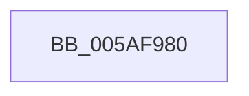

# KcsaniSendReport

- RVA: `0x005AF980`–`0x005AF9E0` (길이 `96` bytes)
- VA: `0x00000001405AF980`
- 실행 섹션: `.text`
- PDB 이름 있음: `예`; PDB Function 태그: `아니요`
- unwind 정보 RVA: `0x000C9748`
- 디코드: `21`개 명령, `96/96` bytes 표시
- 미해석 바이트: `0` (있으면 어셈블리에 `.byte`로 보존)

> 이 문서는 커널 이미지의 기계어와 PDB 기호를 분석해 생성했습니다. 4번과 5번은 함수 원형과 자료형을 바이너리 사용 방식에서 추정한 C 해석이며 원본 소스 복구 결과는 아닙니다.

## 1. Dependencies

- 직접 호출 지점: **3**; 고유 호출 대상: **2**
- 직접 호출자로 확인된 함수: **1**
- RIP 상대 이미지 참조: **1**

### Outgoing calls
- `0x005AF9B2` → [memset](../6C/memset_function_006C6C40.md) (function, `0x006C6C40`)
- `0x005AF9C6` → [memset](../6C/memset_function_006C6C40.md) (function, `0x006C6C40`)
- `0x005AF9D3` → [KasaniBuildPc](KasaniBuildPc_function_005AAF40.md) (function, `0x005AAF40`)

### Direct callers
- [sub_005AF3E2](Unknown_function_005AF3E2.md) at `0x005AF40C`

### Static image references
- `0x005AF992` → RVA `0x00E0A740` (`.data`; read)

## 2. Other-region calls and transfers

- 다른 실행 섹션으로 향하는 call: **0**
- call이 아닌 외부 분기/꼬리 이동: **1**
  - `0x005AF9DA` → [sub_005AFA55 + 0x993](Unknown_function_005AFA55.md) (`tail-transfer`)

## 3. Assembly (complete function range)

```asm
005AF980  40 55                           push rbp
005AF982  53                              push rbx
005AF983  48 8D AC 24 78 F1 FF FF         lea rbp, [rsp - 0xe88]
005AF98B  48 81 EC 88 0F 00 00            sub rsp, 0xf88
005AF992  48 8B 05 A7 AD 85 00            mov rax, qword ptr [rip + 0x85ada7]
005AF999  48 33 C4                        xor rax, rsp
005AF99C  48 89 85 70 0E 00 00            mov qword ptr [rbp + 0xe70], rax
005AF9A3  48 8B D9                        mov rbx, rcx
005AF9A6  33 D2                           xor edx, edx
005AF9A8  48 8D 4D 40                     lea rcx, [rbp + 0x40]
005AF9AC  41 B8 8C 00 00 00               mov r8d, 0x8c
005AF9B2  E8 89 72 11 00                  call 0x1406c6c40
005AF9B7  33 D2                           xor edx, edx
005AF9B9  48 8D 8D D0 00 00 00            lea rcx, [rbp + 0xd0]
005AF9C0  41 B8 8C 00 00 00               mov r8d, 0x8c
005AF9C6  E8 75 72 11 00                  call 0x1406c6c40
005AF9CB  48 8B 4B 18                     mov rcx, qword ptr [rbx + 0x18]
005AF9CF  48 8D 55 40                     lea rdx, [rbp + 0x40]
005AF9D3  E8 68 B5 FF FF                  call 0x1405aaf40
005AF9D8  84 C0                           test al, al
005AF9DA  0F 84 08 0A 00 00               je 0x1405b03e8
```

## 4. C-style interpretation (structured pseudocode)

```c
__int64 __fastcall KcsaniSendReport(__int64 a1, int a2)
{
    __int64 result;
    __int64 v_rsp;
    unsigned __int64 v_stack_m28;
    unsigned __int64 v_stack_mDC8;
    unsigned __int64 v_stack_mE58;
    unsigned __int64 v_stack_mE98;

    v_rsp = (v_rsp) - (0xF88ULL);
    result = (*(unsigned __int64 *)(v_rip + 8760743)) ^ (v_rsp);
    v_stack_m28 = result;
    a2 = 0;
    result = memset(v_stack_mE58, a2, 140, a4);
    a2 = 0;
    result = memset(v_stack_mDC8, a2, 140, a4);
    result = KasaniBuildPc(*(unsigned __int64 *)(a1 + 24), v_stack_mE58, 140, a4);
}
```

## 5. (Beta) C Style

```c
int64_t KcsaniSendReport(void *Arg1, int32_t Arg2)
{
    uint8_t *arg1 = (uint8_t *)Arg1;

    int64_t result;
    int64_t local_rsp;
    uint64_t v_stack_m28;
    uint64_t v_stack_mDC8;
    uint64_t v_stack_mE58;
    uint64_t v_stack_mE98;

    local_rsp = (local_rsp) - (0xF88ULL);
    result = (*(uint64_t *)(v_rip + 0x85ADA7)) ^ (local_rsp);
    v_stack_m28 = result;
    Arg2 = 0;
    result = memset(v_stack_mE58, Arg2, 140, a4);
    Arg2 = 0;
    result = memset(v_stack_mDC8, Arg2, 140, a4);
    result = KasaniBuildPc(*(uint64_t *)(arg1 + 0x18), v_stack_mE58, 140, a4);
}
```

### 관측된 메모리 오프셋

구조체 형식이 확인되지 않은 접근은 인자 기준의 오프셋으로만 기록했습니다.

| 기준 인자 | 오프셋 표현 | 폭 (bit) | 접근 |
|---|---:|---:|---|
| `Arg1` | `+ 0x18` | `64` | `R` |

## 6. Execution-region graph

[열기: 2D/3D 그래프와 함수 탐색 컨트롤 패널](../../../control-panel.html?section=text&rva=0x005AF980&view=graph)

- 2D 그래프는 위에서 아래로 흐르고, 3D 그래프는 빈 공간을 드래그해 회전합니다. Shift+드래그는 이동, 휠은 확대·축소, 함수 노드 선택은 대상 보고서 이동입니다.

### Static fallback


