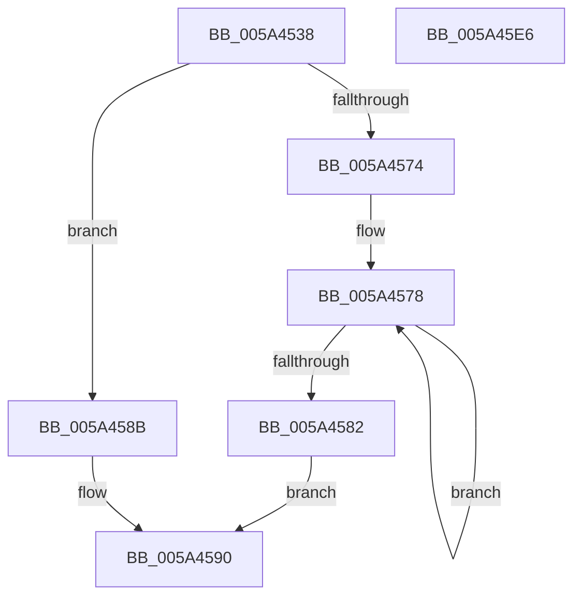

# McTemplateK0dzd_EtwWriteTransfer

- RVA: `0x005A4538`–`0x005A45E7` (길이 `175` bytes)
- VA: `0x00000001405A4538`
- 실행 섹션: `.text`
- PDB 이름 있음: `예`; PDB Function 태그: `아니요`
- unwind 정보 RVA: `0x000C6178`
- 디코드: `43`개 명령, `175/175` bytes 표시
- 미해석 바이트: `0` (있으면 어셈블리에 `.byte`로 보존)

> 이 문서는 커널 이미지의 기계어와 PDB 기호를 분석해 생성했습니다. 4번과 5번은 함수 원형과 자료형을 바이너리 사용 방식에서 추정한 C 해석이며 원본 소스 복구 결과는 아닙니다.

## 1. Dependencies

- 직접 호출 지점: **2**; 고유 호출 대상: **2**
- 직접 호출자로 확인된 함수: **1**
- RIP 상대 이미지 참조: **4**

### Outgoing calls
- `0x005A45CC` → [McGenEventWrite_EtwWriteTransfer](../42/McGenEventWrite_EtwWriteTransfer_function_00424FC8.md) (function, `0x00424FC8`)
- `0x005A45D8` → [_security_check_cookie](../6A/_security_check_cookie_function_006AC640.md) (function, `0x006AC640`)

### Direct callers
- [IopInitializeBootDrivers](../../init/C2/IopInitializeBootDrivers_function_00C2E6F4.md) at `0x00C2F212`

### Static image references
- `0x005A4548` → RVA `0x00E0A740` (`.data`; read)
- `0x005A4596` → RVA `0x006CB080` (` ?? ::FNODOBFM::`string'`; read)
- `0x005A45B5` → RVA `0x00E06DA0` (`.data`; read)
- `0x005A45C0` → RVA `0x000274E0` (`.rdata`; read)

## 2. Other-region calls and transfers

- 다른 실행 섹션으로 향하는 call: **0**
- 별도 외부 분기/꼬리 이동을 확인하지 못했습니다.

## 3. Assembly (complete function range)

```asm
005A4538  44 89 4C 24 20                  mov dword ptr [rsp + 0x20], r9d
005A453D  55                              push rbp
005A453E  48 8B EC                        mov rbp, rsp
005A4541  48 81 EC 80 00 00 00            sub rsp, 0x80
005A4548  48 8B 05 F1 61 86 00            mov rax, qword ptr [rip + 0x8661f1]
005A454F  48 33 C4                        xor rax, rsp
005A4552  48 89 45 F0                     mov qword ptr [rbp - 0x10], rax
005A4556  48 8B 4D 30                     mov rcx, qword ptr [rbp + 0x30]
005A455A  48 8D 45 28                     lea rax, [rbp + 0x28]
005A455E  45 33 C0                        xor r8d, r8d
005A4561  48 89 45 C0                     mov qword ptr [rbp - 0x40], rax
005A4565  41 B9 04 00 00 00               mov r9d, 4
005A456B  4C 89 4D C8                     mov qword ptr [rbp - 0x38], r9
005A456F  48 85 C9                        test rcx, rcx
005A4572  74 17                           je 0x1405a458b
005A4574  48 83 C8 FF                     or rax, 0xffffffffffffffff
005A4578  48 FF C0                        inc rax
005A457B  66 44 39 04 41                  cmp word ptr [rcx + rax*2], r8w
005A4580  75 F6                           jne 0x1405a4578
005A4582  8D 04 45 02 00 00 00            lea eax, [rax*2 + 2]
005A4589  EB 05                           jmp 0x1405a4590
005A458B  B8 0A 00 00 00                  mov eax, 0xa
005A4590  48 85 C9                        test rcx, rcx
005A4593  89 45 D8                        mov dword ptr [rbp - 0x28], eax
005A4596  48 8D 15 E3 6A 12 00            lea rdx, [rip + 0x126ae3]
005A459D  44 89 45 DC                     mov dword ptr [rbp - 0x24], r8d
005A45A1  48 0F 44 CA                     cmove rcx, rdx
005A45A5  4C 89 4D E8                     mov qword ptr [rbp - 0x18], r9
005A45A9  48 8D 45 38                     lea rax, [rbp + 0x38]
005A45AD  48 89 4D D0                     mov qword ptr [rbp - 0x30], rcx
005A45B1  48 89 45 E0                     mov qword ptr [rbp - 0x20], rax
005A45B5  48 8D 0D E4 27 86 00            lea rcx, [rip + 0x8627e4]
005A45BC  48 8D 45 B0                     lea rax, [rbp - 0x50]
005A45C0  48 8D 15 19 2F A8 FF            lea rdx, [rip - 0x57d0e7]
005A45C7  48 89 44 24 20                  mov qword ptr [rsp + 0x20], rax
005A45CC  E8 F7 09 E8 FF                  call 0x140424fc8
005A45D1  48 8B 4D F0                     mov rcx, qword ptr [rbp - 0x10]
005A45D5  48 33 CC                        xor rcx, rsp
005A45D8  E8 63 80 10 00                  call 0x1406ac640
005A45DD  48 81 C4 80 00 00 00            add rsp, 0x80
005A45E4  5D                              pop rbp
005A45E5  C3                              ret
005A45E6  CC                              int3
```

## 4. C-style interpretation (structured pseudocode)

```c
__int64 __fastcall McTemplateK0dzd_EtwWriteTransfer(__int64 a1, __int64 a2, int a3, int a4, __int64 a5, __int64 a6)
{
    __int64 result;
    __int64 v_rsp;
    unsigned __int64 v_stack_m18;
    unsigned __int64 v_stack_m20;
    unsigned __int64 v_stack_m28;
    unsigned int v_stack_m2C;
    unsigned int v_stack_m30;
    unsigned __int64 v_stack_m38;
    unsigned __int64 v_stack_m40;
    unsigned __int64 v_stack_m48;
    unsigned __int64 v_stack_m58;
    unsigned __int64 v_stack_m68;
    unsigned int v_stack_p20;

    v_stack_p20 = a4;
    v_rsp = (v_rsp) - (128);
    result = (*(unsigned __int64 *)(v_rip + 8806897)) ^ (v_rsp);
    v_stack_m18 = result;
    a3 = 0;
    v_stack_m48 = v_stack_p20;
    v_stack_m40 = 4;
    if (a5 == 0) goto loc_005A458B;
    result = (v_stack_p20) | (-1);
loc_005A4578:
    result = (result) + 1;
    if ((*(unsigned __int16 *)(a5 + result * 2)) != 0) goto loc_005A4578;
    goto loc_005A4590;
loc_005A458B:
loc_005A4590:
    v_stack_m30 = 10;
    v_stack_m2C = 0;
    if (a5 == 0) { a5 = v_rip + 1207011; }
    v_stack_m20 = 4;
    v_stack_m38 = a5;
    v_stack_m28 = a6;
    v_stack_m68 = v_stack_m58;
    result = McGenEventWrite_EtwWriteTransfer(v_rip + 8792036, v_rip - 5755111, a3, 4);
    a1 = (v_stack_m18) ^ (v_rsp);
    result = _security_check_cookie(a1, v_rip - 5755111, a3, 4);
    v_rsp = (v_rsp) + (128);
    return result;
}
```

## 5. (Beta) C Style

```c
int64_t McTemplateK0dzd_EtwWriteTransfer(int64_t Arg1, int64_t Arg2, int32_t Arg3, int32_t Arg4, int64_t Arg5, int64_t Arg6)
{
    int64_t result;
    int64_t local_rsp;
    uint64_t v_stack_m18;
    uint64_t v_stack_m20;
    uint64_t v_stack_m28;
    uint32_t v_stack_m2C;
    uint32_t v_stack_m30;
    uint64_t v_stack_m38;
    uint64_t v_stack_m40;
    uint64_t v_stack_m48;
    uint64_t v_stack_m58;
    uint64_t v_stack_m68;
    uint32_t v_stack_p20;

    v_stack_p20 = Arg4;
    local_rsp = (local_rsp) - (128);
    result = (*(uint64_t *)(v_rip + 0x8661F1)) ^ (local_rsp);
    v_stack_m18 = result;
    Arg3 = 0;
    v_stack_m48 = v_stack_p20;
    v_stack_m40 = 4;
    if (Arg5 == 0) goto loc_005A458B;
    result = (v_stack_p20) | (-1);
loc_005A4578:
    result = (result) + 1;
    if ((*(uint16_t *)(Arg5 + result * 2)) != 0) goto loc_005A4578;
    goto loc_005A4590;
loc_005A458B:
loc_005A4590:
    v_stack_m30 = 10;
    v_stack_m2C = 0;
    if (Arg5 == 0) { Arg5 = v_rip + 1207011; }
    v_stack_m20 = 4;
    v_stack_m38 = Arg5;
    v_stack_m28 = Arg6;
    v_stack_m68 = v_stack_m58;
    result = McGenEventWrite_EtwWriteTransfer(v_rip + 8792036, v_rip - 5755111, Arg3, 4);
    Arg1 = (v_stack_m18) ^ (local_rsp);
    result = _security_check_cookie(Arg1, v_rip - 5755111, Arg3, 4);
    local_rsp = (local_rsp) + (128);
    return result;
}
```

## 6. Execution-region graph

[열기: 2D/3D 그래프와 함수 탐색 컨트롤 패널](../../../control-panel.html?section=text&rva=0x005A4538&view=graph)

- 2D 그래프는 위에서 아래로 흐르고, 3D 그래프는 빈 공간을 드래그해 회전합니다. Shift+드래그는 이동, 휠은 확대·축소, 함수 노드 선택은 대상 보고서 이동입니다.

### Static fallback


