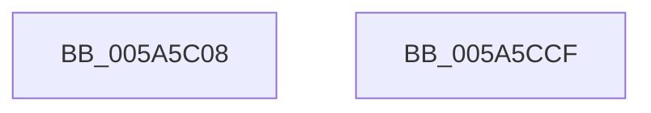

# McTemplateK0hzr0qqhzr4_EtwWriteTransfer

- RVA: `0x005A5C08`–`0x005A5CD0` (길이 `200` bytes)
- VA: `0x00000001405A5C08`
- 실행 섹션: `.text`
- PDB 이름 있음: `예`; PDB Function 태그: `아니요`
- unwind 정보 RVA: `0x000C84D0`
- 디코드: `46`개 명령, `200/200` bytes 표시
- 미해석 바이트: `0` (있으면 어셈블리에 `.byte`로 보존)

> 이 문서는 커널 이미지의 기계어와 PDB 기호를 분석해 생성했습니다. 4번과 5번은 함수 원형과 자료형을 바이너리 사용 방식에서 추정한 C 해석이며 원본 소스 복구 결과는 아닙니다.

## 1. Dependencies

- 직접 호출 지점: **2**; 고유 호출 대상: **2**
- 직접 호출자로 확인된 함수: **1**
- RIP 상대 이미지 참조: **3**

### Outgoing calls
- `0x005A5CB5` → [McGenEventWrite_EtwWriteTransfer](../42/McGenEventWrite_EtwWriteTransfer_function_00424FC8.md) (function, `0x00424FC8`)
- `0x005A5CC1` → [_security_check_cookie](../6A/_security_check_cookie_function_006AC640.md) (function, `0x006AC640`)

### Direct callers
- [IopLogDeviceResetComplete](../../page/72/IopLogDeviceResetComplete_function_0072A914.md) at `0x0072A97E`

### Static image references
- `0x005A5C1B` → RVA `0x00E0A740` (`.data`; read)
- `0x005A5C40` → RVA `0x00026CF0` (`.rdata`; read)
- `0x005A5C4B` → RVA `0x00E06DA0` (`.data`; read)

## 2. Other-region calls and transfers

- 다른 실행 섹션으로 향하는 call: **0**
- 별도 외부 분기/꼬리 이동을 확인하지 못했습니다.

## 3. Assembly (complete function range)

```asm
005A5C08  66 44 89 4C 24 20               mov word ptr [rsp + 0x20], r9w
005A5C0E  55                              push rbp
005A5C0F  48 8D 6C 24 D1                  lea rbp, [rsp - 0x2f]
005A5C14  48 81 EC C0 00 00 00            sub rsp, 0xc0
005A5C1B  48 8B 05 1E 4B 86 00            mov rax, qword ptr [rip + 0x864b1e]
005A5C22  48 33 C4                        xor rax, rsp
005A5C25  48 89 45 1F                     mov qword ptr [rbp + 0x1f], rax
005A5C29  45 33 C0                        xor r8d, r8d
005A5C2C  48 C7 45 C7 02 00 00 00         mov qword ptr [rbp - 0x39], 2
005A5C34  48 8D 45 57                     lea rax, [rbp + 0x57]
005A5C38  44 89 45 9F                     mov dword ptr [rbp - 0x61], r8d
005A5C3C  48 89 45 BF                     mov qword ptr [rbp - 0x41], rax
005A5C40  48 8D 15 A9 10 A8 FF            lea rdx, [rip - 0x57ef57]
005A5C47  48 8B 45 5F                     mov rax, qword ptr [rbp + 0x5f]
005A5C4B  48 8D 0D 4E 11 86 00            lea rcx, [rip + 0x86114e]
005A5C52  48 89 45 CF                     mov qword ptr [rbp - 0x31], rax
005A5C56  41 0F B7 C1                     movzx eax, r9w
005A5C5A  45 8D 48 07                     lea r9d, [r8 + 7]
005A5C5E  03 C0                           add eax, eax
005A5C60  44 89 45 DB                     mov dword ptr [rbp - 0x25], r8d
005A5C64  89 45 D7                        mov dword ptr [rbp - 0x29], eax
005A5C67  48 8D 45 67                     lea rax, [rbp + 0x67]
005A5C6B  48 89 45 DF                     mov qword ptr [rbp - 0x21], rax
005A5C6F  48 8D 45 9F                     lea rax, [rbp - 0x61]
005A5C73  48 89 45 EF                     mov qword ptr [rbp - 0x11], rax
005A5C77  48 8D 45 77                     lea rax, [rbp + 0x77]
005A5C7B  48 89 45 FF                     mov qword ptr [rbp - 1], rax
005A5C7F  48 8B 45 7F                     mov rax, qword ptr [rbp + 0x7f]
005A5C83  48 89 45 0F                     mov qword ptr [rbp + 0xf], rax
005A5C87  0F B7 45 77                     movzx eax, word ptr [rbp + 0x77]
005A5C8B  03 C0                           add eax, eax
005A5C8D  48 C7 45 E7 04 00 00 00         mov qword ptr [rbp - 0x19], 4
005A5C95  89 45 17                        mov dword ptr [rbp + 0x17], eax
005A5C98  48 8D 45 AF                     lea rax, [rbp - 0x51]
005A5C9C  48 89 44 24 20                  mov qword ptr [rsp + 0x20], rax
005A5CA1  48 C7 45 F7 04 00 00 00         mov qword ptr [rbp - 9], 4
005A5CA9  48 C7 45 07 02 00 00 00         mov qword ptr [rbp + 7], 2
005A5CB1  44 89 45 1B                     mov dword ptr [rbp + 0x1b], r8d
005A5CB5  E8 0E F3 E7 FF                  call 0x140424fc8
005A5CBA  48 8B 4D 1F                     mov rcx, qword ptr [rbp + 0x1f]
005A5CBE  48 33 CC                        xor rcx, rsp
005A5CC1  E8 7A 69 10 00                  call 0x1406ac640
005A5CC6  48 81 C4 C0 00 00 00            add rsp, 0xc0
005A5CCD  5D                              pop rbp
005A5CCE  C3                              ret
005A5CCF  CC                              int3
```

## 4. C-style interpretation (structured pseudocode)

```c
__int64 __fastcall McTemplateK0hzr0qqhzr4_EtwWriteTransfer(__int64 a1, __int64 a2, int a3, unsigned __int16 a4, __int64 a5, __int64 a6, __int64 a7, unsigned __int16 a8, __int64 a9)
{
    __int64 result;
    __int64 v_rsp;
    unsigned __int64 v_stack_m18;
    unsigned int v_stack_m1C;
    unsigned int v_stack_m20;
    unsigned __int64 v_stack_m28;
    unsigned __int64 v_stack_m30;
    unsigned __int64 v_stack_m37;
    unsigned __int64 v_stack_m38;
    unsigned __int64 v_stack_m40;
    unsigned __int64 v_stack_m48;
    unsigned __int64 v_stack_m50;
    unsigned __int64 v_stack_m58;
    unsigned int v_stack_m5C;
    unsigned int v_stack_m60;
    unsigned __int64 v_stack_m68;
    unsigned __int64 v_stack_m70;
    unsigned __int64 v_stack_m78;
    unsigned __int64 v_stack_m88;
    unsigned int v_stack_m98;
    unsigned __int64 v_stack_mA8;
    unsigned __int16 v_stack_p20;

    v_stack_p20 = a4;
    v_rsp = (v_rsp) - (192);
    result = (*(unsigned __int64 *)(v_rip + 8801054)) ^ (v_rsp);
    v_stack_m18 = result;
    a3 = 0;
    v_stack_m70 = 2;
    v_stack_m98 = 0;
    v_stack_m78 = v_stack_p20;
    v_stack_m68 = a5;
    result = (unsigned int)((a4) + (a4));
    v_stack_m5C = 0;
    v_stack_m60 = (unsigned int)(result);
    v_stack_m58 = a6;
    v_stack_m48 = v_stack_m98;
    v_stack_m38 = a8;
    v_stack_m28 = a9;
    result = (unsigned int)((a8) + (a8));
    v_stack_m50 = 4;
    v_stack_m20 = (unsigned int)(result);
    v_stack_mA8 = v_stack_m88;
    v_stack_m40 = 4;
    v_stack_m30 = 2;
    v_stack_m1C = 0;
    result = McGenEventWrite_EtwWriteTransfer(v_rip + 8786254, v_rip - 5762903, a3, a3 + 7);
    a1 = (v_stack_m18) ^ (v_rsp);
    result = _security_check_cookie(a1, v_rip - 5762903, a3, a3 + 7);
    v_rsp = (v_rsp) + (192);
    return result;
}
```

## 5. (Beta) C Style

```c
int64_t McTemplateK0hzr0qqhzr4_EtwWriteTransfer(int64_t Arg1, int64_t Arg2, int32_t Arg3, uint16_t Arg4, int64_t Arg5, int64_t Arg6, uint64_t Arg7, uint16_t Arg8, int64_t Arg9)
{
    int64_t result;
    int64_t local_rsp;
    uint64_t v_stack_m18;
    uint32_t v_stack_m1C;
    uint32_t v_stack_m20;
    uint64_t v_stack_m28;
    uint64_t v_stack_m30;
    uint64_t v_stack_m37;
    uint64_t v_stack_m38;
    uint64_t v_stack_m40;
    uint64_t v_stack_m48;
    uint64_t v_stack_m50;
    uint64_t v_stack_m58;
    uint32_t v_stack_m5C;
    uint32_t v_stack_m60;
    uint64_t v_stack_m68;
    uint64_t v_stack_m70;
    uint64_t v_stack_m78;
    uint64_t v_stack_m88;
    uint32_t v_stack_m98;
    uint64_t v_stack_mA8;
    uint16_t v_stack_p20;

    v_stack_p20 = Arg4;
    local_rsp = (local_rsp) - (192);
    result = (*(uint64_t *)(v_rip + 0x864B1E)) ^ (local_rsp);
    v_stack_m18 = result;
    Arg3 = 0;
    v_stack_m70 = 2;
    v_stack_m98 = 0;
    v_stack_m78 = v_stack_p20;
    v_stack_m68 = Arg5;
    result = (uint32_t)((Arg4) + (Arg4));
    v_stack_m5C = 0;
    v_stack_m60 = (uint32_t)(result);
    v_stack_m58 = Arg6;
    v_stack_m48 = v_stack_m98;
    v_stack_m38 = Arg8;
    v_stack_m28 = Arg9;
    result = (uint32_t)((Arg8) + (Arg8));
    v_stack_m50 = 4;
    v_stack_m20 = (uint32_t)(result);
    v_stack_mA8 = v_stack_m88;
    v_stack_m40 = 4;
    v_stack_m30 = 2;
    v_stack_m1C = 0;
    result = McGenEventWrite_EtwWriteTransfer(v_rip + 8786254, v_rip - 5762903, Arg3, Arg3 + 7);
    Arg1 = (v_stack_m18) ^ (local_rsp);
    result = _security_check_cookie(Arg1, v_rip - 5762903, Arg3, Arg3 + 7);
    local_rsp = (local_rsp) + (192);
    return result;
}
```

## 6. Execution-region graph

[열기: 2D/3D 그래프와 함수 탐색 컨트롤 패널](../../../control-panel.html?section=text&rva=0x005A5C08&view=graph)

- 2D 그래프는 위에서 아래로 흐르고, 3D 그래프는 빈 공간을 드래그해 회전합니다. Shift+드래그는 이동, 휠은 확대·축소, 함수 노드 선택은 대상 보고서 이동입니다.

### Static fallback


