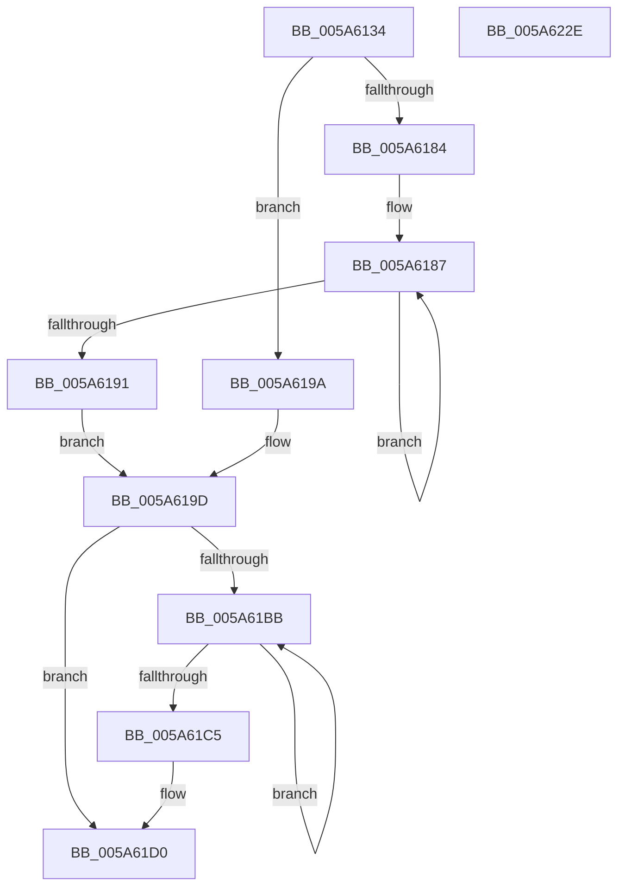

# McTemplateK0izzx_EtwWriteTransfer

- RVA: `0x005A6134`–`0x005A622F` (길이 `251` bytes)
- VA: `0x00000001405A6134`
- 실행 섹션: `.text`
- PDB 이름 있음: `예`; PDB Function 태그: `아니요`
- unwind 정보 RVA: `0x000C85C0`
- 디코드: `61`개 명령, `251/251` bytes 표시
- 미해석 바이트: `0` (있으면 어셈블리에 `.byte`로 보존)

> 이 문서는 커널 이미지의 기계어와 PDB 기호를 분석해 생성했습니다. 4번과 5번은 함수 원형과 자료형을 바이너리 사용 방식에서 추정한 C 해석이며 원본 소스 복구 결과는 아닙니다.

## 1. Dependencies

- 직접 호출 지점: **2**; 고유 호출 대상: **2**
- 직접 호출자로 확인된 함수: **1**
- RIP 상대 이미지 참조: **3**

### Outgoing calls
- `0x005A620C` → [McGenEventWrite_EtwWriteTransfer](../42/McGenEventWrite_EtwWriteTransfer_function_00424FC8.md) (function, `0x00424FC8`)
- `0x005A6218` → [_security_check_cookie](../6A/_security_check_cookie_function_006AC640.md) (function, `0x006AC640`)

### Direct callers
- [PnpWatchdogEtwWrite](../4D/PnpWatchdogEtwWrite_function_004D2FB0.md) at `0x004D3138`

### Static image references
- `0x005A614B` → RVA `0x00E0A740` (`.data`; read)
- `0x005A61A3` → RVA `0x006CB080` (` ?? ::FNODOBFM::`string'`; read)
- `0x005A61E4` → RVA `0x00E06DA0` (`.data`; read)

## 2. Other-region calls and transfers

- 다른 실행 섹션으로 향하는 call: **0**
- 별도 외부 분기/꼬리 이동을 확인하지 못했습니다.

## 3. Assembly (complete function range)

```asm
005A6134  48 89 5C 24 08                  mov qword ptr [rsp + 8], rbx
005A6139  4C 89 4C 24 20                  mov qword ptr [rsp + 0x20], r9
005A613E  55                              push rbp
005A613F  48 8D 6C 24 C1                  lea rbp, [rsp - 0x3f]
005A6144  48 81 EC 90 00 00 00            sub rsp, 0x90
005A614B  48 8B 05 EE 45 86 00            mov rax, qword ptr [rip + 0x8645ee]
005A6152  48 33 C4                        xor rax, rsp
005A6155  48 89 45 2F                     mov qword ptr [rbp + 0x2f], rax
005A6159  48 8B 4D 6F                     mov rcx, qword ptr [rbp + 0x6f]
005A615D  48 8D 45 67                     lea rax, [rbp + 0x67]
005A6161  4C 8B 45 77                     mov r8, qword ptr [rbp + 0x77]
005A6165  45 33 DB                        xor r11d, r11d
005A6168  48 89 45 EF                     mov qword ptr [rbp - 0x11], rax
005A616C  4C 8B D2                        mov r10, rdx
005A616F  48 83 C8 FF                     or rax, 0xffffffffffffffff
005A6173  48 C7 45 F7 08 00 00 00         mov qword ptr [rbp - 9], 8
005A617B  45 8D 4B 0A                     lea r9d, [r11 + 0xa]
005A617F  48 85 C9                        test rcx, rcx
005A6182  74 16                           je 0x1405a619a
005A6184  48 8B D0                        mov rdx, rax
005A6187  48 FF C2                        inc rdx
005A618A  66 44 39 1C 51                  cmp word ptr [rcx + rdx*2], r11w
005A618F  75 F6                           jne 0x1405a6187
005A6191  8D 14 55 02 00 00 00            lea edx, [rdx*2 + 2]
005A6198  EB 03                           jmp 0x1405a619d
005A619A  41 8B D1                        mov edx, r9d
005A619D  48 85 C9                        test rcx, rcx
005A61A0  89 55 07                        mov dword ptr [rbp + 7], edx
005A61A3  48 8D 1D D6 4E 12 00            lea rbx, [rip + 0x124ed6]
005A61AA  44 89 5D 0B                     mov dword ptr [rbp + 0xb], r11d
005A61AE  48 0F 44 CB                     cmove rcx, rbx
005A61B2  48 89 4D FF                     mov qword ptr [rbp - 1], rcx
005A61B6  4D 85 C0                        test r8, r8
005A61B9  74 15                           je 0x1405a61d0
005A61BB  48 FF C0                        inc rax
005A61BE  66 45 39 1C 40                  cmp word ptr [r8 + rax*2], r11w
005A61C3  75 F6                           jne 0x1405a61bb
005A61C5  44 8D 0C 45 02 00 00 00         lea r9d, [rax*2 + 2]
005A61CD  4D 85 C0                        test r8, r8
005A61D0  4C 0F 44 C3                     cmove r8, rbx
005A61D4  44 89 4D 17                     mov dword ptr [rbp + 0x17], r9d
005A61D8  48 8D 45 7F                     lea rax, [rbp + 0x7f]
005A61DC  4C 89 45 0F                     mov qword ptr [rbp + 0xf], r8
005A61E0  48 89 45 1F                     mov qword ptr [rbp + 0x1f], rax
005A61E4  48 8D 0D B5 0B 86 00            lea rcx, [rip + 0x860bb5]
005A61EB  48 8D 45 DF                     lea rax, [rbp - 0x21]
005A61EF  44 89 5D 1B                     mov dword ptr [rbp + 0x1b], r11d
005A61F3  41 B9 05 00 00 00               mov r9d, 5
005A61F9  48 89 44 24 20                  mov qword ptr [rsp + 0x20], rax
005A61FE  45 33 C0                        xor r8d, r8d
005A6201  48 C7 45 27 08 00 00 00         mov qword ptr [rbp + 0x27], 8
005A6209  49 8B D2                        mov rdx, r10
005A620C  E8 B7 ED E7 FF                  call 0x140424fc8
005A6211  48 8B 4D 2F                     mov rcx, qword ptr [rbp + 0x2f]
005A6215  48 33 CC                        xor rcx, rsp
005A6218  E8 23 64 10 00                  call 0x1406ac640
005A621D  48 8B 9C 24 A0 00 00 00         mov rbx, qword ptr [rsp + 0xa0]
005A6225  48 81 C4 90 00 00 00            add rsp, 0x90
005A622C  5D                              pop rbp
005A622D  C3                              ret
005A622E  CC                              int3
```

## 4. C-style interpretation (structured pseudocode)

```c
__int64 __fastcall McTemplateK0izzx_EtwWriteTransfer(__int64 a1, __int64 a2, __int64 a3, __int64 a4, __int64 a5, __int64 a6, __int64 a7)
{
    __int64 result;
    __int64 v_r11;
    __int64 v_rsp;
    unsigned __int64 v_stack_m18;
    unsigned __int64 v_stack_m20;
    unsigned __int64 v_stack_m28;
    unsigned int v_stack_m2C;
    unsigned int v_stack_m30;
    unsigned __int64 v_stack_m38;
    unsigned int v_stack_m3C;
    unsigned int v_stack_m40;
    unsigned __int64 v_stack_m47;
    unsigned __int64 v_stack_m48;
    unsigned __int64 v_stack_m50;
    unsigned __int64 v_stack_m58;
    unsigned __int64 v_stack_m68;
    unsigned __int64 v_stack_m78;
    unsigned __int64 v_stack_p20;
    unsigned __int64 v_stack_p8;

    v_stack_p8 = v_rbx;
    v_stack_p20 = a4;
    v_rsp = (v_rsp) - (144);
    result = (*(unsigned __int64 *)(v_rip + 8799726)) ^ (v_rsp);
    v_stack_m18 = result;
    v_r11 = 0;
    v_stack_m58 = v_stack_p20;
    result = (v_stack_p20) | (-1);
    v_stack_m50 = 8;
    if (a5 == 0) goto loc_005A619A;
loc_005A6187:
    a2 = (result) + 1;
    if ((*(unsigned __int16 *)(a5 + a2 * 2)) != 0) goto loc_005A6187;
    goto loc_005A619D;
loc_005A619A:
loc_005A619D:
    v_stack_m40 = (unsigned int)((unsigned int)((unsigned int)(v_r11 + 10)));
    v_stack_m3C = 0;
    if (a5 == 0) { a5 = v_rip + 1199830; }
    v_stack_m48 = a5;
    if (a6 == 0) goto loc_005A61D0;
loc_005A61BB:
    result = (result) + 1;
    if ((*(unsigned __int16 *)(a6 + result * 2)) != 0) goto loc_005A61BB;
loc_005A61D0:
    if (a6 == 0) { a6 = v_rip + 1199830; }
    v_stack_m30 = (unsigned int)(result * 2 + 2);
    v_stack_m38 = a6;
    v_stack_m28 = a7;
    v_stack_m2C = 0;
    v_stack_m78 = v_stack_m68;
    a3 = 0;
    v_stack_m20 = 8;
    result = McGenEventWrite_EtwWriteTransfer(v_rip + 8784821, a2, a3, 5);
    a1 = (v_stack_m18) ^ (v_rsp);
    result = _security_check_cookie(a1, a2, a3, 5);
    v_rsp = (v_rsp) + (144);
    return result;
}
```

## 5. (Beta) C Style

```c
int64_t McTemplateK0izzx_EtwWriteTransfer(int64_t Arg1, int64_t Arg2, int64_t Arg3, int64_t Arg4, int64_t Arg5, int64_t Arg6, int64_t Arg7)
{
    int64_t result;
    int64_t local_r11;
    int64_t local_rsp;
    uint64_t v_stack_m18;
    uint64_t v_stack_m20;
    uint64_t v_stack_m28;
    uint32_t v_stack_m2C;
    uint32_t v_stack_m30;
    uint64_t v_stack_m38;
    uint32_t v_stack_m3C;
    uint32_t v_stack_m40;
    uint64_t v_stack_m47;
    uint64_t v_stack_m48;
    uint64_t v_stack_m50;
    uint64_t v_stack_m58;
    uint64_t v_stack_m68;
    uint64_t v_stack_m78;
    uint64_t v_stack_p20;
    uint64_t v_stack_p8;

    v_stack_p8 = local_rbx;
    v_stack_p20 = Arg4;
    local_rsp = (local_rsp) - (144);
    result = (*(uint64_t *)(v_rip + 0x8645EE)) ^ (local_rsp);
    v_stack_m18 = result;
    local_r11 = 0;
    v_stack_m58 = v_stack_p20;
    result = (v_stack_p20) | (-1);
    v_stack_m50 = 8;
    if (Arg5 == 0) goto loc_005A619A;
loc_005A6187:
    Arg2 = (result) + 1;
    if ((*(uint16_t *)(Arg5 + Arg2 * 2)) != 0) goto loc_005A6187;
    goto loc_005A619D;
loc_005A619A:
loc_005A619D:
    v_stack_m40 = (uint32_t)((uint32_t)((uint32_t)(local_r11 + 10)));
    v_stack_m3C = 0;
    if (Arg5 == 0) { Arg5 = v_rip + 1199830; }
    v_stack_m48 = Arg5;
    if (Arg6 == 0) goto loc_005A61D0;
loc_005A61BB:
    result = (result) + 1;
    if ((*(uint16_t *)(Arg6 + result * 2)) != 0) goto loc_005A61BB;
loc_005A61D0:
    if (Arg6 == 0) { Arg6 = v_rip + 1199830; }
    v_stack_m30 = (uint32_t)(result * 2 + 2);
    v_stack_m38 = Arg6;
    v_stack_m28 = Arg7;
    v_stack_m2C = 0;
    v_stack_m78 = v_stack_m68;
    Arg3 = 0;
    v_stack_m20 = 8;
    result = McGenEventWrite_EtwWriteTransfer(v_rip + 8784821, Arg2, Arg3, 5);
    Arg1 = (v_stack_m18) ^ (local_rsp);
    result = _security_check_cookie(Arg1, Arg2, Arg3, 5);
    local_rsp = (local_rsp) + (144);
    return result;
}
```

## 6. Execution-region graph

[열기: 2D/3D 그래프와 함수 탐색 컨트롤 패널](../../../control-panel.html?section=text&rva=0x005A6134&view=graph)

- 2D 그래프는 위에서 아래로 흐르고, 3D 그래프는 빈 공간을 드래그해 회전합니다. Shift+드래그는 이동, 휠은 확대·축소, 함수 노드 선택은 대상 보고서 이동입니다.

### Static fallback


