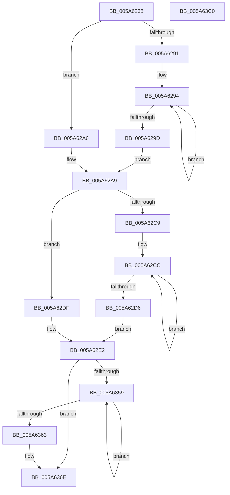

# McTemplateK0izzxqjddjz_EtwWriteTransfer

- RVA: `0x005A6238`–`0x005A63C1` (길이 `393` bytes)
- VA: `0x00000001405A6238`
- 실행 섹션: `.text`
- PDB 이름 있음: `예`; PDB Function 태그: `아니요`
- unwind 정보 RVA: `0x000C85A0`
- 디코드: `95`개 명령, `393/393` bytes 표시
- 미해석 바이트: `0` (있으면 어셈블리에 `.byte`로 보존)

> 이 문서는 커널 이미지의 기계어와 PDB 기호를 분석해 생성했습니다. 4번과 5번은 함수 원형과 자료형을 바이너리 사용 방식에서 추정한 C 해석이며 원본 소스 복구 결과는 아닙니다.

## 1. Dependencies

- 직접 호출 지점: **2**; 고유 호출 대상: **2**
- 직접 호출자로 확인된 함수: **1**
- RIP 상대 이미지 참조: **3**

### Outgoing calls
- `0x005A639A` → [McGenEventWrite_EtwWriteTransfer](../42/McGenEventWrite_EtwWriteTransfer_function_00424FC8.md) (function, `0x00424FC8`)
- `0x005A63A6` → [_security_check_cookie](../6A/_security_check_cookie_function_006AC640.md) (function, `0x006AC640`)

### Direct callers
- [PnpWatchdogEtwWrite](../4D/PnpWatchdogEtwWrite_function_004D2FB0.md) at `0x004D32A7`

### Static image references
- `0x005A6253` → RVA `0x00E0A740` (`.data`; read)
- `0x005A62B0` → RVA `0x006CB080` (` ?? ::FNODOBFM::`string'`; read)
- `0x005A6393` → RVA `0x00E06DA0` (`.data`; read)

## 2. Other-region calls and transfers

- 다른 실행 섹션으로 향하는 call: **0**
- 별도 외부 분기/꼬리 이동을 확인하지 못했습니다.

## 3. Assembly (complete function range)

```asm
005A6238  48 8B C4                        mov rax, rsp
005A623B  48 89 58 08                     mov qword ptr [rax + 8], rbx
005A623F  48 89 78 18                     mov qword ptr [rax + 0x18], rdi
005A6243  4C 89 48 20                     mov qword ptr [rax + 0x20], r9
005A6247  55                              push rbp
005A6248  48 8D 68 E9                     lea rbp, [rax - 0x17]
005A624C  48 81 EC F0 00 00 00            sub rsp, 0xf0
005A6253  48 8B 05 E6 44 86 00            mov rax, qword ptr [rip + 0x8644e6]
005A625A  48 33 C4                        xor rax, rsp
005A625D  48 89 45 FF                     mov qword ptr [rbp - 1], rax
005A6261  48 8B 45 3F                     mov rax, qword ptr [rbp + 0x3f]
005A6265  48 8D 4D 37                     lea rcx, [rbp + 0x37]
005A6269  4C 8B 45 7F                     mov r8, qword ptr [rbp + 0x7f]
005A626D  33 DB                           xor ebx, ebx
005A626F  4C 8B 55 47                     mov r10, qword ptr [rbp + 0x47]
005A6273  4C 8B DA                        mov r11, rdx
005A6276  48 89 4C 24 40                  mov qword ptr [rsp + 0x40], rcx
005A627B  48 83 C9 FF                     or rcx, 0xffffffffffffffff
005A627F  48 C7 44 24 48 08 00 00 00      mov qword ptr [rsp + 0x48], 8
005A6288  44 8D 4B 0A                     lea r9d, [rbx + 0xa]
005A628C  48 85 C0                        test rax, rax
005A628F  74 15                           je 0x1405a62a6
005A6291  48 8B D1                        mov rdx, rcx
005A6294  48 FF C2                        inc rdx
005A6297  66 39 1C 50                     cmp word ptr [rax + rdx*2], bx
005A629B  75 F7                           jne 0x1405a6294
005A629D  8D 14 55 02 00 00 00            lea edx, [rdx*2 + 2]
005A62A4  EB 03                           jmp 0x1405a62a9
005A62A6  41 8B D1                        mov edx, r9d
005A62A9  48 85 C0                        test rax, rax
005A62AC  89 54 24 58                     mov dword ptr [rsp + 0x58], edx
005A62B0  48 8D 3D C9 4D 12 00            lea rdi, [rip + 0x124dc9]
005A62B7  89 5C 24 5C                     mov dword ptr [rsp + 0x5c], ebx
005A62BB  48 0F 44 C7                     cmove rax, rdi
005A62BF  48 89 44 24 50                  mov qword ptr [rsp + 0x50], rax
005A62C4  4D 85 D2                        test r10, r10
005A62C7  74 16                           je 0x1405a62df
005A62C9  48 8B C1                        mov rax, rcx
005A62CC  48 FF C0                        inc rax
005A62CF  66 41 39 1C 42                  cmp word ptr [r10 + rax*2], bx
005A62D4  75 F6                           jne 0x1405a62cc
005A62D6  8D 04 45 02 00 00 00            lea eax, [rax*2 + 2]
005A62DD  EB 03                           jmp 0x1405a62e2
005A62DF  41 8B C1                        mov eax, r9d
005A62E2  89 45 87                        mov dword ptr [rbp - 0x79], eax
005A62E5  4D 85 D2                        test r10, r10
005A62E8  48 8D 45 4F                     lea rax, [rbp + 0x4f]
005A62EC  89 5D 8B                        mov dword ptr [rbp - 0x75], ebx
005A62EF  48 89 45 8F                     mov qword ptr [rbp - 0x71], rax
005A62F3  4C 0F 44 D7                     cmove r10, rdi
005A62F7  4C 89 54 24 60                  mov qword ptr [rsp + 0x60], r10
005A62FC  48 8D 45 57                     lea rax, [rbp + 0x57]
005A6300  48 89 45 9F                     mov qword ptr [rbp - 0x61], rax
005A6304  48 8B 45 5F                     mov rax, qword ptr [rbp + 0x5f]
005A6308  48 89 45 AF                     mov qword ptr [rbp - 0x51], rax
005A630C  48 8D 45 67                     lea rax, [rbp + 0x67]
005A6310  48 89 45 BF                     mov qword ptr [rbp - 0x41], rax
005A6314  48 8D 45 6F                     lea rax, [rbp + 0x6f]
005A6318  48 89 45 CF                     mov qword ptr [rbp - 0x31], rax
005A631C  48 8B 45 77                     mov rax, qword ptr [rbp + 0x77]
005A6320  48 89 45 DF                     mov qword ptr [rbp - 0x21], rax
005A6324  48 C7 45 97 08 00 00 00         mov qword ptr [rbp - 0x69], 8
005A632C  48 C7 45 A7 04 00 00 00         mov qword ptr [rbp - 0x59], 4
005A6334  48 C7 45 B7 10 00 00 00         mov qword ptr [rbp - 0x49], 0x10
005A633C  48 C7 45 C7 04 00 00 00         mov qword ptr [rbp - 0x39], 4
005A6344  48 C7 45 D7 04 00 00 00         mov qword ptr [rbp - 0x29], 4
005A634C  48 C7 45 E7 10 00 00 00         mov qword ptr [rbp - 0x19], 0x10
005A6354  4D 85 C0                        test r8, r8
005A6357  74 15                           je 0x1405a636e
005A6359  48 FF C1                        inc rcx
005A635C  66 41 39 1C 48                  cmp word ptr [r8 + rcx*2], bx
005A6361  75 F6                           jne 0x1405a6359
005A6363  44 8D 0C 4D 02 00 00 00         lea r9d, [rcx*2 + 2]
005A636B  4D 85 C0                        test r8, r8
005A636E  4C 0F 44 C7                     cmove r8, rdi
005A6372  44 89 4D F7                     mov dword ptr [rbp - 9], r9d
005A6376  4C 89 45 EF                     mov qword ptr [rbp - 0x11], r8
005A637A  48 8D 44 24 30                  lea rax, [rsp + 0x30]
005A637F  45 33 C0                        xor r8d, r8d
005A6382  89 5D FB                        mov dword ptr [rbp - 5], ebx
005A6385  41 B9 0B 00 00 00               mov r9d, 0xb
005A638B  48 89 44 24 20                  mov qword ptr [rsp + 0x20], rax
005A6390  49 8B D3                        mov rdx, r11
005A6393  48 8D 0D 06 0A 86 00            lea rcx, [rip + 0x860a06]
005A639A  E8 29 EC E7 FF                  call 0x140424fc8
005A639F  48 8B 4D FF                     mov rcx, qword ptr [rbp - 1]
005A63A3  48 33 CC                        xor rcx, rsp
005A63A6  E8 95 62 10 00                  call 0x1406ac640
005A63AB  4C 8D 9C 24 F0 00 00 00         lea r11, [rsp + 0xf0]
005A63B3  49 8B 5B 10                     mov rbx, qword ptr [r11 + 0x10]
005A63B7  49 8B 7B 20                     mov rdi, qword ptr [r11 + 0x20]
005A63BB  49 8B E3                        mov rsp, r11
005A63BE  5D                              pop rbp
005A63BF  C3                              ret
005A63C0  CC                              int3
```

## 4. C-style interpretation (structured pseudocode)

```c
__int64 __fastcall McTemplateK0izzxqjddjz_EtwWriteTransfer(__int64 a1, __int64 a2, __int64 a3, __int64 a4)
{
    __int64 result;
    __int64 v_r10;
    __int64 v_rbx;
    __int64 v_rsp;
    unsigned __int64 v_stack_m8;
    unsigned __int64 v_stack_m98;
    unsigned int v_stack_m9C;
    unsigned int v_stack_mA0;
    unsigned __int64 v_stack_mA8;
    unsigned __int64 v_stack_mB0;
    unsigned __int64 v_stack_mB8;
    unsigned __int64 v_stack_mC8;
    unsigned __int64 v_stack_mD8;

    *(unsigned __int64 *)(v_rsp + 8) = v_rbx;
    *(unsigned __int64 *)(v_rsp + 24) = v_rdi;
    *(unsigned __int64 *)(v_rsp + 32) = a4;
    v_rsp = (v_rsp) - (240);
    result = (*(unsigned __int64 *)(v_rip + 8799462)) ^ (v_rsp);
    *(unsigned __int64 *)(v_rsp - 23 - 1) = result;
    v_rbx = 0;
    v_stack_mB8 = v_rsp - 23 + 55;
    a1 = (v_rsp - 23 + 55) | (-1);
    v_stack_mB0 = 8;
    if (*(unsigned __int64 *)(v_rsp - 23 + 63) == 0) goto loc_005A62A6;
loc_005A6294:
    a2 = (a1) + 1;
    if ((*(unsigned __int16 *)(*(unsigned __int64 *)(v_rsp - 23 + 63) + a2 * 2)) != 0) goto loc_005A6294;
    goto loc_005A62A9;
loc_005A62A6:
loc_005A62A9:
    v_stack_mA0 = (unsigned int)((unsigned int)((unsigned int)(v_rbx + 10)));
    v_stack_m9C = 0;
    result = *(unsigned __int64 *)(v_rsp - 23 + 63);
    if (*(unsigned __int64 *)(v_rsp - 23 + 63) == 0) { result = v_rip + 1199561; }
    v_stack_mA8 = result;
    if (*(unsigned __int64 *)(v_rsp - 23 + 71) == 0) goto loc_005A62DF;
loc_005A62CC:
    result = (a1) + 1;
    if ((*(unsigned __int16 *)(*(unsigned __int64 *)(v_rsp - 23 + 71) + result * 2)) != 0) goto loc_005A62CC;
    goto loc_005A62E2;
loc_005A62DF:
loc_005A62E2:
    *(unsigned int *)(v_rsp - 23 - 121) = (unsigned int)((unsigned int)((unsigned int)(v_rbx + 10)));
    *(unsigned int *)(v_rsp - 23 - 117) = 0;
    *(unsigned __int64 *)(v_rsp - 23 - 113) = v_rsp - 23 + 79;
    v_r10 = *(unsigned __int64 *)(v_rsp - 23 + 71);
    if (*(unsigned __int64 *)(v_rsp - 23 + 71) == 0) { v_r10 = v_rip + 1199561; }
    v_stack_m98 = v_r10;
    *(unsigned __int64 *)(v_rsp - 23 - 97) = v_rsp - 23 + 87;
    *(unsigned __int64 *)(v_rsp - 23 - 81) = *(unsigned __int64 *)(v_rsp - 23 + 95);
    *(unsigned __int64 *)(v_rsp - 23 - 65) = v_rsp - 23 + 103;
    *(unsigned __int64 *)(v_rsp - 23 - 49) = v_rsp - 23 + 111;
    *(unsigned __int64 *)(v_rsp - 23 - 33) = *(unsigned __int64 *)(v_rsp - 23 + 119);
    *(unsigned __int64 *)(v_rsp - 23 - 105) = 8;
    *(unsigned __int64 *)(v_rsp - 23 - 89) = 4;
    *(unsigned __int64 *)(v_rsp - 23 - 73) = 16;
    *(unsigned __int64 *)(v_rsp - 23 - 57) = 4;
    *(unsigned __int64 *)(v_rsp - 23 - 41) = 4;
    *(unsigned __int64 *)(v_rsp - 23 - 25) = 16;
    if (*(unsigned __int64 *)(v_rsp - 23 + 127) == 0) goto loc_005A636E;
loc_005A6359:
    a1 = (a1) + 1;
    if ((*(unsigned __int16 *)(*(unsigned __int64 *)(v_rsp - 23 + 127) + a1 * 2)) != 0) goto loc_005A6359;
loc_005A636E:
    a3 = *(unsigned __int64 *)(v_rsp - 23 + 127);
    if (*(unsigned __int64 *)(v_rsp - 23 + 127) == 0) { a3 = v_rip + 1199561; }
    *(unsigned int *)(v_rsp - 23 - 9) = (unsigned int)(a1 * 2 + 2);
    *(unsigned __int64 *)(v_rsp - 23 - 17) = a3;
    a3 = 0;
    *(unsigned int *)(v_rsp - 23 - 5) = 0;
    v_stack_mD8 = v_stack_mC8;
    result = McGenEventWrite_EtwWriteTransfer(v_rip + 8784390, a2, a3, 11);
    a1 = (*(unsigned __int64 *)(v_rsp - 23 - 1)) ^ (v_rsp);
    result = _security_check_cookie(a1, a2, a3, 11);
    return result;
}
```

## 5. (Beta) C Style

```c
int64_t McTemplateK0izzxqjddjz_EtwWriteTransfer(int64_t Arg1, int64_t Arg2, int64_t Arg3, int64_t Arg4)
{
    int64_t result;
    int64_t local_r10;
    int64_t local_rbx;
    int64_t local_rsp;
    uint64_t v_stack_m8;
    uint64_t v_stack_m98;
    uint32_t v_stack_m9C;
    uint32_t v_stack_mA0;
    uint64_t v_stack_mA8;
    uint64_t v_stack_mB0;
    uint64_t v_stack_mB8;
    uint64_t v_stack_mC8;
    uint64_t v_stack_mD8;

    *(uint64_t *)(local_rsp + 0x8) = local_rbx;
    *(uint64_t *)(local_rsp + 0x18) = local_rdi;
    *(uint64_t *)(local_rsp + 0x20) = Arg4;
    local_rsp = (local_rsp) - (240);
    result = (*(uint64_t *)(v_rip + 0x8644E6)) ^ (local_rsp);
    *(uint64_t *)(local_rsp - 0x17 - 0x1) = result;
    local_rbx = 0;
    v_stack_mB8 = local_rsp - 23 + 55;
    Arg1 = (local_rsp - 23 + 55) | (-1);
    v_stack_mB0 = 8;
    if (*(uint64_t *)(local_rsp - 0x17 + 0x3F) == 0) goto loc_005A62A6;
loc_005A6294:
    Arg2 = (Arg1) + 1;
    if ((*(uint16_t *)(*(uint64_t *)(local_rsp - 0x17 + 0x3F) + Arg2 * 2)) != 0) goto loc_005A6294;
    goto loc_005A62A9;
loc_005A62A6:
loc_005A62A9:
    v_stack_mA0 = (uint32_t)((uint32_t)((uint32_t)(local_rbx + 10)));
    v_stack_m9C = 0;
    result = *(uint64_t *)(local_rsp - 0x17 + 0x3F);
    if (*(uint64_t *)(local_rsp - 0x17 + 0x3F) == 0) { result = v_rip + 1199561; }
    v_stack_mA8 = result;
    if (*(uint64_t *)(local_rsp - 0x17 + 0x47) == 0) goto loc_005A62DF;
loc_005A62CC:
    result = (Arg1) + 1;
    if ((*(uint16_t *)(*(uint64_t *)(local_rsp - 0x17 + 0x47) + result * 2)) != 0) goto loc_005A62CC;
    goto loc_005A62E2;
loc_005A62DF:
loc_005A62E2:
    *(uint32_t *)(local_rsp - 0x17 - 0x79) = (uint32_t)((uint32_t)((uint32_t)(local_rbx + 10)));
    *(uint32_t *)(local_rsp - 0x17 - 0x75) = 0;
    *(uint64_t *)(local_rsp - 0x17 - 0x71) = local_rsp - 23 + 79;
    local_r10 = *(uint64_t *)(local_rsp - 0x17 + 0x47);
    if (*(uint64_t *)(local_rsp - 0x17 + 0x47) == 0) { local_r10 = v_rip + 1199561; }
    v_stack_m98 = local_r10;
    *(uint64_t *)(local_rsp - 0x17 - 0x61) = local_rsp - 23 + 87;
    *(uint64_t *)(local_rsp - 0x17 - 0x51) = *(uint64_t *)(local_rsp - 0x17 + 0x5F);
    *(uint64_t *)(local_rsp - 0x17 - 0x41) = local_rsp - 23 + 103;
    *(uint64_t *)(local_rsp - 0x17 - 0x31) = local_rsp - 23 + 111;
    *(uint64_t *)(local_rsp - 0x17 - 0x21) = *(uint64_t *)(local_rsp - 0x17 + 0x77);
    *(uint64_t *)(local_rsp - 0x17 - 0x69) = 8;
    *(uint64_t *)(local_rsp - 0x17 - 0x59) = 4;
    *(uint64_t *)(local_rsp - 0x17 - 0x49) = 16;
    *(uint64_t *)(local_rsp - 0x17 - 0x39) = 4;
    *(uint64_t *)(local_rsp - 0x17 - 0x29) = 4;
    *(uint64_t *)(local_rsp - 0x17 - 0x19) = 16;
    if (*(uint64_t *)(local_rsp - 0x17 + 0x7F) == 0) goto loc_005A636E;
loc_005A6359:
    Arg1 = (Arg1) + 1;
    if ((*(uint16_t *)(*(uint64_t *)(local_rsp - 0x17 + 0x7F) + Arg1 * 2)) != 0) goto loc_005A6359;
loc_005A636E:
    Arg3 = *(uint64_t *)(local_rsp - 0x17 + 0x7F);
    if (*(uint64_t *)(local_rsp - 0x17 + 0x7F) == 0) { Arg3 = v_rip + 1199561; }
    *(uint32_t *)(local_rsp - 0x17 - 0x9) = (uint32_t)(Arg1 * 2 + 2);
    *(uint64_t *)(local_rsp - 0x17 - 0x11) = Arg3;
    Arg3 = 0;
    *(uint32_t *)(local_rsp - 0x17 - 0x5) = 0;
    v_stack_mD8 = v_stack_mC8;
    result = McGenEventWrite_EtwWriteTransfer(v_rip + 8784390, Arg2, Arg3, 11);
    Arg1 = (*(uint64_t *)(local_rsp - 0x17 - 0x1)) ^ (local_rsp);
    result = _security_check_cookie(Arg1, Arg2, Arg3, 11);
    return result;
}
```

## 6. Execution-region graph

[열기: 2D/3D 그래프와 함수 탐색 컨트롤 패널](../../../control-panel.html?section=text&rva=0x005A6238&view=graph)

- 2D 그래프는 위에서 아래로 흐르고, 3D 그래프는 빈 공간을 드래그해 회전합니다. Shift+드래그는 이동, 휠은 확대·축소, 함수 노드 선택은 대상 보고서 이동입니다.

### Static fallback


