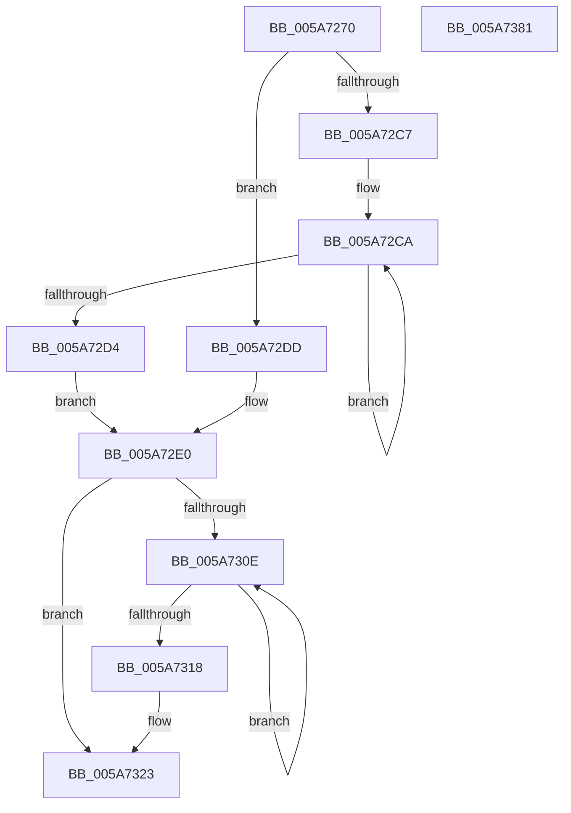

# McTemplateK0jqzjzx_EtwWriteTransfer

- RVA: `0x005A7270`–`0x005A7382` (길이 `274` bytes)
- VA: `0x00000001405A7270`
- 실행 섹션: `.text`
- PDB 이름 있음: `예`; PDB Function 태그: `아니요`
- unwind 정보 RVA: `0x000C87FC`
- 디코드: `65`개 명령, `274/274` bytes 표시
- 미해석 바이트: `0` (있으면 어셈블리에 `.byte`로 보존)

> 이 문서는 커널 이미지의 기계어와 PDB 기호를 분석해 생성했습니다. 4번과 5번은 함수 원형과 자료형을 바이너리 사용 방식에서 추정한 C 해석이며 원본 소스 복구 결과는 아닙니다.

## 1. Dependencies

- 직접 호출 지점: **2**; 고유 호출 대상: **2**
- 직접 호출자로 확인된 함수: **1**
- RIP 상대 이미지 참조: **3**

### Outgoing calls
- `0x005A735F` → [McGenEventWrite_EtwWriteTransfer](../42/McGenEventWrite_EtwWriteTransfer_function_00424FC8.md) (function, `0x00424FC8`)
- `0x005A736B` → [_security_check_cookie](../6A/_security_check_cookie_function_006AC640.md) (function, `0x006AC640`)

### Direct callers
- [PiUEventNotifyUserMode](../../page/95/PiUEventNotifyUserMode_function_00954CB4.md) at `0x0095515F`
- [PiUEventNotifyUserMode](../../page/95/PiUEventNotifyUserMode_function_00954CB4.md) at `0x009551C4`

### Static image references
- `0x005A7282` → RVA `0x00E0A740` (`.data`; read)
- `0x005A72EA` → RVA `0x006CB080` (` ?? ::FNODOBFM::`string'`; read)
- `0x005A7337` → RVA `0x00E06DA0` (`.data`; read)

## 2. Other-region calls and transfers

- 다른 실행 섹션으로 향하는 call: **0**
- 별도 외부 분기/꼬리 이동을 확인하지 못했습니다.

## 3. Assembly (complete function range)

```asm
005A7270  48 89 5C 24 08                  mov qword ptr [rsp + 8], rbx
005A7275  55                              push rbp
005A7276  48 8D 6C 24 D1                  lea rbp, [rsp - 0x2f]
005A727B  48 81 EC B0 00 00 00            sub rsp, 0xb0
005A7282  48 8B 05 B7 34 86 00            mov rax, qword ptr [rip + 0x8634b7]
005A7289  48 33 C4                        xor rax, rsp
005A728C  48 89 45 1F                     mov qword ptr [rbp + 0x1f], rax
005A7290  4C 8B 45 77                     mov r8, qword ptr [rbp + 0x77]
005A7294  48 8D 45 5F                     lea rax, [rbp + 0x5f]
005A7298  45 33 DB                        xor r11d, r11d
005A729B  4C 89 4D BF                     mov qword ptr [rbp - 0x41], r9
005A729F  4C 8B D2                        mov r10, rdx
005A72A2  48 C7 45 C7 10 00 00 00         mov qword ptr [rbp - 0x39], 0x10
005A72AA  48 8B 55 67                     mov rdx, qword ptr [rbp + 0x67]
005A72AE  48 83 C9 FF                     or rcx, 0xffffffffffffffff
005A72B2  48 89 45 CF                     mov qword ptr [rbp - 0x31], rax
005A72B6  48 C7 45 D7 04 00 00 00         mov qword ptr [rbp - 0x29], 4
005A72BE  45 8D 4B 0A                     lea r9d, [r11 + 0xa]
005A72C2  48 85 D2                        test rdx, rdx
005A72C5  74 16                           je 0x1405a72dd
005A72C7  48 8B C1                        mov rax, rcx
005A72CA  48 FF C0                        inc rax
005A72CD  66 44 39 1C 42                  cmp word ptr [rdx + rax*2], r11w
005A72D2  75 F6                           jne 0x1405a72ca
005A72D4  8D 04 45 02 00 00 00            lea eax, [rax*2 + 2]
005A72DB  EB 03                           jmp 0x1405a72e0
005A72DD  41 8B C1                        mov eax, r9d
005A72E0  48 85 D2                        test rdx, rdx
005A72E3  89 45 E7                        mov dword ptr [rbp - 0x19], eax
005A72E6  48 8B 45 6F                     mov rax, qword ptr [rbp + 0x6f]
005A72EA  48 8D 1D 8F 3D 12 00            lea rbx, [rip + 0x123d8f]
005A72F1  48 0F 44 D3                     cmove rdx, rbx
005A72F5  44 89 5D EB                     mov dword ptr [rbp - 0x15], r11d
005A72F9  48 89 55 DF                     mov qword ptr [rbp - 0x21], rdx
005A72FD  48 89 45 EF                     mov qword ptr [rbp - 0x11], rax
005A7301  48 C7 45 F7 10 00 00 00         mov qword ptr [rbp - 9], 0x10
005A7309  4D 85 C0                        test r8, r8
005A730C  74 15                           je 0x1405a7323
005A730E  48 FF C1                        inc rcx
005A7311  66 45 39 1C 48                  cmp word ptr [r8 + rcx*2], r11w
005A7316  75 F6                           jne 0x1405a730e
005A7318  44 8D 0C 4D 02 00 00 00         lea r9d, [rcx*2 + 2]
005A7320  4D 85 C0                        test r8, r8
005A7323  4C 0F 44 C3                     cmove r8, rbx
005A7327  44 89 4D 07                     mov dword ptr [rbp + 7], r9d
005A732B  48 8D 45 7F                     lea rax, [rbp + 0x7f]
005A732F  4C 89 45 FF                     mov qword ptr [rbp - 1], r8
005A7333  48 89 45 0F                     mov qword ptr [rbp + 0xf], rax
005A7337  48 8D 0D 62 FA 85 00            lea rcx, [rip + 0x85fa62]
005A733E  48 8D 45 AF                     lea rax, [rbp - 0x51]
005A7342  44 89 5D 0B                     mov dword ptr [rbp + 0xb], r11d
005A7346  41 B9 07 00 00 00               mov r9d, 7
005A734C  48 89 44 24 20                  mov qword ptr [rsp + 0x20], rax
005A7351  45 33 C0                        xor r8d, r8d
005A7354  48 C7 45 17 08 00 00 00         mov qword ptr [rbp + 0x17], 8
005A735C  49 8B D2                        mov rdx, r10
005A735F  E8 64 DC E7 FF                  call 0x140424fc8
005A7364  48 8B 4D 1F                     mov rcx, qword ptr [rbp + 0x1f]
005A7368  48 33 CC                        xor rcx, rsp
005A736B  E8 D0 52 10 00                  call 0x1406ac640
005A7370  48 8B 9C 24 C0 00 00 00         mov rbx, qword ptr [rsp + 0xc0]
005A7378  48 81 C4 B0 00 00 00            add rsp, 0xb0
005A737F  5D                              pop rbp
005A7380  C3                              ret
005A7381  CC                              int3
```

## 4. C-style interpretation (structured pseudocode)

```c
__int64 __fastcall McTemplateK0jqzjzx_EtwWriteTransfer(__int64 a1, __int64 a2, __int64 a3, __int64 a4, __int64 a5, __int64 a6, __int64 a7, __int64 a8, __int64 a9)
{
    __int64 result;
    __int64 v_r11;
    __int64 v_rsp;
    unsigned __int64 v_stack_m18;
    unsigned __int64 v_stack_m20;
    unsigned __int64 v_stack_m28;
    unsigned int v_stack_m2C;
    unsigned int v_stack_m30;
    unsigned __int64 v_stack_m37;
    unsigned __int64 v_stack_m38;
    unsigned __int64 v_stack_m40;
    unsigned __int64 v_stack_m48;
    unsigned int v_stack_m4C;
    unsigned int v_stack_m50;
    unsigned __int64 v_stack_m58;
    unsigned __int64 v_stack_m60;
    unsigned __int64 v_stack_m68;
    unsigned __int64 v_stack_m70;
    unsigned __int64 v_stack_m78;
    unsigned __int64 v_stack_m88;
    unsigned __int64 v_stack_m98;
    unsigned __int64 v_stack_p8;

    v_stack_p8 = v_rbx;
    v_rsp = (v_rsp) - (176);
    result = (*(unsigned __int64 *)(v_rip + 8795319)) ^ (v_rsp);
    v_stack_m18 = result;
    v_r11 = 0;
    v_stack_m78 = a4;
    v_stack_m70 = 16;
    a1 = (a1) | (-1);
    v_stack_m68 = a5;
    v_stack_m60 = 4;
    if (a6 == 0) goto loc_005A72DD;
loc_005A72CA:
    result = (a1) + 1;
    if ((*(unsigned __int16 *)(a6 + result * 2)) != 0) goto loc_005A72CA;
    goto loc_005A72E0;
loc_005A72DD:
loc_005A72E0:
    v_stack_m50 = (unsigned int)((unsigned int)((unsigned int)(v_r11 + 10)));
    if (a6 == 0) { a6 = v_rip + 1195407; }
    v_stack_m4C = 0;
    v_stack_m58 = a6;
    v_stack_m48 = a7;
    v_stack_m40 = 16;
    if (a8 == 0) goto loc_005A7323;
loc_005A730E:
    a1 = (a1) + 1;
    if ((*(unsigned __int16 *)(a8 + a1 * 2)) != 0) goto loc_005A730E;
loc_005A7323:
    if (a8 == 0) { a8 = v_rip + 1195407; }
    v_stack_m30 = (unsigned int)(a1 * 2 + 2);
    v_stack_m38 = a8;
    v_stack_m28 = a9;
    v_stack_m2C = 0;
    v_stack_m98 = v_stack_m88;
    a3 = 0;
    v_stack_m20 = 8;
    result = McGenEventWrite_EtwWriteTransfer(v_rip + 8780386, a2, a3, 7);
    a1 = (v_stack_m18) ^ (v_rsp);
    result = _security_check_cookie(a1, a2, a3, 7);
    v_rsp = (v_rsp) + (176);
    return result;
}
```

## 5. (Beta) C Style

```c
int64_t McTemplateK0jqzjzx_EtwWriteTransfer(int64_t Arg1, int64_t Arg2, int64_t Arg3, int64_t Arg4, int64_t Arg5, int64_t Arg6, int64_t Arg7, int64_t Arg8, int64_t Arg9)
{
    int64_t result;
    int64_t local_r11;
    int64_t local_rsp;
    uint64_t v_stack_m18;
    uint64_t v_stack_m20;
    uint64_t v_stack_m28;
    uint32_t v_stack_m2C;
    uint32_t v_stack_m30;
    uint64_t v_stack_m37;
    uint64_t v_stack_m38;
    uint64_t v_stack_m40;
    uint64_t v_stack_m48;
    uint32_t v_stack_m4C;
    uint32_t v_stack_m50;
    uint64_t v_stack_m58;
    uint64_t v_stack_m60;
    uint64_t v_stack_m68;
    uint64_t v_stack_m70;
    uint64_t v_stack_m78;
    uint64_t v_stack_m88;
    uint64_t v_stack_m98;
    uint64_t v_stack_p8;

    v_stack_p8 = local_rbx;
    local_rsp = (local_rsp) - (176);
    result = (*(uint64_t *)(v_rip + 0x8634B7)) ^ (local_rsp);
    v_stack_m18 = result;
    local_r11 = 0;
    v_stack_m78 = Arg4;
    v_stack_m70 = 16;
    Arg1 = (Arg1) | (-1);
    v_stack_m68 = Arg5;
    v_stack_m60 = 4;
    if (Arg6 == 0) goto loc_005A72DD;
loc_005A72CA:
    result = (Arg1) + 1;
    if ((*(uint16_t *)(Arg6 + result * 2)) != 0) goto loc_005A72CA;
    goto loc_005A72E0;
loc_005A72DD:
loc_005A72E0:
    v_stack_m50 = (uint32_t)((uint32_t)((uint32_t)(local_r11 + 10)));
    if (Arg6 == 0) { Arg6 = v_rip + 1195407; }
    v_stack_m4C = 0;
    v_stack_m58 = Arg6;
    v_stack_m48 = Arg7;
    v_stack_m40 = 16;
    if (Arg8 == 0) goto loc_005A7323;
loc_005A730E:
    Arg1 = (Arg1) + 1;
    if ((*(uint16_t *)(Arg8 + Arg1 * 2)) != 0) goto loc_005A730E;
loc_005A7323:
    if (Arg8 == 0) { Arg8 = v_rip + 1195407; }
    v_stack_m30 = (uint32_t)(Arg1 * 2 + 2);
    v_stack_m38 = Arg8;
    v_stack_m28 = Arg9;
    v_stack_m2C = 0;
    v_stack_m98 = v_stack_m88;
    Arg3 = 0;
    v_stack_m20 = 8;
    result = McGenEventWrite_EtwWriteTransfer(v_rip + 8780386, Arg2, Arg3, 7);
    Arg1 = (v_stack_m18) ^ (local_rsp);
    result = _security_check_cookie(Arg1, Arg2, Arg3, 7);
    local_rsp = (local_rsp) + (176);
    return result;
}
```

## 6. Execution-region graph

[열기: 2D/3D 그래프와 함수 탐색 컨트롤 패널](../../../control-panel.html?section=text&rva=0x005A7270&view=graph)

- 2D 그래프는 위에서 아래로 흐르고, 3D 그래프는 빈 공간을 드래그해 회전합니다. Shift+드래그는 이동, 휠은 확대·축소, 함수 노드 선택은 대상 보고서 이동입니다.

### Static fallback


