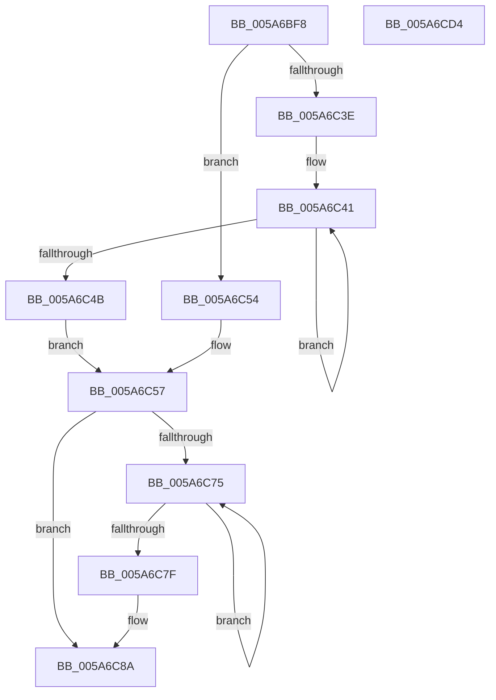

# McTemplateK0pzz_EtwWriteTransfer

- RVA: `0x005A6BF8`–`0x005A6CD5` (길이 `221` bytes)
- VA: `0x00000001405A6BF8`
- 실행 섹션: `.text`
- PDB 이름 있음: `예`; PDB Function 태그: `아니요`
- unwind 정보 RVA: `0x000C6178`
- 디코드: `55`개 명령, `221/221` bytes 표시
- 미해석 바이트: `0` (있으면 어셈블리에 `.byte`로 보존)

> 이 문서는 커널 이미지의 기계어와 PDB 기호를 분석해 생성했습니다. 4번과 5번은 함수 원형과 자료형을 바이너리 사용 방식에서 추정한 C 해석이며 원본 소스 복구 결과는 아닙니다.

## 1. Dependencies

- 직접 호출 지점: **2**; 고유 호출 대상: **2**
- 직접 호출자로 확인된 함수: **1**
- RIP 상대 이미지 참조: **4**

### Outgoing calls
- `0x005A6CBA` → [McGenEventWrite_EtwWriteTransfer](../42/McGenEventWrite_EtwWriteTransfer_function_00424FC8.md) (function, `0x00424FC8`)
- `0x005A6CC6` → [_security_check_cookie](../6A/_security_check_cookie_function_006AC640.md) (function, `0x006AC640`)

### Direct callers
- [PiProcessNewDeviceNode](../../page/A2/PiProcessNewDeviceNode_function_00A28F20.md) at `0x00A292AA`

### Static image references
- `0x005A6C08` → RVA `0x00E0A740` (`.data`; read)
- `0x005A6C5D` → RVA `0x006CB080` (` ?? ::FNODOBFM::`string'`; read)
- `0x005A6CAC` → RVA `0x00026F40` (`.rdata`; read)
- `0x005A6CB3` → RVA `0x00E06DA0` (`.data`; read)

## 2. Other-region calls and transfers

- 다른 실행 섹션으로 향하는 call: **0**
- 별도 외부 분기/꼬리 이동을 확인하지 못했습니다.

## 3. Assembly (complete function range)

```asm
005A6BF8  4C 89 4C 24 20                  mov qword ptr [rsp + 0x20], r9
005A6BFD  55                              push rbp
005A6BFE  48 8B EC                        mov rbp, rsp
005A6C01  48 81 EC 80 00 00 00            sub rsp, 0x80
005A6C08  48 8B 05 31 3B 86 00            mov rax, qword ptr [rip + 0x863b31]
005A6C0F  48 33 C4                        xor rax, rsp
005A6C12  48 89 45 F0                     mov qword ptr [rbp - 0x10], rax
005A6C16  48 8B 4D 30                     mov rcx, qword ptr [rbp + 0x30]
005A6C1A  48 8D 45 28                     lea rax, [rbp + 0x28]
005A6C1E  4C 8B 45 38                     mov r8, qword ptr [rbp + 0x38]
005A6C22  45 33 D2                        xor r10d, r10d
005A6C25  48 89 45 C0                     mov qword ptr [rbp - 0x40], rax
005A6C29  48 83 C8 FF                     or rax, 0xffffffffffffffff
005A6C2D  48 C7 45 C8 08 00 00 00         mov qword ptr [rbp - 0x38], 8
005A6C35  45 8D 4A 0A                     lea r9d, [r10 + 0xa]
005A6C39  48 85 C9                        test rcx, rcx
005A6C3C  74 16                           je 0x1405a6c54
005A6C3E  48 8B D0                        mov rdx, rax
005A6C41  48 FF C2                        inc rdx
005A6C44  66 44 39 14 51                  cmp word ptr [rcx + rdx*2], r10w
005A6C49  75 F6                           jne 0x1405a6c41
005A6C4B  8D 14 55 02 00 00 00            lea edx, [rdx*2 + 2]
005A6C52  EB 03                           jmp 0x1405a6c57
005A6C54  41 8B D1                        mov edx, r9d
005A6C57  48 85 C9                        test rcx, rcx
005A6C5A  89 55 D8                        mov dword ptr [rbp - 0x28], edx
005A6C5D  4C 8D 1D 1C 44 12 00            lea r11, [rip + 0x12441c]
005A6C64  44 89 55 DC                     mov dword ptr [rbp - 0x24], r10d
005A6C68  49 0F 44 CB                     cmove rcx, r11
005A6C6C  48 89 4D D0                     mov qword ptr [rbp - 0x30], rcx
005A6C70  4D 85 C0                        test r8, r8
005A6C73  74 15                           je 0x1405a6c8a
005A6C75  48 FF C0                        inc rax
005A6C78  66 45 39 14 40                  cmp word ptr [r8 + rax*2], r10w
005A6C7D  75 F6                           jne 0x1405a6c75
005A6C7F  44 8D 0C 45 02 00 00 00         lea r9d, [rax*2 + 2]
005A6C87  4D 85 C0                        test r8, r8
005A6C8A  4D 0F 44 C3                     cmove r8, r11
005A6C8E  44 89 4D E8                     mov dword ptr [rbp - 0x18], r9d
005A6C92  4C 89 45 E0                     mov qword ptr [rbp - 0x20], r8
005A6C96  48 8D 45 B0                     lea rax, [rbp - 0x50]
005A6C9A  45 33 C0                        xor r8d, r8d
005A6C9D  44 89 55 EC                     mov dword ptr [rbp - 0x14], r10d
005A6CA1  41 B9 04 00 00 00               mov r9d, 4
005A6CA7  48 89 44 24 20                  mov qword ptr [rsp + 0x20], rax
005A6CAC  48 8D 15 8D 02 A8 FF            lea rdx, [rip - 0x57fd73]
005A6CB3  48 8D 0D E6 00 86 00            lea rcx, [rip + 0x8600e6]
005A6CBA  E8 09 E3 E7 FF                  call 0x140424fc8
005A6CBF  48 8B 4D F0                     mov rcx, qword ptr [rbp - 0x10]
005A6CC3  48 33 CC                        xor rcx, rsp
005A6CC6  E8 75 59 10 00                  call 0x1406ac640
005A6CCB  48 81 C4 80 00 00 00            add rsp, 0x80
005A6CD2  5D                              pop rbp
005A6CD3  C3                              ret
005A6CD4  CC                              int3
```

## 4. C-style interpretation (structured pseudocode)

```c
__int64 __fastcall McTemplateK0pzz_EtwWriteTransfer(__int64 a1, __int64 a2, __int64 a3, __int64 a4, __int64 a5, __int64 a6)
{
    __int64 result;
    __int64 v_r10;
    __int64 v_rsp;
    unsigned __int64 v_stack_m18;
    unsigned int v_stack_m1C;
    unsigned int v_stack_m20;
    unsigned __int64 v_stack_m28;
    unsigned int v_stack_m2C;
    unsigned int v_stack_m30;
    unsigned __int64 v_stack_m38;
    unsigned __int64 v_stack_m40;
    unsigned __int64 v_stack_m48;
    unsigned __int64 v_stack_m58;
    unsigned __int64 v_stack_m68;
    unsigned __int64 v_stack_p20;

    v_stack_p20 = a4;
    v_rsp = (v_rsp) - (128);
    result = (*(unsigned __int64 *)(v_rip + 8796977)) ^ (v_rsp);
    v_stack_m18 = result;
    v_r10 = 0;
    v_stack_m48 = v_stack_p20;
    result = (v_stack_p20) | (-1);
    v_stack_m40 = 8;
    if (a5 == 0) goto loc_005A6C54;
loc_005A6C41:
    a2 = (result) + 1;
    if ((*(unsigned __int16 *)(a5 + a2 * 2)) != 0) goto loc_005A6C41;
    goto loc_005A6C57;
loc_005A6C54:
loc_005A6C57:
    v_stack_m30 = (unsigned int)((unsigned int)((unsigned int)(v_r10 + 10)));
    v_stack_m2C = 0;
    if (a5 == 0) { a5 = v_rip + 1197084; }
    v_stack_m38 = a5;
    if (a6 == 0) goto loc_005A6C8A;
loc_005A6C75:
    result = (result) + 1;
    if ((*(unsigned __int16 *)(a6 + result * 2)) != 0) goto loc_005A6C75;
loc_005A6C8A:
    if (a6 == 0) { a6 = v_rip + 1197084; }
    v_stack_m20 = (unsigned int)(result * 2 + 2);
    v_stack_m28 = a6;
    a3 = 0;
    v_stack_m1C = 0;
    v_stack_m68 = v_stack_m58;
    result = McGenEventWrite_EtwWriteTransfer(v_rip + 8782054, v_rip - 5766515, a3, 4);
    a1 = (v_stack_m18) ^ (v_rsp);
    result = _security_check_cookie(a1, v_rip - 5766515, a3, 4);
    v_rsp = (v_rsp) + (128);
    return result;
}
```

## 5. (Beta) C Style

```c
int64_t McTemplateK0pzz_EtwWriteTransfer(int64_t Arg1, int64_t Arg2, int64_t Arg3, int64_t Arg4, int64_t Arg5, int64_t Arg6)
{
    int64_t result;
    int64_t local_r10;
    int64_t local_rsp;
    uint64_t v_stack_m18;
    uint32_t v_stack_m1C;
    uint32_t v_stack_m20;
    uint64_t v_stack_m28;
    uint32_t v_stack_m2C;
    uint32_t v_stack_m30;
    uint64_t v_stack_m38;
    uint64_t v_stack_m40;
    uint64_t v_stack_m48;
    uint64_t v_stack_m58;
    uint64_t v_stack_m68;
    uint64_t v_stack_p20;

    v_stack_p20 = Arg4;
    local_rsp = (local_rsp) - (128);
    result = (*(uint64_t *)(v_rip + 0x863B31)) ^ (local_rsp);
    v_stack_m18 = result;
    local_r10 = 0;
    v_stack_m48 = v_stack_p20;
    result = (v_stack_p20) | (-1);
    v_stack_m40 = 8;
    if (Arg5 == 0) goto loc_005A6C54;
loc_005A6C41:
    Arg2 = (result) + 1;
    if ((*(uint16_t *)(Arg5 + Arg2 * 2)) != 0) goto loc_005A6C41;
    goto loc_005A6C57;
loc_005A6C54:
loc_005A6C57:
    v_stack_m30 = (uint32_t)((uint32_t)((uint32_t)(local_r10 + 10)));
    v_stack_m2C = 0;
    if (Arg5 == 0) { Arg5 = v_rip + 1197084; }
    v_stack_m38 = Arg5;
    if (Arg6 == 0) goto loc_005A6C8A;
loc_005A6C75:
    result = (result) + 1;
    if ((*(uint16_t *)(Arg6 + result * 2)) != 0) goto loc_005A6C75;
loc_005A6C8A:
    if (Arg6 == 0) { Arg6 = v_rip + 1197084; }
    v_stack_m20 = (uint32_t)(result * 2 + 2);
    v_stack_m28 = Arg6;
    Arg3 = 0;
    v_stack_m1C = 0;
    v_stack_m68 = v_stack_m58;
    result = McGenEventWrite_EtwWriteTransfer(v_rip + 8782054, v_rip - 5766515, Arg3, 4);
    Arg1 = (v_stack_m18) ^ (local_rsp);
    result = _security_check_cookie(Arg1, v_rip - 5766515, Arg3, 4);
    local_rsp = (local_rsp) + (128);
    return result;
}
```

## 6. Execution-region graph

[열기: 2D/3D 그래프와 함수 탐색 컨트롤 패널](../../../control-panel.html?section=text&rva=0x005A6BF8&view=graph)

- 2D 그래프는 위에서 아래로 흐르고, 3D 그래프는 빈 공간을 드래그해 회전합니다. Shift+드래그는 이동, 휠은 확대·축소, 함수 노드 선택은 대상 보고서 이동입니다.

### Static fallback


