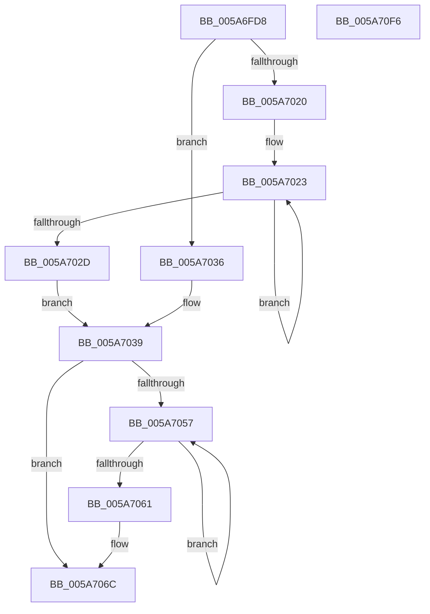

# McTemplateK0pzzqdqd_EtwWriteTransfer

- RVA: `0x005A6FD8`–`0x005A70F7` (길이 `287` bytes)
- VA: `0x00000001405A6FD8`
- 실행 섹션: `.text`
- PDB 이름 있음: `예`; PDB Function 태그: `아니요`
- unwind 정보 RVA: `0x0006CFB4`
- 디코드: `67`개 명령, `287/287` bytes 표시
- 미해석 바이트: `0` (있으면 어셈블리에 `.byte`로 보존)

> 이 문서는 커널 이미지의 기계어와 PDB 기호를 분석해 생성했습니다. 4번과 5번은 함수 원형과 자료형을 바이너리 사용 방식에서 추정한 C 해석이며 원본 소스 복구 결과는 아닙니다.

## 1. Dependencies

- 직접 호출 지점: **2**; 고유 호출 대상: **2**
- 직접 호출자로 확인된 함수: **2**
- RIP 상대 이미지 참조: **4**

### Outgoing calls
- `0x005A70DC` → [McGenEventWrite_EtwWriteTransfer](../42/McGenEventWrite_EtwWriteTransfer_function_00424FC8.md) (function, `0x00424FC8`)
- `0x005A70E8` → [_security_check_cookie](../6A/_security_check_cookie_function_006AC640.md) (function, `0x006AC640`)

### Direct callers
- [PipSetDevNodeProblem](../../page/8F/PipSetDevNodeProblem_function_008FDE0C.md) at `0x008FE071`
- [PipClearDevNodeProblem](../../page/A2/PipClearDevNodeProblem_function_00A27C8C.md) at `0x00A27E47`

### Static image references
- `0x005A6FEA` → RVA `0x00E0A740` (`.data`; read)
- `0x005A703F` → RVA `0x006CB080` (` ?? ::FNODOBFM::`string'`; read)
- `0x005A7080` → RVA `0x000275A0` (`.rdata`; read)
- `0x005A7093` → RVA `0x00E06DA0` (`.data`; read)

## 2. Other-region calls and transfers

- 다른 실행 섹션으로 향하는 call: **0**
- 별도 외부 분기/꼬리 이동을 확인하지 못했습니다.

## 3. Assembly (complete function range)

```asm
005A6FD8  4C 89 4C 24 20                  mov qword ptr [rsp + 0x20], r9
005A6FDD  55                              push rbp
005A6FDE  48 8D 6C 24 D9                  lea rbp, [rsp - 0x27]
005A6FE3  48 81 EC C0 00 00 00            sub rsp, 0xc0
005A6FEA  48 8B 05 4F 37 86 00            mov rax, qword ptr [rip + 0x86374f]
005A6FF1  48 33 C4                        xor rax, rsp
005A6FF4  48 89 45 17                     mov qword ptr [rbp + 0x17], rax
005A6FF8  48 8B 4D 57                     mov rcx, qword ptr [rbp + 0x57]
005A6FFC  48 8D 45 4F                     lea rax, [rbp + 0x4f]
005A7000  4C 8B 45 5F                     mov r8, qword ptr [rbp + 0x5f]
005A7004  45 33 D2                        xor r10d, r10d
005A7007  48 89 45 A7                     mov qword ptr [rbp - 0x59], rax
005A700B  48 83 C8 FF                     or rax, 0xffffffffffffffff
005A700F  48 C7 45 AF 08 00 00 00         mov qword ptr [rbp - 0x51], 8
005A7017  45 8D 4A 0A                     lea r9d, [r10 + 0xa]
005A701B  48 85 C9                        test rcx, rcx
005A701E  74 16                           je 0x1405a7036
005A7020  48 8B D0                        mov rdx, rax
005A7023  48 FF C2                        inc rdx
005A7026  66 44 39 14 51                  cmp word ptr [rcx + rdx*2], r10w
005A702B  75 F6                           jne 0x1405a7023
005A702D  8D 14 55 02 00 00 00            lea edx, [rdx*2 + 2]
005A7034  EB 03                           jmp 0x1405a7039
005A7036  41 8B D1                        mov edx, r9d
005A7039  48 85 C9                        test rcx, rcx
005A703C  89 55 BF                        mov dword ptr [rbp - 0x41], edx
005A703F  4C 8D 1D 3A 40 12 00            lea r11, [rip + 0x12403a]
005A7046  44 89 55 C3                     mov dword ptr [rbp - 0x3d], r10d
005A704A  49 0F 44 CB                     cmove rcx, r11
005A704E  48 89 4D B7                     mov qword ptr [rbp - 0x49], rcx
005A7052  4D 85 C0                        test r8, r8
005A7055  74 15                           je 0x1405a706c
005A7057  48 FF C0                        inc rax
005A705A  66 45 39 14 40                  cmp word ptr [r8 + rax*2], r10w
005A705F  75 F6                           jne 0x1405a7057
005A7061  44 8D 0C 45 02 00 00 00         lea r9d, [rax*2 + 2]
005A7069  4D 85 C0                        test r8, r8
005A706C  4D 0F 44 C3                     cmove r8, r11
005A7070  44 89 4D CF                     mov dword ptr [rbp - 0x31], r9d
005A7074  48 8D 45 67                     lea rax, [rbp + 0x67]
005A7078  4C 89 45 C7                     mov qword ptr [rbp - 0x39], r8
005A707C  48 89 45 D7                     mov qword ptr [rbp - 0x29], rax
005A7080  48 8D 15 19 05 A8 FF            lea rdx, [rip - 0x57fae7]
005A7087  48 8D 45 6F                     lea rax, [rbp + 0x6f]
005A708B  44 89 55 D3                     mov dword ptr [rbp - 0x2d], r10d
005A708F  48 89 45 E7                     mov qword ptr [rbp - 0x19], rax
005A7093  48 8D 0D 06 FD 85 00            lea rcx, [rip + 0x85fd06]
005A709A  48 8D 45 77                     lea rax, [rbp + 0x77]
005A709E  48 C7 45 DF 04 00 00 00         mov qword ptr [rbp - 0x21], 4
005A70A6  48 89 45 F7                     mov qword ptr [rbp - 9], rax
005A70AA  41 B9 08 00 00 00               mov r9d, 8
005A70B0  48 8D 45 7F                     lea rax, [rbp + 0x7f]
005A70B4  48 C7 45 EF 04 00 00 00         mov qword ptr [rbp - 0x11], 4
005A70BC  48 89 45 07                     mov qword ptr [rbp + 7], rax
005A70C0  45 33 C0                        xor r8d, r8d
005A70C3  48 8D 45 97                     lea rax, [rbp - 0x69]
005A70C7  48 C7 45 FF 04 00 00 00         mov qword ptr [rbp - 1], 4
005A70CF  48 89 44 24 20                  mov qword ptr [rsp + 0x20], rax
005A70D4  48 C7 45 0F 04 00 00 00         mov qword ptr [rbp + 0xf], 4
005A70DC  E8 E7 DE E7 FF                  call 0x140424fc8
005A70E1  48 8B 4D 17                     mov rcx, qword ptr [rbp + 0x17]
005A70E5  48 33 CC                        xor rcx, rsp
005A70E8  E8 53 55 10 00                  call 0x1406ac640
005A70ED  48 81 C4 C0 00 00 00            add rsp, 0xc0
005A70F4  5D                              pop rbp
005A70F5  C3                              ret
005A70F6  CC                              int3
```

## 4. C-style interpretation (structured pseudocode)

```c
__int64 __fastcall McTemplateK0pzzqdqd_EtwWriteTransfer(__int64 a1, __int64 a2, __int64 a3, __int64 a4, __int64 a5, __int64 a6, __int64 a7, __int64 a8, __int64 a9, __int64 a10)
{
    __int64 result;
    __int64 v_r10;
    __int64 v_rsp;
    unsigned __int64 v_stack_m18;
    unsigned __int64 v_stack_m20;
    unsigned __int64 v_stack_m28;
    unsigned __int64 v_stack_m2F;
    unsigned __int64 v_stack_m30;
    unsigned __int64 v_stack_m38;
    unsigned __int64 v_stack_m40;
    unsigned __int64 v_stack_m48;
    unsigned __int64 v_stack_m50;
    unsigned __int64 v_stack_m58;
    unsigned int v_stack_m5C;
    unsigned int v_stack_m60;
    unsigned __int64 v_stack_m68;
    unsigned int v_stack_m6C;
    unsigned int v_stack_m70;
    unsigned __int64 v_stack_m78;
    unsigned __int64 v_stack_m80;
    unsigned __int64 v_stack_m88;
    unsigned __int64 v_stack_m98;
    unsigned __int64 v_stack_mA8;
    unsigned __int64 v_stack_p20;

    v_stack_p20 = a4;
    v_rsp = (v_rsp) - (192);
    result = (*(unsigned __int64 *)(v_rip + 8795983)) ^ (v_rsp);
    v_stack_m18 = result;
    v_r10 = 0;
    v_stack_m88 = v_stack_p20;
    result = (v_stack_p20) | (-1);
    v_stack_m80 = 8;
    if (a5 == 0) goto loc_005A7036;
loc_005A7023:
    a2 = (result) + 1;
    if ((*(unsigned __int16 *)(a5 + a2 * 2)) != 0) goto loc_005A7023;
    goto loc_005A7039;
loc_005A7036:
loc_005A7039:
    v_stack_m70 = (unsigned int)((unsigned int)((unsigned int)(v_r10 + 10)));
    v_stack_m6C = 0;
    if (a5 == 0) { a5 = v_rip + 1196090; }
    v_stack_m78 = a5;
    if (a6 == 0) goto loc_005A706C;
loc_005A7057:
    result = (result) + 1;
    if ((*(unsigned __int16 *)(a6 + result * 2)) != 0) goto loc_005A7057;
loc_005A706C:
    if (a6 == 0) { a6 = v_rip + 1196090; }
    v_stack_m60 = (unsigned int)(result * 2 + 2);
    v_stack_m68 = a6;
    v_stack_m58 = a7;
    v_stack_m5C = 0;
    v_stack_m48 = a8;
    v_stack_m50 = 4;
    v_stack_m38 = a9;
    v_stack_m40 = 4;
    v_stack_m28 = a10;
    a3 = 0;
    v_stack_m30 = 4;
    v_stack_mA8 = v_stack_m98;
    v_stack_m20 = 4;
    result = McGenEventWrite_EtwWriteTransfer(v_rip + 8781062, v_rip - 5765863, a3, 8);
    a1 = (v_stack_m18) ^ (v_rsp);
    result = _security_check_cookie(a1, v_rip - 5765863, a3, 8);
    v_rsp = (v_rsp) + (192);
    return result;
}
```

## 5. (Beta) C Style

```c
int64_t McTemplateK0pzzqdqd_EtwWriteTransfer(int64_t Arg1, int64_t Arg2, int64_t Arg3, int64_t Arg4, int64_t Arg5, int64_t Arg6, int64_t Arg7, int64_t Arg8, int64_t Arg9, int64_t Arg10)
{
    int64_t result;
    int64_t local_r10;
    int64_t local_rsp;
    uint64_t v_stack_m18;
    uint64_t v_stack_m20;
    uint64_t v_stack_m28;
    uint64_t v_stack_m2F;
    uint64_t v_stack_m30;
    uint64_t v_stack_m38;
    uint64_t v_stack_m40;
    uint64_t v_stack_m48;
    uint64_t v_stack_m50;
    uint64_t v_stack_m58;
    uint32_t v_stack_m5C;
    uint32_t v_stack_m60;
    uint64_t v_stack_m68;
    uint32_t v_stack_m6C;
    uint32_t v_stack_m70;
    uint64_t v_stack_m78;
    uint64_t v_stack_m80;
    uint64_t v_stack_m88;
    uint64_t v_stack_m98;
    uint64_t v_stack_mA8;
    uint64_t v_stack_p20;

    v_stack_p20 = Arg4;
    local_rsp = (local_rsp) - (192);
    result = (*(uint64_t *)(v_rip + 0x86374F)) ^ (local_rsp);
    v_stack_m18 = result;
    local_r10 = 0;
    v_stack_m88 = v_stack_p20;
    result = (v_stack_p20) | (-1);
    v_stack_m80 = 8;
    if (Arg5 == 0) goto loc_005A7036;
loc_005A7023:
    Arg2 = (result) + 1;
    if ((*(uint16_t *)(Arg5 + Arg2 * 2)) != 0) goto loc_005A7023;
    goto loc_005A7039;
loc_005A7036:
loc_005A7039:
    v_stack_m70 = (uint32_t)((uint32_t)((uint32_t)(local_r10 + 10)));
    v_stack_m6C = 0;
    if (Arg5 == 0) { Arg5 = v_rip + 1196090; }
    v_stack_m78 = Arg5;
    if (Arg6 == 0) goto loc_005A706C;
loc_005A7057:
    result = (result) + 1;
    if ((*(uint16_t *)(Arg6 + result * 2)) != 0) goto loc_005A7057;
loc_005A706C:
    if (Arg6 == 0) { Arg6 = v_rip + 1196090; }
    v_stack_m60 = (uint32_t)(result * 2 + 2);
    v_stack_m68 = Arg6;
    v_stack_m58 = Arg7;
    v_stack_m5C = 0;
    v_stack_m48 = Arg8;
    v_stack_m50 = 4;
    v_stack_m38 = Arg9;
    v_stack_m40 = 4;
    v_stack_m28 = Arg10;
    Arg3 = 0;
    v_stack_m30 = 4;
    v_stack_mA8 = v_stack_m98;
    v_stack_m20 = 4;
    result = McGenEventWrite_EtwWriteTransfer(v_rip + 8781062, v_rip - 5765863, Arg3, 8);
    Arg1 = (v_stack_m18) ^ (local_rsp);
    result = _security_check_cookie(Arg1, v_rip - 5765863, Arg3, 8);
    local_rsp = (local_rsp) + (192);
    return result;
}
```

## 6. Execution-region graph

[열기: 2D/3D 그래프와 함수 탐색 컨트롤 패널](../../../control-panel.html?section=text&rva=0x005A6FD8&view=graph)

- 2D 그래프는 위에서 아래로 흐르고, 3D 그래프는 빈 공간을 드래그해 회전합니다. Shift+드래그는 이동, 휠은 확대·축소, 함수 노드 선택은 대상 보고서 이동입니다.

### Static fallback


