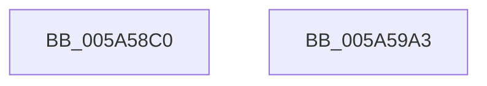

# McTemplateK0qhzr1jxjhzr6_EtwWriteTransfer

- RVA: `0x005A58C0`–`0x005A59A4` (길이 `228` bytes)
- VA: `0x00000001405A58C0`
- 실행 섹션: `.text`
- PDB 이름 있음: `예`; PDB Function 태그: `아니요`
- unwind 정보 RVA: `0x000C8458`
- 디코드: `51`개 명령, `228/228` bytes 표시
- 미해석 바이트: `0` (있으면 어셈블리에 `.byte`로 보존)

> 이 문서는 커널 이미지의 기계어와 PDB 기호를 분석해 생성했습니다. 4번과 5번은 함수 원형과 자료형을 바이너리 사용 방식에서 추정한 C 해석이며 원본 소스 복구 결과는 아닙니다.

## 1. Dependencies

- 직접 호출 지점: **2**; 고유 호출 대상: **2**
- 직접 호출자로 확인된 함수: **1**
- RIP 상대 이미지 참조: **3**

### Outgoing calls
- `0x005A5989` → [McGenEventWrite_EtwWriteTransfer](../42/McGenEventWrite_EtwWriteTransfer_function_00424FC8.md) (function, `0x00424FC8`)
- `0x005A5995` → [_security_check_cookie](../6A/_security_check_cookie_function_006AC640.md) (function, `0x006AC640`)

### Direct callers
- [sub_00B26652](../../page/B2/Unknown_function_00B26652.md) at `0x00B266A2`

### Static image references
- `0x005A58D2` → RVA `0x00E0A740` (`.data`; read)
- `0x005A58FB` → RVA `0x00027110` (`.rdata`; read)
- `0x005A5916` → RVA `0x00E06DA0` (`.data`; read)

## 2. Other-region calls and transfers

- 다른 실행 섹션으로 향하는 call: **0**
- 별도 외부 분기/꼬리 이동을 확인하지 못했습니다.

## 3. Assembly (complete function range)

```asm
005A58C0  44 89 4C 24 20                  mov dword ptr [rsp + 0x20], r9d
005A58C5  55                              push rbp
005A58C6  48 8D 6C 24 E1                  lea rbp, [rsp - 0x1f]
005A58CB  48 81 EC D0 00 00 00            sub rsp, 0xd0
005A58D2  48 8B 05 67 4E 86 00            mov rax, qword ptr [rip + 0x864e67]
005A58D9  48 33 C4                        xor rax, rsp
005A58DC  48 89 45 0F                     mov qword ptr [rbp + 0xf], rax
005A58E0  45 33 C0                        xor r8d, r8d
005A58E3  48 C7 45 97 04 00 00 00         mov qword ptr [rbp - 0x69], 4
005A58EB  48 8D 45 47                     lea rax, [rbp + 0x47]
005A58EF  48 C7 45 A7 02 00 00 00         mov qword ptr [rbp - 0x59], 2
005A58F7  48 89 45 8F                     mov qword ptr [rbp - 0x71], rax
005A58FB  48 8D 15 0E 18 A8 FF            lea rdx, [rip - 0x57e7f2]
005A5902  48 8D 45 4F                     lea rax, [rbp + 0x4f]
005A5906  44 89 45 BB                     mov dword ptr [rbp - 0x45], r8d
005A590A  48 89 45 9F                     mov qword ptr [rbp - 0x61], rax
005A590E  45 8D 48 09                     lea r9d, [r8 + 9]
005A5912  48 8B 45 57                     mov rax, qword ptr [rbp + 0x57]
005A5916  48 8D 0D 83 14 86 00            lea rcx, [rip + 0x861483]
005A591D  48 89 45 AF                     mov qword ptr [rbp - 0x51], rax
005A5921  0F B7 45 4F                     movzx eax, word ptr [rbp + 0x4f]
005A5925  03 C0                           add eax, eax
005A5927  48 C7 45 C7 10 00 00 00         mov qword ptr [rbp - 0x39], 0x10
005A592F  89 45 B7                        mov dword ptr [rbp - 0x49], eax
005A5932  48 8B 45 5F                     mov rax, qword ptr [rbp + 0x5f]
005A5936  48 89 45 BF                     mov qword ptr [rbp - 0x41], rax
005A593A  48 8D 45 67                     lea rax, [rbp + 0x67]
005A593E  48 89 45 CF                     mov qword ptr [rbp - 0x31], rax
005A5942  48 8B 45 6F                     mov rax, qword ptr [rbp + 0x6f]
005A5946  48 89 45 DF                     mov qword ptr [rbp - 0x21], rax
005A594A  48 8D 45 77                     lea rax, [rbp + 0x77]
005A594E  48 89 45 EF                     mov qword ptr [rbp - 0x11], rax
005A5952  48 8B 45 7F                     mov rax, qword ptr [rbp + 0x7f]
005A5956  48 89 45 FF                     mov qword ptr [rbp - 1], rax
005A595A  0F B7 45 77                     movzx eax, word ptr [rbp + 0x77]
005A595E  03 C0                           add eax, eax
005A5960  48 C7 45 D7 08 00 00 00         mov qword ptr [rbp - 0x29], 8
005A5968  89 45 07                        mov dword ptr [rbp + 7], eax
005A596B  48 8D 44 24 30                  lea rax, [rsp + 0x30]
005A5970  48 89 44 24 20                  mov qword ptr [rsp + 0x20], rax
005A5975  48 C7 45 E7 10 00 00 00         mov qword ptr [rbp - 0x19], 0x10
005A597D  48 C7 45 F7 02 00 00 00         mov qword ptr [rbp - 9], 2
005A5985  44 89 45 0B                     mov dword ptr [rbp + 0xb], r8d
005A5989  E8 3A F6 E7 FF                  call 0x140424fc8
005A598E  48 8B 4D 0F                     mov rcx, qword ptr [rbp + 0xf]
005A5992  48 33 CC                        xor rcx, rsp
005A5995  E8 A6 6C 10 00                  call 0x1406ac640
005A599A  48 81 C4 D0 00 00 00            add rsp, 0xd0
005A59A1  5D                              pop rbp
005A59A2  C3                              ret
005A59A3  CC                              int3
```

## 4. C-style interpretation (structured pseudocode)

```c
__int64 __fastcall McTemplateK0qhzr1jxjhzr6_EtwWriteTransfer(__int64 a1, __int64 a2, int a3, int a4, unsigned __int16 a5, __int64 a6, __int64 a7, __int64 a8, __int64 a9, unsigned __int16 a10, __int64 a11)
{
    __int64 result;
    __int64 v_rsp;
    unsigned __int64 v_stack_m18;
    unsigned int v_stack_m1C;
    unsigned int v_stack_m20;
    unsigned __int64 v_stack_m27;
    unsigned __int64 v_stack_m28;
    unsigned __int64 v_stack_m30;
    unsigned __int64 v_stack_m38;
    unsigned __int64 v_stack_m40;
    unsigned __int64 v_stack_m48;
    unsigned __int64 v_stack_m50;
    unsigned __int64 v_stack_m58;
    unsigned __int64 v_stack_m60;
    unsigned __int64 v_stack_m68;
    unsigned int v_stack_m6C;
    unsigned int v_stack_m70;
    unsigned __int64 v_stack_m78;
    unsigned __int64 v_stack_m80;
    unsigned __int64 v_stack_m88;
    unsigned __int64 v_stack_m90;
    unsigned __int64 v_stack_m98;
    unsigned __int64 v_stack_mA8;
    unsigned __int64 v_stack_mB8;
    unsigned int v_stack_p20;

    v_stack_p20 = a4;
    v_rsp = (v_rsp) - (208);
    result = (*(unsigned __int64 *)(v_rip + 8801895)) ^ (v_rsp);
    v_stack_m18 = result;
    a3 = 0;
    v_stack_m90 = 4;
    v_stack_m80 = 2;
    v_stack_m98 = v_stack_p20;
    v_stack_m6C = 0;
    v_stack_m88 = a5;
    v_stack_m78 = a6;
    result = (unsigned int)((a5) + (a5));
    v_stack_m60 = 16;
    v_stack_m70 = (unsigned int)(result);
    v_stack_m68 = a7;
    v_stack_m58 = a8;
    v_stack_m48 = a9;
    v_stack_m38 = a10;
    v_stack_m28 = a11;
    result = (unsigned int)((a10) + (a10));
    v_stack_m50 = 8;
    v_stack_m20 = (unsigned int)(result);
    v_stack_mB8 = v_stack_mA8;
    v_stack_m40 = 16;
    v_stack_m30 = 2;
    v_stack_m1C = 0;
    result = McGenEventWrite_EtwWriteTransfer(v_rip + 8787075, v_rip - 5761010, a3, a3 + 9);
    a1 = (v_stack_m18) ^ (v_rsp);
    result = _security_check_cookie(a1, v_rip - 5761010, a3, a3 + 9);
    v_rsp = (v_rsp) + (208);
    return result;
}
```

## 5. (Beta) C Style

```c
int64_t McTemplateK0qhzr1jxjhzr6_EtwWriteTransfer(int64_t Arg1, int64_t Arg2, int32_t Arg3, int32_t Arg4, uint16_t Arg5, int64_t Arg6, int64_t Arg7, int64_t Arg8, int64_t Arg9, uint16_t Arg10, int64_t Arg11)
{
    int64_t result;
    int64_t local_rsp;
    uint64_t v_stack_m18;
    uint32_t v_stack_m1C;
    uint32_t v_stack_m20;
    uint64_t v_stack_m27;
    uint64_t v_stack_m28;
    uint64_t v_stack_m30;
    uint64_t v_stack_m38;
    uint64_t v_stack_m40;
    uint64_t v_stack_m48;
    uint64_t v_stack_m50;
    uint64_t v_stack_m58;
    uint64_t v_stack_m60;
    uint64_t v_stack_m68;
    uint32_t v_stack_m6C;
    uint32_t v_stack_m70;
    uint64_t v_stack_m78;
    uint64_t v_stack_m80;
    uint64_t v_stack_m88;
    uint64_t v_stack_m90;
    uint64_t v_stack_m98;
    uint64_t v_stack_mA8;
    uint64_t v_stack_mB8;
    uint32_t v_stack_p20;

    v_stack_p20 = Arg4;
    local_rsp = (local_rsp) - (208);
    result = (*(uint64_t *)(v_rip + 0x864E67)) ^ (local_rsp);
    v_stack_m18 = result;
    Arg3 = 0;
    v_stack_m90 = 4;
    v_stack_m80 = 2;
    v_stack_m98 = v_stack_p20;
    v_stack_m6C = 0;
    v_stack_m88 = Arg5;
    v_stack_m78 = Arg6;
    result = (uint32_t)((Arg5) + (Arg5));
    v_stack_m60 = 16;
    v_stack_m70 = (uint32_t)(result);
    v_stack_m68 = Arg7;
    v_stack_m58 = Arg8;
    v_stack_m48 = Arg9;
    v_stack_m38 = Arg10;
    v_stack_m28 = Arg11;
    result = (uint32_t)((Arg10) + (Arg10));
    v_stack_m50 = 8;
    v_stack_m20 = (uint32_t)(result);
    v_stack_mB8 = v_stack_mA8;
    v_stack_m40 = 16;
    v_stack_m30 = 2;
    v_stack_m1C = 0;
    result = McGenEventWrite_EtwWriteTransfer(v_rip + 8787075, v_rip - 5761010, Arg3, Arg3 + 9);
    Arg1 = (v_stack_m18) ^ (local_rsp);
    result = _security_check_cookie(Arg1, v_rip - 5761010, Arg3, Arg3 + 9);
    local_rsp = (local_rsp) + (208);
    return result;
}
```

## 6. Execution-region graph

[열기: 2D/3D 그래프와 함수 탐색 컨트롤 패널](../../../control-panel.html?section=text&rva=0x005A58C0&view=graph)

- 2D 그래프는 위에서 아래로 흐르고, 3D 그래프는 빈 공간을 드래그해 회전합니다. Shift+드래그는 이동, 휠은 확대·축소, 함수 노드 선택은 대상 보고서 이동입니다.

### Static fallback


