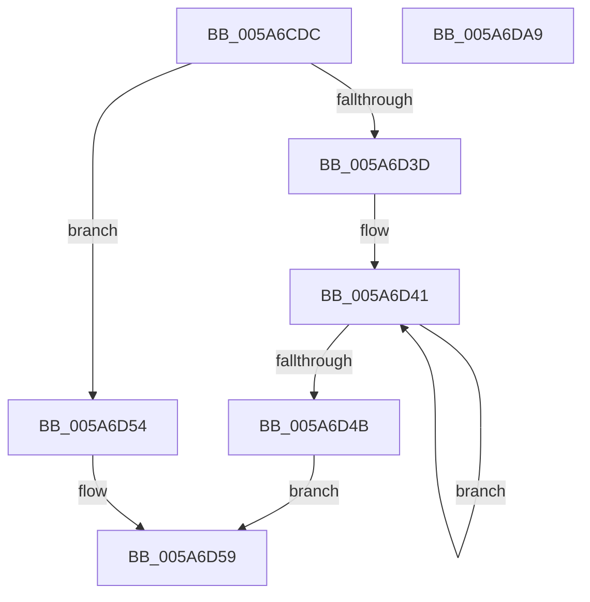

# McTemplateK0qhzr1z_EtwWriteTransfer

- RVA: `0x005A6CDC`–`0x005A6DAA` (길이 `206` bytes)
- VA: `0x00000001405A6CDC`
- 실행 섹션: `.text`
- PDB 이름 있음: `예`; PDB Function 태그: `아니요`
- unwind 정보 RVA: `0x000B6E70`
- 디코드: `49`개 명령, `206/206` bytes 표시
- 미해석 바이트: `0` (있으면 어셈블리에 `.byte`로 보존)

> 이 문서는 커널 이미지의 기계어와 PDB 기호를 분석해 생성했습니다. 4번과 5번은 함수 원형과 자료형을 바이너리 사용 방식에서 추정한 C 해석이며 원본 소스 복구 결과는 아닙니다.

## 1. Dependencies

- 직접 호출 지점: **2**; 고유 호출 대상: **2**
- 직접 호출자로 확인된 함수: **1**
- RIP 상대 이미지 참조: **4**

### Outgoing calls
- `0x005A6D8F` → [McGenEventWrite_EtwWriteTransfer](../42/McGenEventWrite_EtwWriteTransfer_function_00424FC8.md) (function, `0x00424FC8`)
- `0x005A6D9B` → [_security_check_cookie](../6A/_security_check_cookie_function_006AC640.md) (function, `0x006AC640`)

### Direct callers
- [PnpCallAddDevice](../../page/8F/PnpCallAddDevice_function_008FC164.md) at `0x008FC25D`

### Static image references
- `0x005A6CEE` → RVA `0x00E0A740` (`.data`; read)
- `0x005A6D5F` → RVA `0x006CB080` (` ?? ::FNODOBFM::`string'`; read)
- `0x005A6D76` → RVA `0x00026E80` (`.rdata`; read)
- `0x005A6D7D` → RVA `0x00E06DA0` (`.data`; read)

## 2. Other-region calls and transfers

- 다른 실행 섹션으로 향하는 call: **0**
- 별도 외부 분기/꼬리 이동을 확인하지 못했습니다.

## 3. Assembly (complete function range)

```asm
005A6CDC  44 89 4C 24 20                  mov dword ptr [rsp + 0x20], r9d
005A6CE1  55                              push rbp
005A6CE2  48 8D 6C 24 C1                  lea rbp, [rsp - 0x3f]
005A6CE7  48 81 EC 90 00 00 00            sub rsp, 0x90
005A6CEE  48 8B 05 4B 3A 86 00            mov rax, qword ptr [rip + 0x863a4b]
005A6CF5  48 33 C4                        xor rax, rsp
005A6CF8  48 89 45 2F                     mov qword ptr [rbp + 0x2f], rax
005A6CFC  48 8B 4D 7F                     mov rcx, qword ptr [rbp + 0x7f]
005A6D00  48 8D 45 67                     lea rax, [rbp + 0x67]
005A6D04  48 89 45 EF                     mov qword ptr [rbp - 0x11], rax
005A6D08  45 33 C0                        xor r8d, r8d
005A6D0B  48 8D 45 6F                     lea rax, [rbp + 0x6f]
005A6D0F  48 C7 45 F7 04 00 00 00         mov qword ptr [rbp - 9], 4
005A6D17  48 89 45 FF                     mov qword ptr [rbp - 1], rax
005A6D1B  48 8B 45 77                     mov rax, qword ptr [rbp + 0x77]
005A6D1F  48 89 45 0F                     mov qword ptr [rbp + 0xf], rax
005A6D23  0F B7 45 6F                     movzx eax, word ptr [rbp + 0x6f]
005A6D27  03 C0                           add eax, eax
005A6D29  48 C7 45 07 02 00 00 00         mov qword ptr [rbp + 7], 2
005A6D31  89 45 17                        mov dword ptr [rbp + 0x17], eax
005A6D34  44 89 45 1B                     mov dword ptr [rbp + 0x1b], r8d
005A6D38  48 85 C9                        test rcx, rcx
005A6D3B  74 17                           je 0x1405a6d54
005A6D3D  48 83 C8 FF                     or rax, 0xffffffffffffffff
005A6D41  48 FF C0                        inc rax
005A6D44  66 44 39 04 41                  cmp word ptr [rcx + rax*2], r8w
005A6D49  75 F6                           jne 0x1405a6d41
005A6D4B  8D 04 45 02 00 00 00            lea eax, [rax*2 + 2]
005A6D52  EB 05                           jmp 0x1405a6d59
005A6D54  B8 0A 00 00 00                  mov eax, 0xa
005A6D59  48 85 C9                        test rcx, rcx
005A6D5C  89 45 27                        mov dword ptr [rbp + 0x27], eax
005A6D5F  48 8D 15 1A 43 12 00            lea rdx, [rip + 0x12431a]
005A6D66  44 89 45 2B                     mov dword ptr [rbp + 0x2b], r8d
005A6D6A  48 0F 44 CA                     cmove rcx, rdx
005A6D6E  48 8D 45 DF                     lea rax, [rbp - 0x21]
005A6D72  48 89 4D 1F                     mov qword ptr [rbp + 0x1f], rcx
005A6D76  48 8D 15 03 01 A8 FF            lea rdx, [rip - 0x57fefd]
005A6D7D  48 8D 0D 1C 00 86 00            lea rcx, [rip + 0x86001c]
005A6D84  48 89 44 24 20                  mov qword ptr [rsp + 0x20], rax
005A6D89  41 B9 05 00 00 00               mov r9d, 5
005A6D8F  E8 34 E2 E7 FF                  call 0x140424fc8
005A6D94  48 8B 4D 2F                     mov rcx, qword ptr [rbp + 0x2f]
005A6D98  48 33 CC                        xor rcx, rsp
005A6D9B  E8 A0 58 10 00                  call 0x1406ac640
005A6DA0  48 81 C4 90 00 00 00            add rsp, 0x90
005A6DA7  5D                              pop rbp
005A6DA8  C3                              ret
005A6DA9  CC                              int3
```

## 4. C-style interpretation (structured pseudocode)

```c
__int64 __fastcall McTemplateK0qhzr1z_EtwWriteTransfer(__int64 a1, __int64 a2, int a3, int a4, unsigned __int16 a5, __int64 a6, __int64 a7)
{
    __int64 result;
    __int64 v_rsp;
    unsigned __int64 v_stack_m18;
    unsigned int v_stack_m1C;
    unsigned int v_stack_m20;
    unsigned __int64 v_stack_m28;
    unsigned int v_stack_m2C;
    unsigned int v_stack_m30;
    unsigned __int64 v_stack_m38;
    unsigned __int64 v_stack_m40;
    unsigned __int64 v_stack_m47;
    unsigned __int64 v_stack_m48;
    unsigned __int64 v_stack_m50;
    unsigned __int64 v_stack_m58;
    unsigned __int64 v_stack_m68;
    unsigned __int64 v_stack_m78;
    unsigned int v_stack_p20;

    v_stack_p20 = a4;
    v_rsp = (v_rsp) - (144);
    result = (*(unsigned __int64 *)(v_rip + 8796747)) ^ (v_rsp);
    v_stack_m18 = result;
    v_stack_m58 = v_stack_p20;
    a3 = 0;
    v_stack_m50 = 4;
    v_stack_m48 = a5;
    v_stack_m38 = a6;
    result = (unsigned int)((a5) + (a5));
    v_stack_m40 = 2;
    v_stack_m30 = (unsigned int)(result);
    v_stack_m2C = 0;
    if (a7 == 0) goto loc_005A6D54;
    result = (result) | (-1);
loc_005A6D41:
    result = (result) + 1;
    if ((*(unsigned __int16 *)(a7 + result * 2)) != 0) goto loc_005A6D41;
    goto loc_005A6D59;
loc_005A6D54:
loc_005A6D59:
    v_stack_m20 = 10;
    v_stack_m1C = 0;
    if (a7 == 0) { a7 = v_rip + 1196826; }
    v_stack_m28 = a7;
    v_stack_m78 = v_stack_m68;
    result = McGenEventWrite_EtwWriteTransfer(v_rip + 8781852, v_rip - 5766909, a3, 5);
    a1 = (v_stack_m18) ^ (v_rsp);
    result = _security_check_cookie(a1, v_rip - 5766909, a3, 5);
    v_rsp = (v_rsp) + (144);
    return result;
}
```

## 5. (Beta) C Style

```c
int64_t McTemplateK0qhzr1z_EtwWriteTransfer(int64_t Arg1, int64_t Arg2, int32_t Arg3, int32_t Arg4, uint16_t Arg5, int64_t Arg6, int64_t Arg7)
{
    int64_t result;
    int64_t local_rsp;
    uint64_t v_stack_m18;
    uint32_t v_stack_m1C;
    uint32_t v_stack_m20;
    uint64_t v_stack_m28;
    uint32_t v_stack_m2C;
    uint32_t v_stack_m30;
    uint64_t v_stack_m38;
    uint64_t v_stack_m40;
    uint64_t v_stack_m47;
    uint64_t v_stack_m48;
    uint64_t v_stack_m50;
    uint64_t v_stack_m58;
    uint64_t v_stack_m68;
    uint64_t v_stack_m78;
    uint32_t v_stack_p20;

    v_stack_p20 = Arg4;
    local_rsp = (local_rsp) - (144);
    result = (*(uint64_t *)(v_rip + 0x863A4B)) ^ (local_rsp);
    v_stack_m18 = result;
    v_stack_m58 = v_stack_p20;
    Arg3 = 0;
    v_stack_m50 = 4;
    v_stack_m48 = Arg5;
    v_stack_m38 = Arg6;
    result = (uint32_t)((Arg5) + (Arg5));
    v_stack_m40 = 2;
    v_stack_m30 = (uint32_t)(result);
    v_stack_m2C = 0;
    if (Arg7 == 0) goto loc_005A6D54;
    result = (result) | (-1);
loc_005A6D41:
    result = (result) + 1;
    if ((*(uint16_t *)(Arg7 + result * 2)) != 0) goto loc_005A6D41;
    goto loc_005A6D59;
loc_005A6D54:
loc_005A6D59:
    v_stack_m20 = 10;
    v_stack_m1C = 0;
    if (Arg7 == 0) { Arg7 = v_rip + 1196826; }
    v_stack_m28 = Arg7;
    v_stack_m78 = v_stack_m68;
    result = McGenEventWrite_EtwWriteTransfer(v_rip + 8781852, v_rip - 5766909, Arg3, 5);
    Arg1 = (v_stack_m18) ^ (local_rsp);
    result = _security_check_cookie(Arg1, v_rip - 5766909, Arg3, 5);
    local_rsp = (local_rsp) + (144);
    return result;
}
```

## 6. Execution-region graph

[열기: 2D/3D 그래프와 함수 탐색 컨트롤 패널](../../../control-panel.html?section=text&rva=0x005A6CDC&view=graph)

- 2D 그래프는 위에서 아래로 흐르고, 3D 그래프는 빈 공간을 드래그해 회전합니다. Shift+드래그는 이동, 휠은 확대·축소, 함수 노드 선택은 대상 보고서 이동입니다.

### Static fallback


