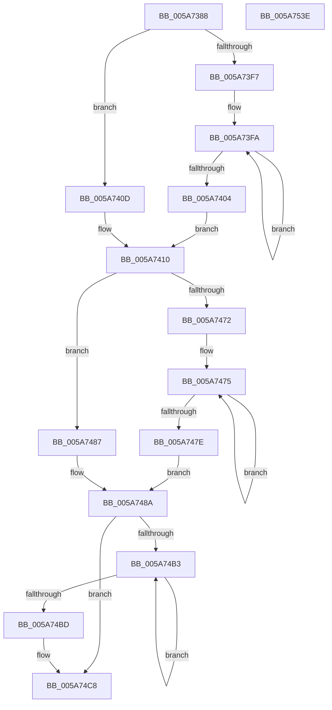

# McTemplateK0qqzqqjqzjztd_EtwWriteTransfer

- RVA: `0x005A7388`–`0x005A753F` (길이 `439` bytes)
- VA: `0x00000001405A7388`
- 실행 섹션: `.text`
- PDB 이름 있음: `예`; PDB Function 태그: `아니요`
- unwind 정보 RVA: `0x000C87DC`
- 디코드: `101`개 명령, `439/439` bytes 표시
- 미해석 바이트: `0` (있으면 어셈블리에 `.byte`로 보존)

> 이 문서는 커널 이미지의 기계어와 PDB 기호를 분석해 생성했습니다. 4번과 5번은 함수 원형과 자료형을 바이너리 사용 방식에서 추정한 C 해석이며 원본 소스 복구 결과는 아닙니다.

## 1. Dependencies

- 직접 호출 지점: **2**; 고유 호출 대상: **2**
- 직접 호출자로 확인된 함수: **1**
- RIP 상대 이미지 참조: **3**

### Outgoing calls
- `0x005A751A` → [McGenEventWrite_EtwWriteTransfer](../42/McGenEventWrite_EtwWriteTransfer_function_00424FC8.md) (function, `0x00424FC8`)
- `0x005A7526` → [_security_check_cookie](../6A/_security_check_cookie_function_006AC640.md) (function, `0x006AC640`)

### Direct callers
- [sub_00B1D4A4](../../page/B1/Unknown_function_00B1D4A4.md) at `0x00B1D5EC`
- [sub_00B1D4A4](../../page/B1/Unknown_function_00B1D4A4.md) at `0x00B1D6BB`

### Static image references
- `0x005A73A1` → RVA `0x00E0A740` (`.data`; read)
- `0x005A7414` → RVA `0x006CB080` (` ?? ::FNODOBFM::`string'`; read)
- `0x005A74DF` → RVA `0x00E06DA0` (`.data`; read)

## 2. Other-region calls and transfers

- 다른 실행 섹션으로 향하는 call: **0**
- 별도 외부 분기/꼬리 이동을 확인하지 못했습니다.

## 3. Assembly (complete function range)

```asm
005A7388  48 89 5C 24 08                  mov qword ptr [rsp + 8], rbx
005A738D  44 89 4C 24 20                  mov dword ptr [rsp + 0x20], r9d
005A7392  55                              push rbp
005A7393  56                              push rsi
005A7394  57                              push rdi
005A7395  48 8D 6C 24 F0                  lea rbp, [rsp - 0x10]
005A739A  48 81 EC 10 01 00 00            sub rsp, 0x110
005A73A1  48 8B 05 98 33 86 00            mov rax, qword ptr [rip + 0x863398]
005A73A8  48 33 C4                        xor rax, rsp
005A73AB  48 89 45 00                     mov qword ptr [rbp], rax
005A73AF  4C 8B 45 58                     mov r8, qword ptr [rbp + 0x58]
005A73B3  48 8D 45 48                     lea rax, [rbp + 0x48]
005A73B7  4C 8B 95 90 00 00 00            mov r10, qword ptr [rbp + 0x90]
005A73BE  33 DB                           xor ebx, ebx
005A73C0  48 89 44 24 40                  mov qword ptr [rsp + 0x40], rax
005A73C5  48 83 C9 FF                     or rcx, 0xffffffffffffffff
005A73C9  48 C7 44 24 48 04 00 00 00      mov qword ptr [rsp + 0x48], 4
005A73D2  48 8D 45 50                     lea rax, [rbp + 0x50]
005A73D6  48 89 44 24 50                  mov qword ptr [rsp + 0x50], rax
005A73DB  4C 8B DA                        mov r11, rdx
005A73DE  48 8B 95 80 00 00 00            mov rdx, qword ptr [rbp + 0x80]
005A73E5  44 8D 4B 0A                     lea r9d, [rbx + 0xa]
005A73E9  48 C7 44 24 58 04 00 00 00      mov qword ptr [rsp + 0x58], 4
005A73F2  4D 85 C0                        test r8, r8
005A73F5  74 16                           je 0x1405a740d
005A73F7  48 8B C1                        mov rax, rcx
005A73FA  48 FF C0                        inc rax
005A73FD  66 41 39 1C 40                  cmp word ptr [r8 + rax*2], bx
005A7402  75 F6                           jne 0x1405a73fa
005A7404  8D 04 45 02 00 00 00            lea eax, [rax*2 + 2]
005A740B  EB 03                           jmp 0x1405a7410
005A740D  41 8B C1                        mov eax, r9d
005A7410  89 44 24 68                     mov dword ptr [rsp + 0x68], eax
005A7414  48 8D 35 65 3C 12 00            lea rsi, [rip + 0x123c65]
005A741B  48 8D 45 60                     lea rax, [rbp + 0x60]
005A741F  89 5C 24 6C                     mov dword ptr [rsp + 0x6c], ebx
005A7423  48 89 44 24 70                  mov qword ptr [rsp + 0x70], rax
005A7428  4D 85 C0                        test r8, r8
005A742B  48 8D 45 68                     lea rax, [rbp + 0x68]
005A742F  48 C7 44 24 78 04 00 00 00      mov qword ptr [rsp + 0x78], 4
005A7438  48 89 45 80                     mov qword ptr [rbp - 0x80], rax
005A743C  4C 0F 44 C6                     cmove r8, rsi
005A7440  48 8B 45 70                     mov rax, qword ptr [rbp + 0x70]
005A7444  48 89 45 90                     mov qword ptr [rbp - 0x70], rax
005A7448  48 8D 45 78                     lea rax, [rbp + 0x78]
005A744C  48 89 45 A0                     mov qword ptr [rbp - 0x60], rax
005A7450  4C 89 44 24 60                  mov qword ptr [rsp + 0x60], r8
005A7455  48 C7 45 88 04 00 00 00         mov qword ptr [rbp - 0x78], 4
005A745D  48 C7 45 98 10 00 00 00         mov qword ptr [rbp - 0x68], 0x10
005A7465  48 C7 45 A8 04 00 00 00         mov qword ptr [rbp - 0x58], 4
005A746D  48 85 D2                        test rdx, rdx
005A7470  74 15                           je 0x1405a7487
005A7472  48 8B C1                        mov rax, rcx
005A7475  48 FF C0                        inc rax
005A7478  66 39 1C 42                     cmp word ptr [rdx + rax*2], bx
005A747C  75 F7                           jne 0x1405a7475
005A747E  8D 04 45 02 00 00 00            lea eax, [rax*2 + 2]
005A7485  EB 03                           jmp 0x1405a748a
005A7487  41 8B C1                        mov eax, r9d
005A748A  48 85 D2                        test rdx, rdx
005A748D  89 45 B8                        mov dword ptr [rbp - 0x48], eax
005A7490  48 8B 85 88 00 00 00            mov rax, qword ptr [rbp + 0x88]
005A7497  48 0F 44 D6                     cmove rdx, rsi
005A749B  89 5D BC                        mov dword ptr [rbp - 0x44], ebx
005A749E  48 89 55 B0                     mov qword ptr [rbp - 0x50], rdx
005A74A2  48 89 45 C0                     mov qword ptr [rbp - 0x40], rax
005A74A6  48 C7 45 C8 10 00 00 00         mov qword ptr [rbp - 0x38], 0x10
005A74AE  4D 85 D2                        test r10, r10
005A74B1  74 15                           je 0x1405a74c8
005A74B3  48 FF C1                        inc rcx
005A74B6  66 41 39 1C 4A                  cmp word ptr [r10 + rcx*2], bx
005A74BB  75 F6                           jne 0x1405a74b3
005A74BD  44 8D 0C 4D 02 00 00 00         lea r9d, [rcx*2 + 2]
005A74C5  4D 85 D2                        test r10, r10
005A74C8  4C 0F 44 D6                     cmove r10, rsi
005A74CC  44 89 4D D8                     mov dword ptr [rbp - 0x28], r9d
005A74D0  48 8D 85 98 00 00 00            lea rax, [rbp + 0x98]
005A74D7  4C 89 55 D0                     mov qword ptr [rbp - 0x30], r10
005A74DB  48 89 45 E0                     mov qword ptr [rbp - 0x20], rax
005A74DF  48 8D 0D BA F8 85 00            lea rcx, [rip + 0x85f8ba]
005A74E6  48 8D 85 A0 00 00 00            lea rax, [rbp + 0xa0]
005A74ED  89 5D DC                        mov dword ptr [rbp - 0x24], ebx
005A74F0  48 89 45 F0                     mov qword ptr [rbp - 0x10], rax
005A74F4  41 B9 0D 00 00 00               mov r9d, 0xd
005A74FA  48 8D 44 24 30                  lea rax, [rsp + 0x30]
005A74FF  48 C7 45 E8 04 00 00 00         mov qword ptr [rbp - 0x18], 4
005A7507  45 33 C0                        xor r8d, r8d
005A750A  48 89 44 24 20                  mov qword ptr [rsp + 0x20], rax
005A750F  49 8B D3                        mov rdx, r11
005A7512  48 C7 45 F8 04 00 00 00         mov qword ptr [rbp - 8], 4
005A751A  E8 A9 DA E7 FF                  call 0x140424fc8
005A751F  48 8B 4D 00                     mov rcx, qword ptr [rbp]
005A7523  48 33 CC                        xor rcx, rsp
005A7526  E8 15 51 10 00                  call 0x1406ac640
005A752B  48 8B 9C 24 30 01 00 00         mov rbx, qword ptr [rsp + 0x130]
005A7533  48 81 C4 10 01 00 00            add rsp, 0x110
005A753A  5F                              pop rdi
005A753B  5E                              pop rsi
005A753C  5D                              pop rbp
005A753D  C3                              ret
005A753E  CC                              int3
```

## 4. C-style interpretation (structured pseudocode)

```c
__int64 __fastcall McTemplateK0qqzqqjqzjztd_EtwWriteTransfer(__int64 a1, __int64 a2, __int64 a3, int a4, __int64 a5, __int64 a6, __int64 a7, __int64 a8, __int64 a9, __int64 a10, __int64 a11, __int64 a12, __int64 a13, __int64 a14, __int64 a15)
{
    __int64 result;
    __int64 v_rbx;
    __int64 v_rsp;
    unsigned __int64 v_stack_m108;
    unsigned __int64 v_stack_m28;
    unsigned __int64 v_stack_m30;
    unsigned __int64 v_stack_m38;
    unsigned __int64 v_stack_m40;
    unsigned __int64 v_stack_m48;
    unsigned int v_stack_m4C;
    unsigned int v_stack_m50;
    unsigned __int64 v_stack_m58;
    unsigned __int64 v_stack_m60;
    unsigned __int64 v_stack_m68;
    unsigned int v_stack_m6C;
    unsigned int v_stack_m70;
    unsigned __int64 v_stack_m78;
    unsigned __int64 v_stack_m80;
    unsigned __int64 v_stack_m88;
    unsigned __int64 v_stack_m90;
    unsigned __int64 v_stack_m98;
    unsigned __int64 v_stack_mA0;
    unsigned __int64 v_stack_mA8;
    unsigned __int64 v_stack_mB0;
    unsigned __int64 v_stack_mB8;
    unsigned int v_stack_mBC;
    unsigned int v_stack_mC0;
    unsigned __int64 v_stack_mC8;
    unsigned __int64 v_stack_mD0;
    unsigned __int64 v_stack_mD8;
    unsigned __int64 v_stack_mE0;
    unsigned __int64 v_stack_mE8;
    unsigned __int64 v_stack_mF8;
    unsigned int v_stack_p20;
    unsigned __int64 v_stack_p8;

    v_stack_p8 = v_rbx;
    v_stack_p20 = a4;
    v_rsp = (v_rsp) - (272);
    result = (*(unsigned __int64 *)(v_rip + 8795032)) ^ (v_rsp);
    v_stack_m28 = result;
    v_rbx = 0;
    v_stack_mE8 = v_stack_p20;
    a1 = (a1) | (-1);
    v_stack_mE0 = 4;
    v_stack_mD8 = a5;
    v_stack_mD0 = 4;
    if (a6 == 0) goto loc_005A740D;
loc_005A73FA:
    result = (a1) + 1;
    if ((*(unsigned __int16 *)(a6 + result * 2)) != 0) goto loc_005A73FA;
    goto loc_005A7410;
loc_005A740D:
loc_005A7410:
    v_stack_mC0 = (unsigned int)((unsigned int)((unsigned int)(v_rbx + 10)));
    v_stack_mBC = 0;
    v_stack_mB8 = a7;
    v_stack_mB0 = 4;
    v_stack_mA8 = a8;
    if (a6 == 0) { a6 = v_rip + 1195109; }
    v_stack_m98 = a9;
    v_stack_m88 = a10;
    v_stack_mC8 = a6;
    v_stack_mA0 = 4;
    v_stack_m90 = 16;
    v_stack_m80 = 4;
    if (a11 == 0) goto loc_005A7487;
loc_005A7475:
    result = (a1) + 1;
    if ((*(unsigned __int16 *)(a11 + result * 2)) != 0) goto loc_005A7475;
    goto loc_005A748A;
loc_005A7487:
loc_005A748A:
    v_stack_m70 = (unsigned int)((unsigned int)((unsigned int)(v_rbx + 10)));
    if (a11 == 0) { a11 = v_rip + 1195109; }
    v_stack_m6C = 0;
    v_stack_m78 = a11;
    v_stack_m68 = a12;
    v_stack_m60 = 16;
    if (a13 == 0) goto loc_005A74C8;
loc_005A74B3:
    a1 = (a1) + 1;
    if ((*(unsigned __int16 *)(a13 + a1 * 2)) != 0) goto loc_005A74B3;
loc_005A74C8:
    if (a13 == 0) { a13 = v_rip + 1195109; }
    v_stack_m50 = (unsigned int)(a1 * 2 + 2);
    v_stack_m58 = a13;
    v_stack_m48 = a14;
    v_stack_m4C = 0;
    v_stack_m38 = a15;
    v_stack_m40 = 4;
    a3 = 0;
    v_stack_m108 = v_stack_mF8;
    v_stack_m30 = 4;
    result = McGenEventWrite_EtwWriteTransfer(v_rip + 8779962, a2, a3, 13);
    a1 = (v_stack_m28) ^ (v_rsp);
    result = _security_check_cookie(a1, a2, a3, 13);
    v_rsp = (v_rsp) + (272);
    return result;
}
```

## 5. (Beta) C Style

```c
int64_t McTemplateK0qqzqqjqzjztd_EtwWriteTransfer(int64_t Arg1, int64_t Arg2, int64_t Arg3, int32_t Arg4, int64_t Arg5, int64_t Arg6, int64_t Arg7, int64_t Arg8, int64_t Arg9, int64_t Arg10, int64_t Arg11, int64_t Arg12, int64_t Arg13, int64_t Arg14, int64_t Arg15)
{
    int64_t result;
    int64_t local_rbx;
    int64_t local_rsp;
    uint64_t v_stack_m108;
    uint64_t v_stack_m28;
    uint64_t v_stack_m30;
    uint64_t v_stack_m38;
    uint64_t v_stack_m40;
    uint64_t v_stack_m48;
    uint32_t v_stack_m4C;
    uint32_t v_stack_m50;
    uint64_t v_stack_m58;
    uint64_t v_stack_m60;
    uint64_t v_stack_m68;
    uint32_t v_stack_m6C;
    uint32_t v_stack_m70;
    uint64_t v_stack_m78;
    uint64_t v_stack_m80;
    uint64_t v_stack_m88;
    uint64_t v_stack_m90;
    uint64_t v_stack_m98;
    uint64_t v_stack_mA0;
    uint64_t v_stack_mA8;
    uint64_t v_stack_mB0;
    uint64_t v_stack_mB8;
    uint32_t v_stack_mBC;
    uint32_t v_stack_mC0;
    uint64_t v_stack_mC8;
    uint64_t v_stack_mD0;
    uint64_t v_stack_mD8;
    uint64_t v_stack_mE0;
    uint64_t v_stack_mE8;
    uint64_t v_stack_mF8;
    uint32_t v_stack_p20;
    uint64_t v_stack_p8;

    v_stack_p8 = local_rbx;
    v_stack_p20 = Arg4;
    local_rsp = (local_rsp) - (272);
    result = (*(uint64_t *)(v_rip + 0x863398)) ^ (local_rsp);
    v_stack_m28 = result;
    local_rbx = 0;
    v_stack_mE8 = v_stack_p20;
    Arg1 = (Arg1) | (-1);
    v_stack_mE0 = 4;
    v_stack_mD8 = Arg5;
    v_stack_mD0 = 4;
    if (Arg6 == 0) goto loc_005A740D;
loc_005A73FA:
    result = (Arg1) + 1;
    if ((*(uint16_t *)(Arg6 + result * 2)) != 0) goto loc_005A73FA;
    goto loc_005A7410;
loc_005A740D:
loc_005A7410:
    v_stack_mC0 = (uint32_t)((uint32_t)((uint32_t)(local_rbx + 10)));
    v_stack_mBC = 0;
    v_stack_mB8 = Arg7;
    v_stack_mB0 = 4;
    v_stack_mA8 = Arg8;
    if (Arg6 == 0) { Arg6 = v_rip + 1195109; }
    v_stack_m98 = Arg9;
    v_stack_m88 = Arg10;
    v_stack_mC8 = Arg6;
    v_stack_mA0 = 4;
    v_stack_m90 = 16;
    v_stack_m80 = 4;
    if (Arg11 == 0) goto loc_005A7487;
loc_005A7475:
    result = (Arg1) + 1;
    if ((*(uint16_t *)(Arg11 + result * 2)) != 0) goto loc_005A7475;
    goto loc_005A748A;
loc_005A7487:
loc_005A748A:
    v_stack_m70 = (uint32_t)((uint32_t)((uint32_t)(local_rbx + 10)));
    if (Arg11 == 0) { Arg11 = v_rip + 1195109; }
    v_stack_m6C = 0;
    v_stack_m78 = Arg11;
    v_stack_m68 = Arg12;
    v_stack_m60 = 16;
    if (Arg13 == 0) goto loc_005A74C8;
loc_005A74B3:
    Arg1 = (Arg1) + 1;
    if ((*(uint16_t *)(Arg13 + Arg1 * 2)) != 0) goto loc_005A74B3;
loc_005A74C8:
    if (Arg13 == 0) { Arg13 = v_rip + 1195109; }
    v_stack_m50 = (uint32_t)(Arg1 * 2 + 2);
    v_stack_m58 = Arg13;
    v_stack_m48 = Arg14;
    v_stack_m4C = 0;
    v_stack_m38 = Arg15;
    v_stack_m40 = 4;
    Arg3 = 0;
    v_stack_m108 = v_stack_mF8;
    v_stack_m30 = 4;
    result = McGenEventWrite_EtwWriteTransfer(v_rip + 8779962, Arg2, Arg3, 13);
    Arg1 = (v_stack_m28) ^ (local_rsp);
    result = _security_check_cookie(Arg1, Arg2, Arg3, 13);
    local_rsp = (local_rsp) + (272);
    return result;
}
```

## 6. Execution-region graph

[열기: 2D/3D 그래프와 함수 탐색 컨트롤 패널](../../../control-panel.html?section=text&rva=0x005A7388&view=graph)

- 2D 그래프는 위에서 아래로 흐르고, 3D 그래프는 빈 공간을 드래그해 회전합니다. Shift+드래그는 이동, 휠은 확대·축소, 함수 노드 선택은 대상 보고서 이동입니다.

### Static fallback


