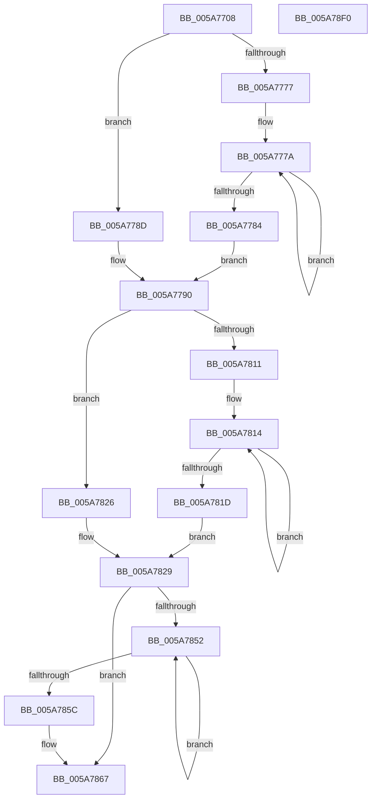

# McTemplateK0qqzqqtjqzjzttx_EtwWriteTransfer

- RVA: `0x005A7708`–`0x005A78F1` (길이 `489` bytes)
- VA: `0x00000001405A7708`
- 실행 섹션: `.text`
- PDB 이름 있음: `예`; PDB Function 태그: `아니요`
- unwind 정보 RVA: `0x000C87BC`
- 디코드: `107`개 명령, `489/489` bytes 표시
- 미해석 바이트: `0` (있으면 어셈블리에 `.byte`로 보존)

> 이 문서는 커널 이미지의 기계어와 PDB 기호를 분석해 생성했습니다. 4번과 5번은 함수 원형과 자료형을 바이너리 사용 방식에서 추정한 C 해석이며 원본 소스 복구 결과는 아닙니다.

## 1. Dependencies

- 직접 호출 지점: **2**; 고유 호출 대상: **2**
- 직접 호출자로 확인된 함수: **2**
- RIP 상대 이미지 참조: **3**

### Outgoing calls
- `0x005A78CC` → [McGenEventWrite_EtwWriteTransfer](../42/McGenEventWrite_EtwWriteTransfer_function_00424FC8.md) (function, `0x00424FC8`)
- `0x005A78D8` → [_security_check_cookie](../6A/_security_check_cookie_function_006AC640.md) (function, `0x006AC640`)

### Direct callers
- [sub_00B2EF58](../../page/B2/Unknown_function_00B2EF58.md) at `0x00B2F07B`
- [sub_00B2F090](../../page/B2/Unknown_function_00B2F090.md) at `0x00B2F208`

### Static image references
- `0x005A7721` → RVA `0x00E0A740` (`.data`; read)
- `0x005A7794` → RVA `0x006CB080` (` ?? ::FNODOBFM::`string'`; read)
- `0x005A787E` → RVA `0x00E06DA0` (`.data`; read)

## 2. Other-region calls and transfers

- 다른 실행 섹션으로 향하는 call: **0**
- 별도 외부 분기/꼬리 이동을 확인하지 못했습니다.

## 3. Assembly (complete function range)

```asm
005A7708  48 89 5C 24 08                  mov qword ptr [rsp + 8], rbx
005A770D  44 89 4C 24 20                  mov dword ptr [rsp + 0x20], r9d
005A7712  55                              push rbp
005A7713  56                              push rsi
005A7714  57                              push rdi
005A7715  48 8D 6C 24 D0                  lea rbp, [rsp - 0x30]
005A771A  48 81 EC 30 01 00 00            sub rsp, 0x130
005A7721  48 8B 05 18 30 86 00            mov rax, qword ptr [rip + 0x863018]
005A7728  48 33 C4                        xor rax, rsp
005A772B  48 89 45 20                     mov qword ptr [rbp + 0x20], rax
005A772F  4C 8B 4D 78                     mov r9, qword ptr [rbp + 0x78]
005A7733  48 8D 45 68                     lea rax, [rbp + 0x68]
005A7737  4C 8B 95 B8 00 00 00            mov r10, qword ptr [rbp + 0xb8]
005A773E  33 DB                           xor ebx, ebx
005A7740  48 89 44 24 40                  mov qword ptr [rsp + 0x40], rax
005A7745  48 83 C9 FF                     or rcx, 0xffffffffffffffff
005A7749  48 C7 44 24 48 04 00 00 00      mov qword ptr [rsp + 0x48], 4
005A7752  48 8D 45 70                     lea rax, [rbp + 0x70]
005A7756  48 89 44 24 50                  mov qword ptr [rsp + 0x50], rax
005A775B  4C 8B DA                        mov r11, rdx
005A775E  48 8B 95 A8 00 00 00            mov rdx, qword ptr [rbp + 0xa8]
005A7765  44 8D 43 0A                     lea r8d, [rbx + 0xa]
005A7769  48 C7 44 24 58 04 00 00 00      mov qword ptr [rsp + 0x58], 4
005A7772  4D 85 C9                        test r9, r9
005A7775  74 16                           je 0x1405a778d
005A7777  48 8B C1                        mov rax, rcx
005A777A  48 FF C0                        inc rax
005A777D  66 41 39 1C 41                  cmp word ptr [r9 + rax*2], bx
005A7782  75 F6                           jne 0x1405a777a
005A7784  8D 04 45 02 00 00 00            lea eax, [rax*2 + 2]
005A778B  EB 03                           jmp 0x1405a7790
005A778D  41 8B C0                        mov eax, r8d
005A7790  89 44 24 68                     mov dword ptr [rsp + 0x68], eax
005A7794  48 8D 35 E5 38 12 00            lea rsi, [rip + 0x1238e5]
005A779B  48 8D 85 80 00 00 00            lea rax, [rbp + 0x80]
005A77A2  89 5C 24 6C                     mov dword ptr [rsp + 0x6c], ebx
005A77A6  48 89 44 24 70                  mov qword ptr [rsp + 0x70], rax
005A77AB  4D 85 C9                        test r9, r9
005A77AE  48 8D 85 88 00 00 00            lea rax, [rbp + 0x88]
005A77B5  48 C7 44 24 78 04 00 00 00      mov qword ptr [rsp + 0x78], 4
005A77BE  48 89 45 80                     mov qword ptr [rbp - 0x80], rax
005A77C2  4C 0F 44 CE                     cmove r9, rsi
005A77C6  4C 89 4C 24 60                  mov qword ptr [rsp + 0x60], r9
005A77CB  48 8D 85 90 00 00 00            lea rax, [rbp + 0x90]
005A77D2  48 89 45 90                     mov qword ptr [rbp - 0x70], rax
005A77D6  48 8B 85 98 00 00 00            mov rax, qword ptr [rbp + 0x98]
005A77DD  48 89 45 A0                     mov qword ptr [rbp - 0x60], rax
005A77E1  48 8D 85 A0 00 00 00            lea rax, [rbp + 0xa0]
005A77E8  48 89 45 B0                     mov qword ptr [rbp - 0x50], rax
005A77EC  48 C7 45 88 04 00 00 00         mov qword ptr [rbp - 0x78], 4
005A77F4  48 C7 45 98 04 00 00 00         mov qword ptr [rbp - 0x68], 4
005A77FC  48 C7 45 A8 10 00 00 00         mov qword ptr [rbp - 0x58], 0x10
005A7804  48 C7 45 B8 04 00 00 00         mov qword ptr [rbp - 0x48], 4
005A780C  48 85 D2                        test rdx, rdx
005A780F  74 15                           je 0x1405a7826
005A7811  48 8B C1                        mov rax, rcx
005A7814  48 FF C0                        inc rax
005A7817  66 39 1C 42                     cmp word ptr [rdx + rax*2], bx
005A781B  75 F7                           jne 0x1405a7814
005A781D  8D 04 45 02 00 00 00            lea eax, [rax*2 + 2]
005A7824  EB 03                           jmp 0x1405a7829
005A7826  41 8B C0                        mov eax, r8d
005A7829  48 85 D2                        test rdx, rdx
005A782C  89 45 C8                        mov dword ptr [rbp - 0x38], eax
005A782F  48 8B 85 B0 00 00 00            mov rax, qword ptr [rbp + 0xb0]
005A7836  48 0F 44 D6                     cmove rdx, rsi
005A783A  89 5D CC                        mov dword ptr [rbp - 0x34], ebx
005A783D  48 89 55 C0                     mov qword ptr [rbp - 0x40], rdx
005A7841  48 89 45 D0                     mov qword ptr [rbp - 0x30], rax
005A7845  48 C7 45 D8 10 00 00 00         mov qword ptr [rbp - 0x28], 0x10
005A784D  4D 85 D2                        test r10, r10
005A7850  74 15                           je 0x1405a7867
005A7852  48 FF C1                        inc rcx
005A7855  66 41 39 1C 4A                  cmp word ptr [r10 + rcx*2], bx
005A785A  75 F6                           jne 0x1405a7852
005A785C  44 8D 04 4D 02 00 00 00         lea r8d, [rcx*2 + 2]
005A7864  4D 85 D2                        test r10, r10
005A7867  4C 0F 44 D6                     cmove r10, rsi
005A786B  44 89 45 E8                     mov dword ptr [rbp - 0x18], r8d
005A786F  48 8D 85 C0 00 00 00            lea rax, [rbp + 0xc0]
005A7876  4C 89 55 E0                     mov qword ptr [rbp - 0x20], r10
005A787A  48 89 45 F0                     mov qword ptr [rbp - 0x10], rax
005A787E  48 8D 0D 1B F5 85 00            lea rcx, [rip + 0x85f51b]
005A7885  48 8D 85 C8 00 00 00            lea rax, [rbp + 0xc8]
005A788C  89 5D EC                        mov dword ptr [rbp - 0x14], ebx
005A788F  48 89 45 00                     mov qword ptr [rbp], rax
005A7893  41 B9 0F 00 00 00               mov r9d, 0xf
005A7899  48 8D 85 D0 00 00 00            lea rax, [rbp + 0xd0]
005A78A0  48 C7 45 F8 04 00 00 00         mov qword ptr [rbp - 8], 4
005A78A8  48 89 45 10                     mov qword ptr [rbp + 0x10], rax
005A78AC  45 33 C0                        xor r8d, r8d
005A78AF  48 8D 44 24 30                  lea rax, [rsp + 0x30]
005A78B4  48 C7 45 08 04 00 00 00         mov qword ptr [rbp + 8], 4
005A78BC  49 8B D3                        mov rdx, r11
005A78BF  48 89 44 24 20                  mov qword ptr [rsp + 0x20], rax
005A78C4  48 C7 45 18 08 00 00 00         mov qword ptr [rbp + 0x18], 8
005A78CC  E8 F7 D6 E7 FF                  call 0x140424fc8
005A78D1  48 8B 4D 20                     mov rcx, qword ptr [rbp + 0x20]
005A78D5  48 33 CC                        xor rcx, rsp
005A78D8  E8 63 4D 10 00                  call 0x1406ac640
005A78DD  48 8B 9C 24 50 01 00 00         mov rbx, qword ptr [rsp + 0x150]
005A78E5  48 81 C4 30 01 00 00            add rsp, 0x130
005A78EC  5F                              pop rdi
005A78ED  5E                              pop rsi
005A78EE  5D                              pop rbp
005A78EF  C3                              ret
005A78F0  CC                              int3
```

## 4. C-style interpretation (structured pseudocode)

```c
__int64 __fastcall McTemplateK0qqzqqtjqzjzttx_EtwWriteTransfer(__int64 a1, __int64 a2, __int64 a3, int a4, __int64 a5, __int64 a6, __int64 a7, __int64 a8, __int64 a9, __int64 a10, __int64 a11, __int64 a12, __int64 a13, __int64 a14, __int64 a15, __int64 a16, __int64 a17)
{
    __int64 result;
    __int64 v_rbx;
    __int64 v_rsp;
    unsigned __int64 v_stack_m100;
    unsigned __int64 v_stack_m108;
    unsigned __int64 v_stack_m118;
    unsigned __int64 v_stack_m128;
    unsigned __int64 v_stack_m28;
    unsigned __int64 v_stack_m30;
    unsigned __int64 v_stack_m38;
    unsigned __int64 v_stack_m40;
    unsigned __int64 v_stack_m48;
    unsigned __int64 v_stack_m50;
    unsigned __int64 v_stack_m58;
    unsigned int v_stack_m5C;
    unsigned int v_stack_m60;
    unsigned __int64 v_stack_m68;
    unsigned __int64 v_stack_m70;
    unsigned __int64 v_stack_m78;
    unsigned int v_stack_m7C;
    unsigned int v_stack_m80;
    unsigned __int64 v_stack_m88;
    unsigned __int64 v_stack_m90;
    unsigned __int64 v_stack_m98;
    unsigned __int64 v_stack_mA0;
    unsigned __int64 v_stack_mA8;
    unsigned __int64 v_stack_mB0;
    unsigned __int64 v_stack_mB8;
    unsigned __int64 v_stack_mC0;
    unsigned __int64 v_stack_mC8;
    unsigned __int64 v_stack_mD0;
    unsigned __int64 v_stack_mD8;
    unsigned int v_stack_mDC;
    unsigned int v_stack_mE0;
    unsigned __int64 v_stack_mE8;
    unsigned __int64 v_stack_mF0;
    unsigned __int64 v_stack_mF8;
    unsigned int v_stack_p20;
    unsigned __int64 v_stack_p8;

    v_stack_p8 = v_rbx;
    v_stack_p20 = a4;
    v_rsp = (v_rsp) - (304);
    result = (*(unsigned __int64 *)(v_rip + 8794136)) ^ (v_rsp);
    v_stack_m28 = result;
    v_rbx = 0;
    v_stack_m108 = v_stack_p20;
    a1 = (a1) | (-1);
    v_stack_m100 = 4;
    v_stack_mF8 = a5;
    v_stack_mF0 = 4;
    if (a6 == 0) goto loc_005A778D;
loc_005A777A:
    result = (a1) + 1;
    if ((*(unsigned __int16 *)(a6 + result * 2)) != 0) goto loc_005A777A;
    goto loc_005A7790;
loc_005A778D:
loc_005A7790:
    v_stack_mE0 = (unsigned int)((unsigned int)((unsigned int)(v_rbx + 10)));
    v_stack_mDC = 0;
    v_stack_mD8 = a7;
    v_stack_mD0 = 4;
    v_stack_mC8 = a8;
    if (a6 == 0) { a6 = v_rip + 1194213; }
    v_stack_mE8 = a6;
    v_stack_mB8 = a9;
    v_stack_mA8 = a10;
    v_stack_m98 = a11;
    v_stack_mC0 = 4;
    v_stack_mB0 = 4;
    v_stack_mA0 = 16;
    v_stack_m90 = 4;
    if (a12 == 0) goto loc_005A7826;
loc_005A7814:
    result = (a1) + 1;
    if ((*(unsigned __int16 *)(a12 + result * 2)) != 0) goto loc_005A7814;
    goto loc_005A7829;
loc_005A7826:
loc_005A7829:
    v_stack_m80 = (unsigned int)((unsigned int)((unsigned int)(v_rbx + 10)));
    if (a12 == 0) { a12 = v_rip + 1194213; }
    v_stack_m7C = 0;
    v_stack_m88 = a12;
    v_stack_m78 = a13;
    v_stack_m70 = 16;
    if (a14 == 0) goto loc_005A7867;
loc_005A7852:
    a1 = (a1) + 1;
    if ((*(unsigned __int16 *)(a14 + a1 * 2)) != 0) goto loc_005A7852;
loc_005A7867:
    if (a14 == 0) { a14 = v_rip + 1194213; }
    v_stack_m60 = (unsigned int)(a1 * 2 + 2);
    v_stack_m68 = a14;
    v_stack_m58 = a15;
    v_stack_m5C = 0;
    v_stack_m48 = a16;
    v_stack_m50 = 4;
    v_stack_m38 = a17;
    a3 = 0;
    v_stack_m40 = 4;
    v_stack_m128 = v_stack_m118;
    v_stack_m30 = 8;
    result = McGenEventWrite_EtwWriteTransfer(v_rip + 8779035, a2, a3, 15);
    a1 = (v_stack_m28) ^ (v_rsp);
    result = _security_check_cookie(a1, a2, a3, 15);
    v_rsp = (v_rsp) + (304);
    return result;
}
```

## 5. (Beta) C Style

```c
int64_t McTemplateK0qqzqqtjqzjzttx_EtwWriteTransfer(int64_t Arg1, int64_t Arg2, int64_t Arg3, int32_t Arg4, int64_t Arg5, int64_t Arg6, int64_t Arg7, int64_t Arg8, int64_t Arg9, int64_t Arg10, int64_t Arg11, int64_t Arg12, int64_t Arg13, int64_t Arg14, int64_t Arg15, int64_t Arg16, int64_t Arg17)
{
    int64_t result;
    int64_t local_rbx;
    int64_t local_rsp;
    uint64_t v_stack_m100;
    uint64_t v_stack_m108;
    uint64_t v_stack_m118;
    uint64_t v_stack_m128;
    uint64_t v_stack_m28;
    uint64_t v_stack_m30;
    uint64_t v_stack_m38;
    uint64_t v_stack_m40;
    uint64_t v_stack_m48;
    uint64_t v_stack_m50;
    uint64_t v_stack_m58;
    uint32_t v_stack_m5C;
    uint32_t v_stack_m60;
    uint64_t v_stack_m68;
    uint64_t v_stack_m70;
    uint64_t v_stack_m78;
    uint32_t v_stack_m7C;
    uint32_t v_stack_m80;
    uint64_t v_stack_m88;
    uint64_t v_stack_m90;
    uint64_t v_stack_m98;
    uint64_t v_stack_mA0;
    uint64_t v_stack_mA8;
    uint64_t v_stack_mB0;
    uint64_t v_stack_mB8;
    uint64_t v_stack_mC0;
    uint64_t v_stack_mC8;
    uint64_t v_stack_mD0;
    uint64_t v_stack_mD8;
    uint32_t v_stack_mDC;
    uint32_t v_stack_mE0;
    uint64_t v_stack_mE8;
    uint64_t v_stack_mF0;
    uint64_t v_stack_mF8;
    uint32_t v_stack_p20;
    uint64_t v_stack_p8;

    v_stack_p8 = local_rbx;
    v_stack_p20 = Arg4;
    local_rsp = (local_rsp) - (304);
    result = (*(uint64_t *)(v_rip + 0x863018)) ^ (local_rsp);
    v_stack_m28 = result;
    local_rbx = 0;
    v_stack_m108 = v_stack_p20;
    Arg1 = (Arg1) | (-1);
    v_stack_m100 = 4;
    v_stack_mF8 = Arg5;
    v_stack_mF0 = 4;
    if (Arg6 == 0) goto loc_005A778D;
loc_005A777A:
    result = (Arg1) + 1;
    if ((*(uint16_t *)(Arg6 + result * 2)) != 0) goto loc_005A777A;
    goto loc_005A7790;
loc_005A778D:
loc_005A7790:
    v_stack_mE0 = (uint32_t)((uint32_t)((uint32_t)(local_rbx + 10)));
    v_stack_mDC = 0;
    v_stack_mD8 = Arg7;
    v_stack_mD0 = 4;
    v_stack_mC8 = Arg8;
    if (Arg6 == 0) { Arg6 = v_rip + 1194213; }
    v_stack_mE8 = Arg6;
    v_stack_mB8 = Arg9;
    v_stack_mA8 = Arg10;
    v_stack_m98 = Arg11;
    v_stack_mC0 = 4;
    v_stack_mB0 = 4;
    v_stack_mA0 = 16;
    v_stack_m90 = 4;
    if (Arg12 == 0) goto loc_005A7826;
loc_005A7814:
    result = (Arg1) + 1;
    if ((*(uint16_t *)(Arg12 + result * 2)) != 0) goto loc_005A7814;
    goto loc_005A7829;
loc_005A7826:
loc_005A7829:
    v_stack_m80 = (uint32_t)((uint32_t)((uint32_t)(local_rbx + 10)));
    if (Arg12 == 0) { Arg12 = v_rip + 1194213; }
    v_stack_m7C = 0;
    v_stack_m88 = Arg12;
    v_stack_m78 = Arg13;
    v_stack_m70 = 16;
    if (Arg14 == 0) goto loc_005A7867;
loc_005A7852:
    Arg1 = (Arg1) + 1;
    if ((*(uint16_t *)(Arg14 + Arg1 * 2)) != 0) goto loc_005A7852;
loc_005A7867:
    if (Arg14 == 0) { Arg14 = v_rip + 1194213; }
    v_stack_m60 = (uint32_t)(Arg1 * 2 + 2);
    v_stack_m68 = Arg14;
    v_stack_m58 = Arg15;
    v_stack_m5C = 0;
    v_stack_m48 = Arg16;
    v_stack_m50 = 4;
    v_stack_m38 = Arg17;
    Arg3 = 0;
    v_stack_m40 = 4;
    v_stack_m128 = v_stack_m118;
    v_stack_m30 = 8;
    result = McGenEventWrite_EtwWriteTransfer(v_rip + 8779035, Arg2, Arg3, 15);
    Arg1 = (v_stack_m28) ^ (local_rsp);
    result = _security_check_cookie(Arg1, Arg2, Arg3, 15);
    local_rsp = (local_rsp) + (304);
    return result;
}
```

## 6. Execution-region graph

[열기: 2D/3D 그래프와 함수 탐색 컨트롤 패널](../../../control-panel.html?section=text&rva=0x005A7708&view=graph)

- 2D 그래프는 위에서 아래로 흐르고, 3D 그래프는 빈 공간을 드래그해 회전합니다. Shift+드래그는 이동, 휠은 확대·축소, 함수 노드 선택은 대상 보고서 이동입니다.

### Static fallback


